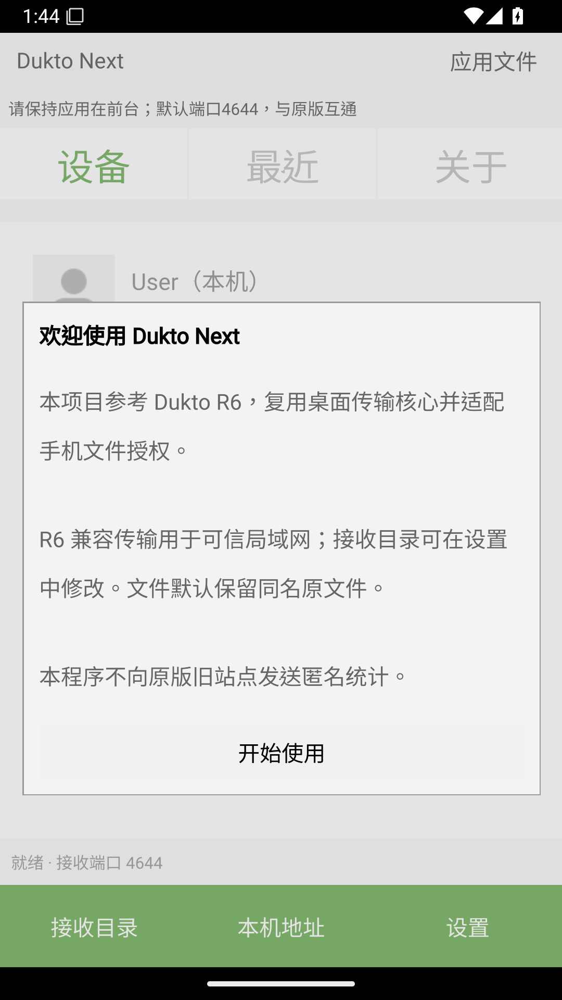

# Android启动目录兼容修复

更新日期：2026-11-25。状态：目录修复后的原始APK已在Android15转译模拟器通过启动；系统栏遮挡修复后已完成新APK的模拟器首屏截图复验。本文保留失败证据，不以编译成功代替启动成功。

## 问题与实际证据

Android原始arm64开发APK在Android11转译模拟器安装成功，启动时遇到原生指令转译失败。切换Android15后安装及Activity调起成功，但进程退出；最初看到的HWUI destroyed mutex是退出之后的现象。新增启动阶段日志后，run45619867182明确显示控制器初始化抛磁盘错误5，尚未加载QML；同PID还有系统根目录read被SELinux拒绝的日志。

目录固定逻辑原来以O_RDONLY打开根目录和所有祖先。Android可以允许搜索某个祖先而拒绝枚举它，读取方式扩大了所需权限。提交3aaf1253改用O_PATH打开Linux/Android中间目录，最终目录仍以O_RDONLY打开用于枚举和fsync，保留O_DIRECTORY、O_NOFOLLOW、O_CLOEXEC及目录身份复验。

修复后的run45621951447仍失败，错误已变为Permission4/path，根目录read拒绝消失。此证据说明还有初始化路径被目录链接防护拒绝，不能将首次修改标成启动修复通过。该次日志没有输出用户路径，具体目录拓扑不能仅凭该错误推断。

## 本轮实现

提交4417b21f增加移动宿主统一私有目录入口：只解析QStandardPaths提供的应用私有沙箱根，创建后取得其canonicalFilePath，控制器、导入缓存、应用文件、临时配对文件、诊断导出和两平台文件桥统一使用真实根。使用系统提供私有根的规范路径，避免入口路径的系统别名差异与后续逐级检查冲突。运行收据仅确认/data/data与/data/user/0两处均显示为目录，未证明它们为符号链接；修复有效不等于确认了底层目录拓扑。

规范化范围限于系统提供的私有根。用户传入的共享目录、相对文件路径及其子目录不通过此入口，不对这些路径预先canonicalize；原来的链接拒绝、目录替换检测和安全提交继续执行。不需要外部存储全盘授权，也不提高进程权限。

为便于下一次实测确认，模拟器收据补充固定系统路径/data/user/0、/data/data的目录元数据，不输出私有文件内容或凭据。

## 验证记录

- [x] Linux非root真实权限回归：祖先0111不可读取时仍可固定末级目录、创建子目录并同步；128轮FD增长0。
- [x] 中间及末级符号链接拒绝、目录替换身份检测继续通过。
- [x] 3aaf1253六项回归任务通过，run45621004006；主机实际R6/TLS/Next1/2/4/8/16通道、十画面QML及220轮压力通过，对象增长0、RSS增长120KiB。
- [x] 4417b21f修复后的Android/iOS完整编译、包检查及本地下载复核通过，run45623204634；见两平台package-4417b21f收据。
- [x] 795c929f新增从私有目录别名启动真实Qt应用的主机回归通过，job139237160423；独立存储测试目标漏依赖失败已在fbfb3dfa修复，job139238810541通过。
- [x] 最新90e8f8fe完整六项回归全部通过，run45625417200。iOS26曾启动超时，保留失败日志；本轮18.6/26.2均实际通过。
- [x] 4417b21f原始arm64 APK在Android15安装、冷启动、20秒前台存活及QML首屏通过；run45624012656/job139239333969。
- [x] 已人工检查截图并记录问题：顶部标题、底部导航被系统栏遮挡，界面验收未通过。
- [x] 90e8f8fe安全边距修复后的两平台完整构建通过，run45625417389。
- [x] 新APK重新安装、20秒前台存活、控制器/QML/事件循环及竖屏截图复验通过；run45626309940/job139247334712，标题与底部导航完整，见android-startup-90e8f8fe.json。
- [x] 23项Android JVM合同测试全部通过，含新增三项安全边距测试，见android-contract-90e8f8fe.json。
- [ ] 真实Android手机的冷启动、文件提供器、双向传输、前后台与权限拒绝。

## 证据位置与交付限制

失败收据分别为evidence/android-startup-android11-bccec09d.json、android-startup-android15-46d61b9c.json、android-startup-diagnostic-467c386b.json及android-startup-path-3aaf1253.json。主机回归收据为evidence/validation-3aaf1253.json。原始日志存于release/development/test-evidence和对应GitHub Actions artifact。

旧APK保留为历史开发包，已知模拟器启动失败，不能作为通过启动验收的客户版本。4417b21f修复包已另存android-storage-4417b21f目录，启动证据见android-startup-4417b21f.json；该历史包仍有界面遮挡，不能当作最新修复包。新系统栏修复包与结果见《当前验收状态》。Android转译模拟器不代表物理arm64手机；iOS编译结果同样不能代替签名后手机安装测试。

## Android系统栏遮挡的后续处理

首屏截图证据来自1080×1920的Android15模拟器，界面标题和底部导航文字与系统栏重叠。提交90e8f8fe在生产Activity启动时为内容容器安装SafeContentInsets：API35及以后取系统栏/显示缺口的安全边距，以原始边距为基准更新，旋转或重复通知不累计；处理过的系统区域从传给子视图的insets中扣除，输入法区域继续传递。旧系统沿用窗口装饰，避免重复留白。

新增Robolectric测试验证实际Activity容器内满尺寸子视图的可见边界、重复分发、横屏不对称缺口、输入法独立保留及API29不重复处理。新APK的实际截图已确认Qt标题与底部导航缩入安全区域。该结论只覆盖本次Android15模拟器竖屏冷启动首屏；三种物理导航、刘海设备、键盘及旋转的手机验收继续保持待完成。

### 修复后实际首屏

原始arm64 APK：`64c11b221ec45c84d5b11eb7878cfc4cff949dffde75ad3a023c0100c08bf526`。构建run45625417389，安装/截图run45626309940。以下为原始1080×1920截图，人工复核范围限于可见首屏与系统栏边界。

