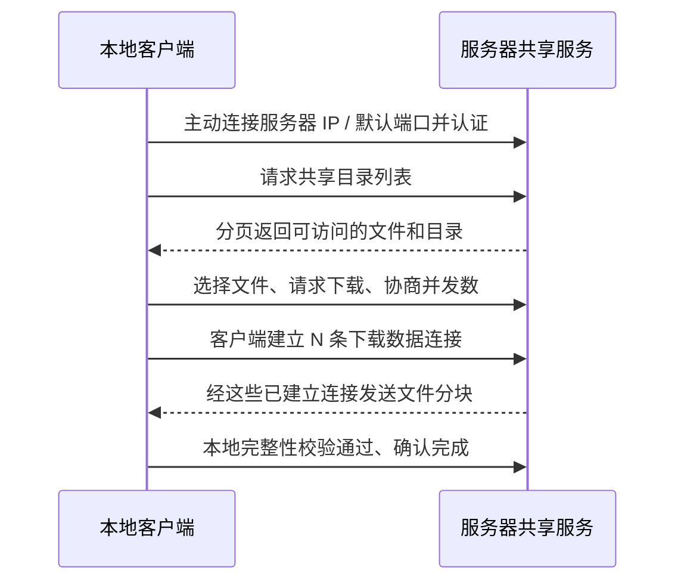

# Dukto 功能复现与多线程传输开发计划及进度

创建日期：2026-11-04  
最后更新：2026-11-09  
文档版本：v0.147
当前阶段：R147正在修复Linux真实回归发现的浏览回收inode复用误删；双Windows首轮浏览专项通过，完整及四原生验收继续。R145/R146含缺陷包已撤下推荐，保留R144四平台已验包。生产写前额度、统一历史预算、完整自动GC、物理网络及正式发布仍未完成。

配套文档：[实施进度](docs/执行进度.md)、[项目入口](README.md)、[补充需求与关键设计](docs/补充需求与关键设计.md)、[首轮开发任务清单](docs/首轮开发任务清单.md)。主计划管理范围和进度，补充设计固定关键行为，任务清单指导首轮 P0/P1 执行。

## R133 Windows UCRT 本机复验归档（2026-11-08）

- [x] 当前本机UCRT重建无待编译目标；完整CTest为35/35目标通过，耗时269.51秒。34份核心Qt XML共438个用例，435通过、0失败、3跳过；跳过均因当前Windows账户不能创建原生符号链接，不能记为全通过。
- [x] 最终协议驱动运行51/51场景并全部通过。`sourceCommit=null`，这是本机工作区证据，不能替代GitHub原生矩阵`42452746044`的50/51失败状态。
- [x] 源码审计256个维护文件，遗留标记0，C++14配置和clang-format均通过。166个原始报告/日志已归档在`docs/validation/2026-11-08/completion-r133-local/`；结构化结果见[本机验收回执](docs/validation/2026-11-08/completion-r133-local/receipt.json)。
- [ ] 本轮未改变生产代码；生产写前全局额度、完整历史预算与GC、完整R6交互对照、当前精确源码的各平台长测、实体LAN/3×3、干净系统和正式签名仍未完成。整体交付和发布资格仍为false。

## R131本机复盘、状态清理子集与Windows运行依赖（2026-11-08）

- [x] 修复GUI测试目标遗漏`boundedfiledialog.cpp`导致的链接失败；失败原件保留。
- [x] 增加`state gc preview|run`及业务打开前的一次机会式维护。只处理过期服务器上传临时项和未发布上传源扫描记录，批次有界并复用既有独占锁、租约、原生身份及持久删除意图；这不是完整Q07回收。
- [x] 当前工作区UCRT与MSVC分别完整构建并通过35/35 CTest；各34份Qt XML共438个用例，失败/跳过均为0。MSVC套件在`PATH=C:/Windows/System32;C:/Windows`下运行，CLI帮助、运行时探针、UI专项、TLS服务管理和16通道双向传输同样通过。
- [x] MSVC `build/windows/Release`已部署Qt 5.15.2、QML/平台/SQLite插件、OpenSSL 1.1.1w和VC运行库；为本机CTest另放入`Qt5Test.dll`与`qoffscreen.dll`。独立客户预览归档另生成于`dist/windows-ucrt-x64/`并通过迁移测试；干净系统及正式发布资格仍未取得。
- [x] 源码审计256个维护文件，遗留标记0，C++14和格式通过；11个改动的既有文本文件BOM/换行类型保持，修改前记录中的13个`Dukto/`原版文件摘要逐一保持。
- [x] 最终源码Ubuntu新快照包含468个文件，SHA-256为`e274393189119184207247bc4d1872689e044980566f805b7cc038f0653f5cee`；87个Ninja构建步骤成功，过期上传清理23项、未发布扫描清理16项全部通过，TLS服务与16通道双向传输专项均通过；原始日志、XML和二进制摘要已归档。
- [x] 当前最终MSVC Release二进制的51个协议场景均有通过证据：新矩阵51项全部执行，50项通过，`windows-path`因隔离PATH未含Windows PowerShell目录而无法启动；补齐该系统工具目录后的独立复验通过。主矩阵原始失败状态保留，完整结果见本轮回执。
- [ ] 全应用写前配额、统一历史预算、长期服务回收、完整资源公平性、F01–F23原生交互对照、Linux全套CTest与跨平台物理LAN/3×3、当前源码各平台24小时及正式签名发布仍待完成；`deliveryComplete=false`、`globalQuotaEnforced=false`、`releaseQualified=false`。

详见[本轮功能复盘与验收](docs/复盘与本轮验收.md)。

## 局域网发现与原生打包构建（2026-11-08）

- [x] GUI在接收服务成功启动后自动启动发现；立即IPv4广播，每60秒重发；设备消息驱动界面刷新。协议依赖同一可达IPv4广播域。
- [x] Windows UCRT发现身份测试4/4通过；独立CLI进程收到本机旧版`dukto.exe`的4644发现广播及合成测试设备。[日志](docs/validation/2026-11-08/lan-discovery-macos-linux/discovery-identity-tests.txt)、[独立进程输出](docs/validation/2026-11-08/lan-discovery-macos-linux/discovery-process-probe.jsonl)。
- [x] GitHub第一轮失败原件保留：公开提交缺少`src/core/statecleanup.cpp`，配置导致runner在生成构建文件时失败。工作区源码同步到单独分支`codex/current-macos-linux-20261108`，提交`f28396020d760bf9b50c1292e205c65babacdf7f`；未修改主分支。
- [x] 当前提交Linux glibc x86_64、macOS arm64与x86_64依赖部署包均已构建并通过迁移运行，分别存放于`dist/linux-x86_64/`、`dist/macos-arm64/`及`dist/macos-x86_64/`；Linux X11/Wayland和Mac Cocoa验证通过，包内Qt/OpenSSL运行库已核验。校验值见[功能复盘](docs/复盘与本轮验收.md)。
- [x] Windows x64 UCRT独立预览包位于`dist/windows-ucrt-x64/`，含GUI/CLI、Qt/QML/SQLite/平台插件、OpenSSL、UCRT运行库、许可证和对应源码；486项文件清单在系统级PATH及中文空格临时目录迁移测试通过，ZIP SHA-256为`4e2994763c40c9895fd6163a7435ff364bbe30c7a69f15f53420b2310b91acd3`。
- [x] Ubuntu、macOS Apple Silicon和Intel三种POSIX runner的完整原生协议矩阵各47/47通过，报告按原artifact收录。
- [ ] Windows原生协议矩阵`42452746044`已终态失败：50/51通过，唯一`cli`在测试启动前32次未能预留TCP/UDP端口对；原始日志保留。相同MSVC Release CLI与UCRT CLI契约定向复跑通过，但完整CI汇总仍失败。macOS预览未作Developer ID签名/公证，正式发布资格仍未完成。
- [ ] 本轮default 4644被本机旧`dukto.exe`监听。跨设备物理LAN、3×3、防火墙/多网卡场景尚未验；整体功能范围和发布资格仍未完成。

## R130状态预算查询与界面（2026-11-08）

- [x] GUI“本机共享”新增折叠预算查询，CLI/GUI共用四类别报告；总额/类别的已登记占用、未决预留、剩余额度、超额与原因均为十进制字符串。可回收量明确未知，生产写前限制仍未启用。[用法](docs/状态预算查询与界面.md)。
- [x] 查询只打开已有协调根，不初始化目录或业务根；共享占用可查询，失败清空旧快照；不读取身份秘密或逐项路径。健康账本原字节保持，有效写前意图仍按原契约向前恢复。
- [x] 双Windows各35完整CTest/34份Qt XML通过；账本25条、服务器面板11条通过，包括大于2^53金额、64位上限、类别/总额透支、GUI/CLI一致、缺失不创建和损坏清屏；两种宽度真实QML按钮及四张截图已验。295输入/36程序前后稳定，原编码/BOM/换行、C++14/格式及252维护文件审计、快照13项通过。[本机原件](docs/validation/2026-11-08/budget-report-r130-local/receipt.json)。
- [x] 独立Ubuntu新目录实际编译，两项报告及初始化/清理共4条通过；安装源码、295输入、C++14及程序前后保持。仅授予报告专项。[原件](docs/validation/2026-11-08/budget-report-r130-glibc/receipt.json)。
- [x] 精确`3094bcf6302e8c8164b6998802787a89ca5d808b`已非强制公开；[四原生构建与核心/协议](https://github.com/29583855/dukto-next/actions/runs/42432270217)及[双Mac依赖包](https://github.com/29583855/dukto-next/actions/runs/42432279510)已实际派发，核心已验4/4、完整协议0/4、依赖包2/2；逐项按原件核验。双Mac R130预览已公开并匿名下载核对。
- [ ] R130其余完整协议终态继续按精确原作业收验；普通历史迁移、生产写前额度、自动GC和完整项目验收继续。
- [ ] Q08仅完成已有账本的公开查询子项；实际生产准入/全部根归属、物理分配/跨卷与回收量、自动GC及完整项目仍未完成。

## R129已有状态持久计量（2026-11-08）

- [x] 已复核本轮计量及若干增长容器的源代码上限；原生文件多选仍一次物化全部路径，完整选择器和任意规模选择的内存资格未授予。[审查原件](docs/validation/2026-11-08/state-accounting-r129-progress-first/bounded-source-review.json)。

- [x] 新增三平台CLI：`state root account --state-directory <父目录> --state-root service|clients|transfers|history [--json]`。仅处理已有域和已绑定根，协调根及成员根均须独占维护；活动GUI/CLI共享会话占用时拒绝。
- [x] 单根直接普通文件逐项观察原生身份、逻辑长度和分配量；按根登记、卷/身份及名称建立Unknown高水位，重复不改修订、增长只补差额，真实既有超额照实登记。缩小、缺失、换名、退出不退款；同名新对象另记。已验证根标记256字节不重复基本计量，额外原生分配仍计入。
- [x] 子目录、链接和特殊项保持并报告未覆盖数，不递归、不打开正文、不建立业务归属、不自动删除。硬链接按名称保守计量；原生身份复用不赋予删除资格。固定槽耗尽和算术溢出受控失败，已落盘的部分计量保持。
- [x] 双Windows各35完整CTest/34份Qt XML通过；新增计量各14条零失败/跳过/警告，包括真实CLI、真实硬链接、同长度换代、取消后继续、子进程直接退出后恢复。295输入和36份程序前后保持，六原文件编码/BOM/LF保持，252维护源码零标记且C++14/格式及快照13项通过。[本机原件](docs/validation/2026-11-08/state-accounting-r129-local/receipt.json)。
- [x] 独立Ubuntu新目录真实构建后14条计量全部通过，POSIX符号链接/FIFO及硬链接分支执行；安装源、295资格输入和程序前后保持。[Linux原件](docs/validation/2026-11-08/state-accounting-r129-glibc/receipt.json)。
- [x] 精确`5ee4d50299326340798396ec4b169c39f8adf797`已非强制公开；[四原生GUI/CLI及核心/协议](https://github.com/29583855/dukto-next/actions/runs/42428808002)和[双Mac含依赖包](https://github.com/29583855/dukto-next/actions/runs/42428818106)已实际派发，核心已验4/4、完整协议2/4、依赖包2/2。双Mac R129含依赖预览已公开并匿名下载核对。
- [ ] R129其余完整协议终态继续按精确原作业收验；普通历史迁移、写前额度、自动GC和完整项目验收继续。
- [ ] 本轮仅完成Q01/Q03的单根Unknown已有占用前置，普通历史安全迁移、全部根/临时归属、SQLite及原子替换/正文实际写前额度、跨卷、幂等保留、Unknown核对/自动GC和完整项目验收继续。[用法和边界](docs/已有状态占用计量.md)。

## R128状态目录协议夹具修正（2026-11-08）

- [x] 精确de0750fc已公开；四平台两项专项4/4、完整核心4/4。完整协议已按原件核验4/4，其余继续原作业；R126/R127旧夹具失败原件保持。

- [x] 保留R126完整协议原始失败；凭据复制绑定反例与旧凭据网络反例分开验证，生产完整性和认证检查均保持。丢确认、进程退出、活动传输15秒停止及同任务恢复等原断言不变。
- [x] 缺失记录查询只允许零字节锁和固定256字节标记；新根代数、仅一次计量、零保留额、重复查询原字节保持、恢复原根核对通过，不生成接收/结果库。
- [x] 双Windows冻结R127程序均通过两项修正专项；原291输入及程序前后保持。首候选ACL前置失败和第二轮通过分别保留；原两文件编码/BOM/LF保持，C++14/格式和维护源码审计通过。[说明](docs/状态目录协议夹具说明.md)。
- [x] 本轮只修改两份Python夹具及新增独立四平台复验脚本/工作流，生产C++与R127相同。含Qt5/OpenSSL的Mac ARM/Intel下载继续为R127精确源。
- [ ] 新293份资格输入的四原生专项及完整GUI/核心/协议按精确公开提交分别收验，未完成前不授予完整协议资格。
- [ ] 普通历史安全迁移、全应用/临时对象归属、实际写前预算、跨卷/未知项/有效幂等保留、自动GC、完整R6/选择器、物理LAN/3×3、当前各平台24h和正式发布继续，整体active。

## R127四原生GUI接入与双Mac预览（2026-11-08）

- [x] 精确6c6dc363c7bb755f7b5aae1f7627385c009a0ac2四平台C++14 GUI/独立CLI编译、各34完整CTest/33份Qt XML已收验；服务器面板各8项通过，包括真实GUI空闲监听阻止CLI维护及停止/启动失败释放资格。精确Darwin端口XFAIL和Windows权限跳过继续披露。[核心原件](docs/validation/2026-11-08/gui-state-session-r127-full-native-core/receipt.json)。
- [x] 双Mac含Qt5/OpenSSL部署包、中文空格目录迁移运行、各五项实际业务、Cocoa窗口/高DPI及四张截图通过；官方ZIP和内部tar摘要、源码/载荷/链接/架构/执行位逐项核对。[开发预览](https://github.com/29583855/dukto-next/releases/tag/preview-r127-20261108)四份附件已真实匿名下载核对。[摘要和用法](docs/macOS独立预览包.md)。
- [x] 开发预览固定精确源码标签；仍采用adhoc签名，Developer ID签名、公证及最低干净系统验收继续。本次预览发布不授予完整项目或正式发布资格。
- [x] 独立Ubuntu新目录真实构建后，首次驱动从源码目录启动导致3项截图保存失败（5通过/3失败）；原件保留。改为CTest构建工作目录后，相同源和程序8项面板测试全部通过；291资格输入与公开提交全部相同。
- [x] 双Windows34核心及8项面板、真实GUI强杀后同任务续传和诊断已验，291源码及程序保持，249维护源码零标记、原编码及C++14/格式保持。GUI远程状态目录与CLI同目录域共用，普通历史和全应用预算范围见[目录契约](docs/GUI与CLI状态目录共享.md)。
- [ ] R126完整协议已收取的原生终态中，credential-rotation因复制旧根标记、task-items因仅允许锁文件的旧夹具假设失败；完整协议资格未通过，原日志与报告保留。R127沿用相同旧夹具，其原作业独立收验；后续修正先建立正确ACL的测试根并独立验证绑定拒绝，同时保留旧凭据网络负例和固定256字节标记的只读计量。不能用后续通过改写本轮原失败。R126完整协议已验0/4，本轮已验0/4，其余按原作业继续；普通历史安全迁移、全应用根/临时对象归属、实际写前额度、跨卷与未知项、有效幂等保留、自动GC、物理LAN/3×3、当前各平台24h和其余完整交付继续；整体active。

## R127 GUI与CLI同目录状态会话（2026-11-08）

- [x] GUI后台身份/授权/资料/传输和逐项查询使用StateSession；空闲及活动监听保留中央共享资格到监听器及工作线程退出。端口启动失败不遗留资格，取消在预算锁外观察。
- [x] 桌面旧remote目录保持原位，服务器页公开目录就是CLI的--state-directory；该实际目录的budget和直接service/clients/transfers共用，旧身份/资料不搬移或重建。上一级普通历史仍须单独安全迁移。[目录契约](docs/GUI与CLI状态目录共享.md)。
- [x] doctor显式资料认证采用只读observe，不新建未登记旧域或改变资料/信任；已有域在整个认证期间核对并保留共享资格。
- [x] 双Windows各34完整CTest/33份Qt XML通过，服务器面板各8项零跳过/警告；新增真实GUI监听→独立CLI配置拒绝→停止可配置→端口占用失败后可配置，中文空格目录和旧身份原字节保持。真实诊断及GUI强杀重建续传通过；291输入和程序前后保持。[本机原件](docs/validation/2026-11-08/gui-state-session-r127-local/receipt.json)。
- [x] 249维护源码零遗留/占位/简化标记，C++14/格式检查及五个原文件编码/BOM/换行保持；源码快照13项通过。R125完整协议四平台终态通过，R126完整协议目前已验0/4，剩余按原作业继续。
- [ ] 本轮精确源码四原生GUI/CLI编译、完整核心/协议和双Mac包分别收验；独立Ubuntu新目录实际GUI专项构建继续。现有Mac含依赖预览仍R125。
- [ ] 普通历史安全迁移、全应用根/临时对象归属、SQLite/原子替换/正文写前额度、原生分配与跨卷、有效幂等保留、未知项和自动GC及其他完整验收继续；整体active。

## R126四原生CLI会话与完整核心（2026-11-08）

- [x] 精确d661fbaf2eb2e71cea6fd19ea25875af2164e3d0已公开；[四平台状态会话专项](https://github.com/29583855/dukto-next/actions/runs/42421210600)全部终态success，每平台13项、零跳过/警告。实际288份维护构建输入按Git检出规则逐项核对，CLI/测试程序前后保持；本机完整资格清单另含格式/属性/Docker输入共291份。[原件](docs/validation/2026-11-08/cli-state-session-r126-native/receipt.json)。
- [x] Windows、Ubuntu、Apple Silicon、Intel各34完整CTest/33份Qt XML全部收验。原Darwin端口XFAIL、Windows符号链接权限缺口及精确历史诊断保留；核心成功不替代完整协议终态。[核心原件](docs/validation/2026-11-08/cli-state-session-r126-full-native-core/receipt.json)。
- [x] 双Mac真实GUI和独立CLI编译归档已核对官方ZIP、tar摘要、精确提交、Mach-O架构和执行位；归档需要相应Qt5/OpenSSL运行库。可直接使用的含依赖开发预览继续为[R125](docs/macOS独立预览包.md)，本轮没有重发预览或授予正式签名/公证资格。
- [x] 两套Windows程序真实配对/授权/浏览业务、1/2/4/8/16通道上传和下载各10场景通过，程序及291输入前后保持。不同文件检查点实际重叠、双端摘要一致，记录RSS/线程/句柄峰值；测试为本机不透明限速TLS代理，不能据此授予物理LAN或长期无增长资格。[业务原件](docs/validation/2026-11-08/cli-state-session-r126-native-results/receipt.json)。
- [x] R125原完整协议作业现已四平台终态success，Windows51项、三个POSIX各47项均按原件收验。此前进行中记录保留为历史快照。
- [x] 独立Ubuntu新目录真实构建及13项专项通过，全部安装源、程序和C++14保持；291资格输入与公开提交全部相同。
- [ ] 本轮完整协议当前已验0/4，其余按原作业继续；GUI旧remote目录与CLI根发现、普通历史安全迁移、实际写前额度、物理分配与跨卷、有效幂等保留、未知项和自动GC继续实施，整体active。

## R126生产CLI状态会话接入（2026-11-08）

- [x] CLI服务/客户端和维护入口使用持久根登记与共享协调会话，句柄最后一个副本关闭前保持资格；真实服务空闲监听阻止额度维护，进程强制退出后内核锁释放且登记/资料保持。[行为与边界](docs/生产状态会话与CLI接入.md)。
- [x] 首次初始化和成员登记的真实双进程竞争、取消、同名根换代/损坏/复制拒绝、已有额度保持、中文空格目录和旧历史资料原字节保持通过。只读storage观察不建立域或标记；显式成员维护遇到共享占用立即拒绝。
- [x] 默认额度可查询修改，账本仍只统计已登记对象；默认16GiB正文额不代表当前传输大小上限。普通历史、资料和用户文件不自动搬移或删除，GUI旧remote目录与CLI域发现继续实现。
- [x] 双Windows各34完整CTest/33份Qt XML和同CLI/测试程序13项原XML通过，291输入及35程序前后保持。专项289输入少两份后来新增的CI脚本/工作流，其余与完整构建逐字节相同。249维护源码零标记、C++14/格式、原两文件编码/BOM/LF和源码快照13项通过。[本机原件](docs/validation/2026-11-08/cli-state-session-r126-local/receipt.json)。
- [x] 首轮Windows夹具terminate未结束控制台服务，各11通过/1失败原件保留；改用kill验证强制退出后锁释放，原30秒门槛保持，不将此夹具授予优雅停机资格。
- [x] R124完整协议终态四平台通过；R125当前已验3/4，其余按原作业继续。历史R122 ARM失败保留，间歇根因未证明解决。
- [ ] 本轮精确源码公开后，四原生13项状态专项和完整GUI/核心/协议分别收验；独立Ubuntu新隔离目录构建继续。当前双Mac可下载含依赖开发预览仍为R125，本轮不替换预览包。
- [ ] GUI/诊断全部根统一发现、普通历史安全迁移、SQLite/VFS及原子替换/正文写前授信、物理分配与跨卷准入、有效幂等保留与未知对象、自动GC、完整R6/选择器、物理LAN/3×3、当前各平台24h、最低干净系统和正式发布继续；整体active。

## R125四原生配置与双Mac交付（2026-11-08）

- [x] 精确1b99cd63eb5c3cfa5c97e17d494a119fc3e7ecdb已非强制公开；[四原生配置专项](https://github.com/29583855/dukto-next/actions/runs/42416752710)全部终态success，每平台16条、零跳过/警告。实际源码、CLI和测试程序前后保持，全部输入按精确Git检出规则核对。[原件](docs/validation/2026-11-08/budget-configuration-r125-native/receipt.json)。
- [x] Windows、Ubuntu、Apple Silicon、Intel各33完整CTest/32份Qt XML收验4/4；精确Darwin端口XFAIL与实际Windows权限跳过继续披露，不能由核心通过推定完整协议通过。[核心原件](docs/validation/2026-11-08/budget-configuration-r125-full-native-core/receipt.json)。
- [x] 双Mac GUI/独立CLI编译成功，含Qt5/OpenSSL包终态success；官方ZIP/内部tar、精确源码/载荷/链接/架构/执行位、系统PATH和中文空格目录迁移、每架构五项业务、Cocoa/高DPI及四张截图核验。[下载与摘要](docs/macOS独立预览包.md)。开发adhoc签名，正式签名/公证与最低干净系统继续。
- [x] [公开Mac开发预览](https://github.com/29583855/dukto-next/releases/tag/preview-r125-20261108)固定精确源码标签，两架构tar.gz及两份SHA-256附件已上传；四份附件实际匿名下载后逐字节摘要核对，无需GitHub登录。预览发布不代表正式发布验收完成。
- [x] 独立Ubuntu新目录真实编译及16条配置专项通过，全部安装快照、C++14和程序前后SHA保持。286资格输入中285份与最终提交相同；唯一差异为未在该环境执行的工作流注释/步骤标签，产品和测试输入全部相同，差异原SHA保留，不声称286份完全相同。[范围](docs/validation/2026-11-08/budget-configuration-r125-delivery/receipt.json)。
- [x] R123四原生完整协议终态全部通过；R124完整协议当前已验3/4，R125已验0/4，剩余按原作业继续。R122 ARM历史失败仍保留，R124旧版对照也通过，底层间歇根因不宣称已解决。
- [x] 额度配置支持原修订比较、固定持久意图/五布局恢复、真实进程退出和有保留额时拒绝收缩；三平台CLI显式域/根管理、64位输出、参数拒绝及原历史保持已验。[用法](docs/预算域管理与配置.md)。245维护源码零遗留/占位/简化标记，C++14/格式和原编码保持。
- [ ] 生产全部入口映射、普通历史安全迁移、SQLite/原子替换/正文及物理分配/跨卷准入、有效幂等保留与自动GC、完整R6/选择器、物理LAN/3×3、当前各平台24h、依赖源码重建、最低干净系统和正式发布继续；整体active。

## R125持久预算配置与三平台CLI（2026-11-08）

- [x] 额度、占用和修订可同时查询；独占维护按查询修订持久修改完整额度，相同配置不写盘，旧修订拒绝。新额度低于实际占用/未决保留时拒绝，足额提高可解除真实透支，不改变原对象槽、域和根代数。
- [x] 固定配置写前意图包含旧/新头、修订和零保留区，五种中断落盘布局重开向前恢复；未知/撕裂/过期意图及夹带占用变更拒绝。真实子进程配置后直接退出、跨进程维护占用及64位额度通过。
- [x] 新增三平台共用state budget init/show/set与state root bind/show；额度必须显式提供，历史不超过256MiB，JSON/人类输出均有实际范围。原普通父目录/历史不自动迁移，productionQuotaEnforced=false。[用法与边界](docs/预算域管理与配置.md)。
- [x] 双Windows完整构建、各33CTest/32份Qt XML、同二进制配置原XML各16条通过，286输入及程序前后身份一致。245维护源码审计、C++14/格式、六个原修改文件编码/BOM/LF和源码快照13项通过。[本机原件](docs/validation/2026-11-08/budget-configuration-r125-local/receipt.json)。
- [x] 首轮夹具错误使用旧数字退出码导致13通过/1失败及测试崩溃原件保留；改用现有ExitCode枚举，原CLI重复参数独立返回2，未放宽产品门槛。原账本及域专项继续通过。
- [x] R123原完整运行四平台终态success，Windows51项、三个POSIX各47项协议原件核验。R124完整协议继续按原作业终态收验。
- [x] 四原生配置专项、完整GUI/核心、双Mac含依赖包和独立Ubuntu专项已按精确身份收验，当前下载R125；完整协议按独立作业继续收验，见本轮交付记录。
- [ ] 全生产状态根接入、普通历史安全迁移、SQLite/原子替换/正文与物理分配/跨卷总预算、有效幂等保留和自动GC、完整R6/选择器、物理LAN/3×3、当前各平台24h、最低干净系统、依赖源码重建和正式发布继续；整体active。

## R124四原生暂停恢复与双Mac交付（2026-11-08）

- [x] 精确424c78b79fd1980ed52f9b2fe78d31a3c28fc39c已公开；[四原生专项](https://github.com/29583855/dukto-next/actions/runs/42412866699)全部终态success，各三轮12场景通过。原5秒期限、6秒暂停、非法文本错误及静默/半帧断言保持；源码/夹具/程序前后身份与精确Git检出规则逐项核对。[原件](docs/validation/2026-11-08/legacy-ready-r124-native/receipt.json)。
- [x] 两Mac同环境旧版对照也各12条全部通过，未复现R122 ARM历史间歇失败；该失败仍保留，底层根因不授予已解决资格。新增最多1毫秒最终就绪等待作为防御性修正。[行为和边界](docs/R6暂停恢复与超时.md)。
- [x] 双Windows各32完整CTest/31份Qt XML；原核心279输入与程序保持，最终更正一条原因注释后重编译CLI，并冻结281输入、各12场景通过。241维护文件审计、C++14/格式、原编码/BOM/LF及源码快照13项通过。
- [x] 四原生各32完整核心/31份Qt XML当前已验4/4，精确Darwin端口XFAIL继续保留；完整协议终态另外收验。[核心原件](docs/validation/2026-11-08/legacy-ready-r124-full-native-core/receipt.json)。
- [x] Apple Silicon/Intel真实GUI与独立CLI编译成功，含Qt5/OpenSSL包终态success；官方ZIP/内部tar、源码/载荷/链接/架构/执行位、系统PATH及中文空格目录迁移、每架构五项业务、Cocoa/高DPI和四截图核验。[下载与摘要](docs/macOS独立预览包.md)。开发adhoc签名，正式签名/公证及最低干净系统继续。
- [x] 独立Ubuntu新目录真实编译、三轮12场景通过；全部安装源码、281资格输入、C++14及执行程序前后SHA一致。完整GUI/核心不由此转授。
- [x] R122原完整运行已终态failure：Windows51项、Ubuntu/Intel各47项通过，ARM原47项中46通过/1暂停后超时失败保留；没有用其他平台通过覆盖该失败。
- [ ] 当前完整协议、生产根迁移与可调整预算、SQLite/正文/跨卷总预算及自动GC、完整R6/原生选择器、物理LAN/3×3、当前各平台24h、最低干净系统、依赖源码重建及正式分发继续；整体active。

## R123四原生关联与双Mac交付（2026-11-08）

- [x] 精确d78954207cfcd21e07f5ba56c9153b36b3b2cc18已非强制公开；[四原生关联专项](https://github.com/29583855/dukto-next/actions/runs/42409838142)全部终态success，每平台12条、零跳过/警告。逐Git检出规则核对全部执行输入和前后程序身份，不以单平台推断其他平台。[原件](docs/validation/2026-11-08/state-domain-r123-native/receipt.json)。
- [x] 双Mac GUI/独立CLI实际编译成功，含Qt5/OpenSSL部署包终态success；官方ZIP/内部tar、源码/载荷/链接/架构/执行位、中文空格目录/系统PATH迁移、每架构五业务、Cocoa/高DPI及四原生截图已验。[下载与摘要](docs/macOS独立预览包.md)。仍为开发adhoc签名，正式签名/公证及最低干净系统继续。
- [x] R123四平台各32完整核心/31份Qt XML已收验4/4，两Mac精确Darwin端口XFAIL保留；完整协议按各原作业终态另外收验。[核心回执](docs/validation/2026-11-08/state-domain-r123-full-native-core/receipt.json)。
- [x] R122 ARM原作业完整协议failure已保留：47份原件中46份通过；暂停6秒后非法文本预期内容错误6，实际网络超时3/stage=transfer。完整原报告、源码/摘要和失败保持，根因未证实；缓冲有效正文及静默/部分停顿超时通过，不以其他子项覆盖此失败。[原件](docs/validation/2026-11-08/state-budget-r122-native-terminal/macos-15/verified-passed-subsets.json)。
- [x] Intel首次启动截图可见“头像端口不可用，使用默认图标”的回退提示，接收端口已就绪；该观察已写入截图回执，未据迁移成功授予头像端口全环境可用资格。
- [x] 源码快照13项通过；收验器沿用旧附件前缀、误要求所有协议报告为字典的两次失败及修正原件保持，没有重跑产品测试。R98 Ubuntu真实24h业务/资源子项与glib依赖漂移导致的原驱动失败继续分开登记。
- [x] 独立Ubuntu新目录实际构建与12条专项通过，所有安装源码、279资格输入、C++14及程序前后摘要核对；不是该环境完整核心/GUI验收。
- [ ] 生产GUI/CLI/服务器根映射、实际分配/跨卷准入及SQLite/正文总预算、孤立登记维护和自动GC、完整R6/原生选择器、物理LAN/3×3、当前三平台24h、依赖源码重建、最低干净系统与正式发布继续；整体active。

## R123持久预算域与多根关联（2026-11-08）

- [x] 新增持久域发现、协调根/成员根生命周期及原生身份绑定；成员显式独占登记，共享使用只核对。相同路径别名/重复登记不重复计量，跨域、复制、损坏/截断、中央失效及旧登记拒绝。[接口和中断边界](docs/持久预算域与根关联.md)。
- [x] 固定256字节标记在创建前持久计入Metadata；真实进程在预扣后、写标记前直接退出仍保留额度。缺失标记的新显式登记使用新代数并再次计量，旧登记继续保留；没有按PID退款或覆盖未知残片。
- [x] 双Windows完整构建、各32核心/31份Qt XML通过；新增12条专项、真实进程维护占用/强退重开和四线程共用域均通过。原核心277输入及全部执行程序前后不变，另以同一程序核对原始XML/CI收验器和279输入；没有重复执行完整核心。[原件](docs/validation/2026-11-08/state-domain-r123-local/receipt.json)。
- [x] 240份维护文件零TODO/占位/简化标记，C++14/格式与四个原修改文件编码/BOM/换行保持；原版参考目录未修改。
- [x] R122独立Ubuntu新目录真实编译及23条账本专项通过，425安装源码、274资格输入、C++14及程序前后摘要核对；完整原生协议按原作业当前已验1/4，不转授R123。[Ubuntu原件](docs/validation/2026-11-08/state-budget-r122-glibc/receipt.json)。
- [x] R98 Ubuntu旧冻结长测完成86400.021秒、262轮/16通道，业务和资源子项通过；glib系统依赖漂移导致原驱动最终passed=false，完整长期资格不授予。原始失败和全部262行保留，不修改原driver断言。收验器首次误比包装脚本摘要，纠正为原核心脚本并核对七输入，未重跑产品。[终态边界](docs/validation/2026-11-08/r98-ubuntu-long-terminal/receipt.json)。
- [ ] R123独立Ubuntu新目录、四原生完整核心/协议及双Mac编译/部署须按精确源码继续收验。生产入口尚未自动接入；实际物理占用/跨卷准入、业务归属/SQLite/正文总预算和自动GC、完整R6/原生选择器、物理LAN/3×3、当前三平台24h、依赖源码重建、最低干净系统与正式发布继续，整体active。

## R122四原生账本与双Mac交付（2026-11-08）

- [x] 精确提交15bd1d0c5e0a484a28da9a1596af726b512d5b8a已非强制公开，274份资格输入逐blob核对；[四原生账本专项](https://github.com/29583855/dukto-next/actions/runs/42406018931)全部终态success，各23条、零跳过/警告，真实进程、线程、退出保留和日志恢复均通过。[原件](docs/validation/2026-11-08/state-budget-r122-native/receipt.json)。
- [x] 原收验器要求Windows工作树与Git原字节相同而失败，真实测试job成功。逐件证明257个UTF-8文本文件仅由Git默认LF转CRLF；既有CRLF和固定vendor原件保持。按精确Git检出规则核对268份执行输入，源/二进制前后稳定，原失败收验器与全部摘要保留；未重跑产品测试。
- [x] 双Mac实际GUI/独立CLI编译成功，含Qt5/OpenSSL包全部终态success；官方ZIP/内部tar、精确源码、载荷/链接/架构/执行位、系统PATH迁移、每架构五项业务、Cocoa/高DPI及四截图核验。[下载与摘要](docs/macOS独立预览包.md)更新至R122。开发adhoc签名，正式签名/公证及最低干净系统仍继续。
- [x] R122四平台各31完整核心/30份Qt XML已收验4/4；两Mac精确Darwin端口XFAIL继续披露，完整协议终态另行收验。[核心回执](docs/validation/2026-11-08/state-budget-r122-full-native-core/receipt.json)。
- [x] R121完整原生运行全部终态success：Windows51条，三个POSIX各47条协议原件已核验；R122生产写入尚未接入预算，不据此授予Q01–Q08整体完成。
- [ ] 全根归属/真实占用对账、SQLite/原子替换/正文预算接入和自动GC、完整R6/原生选择器、物理LAN/3×3、当前各平台24h、依赖源码重建、最低干净系统及正式发布继续；整体active。

## R122持久预算账本底层（2026-11-08）

- [x] 新增受保护永久账本、同实例线程互斥和原生跨进程锁。四类别/总额、4096固定槽、1,056,768字节固定文件，账本自身计入Metadata；格式、域/根身份、私有权限及单链接核对。
- [x] 登记代数/修订协调、持久预留、最近完成幂等、超预期占用透支、维护核对/退役及ABA拒绝已实现。异常退出不退款，未知/损坏意图保留；完整合法意图只向前重放。[格式及调用契约](docs/持久预算账本底层.md)。
- [x] 双Windows最终各31完整核心/30份Qt XML通过，底层专项各23行、零跳过/警告；实际两进程最后额度/同对象竞争、直接退出重开、四线程、五种恢复布局、旧/撕裂意图、溢出和固定槽耗尽均核验。全部274份资格输入和CLI/GUI/全部测试程序前后摘要一致。[严格原件](docs/validation/2026-11-08/state-budget-r122-local/receipt.json)。
- [x] 首轮MSVC握手只接受LF而实际为CRLF导致夹具异常，原件保留；修正精确行尾、分段等待和子进程回收。UCRT首轮QUuid空赋值重载歧义保留，改显式构造后完成最终回归。236维护文件零TODO/占位/简化标记，C++14/格式及原编码/BOM/换行通过。
- [ ] 四原生底层专项、四平台完整核心和双Mac包已验；独立Ubuntu构建及R122完整协议终态继续收验。该底层尚未接入生产写入，不标Q03整体或总预算完成；全根归属、实际分配对账、SQLite/原子替换/正文接入、自动GC及全部交付继续。

## 全状态入口核对与冻结环境差异（2026-11-08）

- [x] 独立Ubuntu新目录干净构建CLI与状态专项真实退出0；15条全通过、零跳过，415份实际源码/268份冻结资格输入、C++14编译参数及程序前后摘要均核验。首次缺Qt私有头文件配置失败继续保留；这不是该环境全部30核心或GUI验收。[严格回执](docs/validation/2026-11-08/state-inventory-r121-followup/glibc-qualified/verified-receipt.json)。
- [x] 231份维护源码无TODO/占位/简化标记，C++14与格式检查通过；产品输入保持CI源30169754。
- [x] 逐处核对GUI历史、接收明细、三类私有根、临时清单、SQLite派生对象、浏览快照、临时正文及设置/截图/诊断入口，形成[状态存储归属清单](docs/状态存储归属清单.md)。这只完成Q01/Q02设计前置，运行时全根登记和持久预算仍未实现。
- [x] 冻结R98 Ubuntu长测只读核对：原服务进程和全部冻结输入保持；安装Qt私有开发包连带升级了磁盘上的glib运行库，摘要与启动清单不同。原长测继续运行，运行库不变资格不能预记通过，实际终态另按原报告保留；不将此环境差异解释为产品故障。

## R121双Mac包交付与原生验收进度（2026-11-08）

- [x] 应用源d924ba5c569212bd015885739c2017b40fbf2fe3与CI计数修正源301697546ef1002ab35fe39decdd8446dd389aee的产品输入相同；四原生状态专项及四平台各30完整核心已验。Windows14条、三个POSIX各15条，均无权限跳过；两Mac精确Darwin端口XFAIL保留。
- [x] [双Mac含依赖包](https://github.com/29583855/dukto-next/actions/runs/42399486035)全部终态success。各架构GUI/独立CLI、Qt5/OpenSSL部署、精确源码/许可、载荷/链接/架构/执行位、系统PATH搬迁、五项实际业务、Cocoa导航/高DPI及四张截图已核验。[下载及摘要](docs/macOS独立预览包.md)已更新至R121；adhoc开发签名，正式签名公证和最低干净系统继续验收。
- [x] 双Mac原生编译归档的官方ZIP与内部tar摘要、源码、Mach-O架构、执行位与许可均已核对。编译归档与含依赖包分别提供，不将编译成功等同部署通过。
- [x] R121完整协议按独立终态已验4/4；四个平台全部终态通过。[终态回执](docs/validation/2026-11-08/state-inventory-r121-native-terminal/receipt.json)。
- [x] R120原完整运行已全部终态success：Windows51条、Ubuntu/双Mac各47条协议通过。环境修正专项四平台各30完整核心同样已验，原环境缺失失败继续保留。
- [x] 冻结R98 Windows原长测真实运行86400.047秒、285轮16通道双向传输并通过，556份冻结输入重新核对不变；原CSV/报告/驱动退出和暖机后资源门槛已验。[独立终态](docs/validation/2026-11-08/r98-windows-long-terminal/receipt.json)。它只授予该冻结版本/有界任务范围，不能转授R121、任意增长或自动GC资格；Ubuntu冻结长测仍按原进程继续。
- [ ] 全根/临时对象归属、跨进程持久预算、自动GC、完整R6/原生选择器、物理LAN/3×3、当前各平台24h、依赖源码独立重建、最低干净系统及正式分发仍待完成；整体保持active。

## R121精确公开与四原生专项（2026-11-08）

- [x] 应用源d924ba5c569212bd015885739c2017b40fbf2fe3与268份输入已非强制公开；CI收验器单独修正POSIX原有FIFO方法计数，产品输入完全相同，CI源301697546ef1002ab35fe39decdd8446dd389aee。原始快照/本机原件按原输入保留，修正只影响证据计数。
- [x] [四原生状态专项](https://github.com/29583855/dukto-next/actions/runs/42399457917)全部终态success。Windows14条，Ubuntu/Apple Silicon/Intel各15条，三项新增方法在四个平台全部通过，零跳过；实际CLI/观察程序前后摘要、262份执行输入和原XML逐件核对。[严格回执](docs/validation/2026-11-08/state-inventory-r121-native/receipt.json)。
- [x] 当前完整原生回归中的30核心/29份Qt XML已核验4/4；两Mac的精确Darwin端口XFAIL继续披露。专项通过不能代替剩余完整核心、协议和打包终态。
- [x] 更新后的对应源码归档含417份快照/415份对应源码，新增CI/适配及固定上游原字节逐件核对；源码/证据身份与原生编译分别记录。
- [ ] 独立Ubuntu首次配置因缺Qt5 SQL私有头文件失败，原日志保留；已自动安装qtbase5-private-dev。新目录干净构建/15条专项继续执行，尚未授予该环境通过。未干预既有冻结长测程序。
- [ ] 新双Mac含依赖包及完整协议继续实际收验，当前Mac下载仍R120。单个私有根观察不代替全根归属、跨进程持久预算及自动GC；完整项目和正式发布继续未完成。

## R121状态根原生身份与系统分配量（2026-11-08）

- [x] 私有根新增独占维护下的逐项原生观察接口，取消、根/锁复验及异常归还统一处理；只保留当前项和固定汇总，不累积按文件数增长的名称列表。普通文件的POSIX设备/inode、Windows卷/128位ID格式与R120 SQLite观察一致，不按路径重开POSIX数据文件。
- [x] client/serve storage在原JSONL版本1中增加allocatedBytes、sqliteSidecarAllocatedBytes及七类分配量；人类输出区分逻辑长度与分配量。未知普通文件保守计入，硬链接仍按名称重复计量；身份不授予归属或删除资格。[接口与限制](docs/状态文件原生观察.md)。
- [x] 双Windows各30完整CTest/29份Qt XML通过。计量专项各13条通过、1条既有符号链接权限跳过；新身份/硬链接/等长独立文件、回调抛出后复用和真实第二进程SQLite写锁三方法均通过。另行专项冻结全部268输入及CLI/观察程序前后摘要，原件保留。
- [x] 231份维护文件零TODO/占位/简化标记，C++14及全量格式通过；5个修改源码的原UTF-8无BOM/LF保持。源快照415文件包含新CI脚本和工作流，归档源码字节与既有固定依赖另行逐项核对。
- [ ] 当前只覆盖指定私有根的直接项；全状态根/临时位置归属、活动写入前授信、持久账本、预算退出恢复和自动GC未完成。新四原生专项及GUI/CLI编译按精确公开源运行，现有Mac含依赖下载保持R120；完整项目及正式资格为false。

## 当前验收快照（2026-11-08，v0.121 / 状态文件原生观察）

公开仓库：[29583855/dukto-next](https://github.com/29583855/dukto-next)。R120精确c9872f72四原生各30完整核心/29份Qt XML、新文件专项各11条已验；Apple Silicon/Intel含Qt5/OpenSSL的GUI及独立CLI预览、迁移/传输和四张截图全部核验。环境修正c19aa40a的专项另按原件收验（当前4/4），完整协议终态已验4/4。总预算/跨进程账本、自动GC及完整项目仍未完成。 [下载与摘要](docs/macOS独立预览包.md)。R117、R118四平台完整协议均已按终态原件核验；R119三个POSIX完整job各47项通过，Windows旧核心夹具失败及51项协议独立通过分别保留。

| 范围 | 最近已核验的结果 | 仍需完成 |
| --- | --- | --- |
| 当前清理范围 | R114四原生目录各59条已验；R113四平台完整协议已验；R116源扫描清理CLI与失败恢复已验 | 未知身份临时项、通用缓存和全局磁盘回收 |
| Windows | R120本机双工具链及云端各30核心/29份Qt XML，新文件专项11条和本机各四项CLI专项通过，部署仍R100 | 完整编辑器及系统剪贴板预算、当前版本24h终态和正式发布 |
| Linux | R120原生30核心/29份Qt原件及文件专项11条通过；完整协议继续 | 当前提交完整协议终态、完整交互及24h |
| macOS ARM / Intel | R120含Qt5/OpenSSL双架构GUI/CLI预览可下载，各30核心/29份Qt原件及文件专项11条通过，迁移/传输及截图已验 | 完整GUI/选择器、最低干净系统及正式分发 |
| 原生复验 | R117、R118四平台完整job已验，Windows各51项、三个POSIX各47项；R119三个POSIX29核心与Windows修正专项通过，原失败保留 | R120完整协议终态和当前输入的长期验证 |
| 整体 | 接收分页、发送预检/草稿恢复、剪贴板状态查询及部分资源/恢复子项已验 | 完整R6/GUI、全部预算、公平性/安全GC、物理LAN/3×3、各平台24h、依赖源码独立重建和正式发布 |

首轮取消测试中的非零进度断言有误，诊断已纠正；原监听器已有接收起始状态，未改变传输核心。当前双Mac含依赖部署包为R120精确c9872f72，Windows和Linux仍为R100精确ed4f5cf，下载与摘要见各平台预览包说明。历史失败、两条精确Darwin XFAIL及依赖证据边界继续保留，整体与正式发布仍为false。

## R120四原生核心与双Mac预览收验（2026-11-08）

- [x] 精确c9872f72d38c62dd8b76f9786354927466c9fe4d四个平台各30完整CTest/29份Qt XML全部通过，新文件观察专项各11条通过且零跳过；两条精确Darwin端口独占XFAIL继续披露。核心通过范围不代替完整协议。[原件](docs/validation/2026-11-08/sqlite-file-info-r120-full-native-core/receipt.json)。
- [x] Apple Silicon与Intel的C++14 GUI/独立CLI含依赖预览均已终态success；官方ZIP、内部tar、精确应用/固定依赖源码及许可、全部载荷/链接已验。系统PATH迁移、各五项实际CLI/传输恢复、Cocoa导航/高DPI通过，四张首页/服务器截图已实际查看。[下载及摘要](docs/macOS独立预览包.md)。
- [x] 首次快速专项已终态failure：Windows30/30通过，Ubuntu缺中文字体、两Mac缺第二回环的原失败保留；四个平台新文件专项均11条通过。仅补齐工作流环境，c19aa40ae8a8462a016b81e39d6b79623c87d72d的产品输入与c9872f72d38c62dd8b76f9786354927466c9fe4d相同；修正专项当前4/4按原件验收。[原失败子集](docs/validation/2026-11-08/sqlite-file-info-r120-native/verified-file-info-subsets.json)、[修正专项](docs/validation/2026-11-08/sqlite-file-info-r120-fixed-native/receipt.json)。
- [x] R119原Windows完整job终态failure仍保留，唯一失败步骤为旧目录时间戳夹具；其51项协议原件独立全验，三个POSIX完整job各47项通过，不能把该Windows完整job改记成功。
- [x] 实际核对状态共享/维护、初始化、任务/接收租约、目标预约、SQLite内部与预算锁的顺序，并记录释放锁后执行I/O、持久授信与退出恢复要求。[锁契约](docs/跨进程磁盘预算设计.md)。该表只完成设计前置项。
- [ ] R120完整协议终态已验4/4，剩余继续按既有运行收验；Q01–Q08的真实跨进程预算、原子替换/正文与安全自动GC未完成。完整R6/GUI、物理LAN/3×3、当前各平台24h、最低干净系统、依赖源码独立重建及签名公证继续。deliveryComplete=false、releaseQualified=false。

## R120 SQLite原生文件身份与占用观察（2026-11-08）

- [x] 固定SQLite同单元适配直接查询已打开文件及WAL共享句柄；POSIX设备/inode与Windows卷/128位ID、64位逻辑长度/系统分配量/链接计数分别返回，不按路径重开或猜测结构偏移。[接口与边界](docs/SQLite原生占用观察.md)。
- [x] 策略在打开完成、写入/截断/大小提示及映射后重查实际占用，失败也不按返回码清零；关闭仅保留关闭前观察，无句柄不证明磁盘对象消失。POSIX共享页分组与u16/native-int边界在原生扩展前核验，拒绝时映射指针归空。
- [x] 双Windows MSVC/UCRT各30完整CTest、29份Qt XML通过，新专项各11条全通过：硬链接/双连接、匿名临时对象、路径换代、超过4GiB稀疏文件、真实底层写入失败、共享文件与实际SQL的journal/WAL/排序溢写。首轮与中间输入原件保留，最终输入及程序前后SHA一致。[本机原件](docs/validation/2026-11-08/sqlite-file-info-r120-local/receipt.json)。
- [x] 230份维护文件含新增C适配的遗留标记/C++14/全量格式审计通过；266份资格输入冻结，上游原件不变，源码快照契约及归档包含新适配。
- [x] 精确源码c9872f72d38c62dd8b76f9786354927466c9fe4d已非强制公开，266份输入逐blob相同；当前双Windows各四项实际CLI专项通过：旧版、TLS16通道、覆盖4→8通道故障恢复和上传确认恢复，程序SHA与完整核心一致。
- [x] 原专项Ubuntu与ARM的新文件11条全通过，其余完整集各29/30；Ubuntu两条GUI中文字体断言和ARM第二回环地址绑定失败原件保留。新工作流漏装字体/回环别名，已补与原完整CI相同的环境准备；产品输入不变，修正提交按精确原件另验。
- [ ] [四原生核心/文件专项](https://github.com/29583855/dukto-next/actions/runs/42395504662)、[完整协议](https://github.com/29583855/dukto-next/actions/runs/42395515171)及[新双Mac部署](https://github.com/29583855/dukto-next/actions/runs/42395534664)已真实启动，按各自终态原件收验；四原生30完整核心及双Mac含依赖包均已验，当前Mac包更新为R120。
- [ ] Q02整体与Q03–Q08仍未完成：当前只是原生观察，生产quotaEnforced=false；实际总预算、跨进程账本、原子替换/正文、幂等分类及自动GC继续。完整R6/GUI、物理LAN/3×3、当前各平台24h、最低干净系统、依赖源码重建与正式分发继续。

## R119 固定SQLite运行时与连接VFS（2026-11-07）

- [x] 固定SQLite 3.53.4与Qt官方5.15.2完整驱动原件，CMake编译前/解压后核对SHA256；内部驱动独立注册，13处生产连接及句柄检查统一使用同一引擎。[设计与边界](docs/SQLite运行时与写入拦截.md)。
- [x] 每连接独立VFS策略覆盖打开、写入、截断、大小提示、WAL共享内存请求及删除；正文映射回退读写，原生锁/同步/短读继续转发；默认策略仅转发，实际总预算尚未安装。
- [x] MSVC/UCRT各29完整CTest和28份Qt XML通过；新专项各10条全通过，含旧插件互读、只读/URI/临时库、拒绝前后原摘要、日志拒绝后重试、WAL/排序溢写、32次释放及两连接隔离。Windows非法文件名及排序文件标志的首轮夹具失败原件保留。[本机证据](docs/validation/2026-11-07/sqlite-vfs-r119-local/receipt.json)。
- [x] 226份维护文件零TODO/占位标记、C++14/格式及原编码/BOM/换行通过；259份资格输入冻结。源码快照和三平台共用对应源码归档包含固定依赖与许可，篡改依赖在写入前拒绝，无关third-party目录排除。[索引](docs/ci-verification-20261107-r119.json)。
- [x] R117四原生完整job终态success，Windows51条、三个POSIX各47条通过；R118四原生完整job终态success，Windows51条、三个POSIX各47条通过。
- [x] 首次原生Windows配置因Git autocrlf改写第三方原件而被固定摘要拒绝；原失败保留。新增仅vendor目录的-text属性及源码包/快照保留规则，真实Git autocrlf=true检出逐字节通过；C++/CMake输入保持，资格输入增至260份，新提交重新原生验证。
- [x] 9af29ca6的Ubuntu新增VFS10条通过，其余28/29核心通过；原state-storage目录变更断言因同一时钟刻度未观察到mtime变化而失败，原件保留。测试显式设置可观测mtime后仍要求Integrity拒绝，不改产品或放宽门槛；本机Windows完整计量专项10通过/1权限跳过，新原生回归继续。
- [x] 325c60cc三个POSIX各29核心/VFS10条通过；Windows VFS10条及其余28核心通过，目录变更测试同样遇到时间戳更新延迟，原失败保留。Windows夹具补原生SetFileTime，仍要求Integrity拒绝；双本机完整计量各10通过/1权限跳过，新增云端完整计量11条及20轮变更专项已通过。115份应用/依赖输入与325c60cc完全一致，新Mac包已按325原件验收。
- [x] 最终夹具精确d2c8c4ff1e9fa7736e0b5bb0a3ceaaaef0dfe992已非强制公开，261份输入逐blob核对；115份应用/依赖输入与Mac源325c60cc2a4230cad1b837ecace356117574777a完全相同。三个POSIX在325c60cc各29完整CTest/28份Qt XML/VFS10条通过；Windows原325的28/29及目录夹具失败原件保留。
- [x] Windows新夹具专项完整计量11条全通过、同一失败方法20轮真实重复通过，CLI/测试SHA前后保持；按d2c8c4f单独授予专项资格，不能将325原完整job改记成功。
- [x] 双Mac GUI/独立CLI编译归档、含Qt5/OpenSSL预览、对应固定依赖源码/许可、逐件载荷/链接、系统PATH迁移、各五项实际CLI/传输、Cocoa/高DPI及四张截图全部核验。[下载](docs/macOS独立预览包.md)。
- [x] 当前双Windows各四项实际CLI专项通过：旧版、TLS16通道、覆盖4→8通道故障恢复、上传确认恢复；二进制前后保持。
- [x] 最终三个POSIX完整job成功，各47项协议通过；Windows完整job因旧核心夹具失败而终态failure，但51项协议独立通过并保留单独回执，不把完整job改记成功。

- [ ] Q02整体及Q03–Q08继续：跨进程持久预算、身份/实际分配对账、所有状态根/原子替换/正文接入、有效幂等保留和自动GC未完成。完整R6 GUI、物理LAN/3×3、当前版本各平台24h、干净系统、依赖源码重建及正式分发继续；整体与正式资格保持false。

## R118 状态根直接占用计量（2026-11-07）

- [x] 新增三平台共用client storage和serve storage命令，分别查询transfers/service已存在状态根；独占维护、常量空间枚举、逐项取消、64位溢出拒绝及七类固定JSON/人类输出。[用法与边界](docs/状态占用查询.md)。
- [x] SQLite主库及三种旁路、未知普通文件均计量；原生不跟随链接，不递归子目录、不打开FIFO正文或SQLite连接；硬链接按名称保守计量并报告。计量不授予删除资格，也不冒充任意外部写入下的原子快照。
- [x] MSVC/UCRT各28完整CTest、27份Qt XML通过；计量各10通过/1本机符号链接权限跳过，实际CLI双入口、热日志原字节保持、超4GiB稀疏逻辑探针及4096项重复查询通过。首轮测试夹具QJsonValueRef悬空引用造成比较失败/崩溃，已改保存实际值，原件保留。[本机证据](docs/validation/2026-11-07/state-storage-r118-local/receipt.json)。
- [x] 221份维护文件零TODO/占位标记、C++14、全量C++格式及原文件编码/BOM/换行通过；247份资格输入已冻结。[索引](docs/ci-verification-20261107-r118.json)。
- [x] R117四原生各27核心已全部收验；R116原生终态failure（Windows热journal原失败保留），三个POSIX完整协议各47项通过。
- [x] 精确e84f34f5dfec9c1edd465a443b37c3bc2696c633已非强制公开，247份构建输入及证据逐blob核对；双Mac GUI/独立CLI编译归档、源码身份、Mach-O架构及执行权限已验。
- [x] 双Mac含Qt5/OpenSSL预览、逐件源码/载荷/链接、系统PATH迁移、各五项CLI/传输、Cocoa导航/高DPI和四张截图已验。[下载](docs/macOS独立预览包.md)。
- [x] 将总配额/自动GC按真实写入、跨进程账本、历史/幂等分类和崩溃恢复拆分为八项待实施及故障验收；[实施清单](docs/磁盘总配额实施清单.md)中每项保持待实现。
- [x] R118原生核心：ubuntu-22.04、macos-15、macos-15-intel、windows-2022各28核心已验，双Mac精确Darwin XFAIL继续保留。四原生完整job已收验success：Windows51条、三个POSIX各47条通过。
- [ ] 全根总配额/活动与历史分类/自动GC尚未完成；其他状态根及传输正文预算、有效幂等保留、完整R6 GUI、物理LAN/3×3、当前版本各平台24h、最低干净系统、依赖源码重建与正式分发继续。整体与正式发布保持false。

## R117 Windows 原生 SQLite 日志恢复（2026-11-07）

- [x] 两轮原生补充诊断证明热journal采用提升进程默认Administrators所有者，DACL仍仅当前用户；原4/identity失败保留。[诊断原件](docs/validation/2026-11-07/upload-scan-r116-windows-owner-diagnostic/receipt.json)。
- [x] 专门日志校验只供独占维护及规范.sqlite-journal；默认管理员所有者须同时匹配当前提升令牌，DACL仍仅当前用户。普通库/根/凭据规则保持，日志另拒绝多硬链接。[设计边界](docs/decisions/0030-Windows原生SQLite回滚日志所有者.md)。
- [x] MSVC/UCRT各27完整CTest及26份Qt原件通过；清理专项各27条通过/2条本机符号链接权限跳过。新增键/维护边界、宽权限拒绝和真实硬链接拒绝通过，拒绝后库/日志/凭据原字节不变。[本机原件](docs/validation/2026-11-07/sqlite-journal-r117-local/receipt.json)。
- [x] GitHub Windows相同应用/测试输入两轮各29条全通过，包括真实符号链接、热日志恢复、实际CLI及缓存耗尽重试；执行前后二进制保持。收验器首次CTest摘要格式假设失败另行保留，不修改生产测试门槛。[原生专项](docs/validation/2026-11-07/sqlite-journal-r117-windows-native/receipt.json)。
- [x] 219份维护文件零TODO/占位标记、C++14、全量C++格式及原编码/BOM/换行通过；R116 Ubuntu/双Mac完整协议各47项原件已验，Windows终态继续单独收验。
- [x] 精确`a46454d0ece59d178f1763c56f60cc61298e3154`已非强制上传，245份资格输入及公开Git树逐blob核对；Apple Silicon/Intel原生GUI及独立CLI编译归档、Mach-O架构、执行权限和许可通过。[索引](docs/ci-verification-20261107-r117.json)。
- [x] 双Mac含Qt5/OpenSSL预览、对应应用源码、逐件载荷及框架链接、系统PATH迁移、各五项真实CLI/传输、Cocoa导航/高DPI及四张截图已验。[下载](docs/macOS独立预览包.md)。
- [x] R117四原生完整job终态success：Windows51条、Ubuntu/Apple Silicon/Intel各47条协议原件已验，冻结R98不转授当前版本24h资格。
- [ ] 未知身份临时项、全局自动GC/磁盘预算、完整R6 GUI、物理LAN/3×3、各平台当前版本24h、最低干净系统、依赖源码重建及正式分发未完成；deliveryComplete=false、releaseQualified=false。

## R116 未发布源扫描清理（2026-11-07）

- [x] 上传扫描开始前原子同步持久请求/主体/路径、私有根与SQLite原生身份；扫描进程异常退出后保留可核验清理凭据，冻结发布后移除扫描凭据。
- [x] 新增三平台共用CLI `client scan-cleanup preview|run --request-id UUID`；独占维护、七天保留、预览原字节不变、SQLite自身恢复热journal、FULL删除意图和原生身份删除；已冻结/幂等记录及未知旧库保留。[规则](docs/decisions/0029-未发布上传源扫描清理.md)。
- [x] MSVC/UCRT各完整扫描清理CTest通过，原始日志各24通过/1权限跳过；删除前后真实退出、热journal、取消恢复、坏证明/主体、替换对象、WAL/shm拒绝及损坏SQLite额度归还通过。相关三个完整CTest在本次最终源码下均通过。缓存额度耗尽的Qt连接残留已真实复现并调整申请顺序，三次连续失败、原库/热日志不变和归还后重试通过。QJsonValueRef临时引用误断言原件保留，已改实际值。[本机回执](docs/validation/2026-11-07/upload-scan-r116-local/receipt.json)。
- [x] 219份维护文件零TODO/占位标记、C++14及全量C++格式通过，已有修改文件UTF-8无BOM/LF保留；参考原版和冻结长测不变。
- [x] 独立Ubuntu隔离验证25条/11方法全通过，包括原生符号链接保护；32个精确R113源/对象复用、10个缺失对象另编、3个候选核心与CLI/测试独立编译，初轮验证工程缺对象/Qt元对象链接失败原件保留，不称完整全新构建。[Ubuntu回执](docs/validation/2026-11-07/upload-scan-r116-ubuntu/receipt.json)。
- [x] 精确`0a60da9120b6be49d1768fa500d042ff394ac9f7`已非强制上传，245份资格输入与Git树逐blob相同；双Mac GUI/独立CLI已编译并核验官方ZIP/内部tar、Mach-O架构、执行权限及LICENSE。[索引](docs/ci-verification-20261107-r116.json)。
- [x] 当前MSVC实际CLI的1/4/16通道上传确认丢失/本地记录恢复专项通过，冻结清单和请求改绑拒绝原件已验；历史确认不冒充当前远端正文验证。
- [x] 双Mac含Qt5/OpenSSL预览包已验：应用源码与载荷逐件核验、系统PATH迁移、各五项真实CLI/传输、Cocoa导航/高DPI及四张截图通过。[下载](docs/macOS独立预览包.md)。
- [ ] Windows R116原生清理测试在热journal场景未捕获异常，其余26个CTest通过；Ubuntu与双Mac各27个CTest及清理25条全通过。原失败保留，隔离[Windows诊断42377256965](https://github.com/29583855/dukto-next/actions/runs/42377256965)只增错误报告，产品输入仍为R116；两轮终态failure，均报4/identity，热journal所有权继续核对。[诊断原件](docs/validation/2026-11-07/upload-scan-r116-windows-diagnostic/receipt.json)。
- [x] R116四平台原生CI终态failure：Windows热journal核心失败原件保留，Ubuntu/双Mac完整job及协议各47项通过；R117专门修正按精确提交另验。
- [ ] 缺少创建凭据的历史未知项、全局自动GC、历史256MiB/活动清单总磁盘预算、完整GUI/R6、物理LAN/3×3、各平台24h、干净系统与正式分发继续；整体未完成。

## R115 服务器界面读取测试时序（2026-11-07）

- [x] 保留R114 Intel服务器面板原始失败：读取会话策略点击返回后，server.busy()已为false；其余25个CTest通过，配置重读和目录59条用例均通过。Intel原完整job终态failure，不能被本专项覆盖。
- [x] 测试在点击前监听真实changed通知，记录是否实际进入busy，再要求最终session-policy结果与持久策略一致；成功操作可在鼠标处理期间完成。应用产品源码未改变，不增加睡眠或模拟结果。
- [x] MSVC/UCRT各一个完整server-panel-tests通过，各7个JUnit方法；首轮误用不存在busyChanged信号的编译失败保留，已改为实际changed信号。218份维护源码零遗留标记，C++14/格式及测试UTF-8无BOM/LF通过。[本机回执](docs/validation/2026-11-07/panel-timing-r115-local/receipt.json)。
- [x] 测试修正与双Mac专项工作流已公开，精确`cfd66f596098ee747066752db90b15bbe0586970`的244份资格输入与Git树一致，应用产品输入与R114完全一致。[索引](docs/ci-verification-20261107-r115.json)。
- [x] [双Mac专项42372364118](https://github.com/29583855/dukto-next/actions/runs/42372364118)终态success；Apple Silicon/Intel各两轮完整面板CTest通过，每轮7个方法，四轮合计28个方法执行。精确提交、官方ZIP、原日志、JUnit与程序前后SHA均已验。[专项回执](docs/validation/2026-11-07/panel-timing-r115-macos/receipt.json)。R114原失败不改写，现有预览应用输入与R115完全一致。
- [x] 12:30 UTC只读核对冻结长测：Windows214轮/64664.906秒、Ubuntu181轮/59421.984秒，实际服务存活、程序SHA与原报告一致；未改原输入，未到86400秒，不授予R114长期资格。[观察原件](docs/validation/2026-11-07/panel-timing-r115-local/frozen-long-observation.json)。
- [ ] 完整R6/GUI、全局预算/安全回收、物理LAN/3×3、当前版本各平台24h、干净系统和正式分发仍未完成。

## R114 私有配置原子换代重读（2026-11-07）

- [x] 精确R113六个依赖对象的独立Ubuntu诊断复现：500次原子更新/8000次读取，1054次错误6/read、6946次成功，无混合正文。完整构建诊断900秒观察超时及首次缺少pkg-config的诊断失败原件保留；实际复现由精确六对象独立链接完成，不以完整构建超时授予资格。
- [x] 只在私有配置路径已换成另一个普通原生对象时，丢弃旧正文并重新打开；每次重新核对根/所有者/权限/大小，至多五次，持续换代明确6/read-busy。普通源、同对象修改、链接和不安全权限继续拒绝。[设计](docs/decisions/0028-私有配置原子换代的有界重读.md)。
- [x] Windows MSVC/UCRT各两个完整核心/身份CTest、各45个JUnit方法通过；Ubuntu直接执行维护测试函数1024次读取/128次更新通过；独立四线程8000次读取/500次更新全部成功，四个源文件变化/不安全路径反例通过，候选程序前后SHA一致。[本机回执](docs/validation/2026-11-07/private-read-r114-local/receipt.json)。
- [x] 243份资格输入与R113逐文件比较，仅三个产品文件和一个核心测试文件改变；218份维护源码零遗留标记、C++14与全量C++格式通过，原UTF-8无BOM/LF保留。私有配置重读不代表历史Mac每个原失败均已定位。
- [x] 精确`d922dc4c793c77de0553ddf44c0fe1fa2d998c24`已非强制上传，243份资格输入与Git提交树逐blob一致。[索引](docs/ci-verification-20261107-r114.json)。
- [x] R114双Mac原生编译归档官方ZIP/内部tar摘要、精确源码、LICENSE、Mach-O架构与GUI/CLI执行权限通过。[回执](docs/validation/2026-11-07/private-read-r114-macos-compiled/receipt.json)。
- [x] R114含依赖双Mac预览包、精确源码/全部载荷/框架链接、系统PATH迁移、各五项真实CLI/传输报告及Cocoa/高DPI通过，四张截图已查看。[部署回执](docs/validation/2026-11-07/private-read-r114-macos-package/receipt.json)。
- [ ] 同源[四平台原生CI42370990486](https://github.com/29583855/dukto-next/actions/runs/42370990486)实际运行状态`in_progress`；双Mac编译归档已验，核心已验3/4平台。完整协议继续按原始附件验收；R114含依赖双Mac预览已验。
- [ ] 全局GC/磁盘预算、完整R6/GUI、物理LAN/3×3、当前版本三平台24h、依赖源码独立重建、干净系统和正式分发继续待验；整体未完成。

## R113 跳过目录交错恢复（2026-11-07）

- [x] 用未修改产品复现客户端/服务器在目录删除前/后真实子进程退出，再由原接收器完成跳过，维护重入报错的四行原始失败，原件保留。
- [x] 完整最终决定与原维护意图一致时，预览返回pending-confirmation，执行只在FULL事务补日志，不再删除同名新对象；原决定、清单、父目录与维护意图仍严格核验，反向状态和坏证明拒绝。[设计](docs/decisions/0027-跳过目录接收确认后的维护日志收敛.md)。
- [x] UCRT/MSVC各四个完整相关CTest通过；目录专项各59条/19方法，新四种真实退出交错、六种损坏反例及确认失败回滚/重复恢复/新对象正文保护通过。[本机原件](docs/validation/2026-11-07/skip-reconcile-r113-local/receipt.json)。243份应用/测试输入冻结，C++14、格式、中文日期注释与原UTF-8无BOM/LF保留。
- [x] R111 Windows完整协议51/51及关键原报告终态success，四平台运行整体仍为failure：Ubuntu 47/47、ARM 46/47、Intel 45/47，三项原失败保留。R112双Mac定向48项通过不覆盖原失败。
- [x] R113精确`400e0621745dc250b3390ad01a5e9f47dfc924a4`已非强制推送，远端main一致，243份输入与提交树逐blob匹配。[验证索引](docs/ci-verification-20261107-r113.json)。
- [x] 双Mac原生编译归档已核对官方ZIP/内部tar摘要、精确源码、LICENSE、Mach-O架构和GUI/CLI执行权限；本机`dist/macos-compiled-20261107-r113-skip-reconcile/`。[归档回执](docs/validation/2026-11-07/skip-reconcile-r113-macos-compiled/receipt.json)。
- [x] 原生核心已验4/4平台：ubuntu-22.04、macos-15、macos-15-intel、windows-2022；已验平台各26个CTest、25份Qt XML及目录59条/19方法。Mac既有精确Darwin XFAIL与头像负例警告独立保留。[核心原件](docs/validation/2026-11-07/skip-reconcile-r113-native-core/receipt.json)。
- [x] [完整协议运行42368086270](https://github.com/29583855/dukto-next/actions/runs/42368086270)终态`completed/success`，4/4完整job原件已验；Windows51/51，Ubuntu/Apple Silicon/Intel各47/47。[逐平台回执](docs/validation/2026-11-07/skip-reconcile-r113-native-terminal/receipt.json)。
- [x] [双Mac含依赖预览42368208979](https://github.com/29583855/dukto-next/actions/runs/42368208979)状态`completed`、结论`success`；双架构包和截图均已验。[部署回执](docs/validation/2026-11-07/skip-reconcile-r113-macos-package-retry/receipt.json)。
- [x] 打包第1次中Intel编译/Cocoa/迁移运行均成功，但GitHub附件服务CreateArtifact五次超时，未取得Intel附件；原失败日志保留。仅失败Intel作业已重跑，第2次结果独立记录，不把网络失败改写为通过。
- [ ] 未知身份临时项、全局GC与总磁盘预算、完整R6/GUI、物理LAN/3×3、当前版本各平台24h与正式分发继续待验，整体保持未完成。

## R112 配置变更故障测试契约（2026-11-07）

- [x] 保留R111 ARM完整协议46/47及缺失失败子报告；不把原失败或未执行的数据保护断言改成通过。
- [x] 修正完整错误字典误比较，只在POSIX撤权/共享根重配时接受精确事件版本、6/read和两条既有完整性拒绝，并额外要求服务器任务未完成且确认量小于总量。原15秒撤权/30秒源变化门槛、原文件摘要和无新副本断言全部保留。[设计与边界](docs/decisions/0026-配置变更竞态与故障测试预期.md)。
- [x] 四个契约测试方法通过；Windows UCRT/MSVC各两策略六故障组合，共24个真实故障用例通过，原二进制前后SHA不变。[本机回执](docs/validation/2026-11-07/fault-refusal-r112-local/receipt.json)。原测试UTF-8无BOM/LF不变，C++产品与C++14配置不变。
- [x] [双Mac专项42366735173](https://github.com/29583855/dukto-next/actions/runs/42366735173)终态success；R111固定包的系统PATH/中文空格路径、各两轮24个真实故障通过，共48项，程序前后SHA一致。应用来源与测试提交分别记录。[原件回执](docs/validation/2026-11-07/fault-refusal-r112-macos/receipt.json)。
- [x] 218份维护文件零遗留标记，C++14和全量C++格式检查通过。原241份输入中仅故障Python脚本按计划变化，其余240份未变；最初全241份不变的错误断言及其原因已保留。[输入对照](docs/validation/2026-11-07/fault-refusal-r112-local/input-comparison.json)。
- [ ] 此轮不授予完整协议重验、干净系统、长期或正式发布资格；R111已验Mac预览包继续可用，整体未完成项保持。

## R111 skip目录清理协调（2026-11-07）

- [x] 过期维护只在原接收日志含有完整且对应的`skip_final`最终决定时清理skip策略的未发布临时目录；原skip、清单项、临时目录身份及最终路径必须一致。没有决定或缺失架构继续保留，已有意图却缺少证明视为完整性错误。
- [x] 目录删除后，skip最终清理位和目录清理位在同一FULL事务中确认；维护器和接收器各自删除后中断均可恢复，确认事务失败会一起回滚两个标志。已确认项目重跑幂等，复用目录和目标数据不受影响。
- [x] Windows UCRT/Qt5.15.19、MSVC/Qt5.15.2各四项清理/skip CTest通过；新增客户端/服务器skip实际冲突、只读预览、两种删除后中断恢复、确认事务回滚和幂等用例。241份精确构建输入、测试前后程序身份均核对。[本机原件](docs/validation/2026-11-07/skip-directory-r111-local/receipt.json)。
- [x] 精确`dfe245b502f586e7df7219e8fb0d5e4030a6b032`经Git数据API非强制快进发布，远端main/整树一致；保留R110及R111独立提交备份。运行`42362014363`四平台C++14 GUI/CLI编译与各26个CTest通过，100份Qt XML及目录专项各49条/17方法逐项核验；双Mac精确Darwin XFAIL和头像负例既有警告保留。[原生核心原件](docs/validation/2026-11-07/skip-directory-r111-native-core/receipt.json)。
- [x] 双Mac原生编译归档官方ZIP/内部tar摘要、精确源码、LICENSE、Mach-O架构和GUI/CLI执行权限通过。[回执](docs/validation/2026-11-07/skip-directory-r111-macos-compiled/receipt.json)；这是编译归档；R111含Qt5/OpenSSL预览运行`42363743119`双架构终态success，包摘要、364份源码、载荷/框架链接及系统PATH迁移另已核验。
- [x] R111双Mac含Qt5/OpenSSL预览、各五项真实CLI/传输报告、系统PATH迁移及Cocoa导航/高DPI均通过；四张首页/服务器截图已查看。[预览回执](docs/validation/2026-11-07/skip-directory-r111-macos-package/receipt.json)。
- [ ] 同提交完整协议：Ubuntu 47/47且终态success；Apple Silicon 46/47，overwrite-faults在下载撤权时收到精确6/read路径完整性拒绝而断言失败，后续数据保护断言未执行，不能算通过。原始日志和成功46项摘要均保存。[失败分析](docs/validation/2026-11-07/skip-directory-r111-native-terminal/macos-15/failure-analysis.json)。Intel 45/47（凭据轮换与会话恢复失败），Windows完整协议51/51且终态success，不能转授完整协议或发布资格。
- [x] R113已在双Windows验证维护删除前/后真实退出、原接收器完成skip后再维护的四种顺序，日志可收敛且同名新对象保留；跨平台与全部处置协调继续按独立范围验收。
- [ ] 2026-11-07 10:28 UTC只读核对冻结服务及原摘要：Windows190轮/57394秒、Ubuntu159轮/52108秒，实际服务均存活但未到86400秒，原进程及输入保持。
- [ ] 未知身份临时项、通用缓存和全局GC/磁盘预算仍未完成；完整R6/GUI、物理LAN/3×3、长期冻结、干净系统与正式分发继续待验。

## R110未发布空目录临时项清理（2026-11-07）

- [x] 扩展已有客户端及服务器cleanup命令，按强清单ID合并文件与目录分页，每页至多100项，执行逐条维护；新增`kind`、`cleanedDirectories`与`preservedDirectories`。不要求用户使用新的参数。
- [x] 只删除原生身份匹配、未发布的空`.dukto-UUID.dir`；FULL持久意图支持删除前后真实进程退出及取消事务回滚后重入。客户端确认时原子复位预约，原任务可重新创建；服务器保留确认，同名新目录不重复删除。
- [x] 删除所用原生父句柄核对原父目录身份，拒绝替换、链接/reparse、损坏日志、未知提交结果及WAL；非空目录不递归删除。原普通文件清理同时拒绝超32位损坏确认标志，避免截断为0/1。
- [x] Windows UCRT/Qt5.15.19、MSVC/Qt5.15.2各8个相关CTest通过，目录专项各45条数据行/15个JUnit方法，零失败、零跳过；真实CLI、四策略、父目录替换、真实junction、删除前后子进程退出和103条混合分页均已核验。[原件与构建输入](docs/validation/2026-11-07/directory-cleanup-r110-local/receipt.json)。216份维护源码零TODO/FIXME/占位标记；C++14、修改代码格式、UTF-8无BOM/LF保留通过。
- [x] R109精确`bea5d81`运行`42347962868`四平台完整job终态success，各47协议项、31 TLS、任务库8进程与平台报告均已从官方附件收验；旧失败及精确Darwin XFAIL保留。[终态原件](docs/validation/2026-11-07/client-cleanup-r109-native-terminal/receipt.json)。
- [x] 精确源码`a29960a38fb46368dd8ac190caed2f4c515f8731`已公开，493份发布文件和241份构建输入与远端Git树逐blob一致，主工作区同步通过。运行`42351739970`四平台C++14 GUI/CLI编译及各26个CTest通过，目录专项各45条/15个JUnit方法通过；双Mac编译与含依赖包摘要、源码、LICENSE、Mach-O架构、执行位和系统PATH搬迁报告均已核验。[四平台原件](docs/validation/2026-11-07/directory-cleanup-r110-native-core/receipt.json)、[Mac归档及预览](docs/macOS独立预览包.md)。各Mac精确Darwin XFAIL与已有头像负例警告保留。
- [x] R110精确`a29960a38fb46368dd8ac190caed2f4c515f8731`运行`42351739970`四平台完整协议终态success：Ubuntu/两种Mac各47项、Windows 51项；原始附件、TLS/任务库及平台报告均已逐项收验。[终态原件](docs/validation/2026-11-07/directory-cleanup-r110-native-terminal/receipt.json)。
- [ ] 未知身份临时项、通用缓存/全局GC及历史256MiB和活动清单总磁盘预算仍未完成；[清理语义](docs/过期任务临时文件清理.md)。
- [ ] 2026-11-07 07:27 UTC只读核对冻结长测服务进程和原程序摘要：Windows154轮/46470秒，Ubuntu125轮/41256秒，实际服务均存活；尚未86400秒终态，原输入和进程未修改。完整R6/GUI、物理LAN/3×3、各平台24h、依赖源码独立重建、最低干净系统及正式签名公证继续待验；deliveryComplete=false、releaseQualified=false。

## R109客户端未完成下载临时正文清理（2026-11-07）

- [x] 首轮提交`48840162d5415995717fd1fc8ba0c1c6167aa26b`远端一致；CI`42346262910`四runner均在测试编译处失败，原始日志明确显示测试调用私有`DurableReceive::openFile`时参数数量不匹配。生产清理核心未被这些诊断指向；原始失败保留，修正仅将三处夹具调用改为公开`open()`。
- [x] 新增`client cleanup preview|run --task UUID` CLI和核心实现，本机两工具链专项通过；只针对绑定、强清单及原生文件身份均匹配的未完成普通文件。执行时删除临时正文、清空块检查点并将文件复位为`planned`，支持同任务重新下载；已完成文件、目录、skip策略项及历史保留。
- [x] 本机UCRT/Qt5.15.19与MSVC/Qt5.15.2各16项专项通过：只读预览、检查点、完成文件保留、重新下载、真实进程退出及取消事务回滚后重入、103条目分页、四策略、目标根/临时文件被替换、维护和接收租约拒绝、无旁路WAL拒绝、真实CLI JSON/误用参数。原9项阶段中的替换夹具重命名失败保留，改为移开原文件后创建替换文件。工具链早已安装在`.tools/`但未入PATH，早前“没有工具链”的判断已纠正。
- [x] 两套Windows工具链各7个相关核心目标全部通过，原Qt XML/文本、CTest、构建输入及程序摘要已收验；213份维护源码零TODO/FIXME/占位标记，C++14配置、修改代码格式和UTF-8无BOM/LF通过。收集器首次误要求JUnit有16方法节点而退出，修正为13方法加四策略数据行独立核对；产品原测试未失败。[本机原件与回执](docs/validation/2026-11-07/client-cleanup-r109-local-verified/receipt.json)。
- [x] 最终源码`bea5d8181fd4e474216ad613120e20c3c086f217`远端一致，自动运行`42347962868`四平台编译完成。双Mac GUI/CLI官方ZIP和内部tar摘要、精确源码、LICENSE、Mach-O架构与执行权限全部通过；[下载入口](docs/macOS独立预览包.md)已更新。编译归档不含Qt/OpenSSL部署依赖，当前含依赖Mac预览仍为R108。[双架构回执](docs/validation/2026-11-07/client-cleanup-r109-macos-compiled/receipt.json)。
- [x] 最终`bea5d81`四runner（Windows、Ubuntu、Apple Silicon、Intel）C++14编译与各25个CTest通过，96份Qt XML逐份核对；下载清理各16条数据行、13个JUnit方法和真实CLI JSON/参数契约通过。双Mac各保留精确`exclusiveTcpBinding` XFAIL；Qt JUnit的`errors`计数包含qinfo/qwarn/XFAIL说明，已与原消息和用例结果独立核对，头像负例中的既有重复错误警告保留。[四平台原件与回执](docs/validation/2026-11-07/client-cleanup-r109-native-core/receipt.json)。
- [x] 同一运行完整协议四平台终态success并逐项收验，新增验证范围不覆盖旧失败。较早`6eea9d2`的Intel `transfer-retry`未生成结果报告：1秒总时限在进入queued前到期，`queue-deadline`要求出现queued的断言失败；其他三job成功。[旧运行失败原件](docs/validation/2026-11-07/client-cleanup-r109-prior-ci/receipt.json)。
- [ ] 目录临时项回收、客户端通用缓存、全局GC、256MiB历史和活动清单总磁盘预算、完整R6/GUI、物理LAN/3×3、各平台24小时、依赖源码独立重建、最低干净系统与正式分发仍待完成。deliveryComplete=false、releaseQualified=false。
- [ ] 2026-11-07 06:44 UTC只读观察原冻结长测：Windows 145轮/43738秒、Ubuntu 117轮/38704秒，原程序摘要仍匹配；两者仍在执行，未授予86400秒终态资格。原进程和输入未修改。

## R108公开上传及macOS原生编译（2026-11-07）

- [x] 源码提交`73cd10ac95be6c97fd67134ba14b6edee4b2c189`已上传公开仓库；终态证据提交`641920f75b76149d49ee01f134bf70097857dc3d`的远端main、211份明确发布文件、整树及216份应用构建输入由独立核验器逐项确认。R108增加服务器过期上传临时正文清理预览/执行CLI与崩溃可恢复身份日志；阶段范围和独立Ubuntu证据见[验证清单](docs/ci-verification-20261107-r108.json)。
- [x] GitHub Actions原生macOS arm64与x86_64均成功编译C++14 GUI及独立CLI；下载归档的官方ZIP SHA-256、内部tar SHA-256、精确源码提交、LICENSE、Mach-O CPU架构和可执行权限全部匹配。[双架构编译回执](docs/validation/2026-11-07/expiry-r108-macos-compiled/receipt.json)。这是编译归档，不含Qt/OpenSSL部署依赖，不代表可运行预览或完整协议测试已通过。
- [x] 原生CI`42332515396`已终态failure：Ubuntu/Apple Silicon各47项及Intel job通过，Windows CLI端口选择测试因端口不可用失败。原附件和结论保留；`6eea9d2`在端口预留时同时探测TCP与UDP并有限重试。
- [x] 新修正提交`6eea9d23a254ac0095e588b03d76c19faf7bf5cf`已公开。它为头像响应添加单次中止保护、让CLI选取TCP/UDP均可绑定的同一端口，并精确接受Darwin上传源文件变化拒绝，同时保留任务未完成、原件未变及未发布断言。
- [x] `d48105e`验证记录提交触发的运行`42337273340`四平台全部成功，含编译、核心/GUI和完整协议集；与`cef3759`失败运行对比，`src/`、`tests/`、`scripts/`、`ui/`、`resources/`、`third-party/`、CMake、GitHub工作流及格式配置均未变化。该复跑证明先前失败不稳定，但不覆盖原失败记录。
- [ ] `cef3759`运行`42336003722`的一次运行failure仍保留：Ubuntu、Intel、Windows job成功，Apple Silicon核心/GUI控制器和协议测试失败；同一构建输入的`d48105e`运行`42337273340`四平台job及协议集均成功。`6eea9d2`运行`42340140189`已终态failure：Windows、Ubuntu与Apple Silicon job成功，Intel的`transfer-retry`在1秒排队期限断言失败，原始job日志及协议执行清单已收验，不能视为整轮通过。R108双Mac部署/搬迁运行`42333318212`已终态success，包源码仍为旧提交`641920f`，不能代表`6eea9d2`新预览包。
- [ ] R107 ARM原始`overwrite-faults`断言失败及其安全拒绝结果继续保留。独立Ubuntu原小文件90秒超时、全局磁盘预算/剩余GC、完整R6/GUI、物理LAN/3×3、各平台86400秒、依赖源码独立重建、最低干净系统及正式签名公证均继续未完成；deliveryComplete=false、releaseQualified=false。

## R108双Mac部署、Ubuntu/Apple Silicon回归及安全拒绝断言（2026-11-07）

- [x] 公开双Mac含依赖预览工作流`42333318212`终态success。两架构各356份应用源码与提交`641920f`一致、71个链接、全部载荷、实际Mach-O及执行权限通过；五项真实CLI/传输/恢复报告、Cocoa与150%/200%导航均通过，四张实际截图已查看。当前入口已切换至R108，[下载与归档SHA](docs/macOS独立预览包.md)。adhoc开发包仍不代表已签名公证或干净系统资格。
- [x] 原应用提交`73cd10a`运行`42332515396`已终态failure：Ubuntu与Apple Silicon各47项、Intel job成功；Windows仅CLI端口选择测试失败。各失败/成功原件与哈希已核验，后续Windows端口选择器修正不覆盖原失败。
- [x] `cef3759`运行`42336003722`保留Apple Silicon核心/GUI控制器及协议失败；Ubuntu、Intel和Windows job成功。随后`d48105e`运行`42337273340`四平台完整通过；与失败运行相比，所有应用/测试/构建输入均未变，仅新增文档与验证记录，按可复现事实标记该次失败为非稳定运行，不删除原件。
- [x] R107 ARM原始失败仍保留。只调整`tests/transfer_faults_integration.py`：仅当上传根配置重配同时出现精确`code=6/stage=read/message=源文件路径在读取期间已被替换`时走特殊分支，并额外要求服务端任务失败/中断、确认字节小于总量；通用故障错误门槛、原件保护/无发布结果/期限检查不变。未修改生产代码、未广泛接受代码6。提交`cef3759`已公开；双Windows六组合复验退出0。
- [ ] `6eea9d2`四runner完整CI运行`42340140189`已终态failure：Intel `transfer-retry`排队期限断言失败，其他三job成功；原始失败已保留，完整回归资格未授予。独立Ubuntu原90秒超时、全局磁盘预算和完整安全GC、完整R6/GUI、物理LAN/3×3、各平台86400秒、依赖源码独立重建、最低干净系统及正式签名公证继续未完成；deliveryComplete=false、releaseQualified=false。

## 1. 开发目标与先后顺序

以 `E:\project\dukto\Dukto` 中的软件为功能参考，先完整实现其用户可见功能及主要交互，再在通过基线验收的版本上增加多线程传输。Windows、macOS、Linux 均为本次正式支持平台，跨平台设计从工程建立阶段执行。

1. 建立原版功能、界面、协议和异常行为基线，逐项登记，避免遗漏功能。
2. 选用 C++14 + Qt 5.15 + CMake，建立同一套核心源码在三种系统上可编译、可运行、可打包的工程。
3. 完成原版全部已确认功能，与参考程序逐项对照，并验证原版双向互传及三平台新版互传。
4. 以缩短大数据传输总耗时为多线程的主要目标，提供可调发送线程/并发通道数，实现多任务并发、多文件并行和单个大文件分块并发传输。
5. 大文件、大量文件及长时间传输必须保持内存和资源受控，通过完整性、崩溃、泄漏与异常恢复测试后交付三平台发布包及使用说明。
6. 增加“连接服务器、上传、浏览共享目录、下载到本地”功能，上传和下载均由客户端主动建立连接，便于本地机器从服务器获取文件。
7. 桌面界面沿用 Dukto 相近的页面排版、设备列表、主题色及主要操作位置，按功能归属安排新增服务器、任务和并发设置；Windows、macOS、Linux 均交付完整、可独立运行的命令行入口。
8. 新版扩展增加暂停/继续、跨重启断点续传和幂等完成确认，并固定文件冲突、临时文件、磁盘配额及诊断规则，补充 R01–R12 验收。

适用场景包括局域网内的大文件/大量文件传输，以及客户端与服务器、服务器之间的直连传输；两端运行本软件，目标地址和端口可达。跨网段使用手动地址/主机名连接，设备发现广播只用于其实际覆盖的局域网。三平台均提供共用传输内核的命令行操作，支持桌面终端、脚本及无桌面服务器使用，CLI 不以 GUI 正在运行为前提。

新增服务器访问功能采用客户端拉取：本地输入服务器 IP，连接后既能上传，也能查看授权共享目录并下载。连接发起方向与文件数据方向分开设计，服务器无需主动连接本地 IP。服务器浏览/下载属于新增扩展能力，安排在原版功能复现后，基础版本先打通单通道，再在多线程阶段增加并发下载。

“提高线程以减小传输时间”要求增加实际并行数据通道，并比较完整任务的耗时；仅把收发放到后台线程不能作为提速功能验收。链路或磁盘已跑满时增加线程可能没有收益，应展示实测速率并允许选择较低并发。

阶段门槛：原版功能清单存在未完成项时，不宣布“完整复现”；多线程能力在基线通过验收后进入实现阶段。发现新的原版功能时，先补入清单，再安排实现与验收。

已按计划开始实施并建立应用源码工程；每个实际完成子项及证据记录在配套实施进度中。文档中的未验收功能、参数和工作量仍为方案，不代表已经完成。

## 2. 已核实的项目现状

| 项目 | 初步核实结果 | 对开发的影响 |
| --- | --- | --- |
| 参考程序位置 | `E:\project\dukto\Dukto\dukto.exe` | 保留该目录作为原版对照样本 |
| 产品版本 | 版本资源显示 Dukto R6，产品版本 6.0，文件版本 6.0.0.0 | 以该本地版本为首要基线 |
| 程序架构 | PE 标识为 Windows x86 | 该二进制用于 Windows 原版对照；新工程面向 Windows、macOS、Linux 分别构建 |
| 随附依赖 | QtCore4、QtGui4、QtNetwork4、QtDeclarative4 等 Qt4 DLL，以及旧版 GCC 运行库 | 新工程单独部署适配的依赖，不混用原版 Qt4 DLL |
| 源码与工程 | 参考目录仅有二进制；已取得并固定公开源码参考，已建立新的 C++14 共用核心、CLI 与 Qt Quick 2 GUI | 按来源决策重建，保留原目录；完成子项见实施进度 |
| 界面线索 | 可执行文件内包含 Qt Quick 1.0 界面资源和槽函数名称 | 可据此建立功能清单，但仍需要实际运行核实行为 |
| 版本管理 | 已上传公开仓库 29583855/dukto-next，独立 checkout 保持原始源码字节，排除依赖/运行数据 | 实际 Actions 与提交身份进入验收记录 |
| 构建工具 | 已核实 VS2019/2022 并安装项目独立 Qt 5.15.2、CMake、Ninja、clang-format；Windows Release 构建通过 | Linux/macOS 工具链与原生测试仍需完成，版本记录见环境证据 |

参考程序 SHA-256：

```text
45B78C1D078DD8775BED7BE18089E8A60492AEB7A39FC9164F10B687C0A9634C
```

已完成与原版文件/目录/文本双向互传、Windows GUI 首次说明/设置/截图与单实例测试，以及超过 4 GiB、10 万文件和 100 轮传输验证；证据见实施进度。两台机器、服务器、多通道、恢复、长时及三平台验收仍未完成，界面入口存在不等同于功能通过验收。

## 3. 开发约束

| 约束 | 执行要求 |
| --- | --- |
| C++ 标准 | 严格使用 C++14；CMake 设置 `CMAKE_CXX_STANDARD 14`、`CMAKE_CXX_STANDARD_REQUIRED ON`、`CMAKE_CXX_EXTENSIONS OFF`；不引入要求 C++17/20 的代码或依赖 |
| 跨平台 | Windows、macOS、Linux 为同等交付范围；通用核心不依赖 Win32、盘符或某一种系统的文件/线程接口，平台差异封装在独立适配层 |
| 界面布局 | 保持与 Dukto 相近的整体排版和交互习惯，新增功能分层放置；不能将所有配置和按钮堆在主页，三平台分别进行布局对照 |
| 命令行 | 三平台交付同一套核心子命令、参数语义、输出及退出码；CLI 独立运行，不能以仅提供 Linux 命令行或 Windows/macOS 的简化入口验收 |
| 大数据稳定性 | 文件数据流式处理；线程、连接、内存、元数据、队列和文件句柄均有限额；不能随累计传输字节数、文件数或运行时间无界增长 |
| 文件保护与恢复 | 新版恢复按源内容身份及已验证块执行，默认不覆盖同名原文件；恢复、临时数据和完成确认遵循 R01–R04 |
| 函数注释 | 新增或修改的函数补充中文注释，说明用途；必要时说明参数、返回值、线程归属和关键边界条件 |
| 日期 | 新增或修改函数的中文注释包含日期，例如 `日期：2026-11-04`；进度文档和开发记录同步更新日期 |
| 代码格式 | 统一缩进、括号及命名方式，建立 `.clang-format`；提交前只格式化本次涉及的代码范围 |
| 原文件编码 | 修改任何已有文本文件前检查其编码、BOM 和换行符，保存时保持原格式；无法确定时先完成识别，不进行整文件转码 |
| 新文件编码 | 新建源码、QML 和 Markdown 默认 UTF-8 无 BOM；MSVC 构建显式指定 UTF-8 输入字符集 |
| 参考文件保护 | 不修改、覆盖或重新编码 `Dukto` 内的原版程序、DLL、卸载文件；新工程、依赖和构建产物分目录存放 |
| 进度真实性 | 区分“已发现”“已实现”“已验证”；只有完成对应验收并留下记录才能标记完成 |

## 4. 原版功能基线与验收清单

证据等级：A = 本地目录、版本资源直接确认；B = 内嵌 QML/字符串确认存在入口或线索；C = 必须通过运行、网络对照或异常测试进一步核实。

状态按实际子范围更新；Windows 子项通过不等于三平台整体验收。本地原版已有程序不计为新工程开发成果。逐项运行记录见[原版对照](docs/原版运行与功能对照.md)。

旧版互传的完整性验收可在两端离线计算 SHA-256 对照；原协议未提供摘要互验/接收端提交确认时，不向其添加不兼容报文，也不将“本机发送结束”显示成“远端已校验完成”。新版端到端校验和完成确认按扩展协议实现。

| 编号 | 功能 | 当前依据及待核实事项 | 新工程验收标准 | 进度 |
| --- | --- | --- | --- | --- |
| F01 | 局域网设备发现与列表 | B：`buddiesListData`、设备列表页面；C：发现包、刷新、离线和多网卡行为 | 同网段设备可被发现，列表能更新与去重；发现及离线时间记录在基线中 | 进行中：UDP 聚合/退出回归通过，跨机租约待验 |
| F02 | 设备信息展示与选择 | B：用户名、系统信息、头像和系统图标字段 | 信息与原版可见字段对齐，选择设备后进入对应发送页；头像等字段缺失时有默认显示 | 进行中：信息/头像新旧双向显示通过，平台图形及三平台待验 |
| F03 | 手动目标地址发送 | B：手动地址输入、`remoteDestinationAddress` 和错误提示；C：地址/端口格式 | 支持核实后的地址格式；无效目标给出明确提示，失败后可重新输入 | 进行中：真实 IPv4、IPv6 回环互传及 GUI 双栈接收通过，跨机器待验 |
| F04 | 本机 IP 地址查看 | B：`IpPage.qml`、`refreshIpList()` | 展示有效本机地址，可刷新；多网卡显示规则与基线对照 | 进行中：已启用网卡的 IPv4/IPv6、scope 与标签已接通，逐网卡对照待验 |
| F05 | 单文件与多文件发送 | B：文件选择、`sendSomeFiles()` | 可选择单个或多个文件并完成收发；名称、大小和 SHA-256 一致 | 进行中：单/多文件协议、原版双向、原生一次多选和超过 4 GiB 通过 |
| F06 | 文件夹及目录树传输 | B：`sendFolder()`；C：空目录、嵌套及相对路径规则 | 目录结构和文件内容正确；空目录、嵌套目录和异常项按核实规则处理 | 进行中：原版目录双向、10 万文件及摘要明细通过 |
| F07 | 拖放文件和文件夹 | B：发送页拖放提示；C：混合拖放、拖放目标行为 | 文件、文件夹及混合选择可通过拖放触发发送，失败状态可恢复 | 进行中：生产 QML 投递混合文件/目录并核对内容通过，原版拖放对照待验 |
| F08 | 编辑并发送文本 | B：文本编辑页、`sendText()` | 支持中文、多行及 Unicode 文本，接收内容与发送内容一致 | 进行中：中文/多行/emoji 原版双向及 UTF-8 回归通过 |
| F09 | 剪贴板文本发送 | B：`sendClipboardText()`、可用状态变化 | 剪贴板变化可反映到操作状态；非空文本可以发送，空内容状态正确 | 进行中：隔离剪贴板空值禁用、变化启用、点击发送及 Unicode 内容核对通过 |
| F10 | 接收文本查看与复制 | B：接收文本只读、选择和复制交互 | 可从接收记录打开文本；有选区时复制选区，无选区时按基线复制全文 | 进行中：历史跨重启、实际键盘选区/点击复制及无选区全文复制通过 |
| F11 | 截图发送 | B：`Send a screenshot`、`sendScreen()`、`Screenshot.jpg`；C：屏幕范围与延迟 | 截图内容、格式、发送和临时文件生命周期符合核实后的行为 | 进行中：Windows 主屏 JPEG 实际发送通过；原版无可用入口，按新版扩展保留，三平台待验 |
| F12 | 自动接收与落盘 | B：接收开始、文件完成和文本完成信号；C：同名文件与接收中断规则 | 接收文件按指定目录落盘；同名文件策略明确，完成状态与实际文件一致 | 进行中：落盘/同名/中断通过，Windows 目录固定/junction、Linux 目录句柄/替换与真实磁盘满通过；双Mac APFS盘满原件保护/恢复子集通过，完整交互与故障矩阵待验 |
| F13 | 最近接收记录 | B：`RecentPage.qml`，类型、发送方、时间和内容字段；C：是否跨重启保留 | 文件、文件组和文本记录展示正确，点击后打开对应内容；持久化按基线实现 | 进行中：持久历史/文本/批次分页已验证，发送方信息已接入 |
| F14 | 打开接收目录及文件 | B：`openDestinationFolder()`、`openFile()` | 可打开目标目录和文件；目标已删除、移动或不可访问时有明确反馈 | 进行中：系统打开与不存在提示已接通，关联失败待验 |
| F15 | 接收目录设置 | B：`SettingsPage.qml`、`changeDestinationFolder()` | 可更改目录并保存；不可写目录有反馈；重启后的行为与基线一致 | 进行中：原生目录选择、同端口新目录落盘、重启保存通过 |
| F16 | 主题颜色与设置保存 | B：颜色选择器、9 个预设颜色及 `ThemeColor` | 预设色、自定义色与界面联动正确；保存及重启恢复行为经验证 | 进行中：九色/自定义入口，实际蓝色切换及重启保存通过 |
| F17 | 进度、传输统计和结果提示 | B：发送/接收页、进度值、统计文本及成功/失败页；C：速率、耗时等具体字段 | 展示方向、对象、百分比及原版实际提供的统计字段，成功/失败结果准确 | 进行中：方向/对象/百分比/速率/耗时接通，三平台待验 |
| F18 | 主动中止与异常恢复 | 原版发送Abort已实际点及EOF核验；随后新批次原版Qt4崩溃，根因未定；接收无主动入口 | 新版发送/接收均可取消，释放资源并再次传输；原版恢复故障不复制 | 进行中：四原生核心及原生/高DPI取消48行与同实例双向内容核验通过；完整故障/GUI矩阵仍待，原版失败保留 |
| F19 | 页面结构与基础交互 | B：设备、最近记录、关于页、工具栏和覆盖页面 | 页面入口、返回关系、空列表提示、按钮状态与基线对照，整体排版与 Dukto 相近；新增布局另按 U01–U05 验收 | 进行中：Windows 三页及工具栏已运行，缩放/三平台待验 |
| F20 | 首次启动说明与关于信息 | B：免责声明、接受按钮、作者和网站链接 | 首次说明展示及接受状态正确；项目归属、版本和资源声明清楚，外链行为可核实 | 进行中：首次说明实际显示/接受/重启保持通过 |
| F21 | 更新提示及旧站点依赖 | B：`UpdatesChecker`、更新横幅和历史 HTTP 地址；C：当前服务状态 | 明确版本检查、失败和无网络行为；以可控测试端点验证更新提示，不依赖历史站点完成验收 | 进行中：受控更新描述边界及超时测试通过，三平台待验 |
| F22 | 单实例及重复启动行为 | B：`QtSingleApplication`、进程间消息名称；C：激活已有窗口或参数转交 | 重复启动行为与原版运行结果对照，不能产生端口抢占或无反馈退出 | 进行中：8 热并发及 5 轮各 8 冷并发启动通过 |
| F23 | 基础协议与原版互传 | B：`DuktoProtocol`、文本类型标识；C：端口、字节序和数据布局 | 新版→原版、原版→新版均能传文件、目录、文本和截图；逐类保存验收记录 | 进行中：文件/目录/文本/JPEG 原版双向通过；原版无主动截图入口，新版截图另验 |

P0 另外核查：窗口关闭/最小化、托盘与通知是否存在、启动参数、用户名来源及是否可修改、IPv6/主机名支持、文件名编码、超大文件和特殊文件规则。没有证据的功能不写成原版已支持；核实存在后新增正式功能编号。

历史首次启动说明提到匿名统计。其实际请求内容、触发方式与是否需要保留列入 P0 待确认事项；现阶段不实现或触发向旧站点发送统计数据，也不将旧站点在线作为局域网传输的运行前提。

## 5. 技术方案与工程布局

### 5.1 已选择的开发语言与技术栈

开发语言确定为 **C++14**，跨平台框架选用 **Qt 5.15**，构建系统选用 **CMake**。C++14 适合直接控制网络、磁盘、线程和缓冲区，能复用 Qt 的跨平台能力，并满足已有编译标准要求。稳定性通过 RAII、明确对象所有权、受限并发和压力测试保证，不能仅凭语言选型认定无泄漏或不会崩溃。

- 传输核心：Qt Core、Network、Sql；不依赖 GUI、桌面会话或 Windows 专用组件。Sql 用于磁盘上的文件清单、块状态及历史索引，限制内存缓存。
- 桌面端：Qt Gui、Qml、Quick，使用 Qt Quick 2 实现与 Dukto 相近的排版及主要交互，新增区域按 5.5 节组织；需要原生文件选择框时增加 Widgets。资源由新工程管理。
- 命令行端：三平台均基于 QCoreApplication 提供独立的 `dukto-cli`，覆盖发现、发送/接收、服务模式、服务器浏览、上传/下载、并发与任务操作，复用同一协议、权限和调度器；运行时不加载 QML、截图或剪贴板组件。
- 服务端：同一 CLI 的服务模式可在三平台前台常驻，也可由操作系统的进程管理工具启动；桌面版提供对应服务设置，服务运行不依赖桌面窗口。
- 新版服务器访问：Qt Network 的 QSslSocket 与可部署的 TLS 后端，提供控制请求、分页目录浏览和上传/下载数据通道；基础配对/令牌认证与只读/可上传权限随该模式实现。
- 并发：具备事件循环的 Qt I/O 工作线程、有限线程池、受限缓冲队列；线程数与通道数的关系明确定义并在界面/命令行输出实际值。
- 数据和路径：网络字段使用固定宽度整数及约定字节序，文件大小/偏移使用 64 位类型；通用路径、配置和用户目录通过 Qt 接口处理。
- 构建与测试：CMake、CTest、Qt Test；分别在三系统构建和运行测试，不能用单一 Windows 构建结果代替跨平台验证。
- 发布：按平台和架构提供原生应用包与命令行程序；匹配 Qt 运行依赖，在无开发环境的干净系统安装验证。

Qt 5.15 的具体补丁版本、源码/安装包来源、目标 SDK、编译器组合及分发条件在 P1 固定；macOS arm64 必须使用已验证可构建运行的版本，不能假设早期 Qt 5.15.2 二进制可直接支持。Qt 6 要求高于 C++14 的语言标准，不纳入当前方案。

### 5.2 拟建目录

```text
E:\project\dukto\
├─ Dukto\                      # 保留原版程序，作为对照样本
├─ 开发计划与进度.md             # 本文档
├─ CMakeLists.txt
├─ .clang-format
├─ src\
│  ├─ app\                     # 启动、单实例及程序生命周期
│  ├─ cli\                     # 三平台独立 CLI、命令解析、输出及退出码
│  ├─ server\                  # 服务监听、会话、共享目录和访问权限
│  ├─ discovery\               # 设备发现和网卡管理
│  ├─ protocol\                # 原版协议及后续扩展协议
│  ├─ transfer\                # 收发会话、调度、分块及校验
│  ├─ storage\                 # 文件落盘、记录与设置
│  ├─ platform\                # Windows/macOS/Linux 系统差异适配
│  └─ ui\                      # 界面模型与系统操作桥接
├─ qml\                        # 页面与交互
├─ resources\                  # 图标及应用资源
├─ tests\                      # 必要的协议、完整性和并发测试
├─ docs\                       # 功能基线、协议、测试和发布记录
├─ build\                      # 构建产物，不纳入源码管理
└─ dist\                       # 发布产物
```

以上为阶段规划结构，当前已建立 `src/core`、`src/app`、`src/cli`、`ui` 及测试工程；后续按模块职责扩展。公开 R6/Qt5 历史源码来源和 GPL 许可已固定，重建决策见 `docs/decisions/0001-来源与协议基线.md`；不直接引入旧图标或字体。

### 5.3 三平台构建与适配范围

| 平台 | 首期目标架构 | 编译工具链 | 发布及验收重点 |
| --- | --- | --- | --- |
| Windows | x64 | MSVC 2019/2022 + 匹配的 Qt5 | GUI 与独立控制台 `dukto-cli.exe`，安装包/便携包均包含；验证 PowerShell/cmd、长路径、依赖部署和原版互传 |
| macOS | Apple Silicon arm64、Intel x86_64 | Apple Clang + 匹配的 Qt5/SDK | 分架构 `.app`、DMG 及可直接从终端调用的 `dukto-cli`；验证动态库、首次运行、截图权限及签名配置 |
| Linux | x86_64 | GCC 或 Clang + 匹配的 Qt5 | 桌面发布包及独立 `dukto-cli` 包；验证 glibc/发行版基线、X11/Wayland、无桌面启动和运行依赖 |

P1 固定每个平台的最低系统版本、Qt 补丁版本与编译器版本；Linux 固定一个基础发行版并增加至少一个其他主流发行版的运行验证。macOS 两种架构均为交付检查项；未具备真机/可用环境时必须登记未验证，不能标记完成。

平台适配要求：

1. 公共传输内核通过 Qt/标准库访问文件、网络、时钟及线程；确需系统 API 的代码集中在 `platform`，通过编译条件隔离并覆盖目标平台测试。
2. 协议传递统一编码的相对路径，接收端转换成本地路径；处理 Windows 保留名、大小写差异、macOS Unicode 规范化差异、超长路径和文件名冲突，不能静默覆盖。
3. 明确符号链接、快捷方式、权限位和特殊文件的传输策略；目录枚举不得跟随链接形成循环，跨平台不支持的条目要给出结果记录。
4. 截图、剪贴板、通知和文件打开使用平台适配；macOS 屏幕录制授权、Linux Wayland 截图门户及权限失败需单独验证，不能只依赖 X11 截图方式。
5. 图形功能不可用时给出可理解的状态；CLI 文件传输不受桌面截图/剪贴板权限影响。无桌面服务器默认通过显式地址连接。
6. 用户配置、日志、缓存和接收目录使用系统标准位置；不硬编码工作区路径、盘符或 Windows 用户目录。
7. Windows/macOS/Linux 设置独立构建与测试任务；核心源码共用，各平台单独打包。编译成功、功能通过、架构通过和分发验证分别记录。

### 5.4 跨平台交付清单

| 编号 | 交付要求 | 验收标准 | 状态 |
| --- | --- | --- | --- |
| X01 | 三平台工程与构建 | Windows x64、macOS arm64/x86_64、Linux x86_64 均完成 C++14 干净构建、启动和核心测试 | 进行中：R92四原生各23核心及180协议已验；R94双Windows各23核心及双Mac编译/部署通过，R94完整原生回归继续 |
| X02 | 跨平台双向互传 | Windows/macOS/Linux 的 3×3 发送端→接收端组合均验证文件、目录、文本及扩展多通道；同平台组合使用两个隔离实例或设备 | 进行中：Windows/Linux 的 R6 双向及同平台互传通过；macOS/扩展多通道待验 |
| X03 | 三平台完整命令行 | Windows/macOS/Linux 均完整覆盖 C01–C08，提供相同核心命令、参数、输出和退出码；GUI 未启动时可独立运行，Linux 另验证无桌面服务 | 进行中：三平台独立CLI已实际运行；R94双Mac迁移CLI契约通过，完整C01–C08及正式安装继续 |
| X04 | 平台功能适配 | 三平台设置、路径、拖放、文件打开、截图、剪贴板及权限失败均有测试记录；受系统限制时明确提示 | 进行中：Windows 原生交互、Linux offscreen QML 通过；真实 Linux 桌面/macOS 待验 |
| X05 | 各平台发布包 | 各目标系统及架构均交付 GUI、完整 CLI、部署说明和依赖清单；桌面包保留 CLI，另可部署最小命令行运行包，在干净环境验证通过 | 进行中：R94双Mac开发预览含GUI/CLI及运行依赖；Windows/Linux旧版预览分别留档，最新全平台与干净环境待验 |

### 5.5 界面排版与新增功能安排

整体采用与 Dukto 相近的紧凑单窗口、清楚的标题层级、主题色、设备条目/列表和底部工具栏。P0 记录原版窗口比例、字号、间距、列表和页面切换；新版按相近视觉关系实现，随系统 DPI、中文字体及窗口大小自适应，不要求逐像素复制。

| 界面区域 | 排版安排 | 新增功能归属 |
| --- | --- | --- |
| 主导航 | `设备 / 服务器 / 最近 / 关于`，保留原有设备、最近、关于页面关系 | 新增服务器页，用于保存的服务器连接、地址输入及远程文件浏览 |
| 设备页 | 保留设备列表、设备信息及选择后进入发送页的路径 | 原有文件、目录、文本、剪贴板、截图及拖放入口保持易找 |
| 服务器页 | 顶部连接信息与路径，中间分页文件列表，底部上传/下载操作 | 连接、配对、返回上级、选择服务器文件和本地保存目录；连接设置按需展开 |
| 发送/上传/下载操作区 | 文件选择与主操作按钮突出；附近显示一个紧凑的并发选择项，默认 4 | 提供 1/2/4/8/16 档；端口等较少修改的选项收入展开区，缓冲和分块内部细节不展示为日常操作 |
| 任务中心 | 底部工具栏新增“传输任务”入口及活动数量，打开独立页面/面板 | 显示方向、对象、进度、速率、剩余时间、暂停/继续、取消及结果；区分扫描、恢复检查、传输、校验和提交 |
| 最近页 | 保留原版接收记录及打开文件/文本习惯 | 新增上传/下载记录带明确方向和结果，列表分页，避免混淆“接收记录”和“正在传输的任务” |
| 底部工具栏 | 保留接收目录、本机地址、设置的常用入口 | 任务入口与活动数量放在同一层级；窄窗口允许文字折叠或更多菜单 |
| 设置页 | 分组为接收目录/主题、传输、服务器服务、命令行说明 | 并发默认值、共享根、上传目录与权限按组呈现；命令行说明提供安装路径和可复制用法 |

窗口较小时，服务器列表和任务列表按可用高度滚动，次要设置折叠；放大窗口时增加可视内容。基本操作不能依赖拖放，键盘和按钮都可完成选择、上传和下载。传输进度、失败及权限提示不遮挡主要操作，状态使用文字与图标共同表达。

| 编号 | 界面验收项 | 验收标准 | 状态 |
| --- | --- | --- | --- |
| U01 | Dukto 相近排版 | 三平台对照 P0 截图检查窗口比例、标题、设备列表、导航、主题和工具栏；形成布局对照记录 | 进行中：Windows 与 Linux offscreen 布局已渲染；三平台原生对照待验 |
| U02 | 新功能位置清楚 | 服务器、任务、并发和服务配置均按上述区域安排；原有发送/接收入口仍可直接找到 | 进行中：服务器分层入口/页签/返回重开通过，任务和并发完整原生交互继续 |
| U03 | 操作与状态完整 | 上传/下载方向明确，多任务不覆盖状态；暂停/恢复、取消、失败、空目录、未连接、无权限、校验和提交状态均可理解；原版不支持的操作明确禁用 | 未开始 |
| U04 | 跨平台与缩放 | Windows 常见缩放、macOS Retina、Linux X11/Wayland 及中文字体分别验证；缩小窗口无重叠、关键按钮不可达或文字截断影响操作 | 进行中：双Mac原生Cocoa及150%/200% offscreen导航通过；完整原生缩放/Retina/Wayland待验 |
| U05 | 长列表和传输时响应 | 10 万文件使用分页/虚拟列表，进度合并更新；高并发、目录浏览和历史增长时界面可操作，内存符合既定预算 | 未开始 |

### 5.6 Windows/macOS/Linux 统一命令行方案

命令行作为三平台必备的独立程序交付：Windows 为 `dukto-cli.exe`，macOS/Linux 为 `dukto-cli`。Windows 使用真正的控制台程序以保留标准输入/输出与退出码；桌面 GUI 的单实例和窗口启动逻辑不能吞掉 CLI 请求。macOS 提供终端可调用的路径/安装方式，Linux 可独立安装 CLI 及核心依赖；三平台桌面安装包均保留 CLI。

CLI 和 GUI 共用传输核心、资源配额、协议、权限及校验；每个进程内部执行同样的全局预算。多个独立进程的内存属于各自进程，部署说明应明确其总资源需求。GUI/CLI 同时监听相同端口时报告可定位的冲突，不无提示退出。CLI 文件传输无需图形会话，截图和剪贴板不列为无桌面 CLI 的必备功能。

#### 5.6.1 核心命令与计划用法

下表保留早期命令接口草案；三平台可执行程序已经生成，当前已实现命令及参数以[README实际用法](README.md#当前开发构建)和程序`--help`为准（例如`--profile`、`--remote-path`）。示例中的 `dukto-cli` 表示程序已在 PATH；从程序所在目录调用时，Windows 使用 `.\dukto-cli.exe`，macOS/Linux 使用 `./dukto-cli`。共享名称和地址均为示例。

| 命令 | 功能 | 拟定用法 |
| --- | --- | --- |
| `help` / `--version` | 总帮助、子命令帮助与版本 | `dukto-cli download --help` |
| `discover` | 限时发现局域网设备，输出地址与能力 | `dukto-cli discover --timeout 5 --json` |
| `send` | 向目标推送本地文件/目录，`--path` 可重复 | `dukto-cli send --to 192.168.1.10 --path "./backup.zip" --threads 4` |
| `send-text` | 发送 UTF-8 文本文件或从标准输入读取文本 | `dukto-cli send-text --to 192.168.1.10 --file "./message.txt"` |
| `receive` | 在本机接收原版兼容推送，保持前台运行 | `dukto-cli receive --output "./received"` |
| `serve` | 启动新版共享服务，按配置提供上传/下载 | `dukto-cli serve --config "./server.json"` |
| `pair` | 配对服务器并保存经核实的身份与访问配置 | `dukto-cli pair --server 192.168.1.10` |
| `list` | 分页列出有权访问的服务器共享目录 | `dukto-cli list --server 192.168.1.10 --share public --remote "." --json` |
| `upload` | 向服务器可写共享上传文件/目录 | `dukto-cli upload --server 192.168.1.10 --share uploads --remote "." --path "./backup.zip" --threads 4` |
| `download` | 主动拉取服务器文件/目录到本机 | `dukto-cli download --server 192.168.1.10 --share public --remote "backup.zip" --output "./downloads" --threads 8` |
| `tasks list/status/pause/resume/cancel` | 查询、暂停、继续或取消当前身份有权管理的服务器任务 | `dukto-cli tasks list --server 192.168.1.10 --json` |
| `resume` | 读取本地持久任务记录并重新验证/连接，恢复新版扩展任务 | `dukto-cli resume --task "saved-task-id" --threads 4` |
| `doctor` | 检查配置/依赖，短探针检查目录和TCP；显式资料认证查能力，原子导出本地报告 | `dukto-cli doctor --report report.json --json` |
| `config show/set` | 管理本地默认服务器、目录、并发及超时配置 | `dukto-cli config show --json` |

默认前台收发命令运行至任务结束并返回最终结果；可用 Ctrl+C 请求取消并清理资源。需要保留数据用于恢复时使用暂停操作，默认取消删除本任务未完成数据；暂停及恢复流程按 R01。服务模式前台常驻，由操作系统进程管理工具按需管理生命周期。原版推送任务在本进程中显示/取消，服务器任务通过已认证的控制接口查询/操作，不能假定独立 CLI 可直接控制其他进程的原版连接。

#### 5.6.2 参数、脚本输出及退出规则

- 三平台子命令和参数语义一致：1/2/4/8/16 并发、服务器地址/自定义端口、输入路径、输出目录、超时和有限重试；无效参数执行前报错，实际并发受服务端能力和全局预算限制。
- 增加统一文件冲突参数 `--on-conflict rename|skip|overwrite|fail`，默认 rename；暂停/续传、诊断及结果结构按 R01/R03/R10/R11，跨重启恢复需重新认证及验证源文件身份。
- 使用人类可读输出作为默认模式；`--json` 提供 UTF-8 的机器可读输出，传输事件采用逐行 JSON，命令结果格式和事件类型有文档及版本字段。标准输出仅保留请求的数据/事件，诊断和日志写标准错误，重定向后不夹杂横幅或进度动画。
- 提供 `--non-interactive`，适用于脚本与定时任务；缺少配对凭据、服务器信任或必要参数时立即给出错误，不停在无人响应的输入提示。凭据通过受保护的配置/凭据存储或受限凭据文件提供，帮助、JSON 和日志不回显秘密。
- 退出码统一为：0 成功，1 未分类运行错误，2 参数/配置错误，3 网络/超时错误，4 身份/证书/权限错误，5 文件/磁盘错误，6 完整性校验失败，7 用户取消。批量任务存在失败不能返回 0；失败文件在结构化结果中逐项记录。
- Ctrl+C、对端断线及进程退出均走可取消的收尾流程；平台信号通过适配层转换，不能依赖 C++17 接口或某一种系统的信号处理方式。
- 三平台测试中文/空格/Unicode 路径、标准输入、管道、重定向及退出码；Windows 覆盖 PowerShell 和 cmd，macOS/Linux 覆盖常用终端 shell。

| 编号 | 命令行验收项 | 三平台共同验收标准 | 状态 |
| --- | --- | --- | --- |
| C01 | 独立程序与安装 | 每个系统/架构均提供 CLI，GUI 未启动可运行；桌面安装后可找到调用方式，无桌面环境无 GUI 运行依赖 | 进行中：三平台GUI/独立CLI已原生构建；R94双Mac部署迁移通过，最新Windows/Linux包和干净系统待验 |
| C02 | 基础发送/接收 | discover、send、send-text、receive 可用，文件/目录/文本与对应 GUI/原版互通并校验 | 进行中：R94四原生协议中R6/基础CLI已验，Windows原版双向已验；物理网络和完整三平台原版对照待验 |
| C03 | 服务端与服务器操作 | serve、pair、list、upload、download 可用，客户端主动连接、目录权限及 TLS 与 GUI 一致 | 进行中：R94四原生上传/下载及权限/TLS等协议原件通过；双Mac包各五项迁移业务通过，当前源码及完整原生GUI仍待验 |
| C04 | 并发与任务管理 | 并发档位、查询、授权暂停/继续/取消、跨重启 resume 和 Ctrl+C 有效；遵守配额，原版不支持续传时明确反馈，单任务操作不损坏其他任务 | 进行中：Windows GUI/CLI 并发设置、所属任务分页及公共控制已接通；首版 4 通道中断→8 通道恢复八组通过；完整故障/公平及三平台待验 |
| C05 | 输出与退出码 | JSON 可解析，标准输出/错误分离，所有成功/失败/取消路径返回约定码；批量失败不返回成功 | 进行中：现有基础命令 JSON/边界退出码回归通过；服务器/完整分支待验 |
| C06 | 脚本及配置 | 非交互不等待输入；超时、有限重试、文件冲突、诊断、配置和凭据缺失行为可重复验证，重复请求无重复文件 | 进行中：INI/非交互/私有凭据、Windows 同请求网络重连、总时限与检查点恢复通过；冲突/完整诊断/其他平台待验 |
| C07 | 各平台终端行为 | PowerShell/cmd、macOS/Linux shell 的中文/空格路径、管道、重定向、退出信号及编码测试通过 | 进行中：Windows 管道及 Linux UTF-8/管道/SIGINT 输入通过；完整终端矩阵待验 |
| C08 | 稳定性与文档 | CLI 独立完成大文件/10 万文件、长时内存及异常测试；三平台帮助、示例、部署和退出码说明齐全 | 进行中：Windows 大文件/10 万文件/100 轮已验；24 小时与三平台文档/稳定性待验 |

### 5.7 Qt5 下载、安装与环境配置责任

按用户 2026-11-04 的补充要求，**开发需要 Qt5 而目标环境缺失或版本不兼容时，由开发助手自行完成下载、安装、配置和构建验证**，纳入 P1 / T03；不将“用户先安装 Qt5”作为开发前置条件。已有可用环境优先复用，安装前先核实实际目录和版本，不能仅凭 PATH 中没有 qmake 就判断未安装。

| 步骤 | 开发助手负责的工作 | 完成证据 |
| --- | --- | --- |
| 环境盘点 | 检查 Qt、CMake、构建工具、编译器和 SDK 的已安装版本、架构及路径 | 环境清单，明确可复用项与缺失项 |
| 获取与安装 | 从 Qt 官方发布源或可追溯的可信来源下载适配的 Qt 5.15 补丁版本；按目标平台、架构和编译器选择安装包，必要时从源码构建；补齐所需 CMake、编译器/SDK 等配套依赖 | 下载来源、版本、文件 SHA-256、发布方校验信息（如有）、安装/构建命令和安装日志 |
| 模块与配置 | 配齐 Core、Network、Sql/SQLite 驱动、Gui、Qml、Quick、Test 及需要时的 Widgets、部署工具和兼容 TLS 运行库；配置项目构建参数与 Qt 查找路径 | 安装路径、组件清单、CMake 配置和准确依赖矩阵；CLI 运行依赖保持独立 |
| 构建与运行验证 | 检查 qmake 和 CMake 识别的 Qt/编译器组合，执行 C++14 最小 GUI、独立 CLI、TLS 连接及 SQLite 读写探针 | 各目标的配置/构建/运行日志；验证 CLI 在无 GUI 启动时可用，Linux 另验证无桌面环境 |
| 记录与复现 | 保存源码构建参数、补丁、依赖许可及后续部署说明，更新任务进度 | 实际产生记录后保存到 `docs/validation/` 和 `docs/decisions/`，可按记录重新配置与构建 |

Qt5 使用独立的安装/构建目录，与参考程序 `Dukto/` 的 Qt4 运行库及其他 Qt 安装区分；优先采用项目级 CMake 配置，避免覆盖已有环境。Windows 必须匹配 MSVC/MinGW 及其 ABI，macOS 验证 SDK 和 arm64/x86_64，Linux 固定编译器及运行库基线。不能把 Windows 安装成功记为其他系统已安装或已验证。

各平台安装在实际可用的目标环境中执行；缺少目标环境或依赖获取受阻时记录具体原因并继续不受影响的工作，Qt5 环境准备责任仍由开发助手承担。C++14 约束保持有效，不能为解决安装问题擅自改用 Qt6/C++17。Windows x64 已完成 Qt5 安装及核心构建/依赖探针，P1 / T03 进行中；GUI/TLS 握手与其他目标架构仍需验证，详见实施进度。

## 6. 多线程传输扩展设计

### 6.1 以缩短大数据传输耗时为主要目标

用户可在新任务开始前选择发送工作线程数 1/2/4/8/16，默认 4；首版按一个发送 I/O 工作线程管理一条活跃数据通道实现，线程和通道在任务间按全局预算复用，不为每个文件或每个块无限创建线程。实际并发数取用户配置、对端允许值及本机资源额度中的可用值，界面和 CLI 同时显示请求值、实际值、限额原因与实际速率。

客户端上传时显示“上传并发数”，拉取服务器文件时显示“下载并发数”。下载请求中的并发数同时约束服务器发送与本地接收通道，受双方限额共同控制；实际发送线程运行在服务器端，不把本地接收线程误标为本地发送线程。

线程设置对新任务生效；当前任务保持创建时的预算，确保并发切换不会破坏任务状态。大文件用多个通道协同传一个文件，多文件批次用有限通道并行处理文件；小文件批次优先减少连接建立与元数据交互开销，复用会话和连接。

| 编号 | 能力 | 实现目标 | 验收标准 |
| --- | --- | --- | --- |
| M01 | 多任务并发 | 多个目标或多个独立传输会话可以同时收发，并共享全局资源配额 | 任务有独立进度和结果；一个任务取消或失败不影响其他任务，资源总量不突破上限 |
| M02 | 多文件并行提速 | 同一批次多个文件由受限线程/通道并行处理，连接复用 | 文件不串写、不重传为重复结果；批次进度按实际有效字节汇总，记录端到端耗时及对照结果 |
| M03 | 单大文件多通道提速 | 同一大文件切块，通过多个连接并发传送、按偏移落盘并校验 | 确实存在多个工作线程/数据通道；最终哈希一致，记录各并发档位耗时及提速比例 |
| M04 | 可调上传/下载并发与状态 | GUI/CLI 支持 1/2/4/8/16 并发设置、任务列表、单任务取消与总体状态 | 实际线程/通道遵守全局及对端上限；区分上传/下载、显示实际值和速率，传输期间界面可操作 |
| M05 | 兼容与回退 | 保留原版文件推送路径，双方支持扩展时启用并行协议 | 面向 R6 文件推送使用兼容方式；新版协商并行能力；远程浏览/拉取不支持时明确提示，认证或证书失败不降级为无认证访问 |

### 6.2 线程、队列和文件写入

1. GUI 主线程仅处理界面及模型更新，文件扫描、网络收发、哈希和磁盘操作移出 GUI 主线程。
2. 使用具备事件循环的 I/O 线程持有网络对象；`QTcpSocket`、定时器及其状态只在所属线程访问，通过队列信号槽传递命令。
3. 有限线程池执行文件枚举、哈希等适合的后台任务；避免在线程池任务中创建依赖未运行事件循环的网络对象。
4. 设置全局并发预算，限制活跃任务、数据连接、待写块、打开文件和缓冲区总量；各任务上限不能简单相乘而突破总预算。
5. 每个接收文件由单一写入所有者管理，按块偏移写入；跨线程传递数据和写入请求，不共享无保护的文件句柄或文件游标。
6. 写入队列有容量上限，达到上限时让收发侧减速；不把整个文件或所有乱序块缓存在内存中。
7. 任务状态区分扫描、排队、传输、暂停中、已暂停、恢复检查、校验、提交、完成、失败、取消中和已取消；状态转换与持久记录按 R01/R02，进度更新合并发送，防止大量小块阻塞界面消息队列。
8. 目录使用流式枚举，文件清单和块状态写入有索引的磁盘存储，按页读取；调度器仅保留有限窗口内的条目，不一次性加载整个目录树、块列表或历史记录。
9. 对应用层收发缓冲、Qt socket 的读缓冲/待发送字节和跨线程排队数据共同计量。读缓冲设上限，写入前检查待发送量；大块分段送入 socket，配额不足时停止预读。磁盘慢时暂停上游，不能只限制业务队列而让 socket 缓冲或信号队列持续膨胀。
10. 对跨线程待处理块先取得字节配额，消费者处理后归还；同一块采用明确的所有权转移/只读共享，避免信号槽和写入操作触发不可控副本。进度合并为每秒最多 4 次更新，日志轮转并限制历史模型缓存。
11. 通过 RAII、可取消等待及一致的退出顺序回收线程、socket、文件和缓冲；分配失败、短读/短写、磁盘满及对端异常应转为可报告的任务失败，不能导致界面进程崩溃或线程永远等待。

### 6.3 扩展协议与完整性

- 原版发现包、传输帧、默认端口和地址格式必须在 P0 实测并记录，不能仅凭名称推断。
- 保留原版数据入口；扩展使用经过兼容测试的独立能力查询/协议入口，不向 R6 数据流预先发送新握手。具体发现方式与端口在 P0/P3A 固定。
- 扩展消息包含协议版本、会话 ID、文件 ID、文件相对路径、总大小、块编号、偏移、长度和必要的校验信息；明确字段长度、字节序、上限与错误码。
- 对长度、偏移、文件总大小和路径进行校验，拒绝越界块及逃离接收目录的路径；定义空文件、目录项及同名文件策略。
- 支持块完成确认、有限次数重试及重复块识别；进度按唯一有效字节计算，重试不能虚增百分比。
- 接收端先写临时文件，全部块完成后计算 SHA-256 并与发送端比对；校验通过、关闭写句柄并完成最终文件落盘后才发送完成确认。
- 取消时终止该任务所有通道、唤醒等待队列并回收资源；失败或取消留下的临时文件按明确策略处理，不冒充完整接收文件。
- 发送源在传输前后检查大小和修改状态；源文件变化导致无法取得一致快照时，明确报告失败，不把混合版本数据标记为成功。
- 所有大小、偏移和累计计数在运算前检查溢出，处理短读/短写和连接半关闭；超时、重试次数及重试队列均受限。原版兼容路径同样执行本机资源限额。
- 扩展版可增加接收侧主动取消；原版兼容路径按已核实的原协议能力处理，并清楚反馈结果。
- v0.5 将新版扩展的暂停/继续与跨重启断点续传纳入正式范围，按 R01 复核源身份和已存块；原版兼容协议不承诺这些能力。基础配对/TLS 为新版服务器访问必做，完整账号体系、公网中继、自动并发调优及完整目录增量同步等按补充设计暂缓。

### 6.4 初始并发参数与内存预算

| 项目 | 初始配置/上限 | 执行方式 |
| --- | --- | --- |
| 活跃任务 | 默认最多 2 个，其他任务排队 | 任务数不乘算成独立的无限线程或缓冲池 |
| 等待任务 | 全进程默认最多 100 个 | 达到上限返回繁忙及可重试结果，不无限保留待处理请求 |
| 发送工作线程/数据通道 | 默认 4，可选 1/2/4/8/16；全局活跃数据通道硬上限 16 | 同时收发及多个任务共享额度；支持扩展的对端可进一步限制 |
| 原版兼容通道 | 按原协议能力使用单通道 | 多通道需要双方支持扩展协议，不能把“线程设置”显示成原版可并行的承诺 |
| 文件块大小 | 默认 4 MiB，可选范围 1–8 MiB | 每次预读/接收前申请配额；扩大块大小不能自动扩大内存总预算 |
| 共享文件数据缓冲池 | 全进程合计最多 64 MiB | 发送预读、接收、乱序待写及跨线程待处理数据共同计量，不能每任务/每连接重复分配该预算 |
| 可计量的应用层 socket 收发缓冲 | 全部数据通道合计最多 32 MiB | 每通道读缓冲和待发送量各最多 1 MiB；大块分段提交，TLS 内部和系统 socket 缓冲另行测量 |
| 元数据/数据库页缓存 | 合计最多 16 MiB | 大清单、块索引及历史记录放磁盘，限页读取；GUI 使用分页模型 |
| 控制消息及其他传输缓存 | 合计最多 16 MiB | 控制帧、待派发消息、任务日志队列均有长度/字节上限 |
| 传输模块受控内存总预算 | 以上四类合计最多 128 MiB | 统一分配和计量；不包含 GUI/Qt 基础开销、线程栈及操作系统文件缓存，进程总内存另行验收 |
| 打开的传输数据文件 | 全进程最多 32 个 | 文件扫描和收发共享句柄预算；无工作条目及时关闭 |

这些数值为首次实现的明确预算，P1/P4 需验证其可执行性并登记实测值。线程对象、CPU 任务池和磁盘写入工作线程另设固定上限，不能把一个限制转移成另一个无限增长的队列。按 R08 允许块分片写入，验证配额耗尽时无环形等待；TLS 内部开销仍计入进程峰值和长时趋势。内存紧张时减少并发或使任务等待/失败，不通过无限缓存维持表面速率。

### 6.5 提速测量与验收

1. 在同一发送端、接收端、数据集和网络条件下，对 1/2/4/8/16 线程分别测量；上传和服务器下载分别测试，每档至少 3 次，记录平均值、波动、CPU、磁盘吞吐、实际网络带宽和双端内存峰值。
2. 端到端总耗时从用户发起任务开始，包含枚举、元数据、读取、传输、最终校验及接收端完成确认；同时单独记录纯传输耗时，避免只比较进度到 100% 的时刻。
3. 提速倍数 = 单线程平均总耗时 ÷ 当前线程数的平均总耗时；时间减少比例 = 1 − 当前平均总耗时 ÷ 单线程平均总耗时。界面显示实际速率与预计剩余时间。
4. 大文件、小文件批量和混合文件分别报告；覆盖局域网高速链路和具有一定延迟的可路由服务器直连环境，记录 RTT、丢包、磁盘及网卡配置。延迟注入结果与真实网络结果分别标识。
5. 初始性能目标：在至少一个已记录的单流未跑满链路、CPU/磁盘仍有余量的大数据场景，使合适并发档位的平均总耗时比 1 线程减少至少 20%。P0 完成基线后复核目标，变更必须记录依据；未达到时继续定位瓶颈，不能仅以多个线程已启动宣告提速完成。
6. 链路或磁盘已饱和时不承诺固定提速倍数；测出更优并发值并给出建议，保留 1 线程模式。不能以文件丢失、跳过最终校验、放大内存或不公平挤占其他任务换取提速。

### 6.6 内存与稳定性验收门槛

“内存不能增加”落实为暖机后的有界工作集和无持续泄漏：允许启动、加载界面和建立有限缓冲时上升，进入稳定工作区后，内存不能随累计字节、文件数量或运行时长持续增长。以下是待实现后实测的初始门槛，并非当前已经通过的结果。

| 编号 | 项目 | 初始验收门槛 |
| --- | --- | --- |
| S01 | 缓冲及进程内存受控 | 受控传输缓存合计不超过 128 MiB；暖机后进程常驻内存峰值增量不超过 256 MiB，GUI 和 CLI 分别测量；同时记录各系统私有内存、线程栈与系统缓存 |
| S02 | 长时无泄漏 | 连续传输至少 24 小时，且完成不少于 100 轮混合传输；24 小时不足 100 轮时继续运行，直到两项均满足。暖机后首小时、末小时的稳定采样均值增量不超过 16 MiB，时间曲线无持续上升趋势 |
| S03 | 大文件/大量文件正确性 | 必测超过 4 GiB 及至少测试机物理内存 2 倍的真实文件；1 千/1 万/10 万文件三档目录分别验证；哈希、大小、数量及目录结构全部一致，缓存不随总文件数线性增长 |
| S04 | 无崩溃、死锁及资源泄漏 | 压力与异常用例均无崩溃、未捕获异常或无期限等待；任务结束后 60 秒内缓冲/活动句柄回归受限空闲状态，进程内存回到该平台已登记的稳定缓存占用范围；线程保留量符合固定池配置 |
| S05 | 异常隔离及恢复 | 断网、源文件变化、磁盘满、权限失败、低内存及取消均能得到正确任务结果，其他任务可继续；资源不足时受控降并发或失败，不破坏已完成文件 |

所有阈值在 Windows/macOS/Linux 分别测量，不能只测一端或只观察任务管理器截图。记录完整的时间序列、任务配置和峰值；内存预算与工作集目标若需修订，必须注明平台原因、数据和新上限，不可通过删除测试来通过验收。

### 6.7 新增方案：客户端主动从服务器下载

#### 6.7.1 连接方向与数据方向

采用“服务端常驻监听、客户端主动连接并发出下载请求”的模式。TCP/TLS 连接建立后可以双向传数据：客户端请求下载，服务器沿客户端建立的连接回传文件，连接发起方不需要等同于文件发送方。



所有新增下载数据连接仍由本地发起，连接到同一个服务器服务端口，通过会话及任务标识区分控制请求和数据通道。服务器不回拨客户端，不要求用户输入本地 IP，也不要求在本地路由器上为该下载功能配置入站端口映射。

服务器地址及服务端口必须从客户端网络可达；服务器在私有网络内时，需要已有路由/VPN或合适的服务器侧端口映射。只开放服务器服务端口，不为每个分块再开放动态监听端口。默认端口在 P0 固定并允许修改，使用默认值时客户端只需填写服务器 IP。

#### 6.7.2 用户操作与服务端配置

服务端首次配置：

1. 安装新版软件，启用“服务器模式”；无桌面 Linux 可通过 CLI 常驻运行，Windows/macOS 也支持同一服务模式。
2. 指定允许下载的共享目录，以及允许上传的目标目录；分别配置读取/上传权限，下载共享默认只读，不开放整台服务器的文件系统。
3. 配置服务监听地址、端口、基础配对凭据及并发/资源限额；启动后显示服务地址、连接状态与任务结果。
4. 配置 TLS 服务身份。首次配对可通过核对服务端证书指纹建立信任，后续验证已保存的身份；凭据通过加密通道交换，证书变化明确提示，不能忽略证书错误继续发送令牌。

本地操作流程：

1. 打开“连接服务器”，输入 IP，使用默认端口；首次连接完成配对，之后可保存服务器配置。
2. 连接成功后显示服务器共享目录，按需展开及分页加载；界面提供“上传文件”和“下载到本地”入口。
3. 上传：选择本地文件/文件夹和服务器可写目标目录，发起上传；下载：选择服务器文件/目录和本地保存位置，发起下载。
4. 上传/下载均可设置 1/2/4/8/16 并发档位，显示实际并发、方向、总量、速率、预计剩余时间及结果，并支持取消。
5. 下载到本地临时文件，完成全部块、最终 SHA-256 校验及目标文件确认后，才显示下载成功。

仅输入 IP 能定位已运行的默认端口服务；首次访问还需要配对及目录授权。后续可记住服务器地址与受保护的配对凭据，不需要每次到服务器桌面点击“发送”。

#### 6.7.3 控制请求与数据通道

- 控制层提供能力查询、认证、分页列目录、查询文件元数据、创建下载任务、创建上传任务、绑定数据通道、取消和查询结果等请求；使用长度明确的消息帧，限制请求与响应大小。
- 文件以“共享根标识 + 服务端文件 ID/相对路径”定位；返回大小、修改状态、类型及读取权限。客户端不能提交任意服务器绝对路径来读取文件。
- 服务端在打开文件时复核共享根、权限及符号链接规则，通过受控句柄读取；下载会话记录文件版本，源文件被修改或删除时返回明确结果，不能静默传出混合版本文件。
- 每个数据连接通过已认证会话绑定到具体任务；绑定凭据限定任务、方向及有效期，不允许借用另一个客户端的任务 ID 获取文件。
- 服务端与客户端共享同一分块协议和有界调度器。对下载而言，服务端是数据发送方，本地是接收方；本地可控制请求并发，服务端保留全局限额与公平调度。
- 双端数据缓冲、socket 待发送量、目录分页和任务索引均受既定预算约束。服务端按所有已连接客户端合计计算全局上限，不能给每个客户端各分配 128 MiB。
- 认证前连接、认证会话、握手时间、空闲时间、排队任务和目录页大小均设上限；慢客户端触发背压，不能拖垮其他客户端或积压无限输出。
- TLS 后端及其缓存开销纳入各平台的部署和进程内存验收。使用新版服务器模式时，认证、权限或 TLS 失败应结束该访问，不能回退到原版无认证协议继续浏览或下载。
- 远程文件浏览与主动拉取是新增协议能力，需要服务器运行新版服务。原版 R6 继续作为原版兼容推送对端，不能假定其支持远程目录和下载请求。

#### 6.7.4 功能清单与完成条件

| 编号 | 新增功能 | 验收标准 | 状态 |
| --- | --- | --- | --- |
| D01 | 服务器模式与 IP 连接 | 三平台可启动共享服务；无桌面 Linux CLI 可常驻监听；客户端输入 IP 使用默认服务端口连接，支持自定义端口 | 进行中：Windows/Alpine Linux 独立 TLS 服务及 CLI 实测通过；服务器 GUI/macOS 待验 |
| D02 | 配对、加密与目录授权 | 可建立并验证 TLS 服务身份；认证后按只读/可上传权限访问指定目录，未授权或证书失败返回清楚结果 | 进行中：Windows/Linux 持久身份、原生私有权限、配对/认证/撤销和共享浏览通过；Windows 轮换/数据传输/客户端管理子项已验，完整三平台待验 |
| D03 | 远程目录浏览 | 按共享根分页/按需浏览；10 万文件目录不一次性载入内存，文件大小、类型、权限及错误显示正确 | 进行中：Windows 十万项/1000 页实测 20.656 秒、服务 RSS 峰值 19.4 MiB，扫描中断连/撤权通过；Linux 分页通过；GUI/macOS 待完成 |
| D04 | 客户端主动下载 | 本地选择服务器文件、多个文件或目录及保存位置后下载；全部网络连接由本地发起，最终数量、目录及 SHA-256 一致 | 进行中：Windows CLI 主动下载目录、大文件/Unicode/空项、最终摘要通过；GUI/多选及其他平台待完成 |
| D05 | 同一服务器入口上传 | 在同一服务器连接界面上传到获准目录；上传与下载方向明确，不能越权写入下载只读目录 | 进行中：Windows CLI 实际上传、同名保留/幂等/授权边界通过；GUI/其他平台待完成 |
| D06 | 多线程下载与限额 | 1/2/4/8/16 档位有效；服务端发送、本地接收均遵守对端/全局限额；有大文件与多文件下载提速报告 | 进行中：Windows 五档实际双向及 SHA 已验；同进程新版 2 活动/100 等待/16 通道按主体轮转、双向与混合等待控制通过；完整预算、物理 LAN 和三平台待验 |
| D07 | 目录边界与数据一致性 | 拒绝越界、链接逃逸、越权任务绑定；源文件变化和同名目标有明确策略，无静默覆盖或假成功 | 进行中：原生路径、共享授权、强内容清单及任务主体/幂等边界通过；Windows 实际块落盘/文件完成/目录预约已验，完整故障与三平台矩阵待验 |
| D08 | 异常恢复及跨平台 | 取消、断线、超时、磁盘满、低内存均可恢复到可继续使用状态；完成三平台服务端/客户端矩阵与 NAT 场景验证，不要求客户端开放入站端口 | 进行中：Windows/Linux 公共单通道八组暂停/进程退出/服务重启/取消通过；Windows 多通道首版八组通过，多文件及更多偏移继续；全矩阵待验 |

实现顺序：P3 全功能复现完成 → P3A 单通道服务器访问及基础幂等完成 → P4 多线程上传/下载 → P4A 持久恢复 → P5 压力与性能验收。恢复数据结构和可靠文件提交需在前序阶段预留，不能在 P4A 才重做协议。

### 6.8 完善审查新增的可靠性要求

详细默认策略、失败语义及验收方法见 [补充需求与关键设计](docs/补充需求与关键设计.md)。以下项目补齐现有功能的可执行边界，不能只更新界面入口或使用库名称就标记完成。

| 编号 | 补充要求 | 实施重点 | 状态 |
| --- | --- | --- | --- |
| R01 | 暂停/继续及跨重启断点续传 | 新版能力协商、源内容身份、已验证块和恢复记录，原版不伪装支持 | 进行中：实际块检查点、暂停/继续、4→8通道和进程/服务重启恢复已有原报告；R94四原生协议通过，物理3×3/长期和完整GUI待验 |
| R02 | 幂等创建与可靠完成确认 | 请求/任务 ID、结果持久化、确认丢失后的结果查询及批次失败记录 | 进行中：任务幂等/执行锁、持久文件提交及完成确认丢失后查询/重试已有原报告；完整跨平台故障矩阵与长期待验 |
| R03 | 文件冲突与最终提交 | 默认重命名、显式覆盖策略、目标预约和临时文件校验后提交 | 进行中：rename/fail/overwrite及预约/恢复已验证；内部skip准备/晚期最终裁决通过Windows，公开skip及统一处置确认已过双Windows；完整三平台与R6策略继续 |
| R04 | 空间与磁盘数据配额 | 空间/文件系统上限、暂停数据保留、历史/日志/数据库及 WAL 计量 | 进行中：容量预检、Linux 真实 ENOSPC、单库上限及浏览快照准入已验；全项目总配额和暂停数据管理待完成 |
| R05 | 公平调度和重试分类 | 有限排队、按客户端/任务分配配额、总截止时间、不可重试错误 | 进行中：Windows 同进程新版 2 活动/100 等待/16 通道、主体轮转和同主体 FIFO、等待控制及异常恢复通过；非抢占；Windows 有限网络重试、共享总时限和远程停止保护通过，客户端/R6全部路径统一进程预算及其他平台待验 |
| R06 | 网络和发现生命周期 | IPv4/主机名、多网卡去重、网卡绑定、地址变化/过期和 IPv6 范围决策 | 进行中：Windows/Linux IPv4/IPv6、发现聚合/过期及双向互传已验；地址变化、物理网络/macOS 待验 |
| R07 | 文件/元数据边界 | 名称映射、链接/特殊文件、时间精度和跨平台非完整备份范围 | 进行中：相对路径、重名/规范化冲突、链接/特殊文件与原生源读取已验；元数据完整对照/macOS 待验 |
| R08 | 无死锁的有界缓冲 | 字节授信、部分块写入、跨线程/Qt/TLS/SQLite 缓存及配额归还 | 进行中：128 MiB 共享授信接入 TLS 与多通道片段队列，32 线程竞争/异常归还通过；16 文件窗口/片段背压已接通；R6固定收发/目录映射缓存及32传输数据文件已接入；全部缓存分类/非数据句柄/公平多任务继续 |
| R09 | 身份与协议入口隔离 | 配对撤销、会话过期、重新鉴权及旧版入口独立配置 | 进行中：Windows/Linux 服务身份、配对撤销、周期重新鉴权与旧入口隔离已验；Windows 凭据轮换/中断恢复、本机客户端分页管理和认证会话期限子项已验；证书生命周期及完整三平台待验 |
| R10 | 任务诊断和错误契约 | 分阶段进度、统一错误、doctor、本地诊断导出及可复现日志 | 进行中：实时字节/持久任务查询、统一退出码、doctor 及可复现验证已接通；R103本地诊断/原子导出双Windows子项已验；新原生/保存选择器和完整阶段观测待验 |
| R11 | 协议与输出版本契约 | 字段和消息上限、能力协商、幂等结果、兼容策略及 CLI JSON 精度 | 进行中：严格帧/JSON、版本/能力、64 位字段和错误映射已验；数据业务完成确认与完整协议矩阵待完成 |
| R12 | 先验工具链与发布证据 | 精确依赖版本、三平台探针、许可/来源、可重复构建及需求到用例追踪 | 进行中：三平台/四原生架构实际C++14/Qt5构建、依赖来源/许可与精确Git/原件摘要已有记录；依赖对应源码独立重建、完整追踪与正式交付待验 |

## 7. 分阶段开发计划

工作量为初步“有效开发日”估算，按单人串行开发统计，不是交付日期承诺；不包含等待设备、依赖或用户反馈的时间。v0.5 补充 R01–R12，将文件保护、幂等与配额纳入各实现阶段，并新增 P4A 持久恢复阶段。先执行首轮任务 T01–T10，依据工具链、协议和单文件互传事实再校准工作量，不能仅根据计划条目数量推算开发进度。

| 阶段 | 工作内容 | 依赖 | 交付物 | 完成门槛 | 估算 | 当前状态 |
| --- | --- | --- | --- | --- | --- | --- |
| P0 基线核实 | 原版页面/协议/真实完成语义、源码与资源来源、文件策略、网络及单通道基准；三平台探针准备 | 本地参考程序 | 功能/排版/协议基线、冲突与元数据决策、基准和测试环境清单 | F01–F23 范围闭合，原版布局可对照，协议可复现；R03/R06/R07/R11 关键边界有结论 | 4–6 日 | 进行中：源码/许可与 R6 文件/目录/文本双向线格式已核实；拖放/中止对照及完整平台基准未闭合 |
| P1 跨平台工程 | 开发助手盘点并按需下载、安装、配置 Qt5 及配套工具链；C++14 的 GUI/CLI/TLS/SQLite 探针、共用核心和独立目标、错误/状态契约及构建任务 | P0 已有事实；工具链验证可独立推进 | 安装/配置记录、准确依赖矩阵、三平台骨架、帮助/版本、诊断接口及构建说明 | 三平台/四架构实际构建启动，CLI 无 GUI 依赖；R12 可行性子项通过，未验证项目不虚报完成 | 5–8 日 | 进行中：Windows/Alpine Linux GUI/CLI、SQLite/TLS 和 11 个测试目标通过；macOS 双架构/主流 Linux 桌面待验 |
| P2 基础传输 | 原版发现/收发、文件/目录/文本、进度/取消、基础 CLI；临时文件、冲突保护及流式有界 I/O | P0 协议、P1 | 原版兼容内核、基础 GUI/CLI、R03/R04/R08 保护及测试 | 原版双向和三平台互传、C02 通过；旧版能力边界明确，取消不破坏原文件，资源回收正确 | 7–10 日 | 进行中：Windows/Linux 基础互传、大文件/海量文件及异常子项通过；完整三平台验收待完成 |
| P3 全功能复现 | 原版完整功能、Dukto 相近排版、导航/工具栏、预留新增入口；平台权限/路径及 CLI 配置 | P2 | 三平台原版功能基线、界面对照报告、配置和帮助 | F01–F23 及新增基线项验收；X04、U01 及 U04 原版页面子项通过，无阻断缺陷 | 8–12 日 | 进行中：Dukto 相近界面和多项原版交互已实现实测；原版拖放/中止及三平台完整对照待完成 |
| P3A 服务器访问 | 服务身份/撤销、TLS、目录授权、分页浏览、单通道上传/下载、GUI/CLI；任务幂等及恢复结构 | P3 基线验收通过 | 服务器访问版本、R02/R09/R11 协议、服务界面及命令 | D01–D05/D07、C03 单通道通过，确认丢失无重复文件，越权与旧版入口隔离，预算/回归通过 | 6–9 日 | 进行中：Windows/Linux 帧/TLS/身份/认证/分页浏览、强清单/持久任务子项通过；Windows 单通道 CLI 数据传输已通过，GUI/完整三平台待完成 |
| P4 多线程提速 | 多通道/分块、公平队列、字节授信及部分块写入、任务中心、GUI/CLI 并发状态 | P3A 单通道验收通过 | 三平台并行版本、M/R05/R08 测试、速度对比及任务状态 | M01–M05、D06、X02 及 C04 并发/查询/取消子项通过；配额无死锁，有端到端提速证据 | 8–12 日 | 进行中：Windows 独立 TLS 数据连接/稀疏块恢复、GUI 并发、五档提速首版通过；多文件新版与完整公平/跨平台待验 |
| P4A 持久恢复 | 暂停/继续、源内容身份、块检查点、跨重启续传、幂等结果恢复、保留/清理及 CLI resume | P4；R01/R02 结构已在前序预留 | 新版 GUI/CLI 恢复能力、恢复格式及故障注入记录 | R01/R02 恢复项、C04/U03 全部通过；重启复用正确块、源变化拒绝复用，资源可回收 | 5–8 日 | 进行中：强内容身份、持久状态及执行所有权基础已验；文件/目录日志及核心块恢复已验，公共服务重启/完整管理待验 |
| P5 稳定性与性能 | 三平台长时/多文件/恢复/异常、NAT、磁盘配额、文件竞争、GUI/CLI/JSON 及性能 | P4A | S/D/U/C/R 验收记录、双端资源序列和缺陷修复 | R01–R11 及 D/S/U、C02–C07 通过，C08 压力部分通过；无数据损坏、崩溃、死锁/泄漏，达到性能目标 | 7–11 日 | 进行中：基础大文件/10 万文件/100 轮、路径/磁盘故障已验，24 小时在运行；多通道/三平台/提速仍待完成 |
| P6 三平台交付 | 固定依赖/许可、可重复构建、GUI/CLI 包、支持矩阵、升级/恢复格式及干净系统回归 | P5 | 发布包、哈希、GUI/CLI/服务说明、R12 证据和需求追踪表 | F/M/X/S/D/U/C/R 全部验收；安装后保留独立 CLI，各系统/架构证据及恢复说明完整 | 4–6 日 | 未开始 |

当前粗估为 54–82 个有效开发日：在 v0.4 的 49–74 日基础上新增 P4A 5–8 日，其余保护规则分配到既有阶段。此数尚未经过工具链/协议事实和具体任务分解校准，不作为交付日期承诺；先关闭首轮关键决策，再给出有依据的版本排期。此处保留最初估算口径；当前实际验收子项见实施进度，尚未完成整体验收，不以估算天数替代交付证据。

## 8. 验证与验收安排

### 8.1 原版对照与互通

- 建立原版→新版、新版→原版、新版→新版三组对照；各自验证文件、目录、文本和截图。
- 现有参考程序仅为 Windows 版本，原版测试端保持 Windows；新版测试端分别为 Windows、macOS、Linux。不假设现有 `.exe` 可以在 macOS/Linux 原生运行。
- 原版和新版可能占用同一监听端口，使用独立设备或隔离虚拟机；同机测试须先确认端口隔离，不以同机回环代替真实局域网发现验收。
- 新版单独完成三平台 3×3 有向互传矩阵，macOS 两种架构补充构建、实际运行和至少一次跨架构互传记录；服务器 CLI 与桌面端共用该兼容测试集中的文件/目录部分。
- 原版每个页面记录入口、操作步骤、截图和结果，新版功能逐项关联 F 编号。
- 更新提示使用受控测试服务验证新版本、无更新、超时及错误响应；旧站点是否可达单独记录。

### 8.2 文件与文本正确性

| 测试组 | 代表用例 | 必须满足 |
| --- | --- | --- |
| 文件边界 | 0 字节、1 字节、块大小前后各 1 字节、超过 4 GiB 及至少物理内存 2 倍的真实文件；具备容量时追加 100 GiB/1 TiB | 长度准确，SHA-256 一致，进度计算不溢出，不把文件整体载入内存；稀疏/缓存测试另标识，不替代真实大文件 |
| 文件名和路径 | 中文、空格、Unicode、同名文件、大小写/规范化差异、保留名称、深层目录、无写权限路径 | 三平台策略明确，错误可见，不能越界写入或无提示覆盖 |
| 目录树 | 空目录、嵌套目录、1 千/1 万/10 万文件、混合拖放、符号链接循环 | 结构正确、无漏项；不支持的特殊项明确提示；目录扫描和记录展示均不随总条目数无界占用内存 |
| 文本 | 中文、多行、不同换行符、Unicode、长文本、空剪贴板 | 传输内容一致，复制及按钮状态正确 |
| 截图 | 三平台的单屏/多屏、缩放、macOS 授权、Linux X11/Wayland、重复发送 | 图像可打开，内容符合基线；拒绝权限时可恢复；临时文件回收正常，CLI 不加载截图依赖 |

### 8.3 多线程与异常

- 在不扩大 128 MiB 受控内存预算的前提下测试 1/2/4/8/16 发送线程/通道；检查请求值、实际线程/连接数、对端限额及全局限额均一致。
- 并发发送与接收、多目标任务、多个大文件、10 万小文件、乱序块、重复块及校验失败；额外验证快发送/慢磁盘、慢接收和小带宽下的背压。
- 在连接、枚举、传输、写入、校验和完成确认阶段分别取消或断开，确认状态、任务隔离及临时文件处理正确；传输中结束进程再重启，不能把半成品当成完整文件。
- 模拟对端退出、断网、端口占用、磁盘满、源文件变化/占用、目录不可写、低内存及协议畸形输入；需要注入时使用测试钩子，不破坏真实用户数据。
- Windows/macOS/Linux 分别完成不少于 24 小时且不少于 100 轮的混合传输，覆盖单通道/多通道及 GUI/CLI 的适用路径；采集每秒内存、句柄/文件描述符、线程、队列、CPU 和磁盘指标。
- 使用各平台可用的地址/线程检查器、泄漏或堆分析工具补充定位；检查工具自身的额外内存与性能开销单独记录，不与正常发布构建混合比较。
- 按 6.6 节 S01–S05 门槛提交峰值和趋势报告；按 6.5 节提交各并发档位端到端耗时及提速比例，不使用一次峰值作为提速结论。

### 8.4 跨平台持续验证与发布门槛

每次修改公共协议、路径处理、线程模型或传输内核，触发三系统构建及核心测试；发布前完成 F/M/X/S/D/U/C/R 全部清单及原版互传回归。缺少某个平台/架构设备或测试结果时如实保留未验证状态，不能将另一个系统的通过结果复制为通过。最低系统版本、打包格式、签名/首次运行要求及 Linux 依赖基线在 P1 记录、P6 实际验证。

### 8.5 服务器浏览与下载验证

- 三平台均作为客户端和服务器完成 3×3 浏览、上传、下载矩阵；无桌面 Linux 运行服务，由 Windows/macOS 客户端浏览并拉取大文件和目录。
- 在客户端没有可入站公网地址、未配置本地入站端口映射的网络中测试；确认控制连接和所有下载通道都由客户端建立，仅服务器服务端口需要可达。
- 验证 1/2/4/8/16 档下载、多个客户端同时下载、同一文件重复下载及上传/下载混合任务；服务器按全部客户端合计限制线程、连接、文件和内存，不因客户端数量增加而突破总预算。
- 验证只读共享、可上传目录、越界路径、符号链接逃逸、错用其他任务 ID、错误凭据、失效会话及证书变化；访问失败时不降级绕过权限或 TLS。
- 10 万文件目录分页、展开和取消浏览时检查内存与响应；列表仅传元数据，不能因浏览就读取或缓存全部文件内容。
- 下载过程中修改/删除源文件、耗尽本地磁盘、断开客户端或停止服务器，检查错误结果、临时文件和资源回收；其他客户端及任务保持可用。
- 每次记录服务器实际发送线程、本地接收通道、两端内存及最终哈希；将端到端耗时与对应单通道下载作比较，避免把客户端请求并发值误当作实际并发。

### 8.6 界面与完整 CLI 验证

- 保存原版及三平台新版的设备、发送、最近、设置、服务器和任务页面对照图；检查新功能入口、返回路径、小窗口滚动及关键按钮位置，按 U01–U05 验收。
- Windows 多档 DPI、macOS Retina、Linux X11/Wayland 和中文字体下验证无布局遮挡；测试高并发时切换页面、浏览长目录、查看任务与取消。
- 三平台 CLI 在 GUI 未启动时逐条执行 C01–C08；验证 CLI→GUI、GUI→CLI、CLI→CLI 的适用文件/目录/文本与服务器上传/下载路径，确保共用内核结果一致。
- 独立脚本解析 JSON 并检查标准输出/错误和每类退出码；非交互认证失败、网络超时、磁盘失败、校验失败及批量部分失败均不能假报成功或挂起等待输入。
- PowerShell/cmd、macOS/Linux shell 分别测试中文/空格路径、文本标准输入、管道、重定向和 Ctrl+C；同机 GUI/CLI 重复监听端口有明确错误且不影响已有进程。
- 在每种目标系统/架构的干净环境安装桌面包后，核实 CLI 文件、调用路径和帮助存在；单独部署最小 CLI 包，核实无桌面会话可运行对应传输命令。CLI 压力测试与 GUI 同样执行内存、完整性及异常恢复门槛。

### 8.7 可靠恢复与补充设计验收

- 按 R01/R02 在传输、检查点、校验、提交及回包阶段注入断网/进程退出，重启后重新认证、复核源和已存块，确认正确续传且无重复最终文件。
- 并发提交同名目标、重复创建请求、完成确认丢失、覆盖前中断、磁盘/WAL 配额耗尽及过期清理，验证原文件保护、准确批次结果和受限占用。
- 以 16 通道、8 MiB 块、慢磁盘及缩小缓冲池测试部分块写入和配额归还；零进展超过截止时间时能受控失败，不能无限等待或不断增内存。
- 测试多网卡/IP 变化、文件名映射、链接与特殊文件、身份撤销、版本不匹配、超限消息和 JSON 64 位计数，记录每项支持范围。
- 新版端到端确认与 R6 离线校验分别记录；比较单通道/多通道时保持校验、冲突、同步和恢复策略一致，不能省略额外磁盘读取来展示虚假提速。
- 每个 R 项附实现提交、数据集、平台、可复现步骤及日志/哈希；R12 在 P1 提交可行性证据，P6 补齐依赖/构建/发布和升级恢复记录。

测试只围绕协议边界、数据完整性、取消回收及线程行为等实质风险建立；文案、目录命名等低影响改动不编写与实现机械对应的测试。

## 9. 当前进度与里程碑

### 9.1 已完成

- [x] 确认参考目录内容及“仅有发行程序、未发现源码”的现状。
- [x] 确认产品版本、x86 架构、Qt4 依赖与参考程序哈希。
- [x] 从内嵌界面资源梳理主要功能入口，包括截图、主题和单实例线索。
- [x] 建立原版功能清单、多线程能力清单、实施阶段及验收标准。
- [x] 将 C++14、中文函数注释、日期、格式化及保留原编码写入开发约束。
- [x] 根据追加要求，将多线程目标明确为大数据传输提速，补充线程调节、速度对照及端到端耗时指标。
- [x] 将 Windows/macOS/Linux 同时交付纳入范围，选定 C++14 + Qt 5.15 + CMake，补充跨平台与服务器 CLI 清单。
- [x] 建立全局内存预算、流式处理方案、S01–S05 稳定性门槛及三平台压力测试计划；尚未通过实际测试。
- [x] 按新增需求设计客户端主动下载、服务器共享目录浏览和统一上传/下载入口；补充 D01–D08、连接流程图、服务端要求及 P3A 阶段，尚未实现。
- [x] 按最新要求明确 Dukto 相近界面排版和新增功能位置，建立 U01–U05；将三平台完整独立 CLI、统一命令、输出/退出码及安装验证写为 C01–C08，尚未实现。
- [x] 完成 v0.5 设计审查，补入 R01–R12、项目入口、补充设计及 T01–T10 首轮任务；明确暂停/续传、文件提交/冲突、磁盘与缓存边界和早期可行性验证，尚未实现。
- [x] 完成 v0.6 文档更新：Qt5 按需下载、安装、配置和验证明确由开发助手负责，已同步 P1 / T03；Windows/Alpine Linux 开发环境已实际安装验证，macOS 仍待环境。

### 9.2 待完成

- [ ] P0：实际运行原版，补齐页面、设置、异常和历史行为记录。
- [ ] P0：准备 Windows/macOS/Linux 与服务器双端测试环境，核实协议、发现机制和原版互传，采集单通道基准。
- [x] P0：核实原始源码可用性、复用范围和资源来源；见决策 0001 与 T02。
- [ ] P1：由开发助手盘点并按需自行下载、安装、配置 Qt5 及三平台配套工具链，保留安装记录；建立独立 GUI/CLI 工程骨架及帮助/版本入口，完成 X01 构建启动验证。
- [ ] P2–P3：三平台原版功能、相近排版与基础 CLI 完成，验收 X04、C02 及原版界面布局子项。
- [ ] P3A：完成共享服务、身份/撤销、单通道上传/下载和 CLI；验证 D01–D05/D07、C03 及 R02/R09/R11 基础项。
- [ ] P4：完成 M01–M05、D06、X02 及 C04 并发/查询/取消子项，公平调度与资源授信通过，任务中心可用。
- [ ] P4A：实现 R01/R02 持久恢复、暂停/继续、CLI resume 和保留清理，完成 C04/U03 恢复项。
- [ ] P5：通过 D08、S/U、C02–C07、R01–R11 和 CLI 压力部分，以及三平台长时内存/稳定性与提速验收。
- [ ] P6：完成 F/M/X/S/D/U/C/R 全部验收，发布三平台带完整 CLI 的包，补齐 R12 交付与追踪记录。

| 里程碑 | 判定条件 | 当前状态 |
| --- | --- | --- |
| G0 计划建立 | 本文档存在，范围、阶段和验收标准可追踪 | 已完成 |
| G1 基线闭合 | 原版全部功能及协议已核实，无未登记功能入口；三平台工具链和性能基准明确 | 未达成 |
| G2 基础互传 | 与 Windows 原版双向互通；三平台核心文件/目录/文本互传并校验 | 未达成 |
| G3 全功能复现 | 三平台原版功能、Dukto 相近排版和基础 CLI 通过对应验收；X04/C02 完成 | 未达成 |
| G3A 服务器访问 | D01–D05/D07、C03 单通道通过，GUI/CLI 均可主动浏览、上传和下载，服务器页布局通过 | 未达成 |
| G4 多线程提速 | M01–M05、D06、X02 及 C04 并发/查询/取消子项通过；任务中心和双向提速有证据，恢复项由 G4A 验收 | 未达成 |
| G4A 可恢复传输 | 新版暂停/继续、跨重启恢复与幂等结果经故障注入通过；原文件、资源及权限边界受保护 | 未达成 |
| G5 三平台可发布 | F/M/X/S/D/U/C/R 全部清单、性能及干净环境验收完成，GUI/完整 CLI/恢复和发布证据齐全 | 未达成 |

## 10. 尚待核实的问题与处理方式

| 问题 | 当前事实 | 下一步处理 | 影响阶段 |
| --- | --- | --- | --- |
| 匹配 R6 的源码是否可取得 | 已取得公开 R6 镜像和 Qt5 历史移植，核实 GPL、版本及协议；参考目录保持不变 | 来源见决策 0001；按已确定重建范围继续补齐全部交互验收 | P0–P2 |
| 原版协议细节 | 文件/目录/文本双向、发现、IPv6、截图边界及完成语义已有样本 | 补齐原版中止/拖放对照与完整 F01–F23 | P0–P2 |
| 原版排版与新增功能布局 | 用户已明确要求与 Dukto 相近，新增功能安排合理 | 按 5.5 节导航、工具栏、服务器页及任务中心设计；P0 保存原版截图，按 U01–U05 跨平台对照 | P0/P3/P4 |
| 旧版外部网络行为 | 发现历史更新 URL 和匿名统计说明，尚未触发验证 | 单独记录服务状态与行为；版本检查使用可配置端点；统计是否纳入范围后续明确 | P0/P3 |
| 三平台工具链及最低版本 | Windows x64 VS2019/Qt5.15.2 与 Alpine x64 GCC15.2/Qt5.15.18 已构建和运行；macOS 未验证 | 继续 glibc/X11/Wayland/macOS 双架构与现代发布依赖，保持安装来源记录 | P1 |
| 三平台及服务器测试设备 | 本机 Windows 和隔离 Alpine QEMU 已具备，Windows/Linux 双向互传及无桌面服务通过；macOS 未发现 | 保留平台缺项，继续其他独立实现与现有两平台回归，不复制其他平台结果 | P0/P5 |
| 提速目标的可实现条件 | Windows 不透明 TLS 限速代理下五档双向首版已测，64 MiB+37 字节 1→16 通道上传约 67→8 秒；多文件版本正在复测 | 继续物理 LAN/真实服务器及磁盘瓶颈对照；本机代理不替代真实网络性能验收 | P0/P5 |
| 内存预算与稳定性阈值 | 128 MiB 共享授信已接 TLS/多通道队列，单通道大文件/海量文件及首版多通道 RSS 已测；24 小时 R6 仍在运行 | 补齐全缓存核算/控制分类、公平多任务、慢磁盘及新版长时测试 | P1/P4/P5 |
| macOS/Linux 桌面系统差异 | 权限、显示协议、命名规则与原版 Windows 不同 | 验证 macOS 截图授权、Wayland 门户、路径规范化及冲突策略，平台限制明确展示 | P1/P3/P6 |
| 服务器部署和访问入口 | TLS 4646 独立服务、显式共享、一次性配对/认证/撤销及分页浏览已实测 | Windows 单通道 CLI 已接通；继续 GUI、恢复故障及 NAT/三平台业务矩阵 | P0/P1/P3A |
| 原版支持远程浏览的边界 | 尚无证据表明 R6 支持目录查询/拉取 | 将该能力作为新版服务器协议实现；原版仅按已验证推送功能互通，界面明确能力不足 | P0/P3A |
| 各平台完整 CLI 的发布方式 | 用户已明确三系统都保留 CLI，旧计划只要求部分平台基本回归 | 三系统同等执行 C01–C08；固定程序名、参数、JSON/退出码、安装路径与最小依赖，桌面包保留独立 CLI | P1–P6 |
| 大文件中断后的可恢复性 | v0.4 暂未纳入完整恢复，v0.5 已列为新版正式能力 | 前序固化源内容身份、任务/块状态与检查点顺序；P4A 实现暂停/续传及重启验证，旧版不承诺 | P3A/P4A/P5 |
| 文件提交与确认丢失 | 新版持久文件/目录提交日志、原生 ID 核对和幂等完成已接公共服务；核心命名前后真实进程退出通过 | 补公共链路确认丢失、更多故障点及断电后文件级证据，不把核心注入当完整场景通过 | P2/P3A/P5 |
| 预算可执行性和磁盘残留 | 已限制内存，但需防止半块等待、TLS 内部和数据库/日志无界增长 | 执行 R04/R08 的片段写入、额度归还及磁盘配额；极限组合与长时指标实测 | P2/P4A/P5 |

## 11. 进度维护规则

1. 每次开发结束更新本文档的最后更新日期、阶段状态、功能状态和开发记录。
2. 任务状态使用“未开始 / 进行中 / 待验证 / 已完成 / 受阻”；受阻时记录具体原因和可继续的独立工作。
3. F/M/X/S/D/U/C/R 编号只有在验收通过后标为已完成；记录测试日期、构建版本、对端、测试数据和结果位置。T 编号管理执行任务，任务完成不自动等于关联需求全部验收。
4. 新发现的原版功能加入 F 清单，不以“后续优化”隐藏遗漏；需求变化记录范围和工作量影响。
5. 新版基础传输内核通过后建立基线标签；多线程修改持续回归旧版兼容路径。
6. 文档未列出的额外功能先登记范围，避免影响“先完整复现，再增加多线程”的顺序。
7. 三平台、相近布局、完整 CLI、提速、有界资源、服务器下载及新版可恢复传输均为正式范围；全部清单保留证据，不能以编译、后台线程、单平台 CLI 或短时未崩溃替代验收。
8. 关键默认行为以配套设计为准，变更需同步主计划、CLI/协议契约和测试。每轮先关闭真实技术风险及完成可验证的纵向功能，不以反复扩充计划代替实现。

## 12. 开发记录

| 日期 | 阶段 | 本次完成 | 验证依据 | 未完成及下一步 |
| --- | --- | --- | --- | --- |
| 2026-11-04 | G0 / P0 | 创建本计划；盘点参考程序；梳理 F01–F23 与 M01–M05；列出阶段、约束和验收要求 | 本地文件清单、版本资源、PE 标识、SHA-256、内嵌 QML 及函数名称；未进行运行互传测试 | 下一步实际运行原版并核实协议，随后落实 C++14 + Qt5 工程环境；本次未新增源码或修改原程序 |
| 2026-11-04 | 文档 v0.2 | 按追加要求明确大数据传输提速及线程调节；将三平台列为正式交付范围；选定 C++14 + Qt5 + CMake；增加 X01–X05、服务器 CLI、128 MiB 受控预算、S01–S05、24 小时/100 轮测试；修订阶段工作量为 39–59 日 | 依据用户追加要求更新方案并检查文档一致性；保持原 UTF-8 无 BOM、LF 格式；原版程序哈希复核；没有实测提速/稳定性结果 | 下一步继续 P0：完成原版运行、协议、三平台环境及单通道基准；源码开发尚未开始 |
| 2026-11-04 | 文档 v0.3 | 设计客户端主动连接、浏览共享目录和下载到本地；补充 D01–D08、控制/数据连接流程、配对/TLS、双方限额与 NAT 测试；新增 P3A，修订总工作量为 45–68 日 | 依据用户新增服务器下载需求完成方案及一致性检查；保持 UTF-8 无 BOM、LF；原版程序哈希不变；未实现服务或执行网络下载 | 下一步继续 P0/P1；服务器扩展按“原版基线→单通道服务器访问→多线程提速”开发 |
| 2026-11-04 | 文档 v0.4 | 明确 Dukto 相近布局、服务器页/任务中心/并发入口与 U01–U05；三平台完整 CLI、统一子命令/JSON/退出码及 C01–C08；同步阶段、测试和交付要求，总估算为 49–74 日 | 按用户最新要求检查布局、CLI 范围及文档一致性；保留 UTF-8 无 BOM、LF；参考程序哈希不变；没有新增源码或完成界面/CLI 实测 | 下一步继续 P0/P1，先核实原版排版和协议，再建立三平台共用核心及独立 GUI/CLI 工程 |
| 2026-11-04 | 文档 v0.5 / 项目文档完善 | 新增 README、补充设计和 T01–T10；补入 R01–R12、新版暂停/跨重启续传、幂等完成、文件/磁盘保护、网络/元数据边界及早期探针；新增 P4A，粗估 54–82 日 | 静态审查现有计划及跨文档一致性检查；UTF-8 无 BOM、LF 保持；参考二进制哈希不变；无应用实现或网络实测 | 按首轮清单推进 P0/P1，以工具链、协议和单文件互传事实修订排期，持续保留未验证项 |
| 2026-11-04 | 文档 v0.6 / Qt5 环境准备责任 | 新增 5.7，明确开发助手按需自行下载、安装、配置 Qt5 及配套工具链；同步 P1、T03、R12 和项目入口，要求来源/版本/安装记录及 C++14 探针证据 | 按用户补充要求完成文档更新及一致性检查；保持 UTF-8 无 BOM、LF；参考程序未修改；本次未执行 Qt5 下载、安装或构建验证 | P1 / T03 仍未开始；开发时先盘点已有环境，再由开发助手补齐依赖并逐平台验证；初步总估算仍为 54–82 日，依据实际工作再校准 |
| 2026-11-04 | P0/P1 实施启动 | 获取上游参考源码并固定协议线索；安装 Windows Qt5 与工具链；建立 Git/CMake/C++14 共用核心、CLI、清单/落盘保护与首批测试 | 环境记录和 CTest 日志见 docs/执行进度.md；Windows 核心 2 个测试目标通过，原版哈希一致 | 持续执行原版运行/互传、GUI、TLS 握手及跨平台探针；未完成项不勾选，尚未进入多线程阶段 |
| 2026-11-04 | 实施 v0.9 / P3A 核心增量 | Windows/Linux 服务身份、配对/认证/撤销、授权分页浏览；4 MiB 强分块清单及持久任务幂等/执行锁/修订状态；补长扫描断连/撤权与 Unicode 路径检查 | 11/11 CTest、服务 CLI、19 项 TLS；Windows 八进程任务竞争/崩溃锁恢复；明细及源码快照见实施进度 | 当前公开能力仍为管理/配对/认证/浏览；实际上传下载、文件提交日志、块恢复、多通道/GUI 与 macOS/完整发布继续，未完成需求不勾选 |
| 2026-11-04 | 实施 v0.10 / P3A 数据核心 | Windows 十万项浏览实测；持久接收文件/块日志、原生 ID、独占命名及提交中断恢复；双向 TLS 强清单分页/流式文件交换与连续块恢复 | 十万项 1000 页耗时 20.656 秒；接收核心 10 个 QtTest 用例通过，真实子进程三处退出；双向 TLS/恢复四种组合通过；Linux 接收模块复验继续 | 公共服务任务创建、CLI/GUI 上传下载入口、目录预约、多通道和完整平台验收继续；当前数据核心测试不等于完整交付 |
| 2026-11-04 | 实施 v0.11 / 单通道服务闭环 | 持久目录预约及父子映射；公共 TLS 服务任务创建/授权复查/单通道上传下载；CLI request-id、目录/文件逐项事件及下载目标绑定 | Windows 独立管理/服务/客户进程实测 8 MiB+37 字节、Unicode/空项、目录同名保留、请求重试无副本、内容变化/目标改绑/权限缩减拒绝；见 transfer.json | 继续 Linux 实测、完整重启/停止/撤权矩阵、任务管理、GUI、多通道及全平台交付；仅已验子项勾选 |
| 2026-11-04 | 实施 v0.12 / 公共恢复与服务器 GUI | 长校验心跳；公共 task/pause/cancel/resume；GUI 独立服务器页、本机身份/共享/配对、原生上传选择、浏览/下载及任务控制共用生产核心；有界进度单槽 | Windows 八组双向暂停/取消/kill客户端/重启服务器恢复无副本；14/14 CTest 含 GUI 面板实际 TLS 双向传输和 QML 浏览点击；Linux 更新快照继续，前轮发现断连写警告已修复待复验 | 继续任务列表/GUI 恢复交互、完整故障矩阵、多通道、资源预算及全平台发布；仅按已验子范围勾选 |

## v0.13 执行增量（2026-11-04）

- [x] Alpine Linux 最新公共传输/任务控制/服务器 GUI 快照 14/14 CTest 及独立进程恢复/TLS 回归通过。任务分页与上传扫描回收使用下一份快照继续复验，不混用证据。
- [x] 任意块持久接收核心在 Windows 通过真实进程退出、非前缀块保留、独立坏块修复、交错写入和 16 活动块限额专项；只保存增量摘要及 256 KiB 片段。
- [ ] 公平调度、全部资源预算、完整故障偏移矩阵及三平台发布继续实施；实际网络多通道的后续成果见 v0.14。

## v0.14 执行增量（2026-11-04）

- [x] Windows 首版真实独立 TLS 数据通道：GUI/CLI 可选 1/2/4/8/16，所有数据连接重新认证并通过短期任务票据加入；服务合计最多 16 数据槽、监听最多 32 连接。首版 15/15 CTest 与 GUI 4 通道双向传输通过，见 [首版日志](docs/validation/2026-11-04/ctest-parallel-first.log)。
- [x] 首版五档双向完整命令耗时及逐文件 SHA-256 通过；64 MiB+37 字节单文件限速代理下上传 67.047→8.125 秒、下载 67.656→7.438 秒。见 [首版性能](docs/validation/2026-11-04/parallel-transfer.json)。仅为本机代理实测，不是物理 LAN 验收。
- [x] 首版 4 通道传输、8 通道继续的八组公共暂停/取消/kill 客户端/重启服务器通过，同一任务/请求/目标且无重复副本；见 [首版恢复](docs/validation/2026-11-04/parallel-transfer-recovery.json)。
- [x] 128 MiB 共享应用缓冲授信已接 TLS 和多通道片段队列；数据队列避开最后 8 MiB，32 线程竞争、溢出拒绝和异常归还通过。全部缓存统一核算及控制连接分类仍需完善，不能勾完整 R08。
- [x] 新版接收采用同一 SQLite 的 16 文件上下文窗口，通道跨文件轮转分块；16 个交错文件和第 17 项准入限制通过，真实 CLI 1/16 通道跨三窗口 35 个追加文件双向摘要通过。见 [专项](docs/validation/2026-11-04/ctest-parallel-files-focused.log) 和 [多窗口](docs/validation/2026-11-04/transfer-windows-multiwindow-16.json)。
- [x] 多文件新版五档双向完整耗时及所有文件 SHA 通过，各并发档实际观察到多个 receiving 文件已同步检查点重叠；约 65 MiB 任务上传 68.750→6.719 秒、下载 68.766→7.875 秒。见 [新版性能](docs/validation/2026-11-04/parallel-files-transfer.json)，仍是本机限速代理；新版 15/15 CTest 见 [完整回归](docs/validation/2026-11-04/ctest-parallel-files-full.log)。
- [x] 四个 8 MiB+4 字节文件、10%/50%/90% 已同步字节阈值、4→8 通道的双向暂停/取消/客户端退出/服务重启共 24 组通过。Close 后补心跳的序号错位已修复并复验；见 [10%](docs/validation/2026-11-04/parallel-files-recovery-r2-10.json)、[50%](docs/validation/2026-11-04/parallel-files-recovery-r2-50.json)、[90%](docs/validation/2026-11-04/parallel-files-recovery-r2-90.json)。实际故障点受 4 MiB 块和并发采样影响，可超过阈值，各组原始字节保留在报告。
- [x] 两个真实配对主体申请 8/16 通道、实际授予 8/8，第三任务明确拒绝；满槽时暂停 0.484 秒，另一任务继续完成，原任务随后以 16 通道恢复且 SHA 正确。15 轮短任务后空闲 5 线程/233 句柄稳定，RSS 约 25.5–25.7 MB。见 [隔离/资源回落](docs/validation/2026-11-04/parallel-isolation.json)。此为准入/隔离子项，FIFO/公平调度仍未完成。
- [x] Linux 任务分页快照 clean 重建后 14/14 CTest 通过，消除了旧时间戳导致的对象布局残留；失败和 gdb 日志保留，见 [clean 回归](docs/validation/2026-11-04/linux/validation/ctest-clean-task-list.log)。最新多通道快照另行构建，不能把旧快照通过复制给新代码。
- [x] Windows 生产 QML 的下载/暂停/查询、重建面板后找回任务/继续、取消/拒绝继续已取消任务，真实鼠标点击专项通过；使用有界 TLS 不透明慢代理使传输期间操作可观察，恢复后同任务/目标、文件 SHA 正确。见 [GUI 点击记录](docs/validation/2026-11-04/server-panel-gui-recovery-clicks.log)。原生选择器、不同平台桌面与进程级 GUI 重启仍另验。
- [x] Windows 现代 Qt5/TLS 原生工具链子项：MSYS2 官方基础包哈希核对、77 个 UCRT 包签名验证后独立安装，Qt5.15.19/OpenSSL3.6.4/GCC16.2 实际 C++14 GUI/CLI 构建及 15/15 CTest、TLS/输入专项通过。见 [工具链](docs/Windows-UCRT工具链.md)；打包和干净系统仍另验。
- [ ] 公平多任务、磁盘保留/安全回收、完整 GUI 交互、macOS 原生、物理 LAN、新版大于内存/十万文件/24 小时及正式打包继续；Windows↔Linux 新协议的已验子项见 v0.15。

## v0.15 执行增量（2026-11-05）

- [x] Windows UCRT64 新环境安装、编译及 Qt/SQLite/TLS 探针通过；实际使用 OpenSSL3.6.4，非旧 1.1 后端。固定包版本/哈希/许可/签名记录见 [环境](docs/validation/2026-11-04/environment-windows-ucrt.json)，构建及验证分别使用 `scripts/build-ucrt.ps1`、`scripts/verify.ps1 -Ucrt`，产物与早期 MSVC 隔离。
- [x] Windows 新工具链 15/15 CTest、19 项 TLS、CLI UTF-8/空输入/超限/空闲超时通过；修复 MinGW 原生线程句柄与 Windows HANDLE 不兼容的编译错误，改用由读取线程复制的真实句柄并在 join 后关闭。见 [CTest](docs/validation/2026-11-04/ctest-windows-ucrt.log) 与 [输入专项](docs/validation/2026-11-04/cli-contracts-ucrt.json)。
- [x] Windows UCRT ↔ Alpine Linux 新版公共 TLS：双方轮流作客户端/服务器，五档共 20 次上传下载；大/小文件、中文、空项及跨三窗口、逐文件 SHA、稳定请求重试无副本、同名目录保留均通过。见 [矩阵](docs/validation/2026-11-04/windows-linux-tls-matrix-ucrt.json)。链路为 QEMU NAT；Windows→Linux 用独立回环 hostfwd，测后移除，不修改 SSH 规则。此矩阵不替代三平台 3×3 或物理 LAN 性能。
- [x] TLS 数据/控制缓冲分类：数据连接认证后原子转换既有 4 MiB 授信，数据类合计至多 120 MiB，128 MiB 总上限不变；增加 dataUsed/controlUsed/dataPeak，转类失败不改变计数或重复占用。控制先进入再分配数据、重复转类、失败回滚与析构归还及原并发竞争测试通过；MSVC/UCRT 两环境 15/15 CTest 通过。旧 R6、全部 SQLite/元数据/模型缓存仍待统一核算。
- [x] UCRT 双主体槽位/暂停隔离及 15 轮短任务资源回落通过，见 [报告](docs/validation/2026-11-04/parallel-isolation-ucrt.json)；完整公平排队和长时门槛未完成。
- [x] Alpine `parallel-files-close-fix` 快照 15/15 CTest、服务/单通道/八组公共恢复通过。五档性能在资源采样时遇到 Linux 子进程退出瞬间 fd 枚举 AccessDenied，原失败日志已归档；采样仅在确认进程退出后忽略该竞态，活动进程权限错误仍失败。含该修正和最新 GUI/授信的 `data-credit-gui-clicks` 快照全量验证中，未勾为通过。
- [ ] 完整 Windows UCRT 验证脚本、Linux 最新快照、全局公平/磁盘管理与后续正式范围继续执行；通过结果再更新勾选。
- [x] 资源审查修复 SecureChannel 构造因授信不足而失败时未接管的原生连接清理。真实 TCP 连续 24 次额度拒绝/断开，释放后正常 TLS 配对与关闭，在 [UCRT](docs/validation/2026-11-04/ctest-budget-refusal-ucrt.log) 和 [MSVC](docs/validation/2026-11-04/ctest-budget-refusal-msvc.log) 通过；晚于当前 Linux 快照，另行补验。
- [x] Ubuntu glibc 独立测试环境已完成准备，初始固定快照 GUI/CLI、X11/Wayland 验证通过；最新快照分别按后续记录验收，既有长时测试保持独立。
## v0.16 执行增量（2026-11-05）

- [x] Windows UCRT 完整验证脚本已结束退出 0：15/15 CTest、R6/CLI/崩溃/路径/信号/服务/单通道恢复、五档双向多文件性能、双主体隔离、4→8 多文件恢复、19 项 TLS、八进程任务及审计通过；见 [整套记录](docs/validation/2026-11-05/windows-ucrt/core-ctest.log)及同目录 JSON。脚本运行期间修过 socket 额度拒绝清理，最新二进制另经专项和下列全量 CTest 验证，不将整套脚本冒称为单一最终源码快照。
- [x] 大文件实时字节进度：接收端实际写入片段、同步确认块与本轮重读恢复块独立计量，最多每 250ms 一次固定大小快照；单/多通道和多文件窗口共用，GUI 单槽快照及 CLI JSON/文字均展示接收、已校验落盘、恢复、速率和剩余传输时间。全部字节到达仍须等待最终校验和提交，不能提前报完成。
- [x] `byte-progress-v1` 显式能力协商、Progress=50；严格核对任务/清单/请求序号/总量/单调计数，未协商或交换阶段之外拒绝。十组真实 TLS 错误快照、最新 MSVC/UCRT 15/15 CTest 通过；见 [UCRT](docs/validation/2026-11-05/ctest-byte-progress-final.log)、[MSVC](docs/validation/2026-11-05/ctest-byte-progress-msvc-final.log)。最终进度排在最终文件确认之前，修复首轮发现的尾帧残留；失败日志保留。
- [x] Windows 实时进度 1/4/16 通道双向、4→8 暂停恢复：文件完成前出现部分字节和持久查询进度，恢复计数来自实际重读，计数单调、最终 SHA 与无副本通过；[专项](docs/validation/2026-11-05/byte-progress-final.json)。最终脚本又增加人类可读 CLI 输出核对，正在执行。生产 QML 进度条及中途速率实际断言已纳入最新 15/15 CTest。
- [x] CLI 查询字段复制改用值复制，避免 Qt JSON 对象插入新键后引用重排，把 manifest 错当 errorMessage；专项核对正常任务错误说明为空。
- [x] Ubuntu 24.04 LTS glibc 独立环境已建立，官方云镜像 SHA256 `04e8f2461a16a44e78a370284471f29616cdd9baf1893df25807b71f985b6c94` 核对通过，Qt5.15.13、GCC13.3、glibc2.39、OpenSSL3.0.13 及发行版安全补丁、Xvfb/Weston/Wayland 依赖通过签名仓库安装。1CPU/1536MiB TCG，端口与磁盘独立，不影响既有测试。
- [x] Ubuntu 初始固定快照 C++14 GUI/CLI、15/15 CTest、X11/Wayland 和数据业务已通过；[源码摘要](docs/validation/2026-11-05/linux-glibc/source-manifest.json)。不将该快照或虚拟显示结果代替最新源码、物理 LAN 或 macOS 验收。
- [x] 当前 111 个维护文件审计：TODO/FIXME/占位标记 0、C++14、clang-format 通过；[审计](docs/validation/2026-11-05/source-audit-byte-progress.json)保留 deliveryComplete=false 及全部开放需求，不把零标记等同完整功能。
- [ ] 全局公平/有限排队、全部缓存/磁盘配额和安全回收、冲突策略、剩余故障/长时/海量数据、原版基线、macOS/完整三平台矩阵与正式包继续实施。

## 中途故障与进度收尾验证（2026-11-05）

- [x] 四通道、64 MiB+尾块，上传/下载双方在首个已同步块之后分别执行同大小且恢复 mtime 的源内容修改、主体撤权和共享根改配，六组均拒绝错误发布；原有同名文件完整保留，无新副本，检查点保留。撤权/改根后 0.172–0.609 秒退出；内容变化按强清单检测，约 11.7 秒。见 [故障报告](docs/validation/2026-11-05/transfer-faults.json)。这不表示磁盘满或完成确认丢失已验收。
- [x] 故障测试驱动显式关闭 SQLite 只读连接，后台持续排空服务输出，避免测试自身锁文件或管道背压；首轮失败日志保留。新专项已加入 Windows 完整验证脚本及三平台 CI。
- [x] 修复 GUI 合并进度后完成态偶尔残留小于总量的接收字节数；真实 completed 确认后对齐计数并清理瞬时速率/ETA。[UCRT](docs/validation/2026-11-05/ctest-progress-gui-final-count.log) 与 [MSVC](docs/validation/2026-11-05/ctest-progress-gui-final-count-msvc.log) 面板专项通过。

## Windows 独立预览包与 Linux 后续验证（2026-11-05）

- [x] Windows UCRT 独立预览包构建脚本、Qt 部署、递归 PE 依赖、逐文件 SHA/实际包版本/许可/本工程对应源码归档；[迁移运行专项](docs/validation/2026-11-05/package-windows-runtime.json) 在仅系统 PATH、中文及空格目录下，CLI/GUI 实际渲染/SQLite/TLS/16 通道双向传输通过。[生成与使用](docs/Windows独立预览包.md)。此子项不关闭 P6；干净系统及第三方精确对应源码仍待验。
- [x] Alpine `data-credit-gui-clicks` 快照五档双向性能及四文件 50%/4→8 八组暂停/客户退出/服务重启/取消通过，分别见 [性能](docs/validation/2026-11-04/linux/validation/parallel-transfer-data-credit-gui-clicks.json)、[恢复](docs/validation/2026-11-04/linux/validation/parallel-recovery-data-credit-gui-clicks.json)。随后双任务隔离第二任务就绪 30 秒超时，该专项未通过，失败日志保留；最新源码增量与显式较长扫描就绪预算独立复验中，暂停响应标准不变。
- [x] [源码审计](docs/validation/2026-11-05/source-audit-package.json)：114 文件，TODO/FIXME/占位标记 0，C++14 与 clang-format 通过，完整交付仍为 false。

## 最终确认丢失与新版连续测试（2026-11-05）

- [x] 真实不透明 TLS 代理，在服务 SQLite 已同步 completed 且最终文件存在之后、响应转发前丢弃加密片段；1/4/16 通道上传/下载六组均先报网络失败，再以同请求/同任务重试成功，SHA、同名原文件保护和无第三份副本通过。[UCRT 最终报告](docs/validation/2026-11-05/final-ack-final.json)、[MSVC](docs/validation/2026-11-05/final-ack-msvc.json)。专项已纳入完整验证与三平台 CI；任意指令处断电仍独立待验。
- [x] Windows 更新后的独立预览包 [r2 迁移运行](docs/validation/2026-11-05/package-windows-runtime-r2.json) 通过；包 SHA-256 为 `c8bc2636e437b1cc30dd0101fe7c64af245e12e7b995af7eff041071f6f11c77`，记录包内源码及许可快照，不将其作为后续源码的包。
- [x] 新版 16 通道 100 轮双向连续测试最终通过，证据见后文。首轮和诊断复验在第 20 轮触发空闲线程数门槛，实际原生起始模块证明新增两条来自 Windows ntdll 线程池，应用空闲线程仍为 1；内存和句柄未呈同类增长。门槛现分别约束应用空闲线程增量 ≤1、Windows 内部线程总数 ≤16，保留全部失败/诊断证据。100 轮和 24 小时均须实际结束才能标记完成。
- [x] Ubuntu glibc 初始字节进度源码快照原生 clean 构建、15/15 CTest（172.22 秒）通过，X11/Wayland 实际 GUI 与后续专项继续。见 [快照](docs/validation/2026-11-05/linux-glibc/source-manifest.json)，不替代之后 GUI 收尾修复快照的验证。

## 新版 100 轮通过及 Linux 快照重建（2026-11-05）

- [x] Windows 16 通道真实双向 [100 轮连续测试](docs/validation/2026-11-05/parallel-soak-100-r4/summary.json) 通过，172.515 秒，200 个新任务，每轮含 SHA、保留同名原文件、完成确认与同请求重试；常驻服务 RSS 峰值 49,180,672 字节，private 峰值 62,455,808 字节，最终空闲 3 线程/238 句柄。首十轮逐指标空闲峰值作暖机基线，后续 RSS/private 增量 ≤16 MiB；Windows 内部线程与应用线程分别核对。首轮、线程诊断、单点低谷基线失败均保留，不以零标记代替该项实测。
- [ ] 新版 16 通道 Windows [24 小时测试](docs/validation/2026-11-05/parallel-soak-windows-24h/summary.json) 已启动；常驻同一服务 PID，每 300 秒双向真实传输，最多 578 任务、每 48 轮换测试主体，始终在现有全库 1024/主体 128 的硬限额内，不把尚未实施的 GC 当作已有能力。结束前保持 running。旧 R6 两个长时测试继续独立运行。
- [x] Ubuntu 初始固定快照 [15/15 CTest](docs/validation/2026-11-05/linux-glibc/validation/ctest.log)、字节进度、16 通道传输、POSIX 路径、服务、19 TLS，以及 [X11 面板](docs/validation/2026-11-05/linux-glibc/validation/server-panel-x11.log)、[Wayland 面板](docs/validation/2026-11-05/linux-glibc/validation/server-panel-wayland.log) 均通过，独立驱动退出 0；该快照不含最后 GUI 收尾修复。Weston 退出时自身层清理日志保留，与应用测试通过分开记录。
- [ ] Linux 后续增量检测出快照时间戳早于对象文件，存在混用旧对象风险；Alpine 一次配对后退出发生 -11，失败日志保留。改回完整 clean 重建验证。Ubuntu 后续曾显示 no work，不能作为新源码编译证据，后续包亦须完整重建再验。

## 新版超大文件验证（2026-11-05）

- [x] Windows 16 通道新版 TLS [超过 4 GiB 双向专项](docs/validation/2026-11-05/parallel-scale-large-4g.json) 完成，4,294,967,427 字节，跨 2/4 GiB 边界标记、整文件 SHA、同名保留与同任务重试通过。上传完整命令 104.766 秒、下载 92.953 秒，双方 RSS 峰值均低于 68 MiB；重试分别 30.844/17.281 秒，上传确认后删除测试源再下载，最多保留两份大数据。测试机物理内存约 23.35 GiB，该结果不表示文件大于物理内存；小内存 VM 另验。
- [x] 新版 100,000 普通文件（100,102 条目、859,254 字节）、Unicode/空文件/空目录，16 通道双向、逐文件内容公式核对及同请求重试均完成；[报告](docs/validation/2026-11-05/parallel-scale-many-100k.json)。上传 2,948.719 秒、下载 2,549.078 秒，重试 78.828/626.500 秒；双端 RSS 峰值 82,382,848 字节、private 峰值 97,644,544 字节，保留同名原文件且无额外副本。该运行早于任务汇总去重/SQLite 授信/完成确认/凭据轮换修改，原报告未记录二进制 SHA，不能归为最新全源码验收。测试事件和逐文件验证保持有界，不将十万事件装入数组。
- [x] [当前源码审计](docs/validation/2026-11-05/source-audit-scale.json) 覆盖 119 个维护文件，0 遗留标记，C++14/clang-format 通过；三平台完整交付仍为 false。
- [x] 海量文件任务汇总去重：确认字节没有增加时跳过重复汇总写入；文件和块接收日志的同步与完整性校验保持。Windows 双工具链构建和专项 CTest、[16 通道双向](docs/validation/2026-11-05/transfer-noop-task-progress.json)、[字节进度与暂停恢复](docs/validation/2026-11-05/byte-progress-noop-task-progress.json)、[4 文件 4→8 八组恢复](docs/validation/2026-11-05/recovery-noop-task-progress.json) 均已通过。该优化晚于本节大文件/海量文件/24 小时测试的二进制快照，不将旧快照证据归给此修改。

## v0.18 执行增量（2026-11-05）

- [x] 生产服务器页零字节任务完成进度修复：仅真实 `completed` 显示 100%，完成后结束不定进度；真实空文件与纯空目录上传/分别下载及 QML 断言在 Windows [UCRT](docs/validation/2026-11-05/ctest-zero-progress.log)、[MSVC](docs/validation/2026-11-05/ctest-zero-progress-msvc.log) 均通过，原有 QML CRLF 编码与换行保持。
- [x] Windows 第三版预览包迁移运行通过：[运行记录](docs/validation/2026-11-05/package-windows-runtime-r3.json)。包含任务汇总优化，但早于本节零字节进度与 SQLite 缓存修改；该包仍为开发预览，正式发布/干净系统资格保持 false。
- [x] Windows 五类生产 SQLite 连接缓存目标纳入 128 MiB 共用授信：主库 1/2 MiB、临时库 64 KiB，禁用 mmap，回读配置；数据线程任务库按数据分类，控制查询保留额度。Windows [UCRT](docs/validation/2026-11-05/ctest-sqlite-budget-r2.log)、[MSVC](docs/validation/2026-11-05/ctest-sqlite-budget-msvc-r2.log) 均 16/16 CTest，通过真实五类开库/只读/额度拒绝/控制查询/坏库归还；[16 通道双向](docs/validation/2026-11-05/transfer-sqlite-budget-r2.json)、[双主体隔离](docs/validation/2026-11-05/isolation-sqlite-budget-r2.json)、[实时进度及恢复](docs/validation/2026-11-05/byte-progress-sqlite-budget-r2.json) 通过，MSVC 16 通道双向亦通过。首轮 16 通道下载触及总预算的失败已保留；数据线程只读清单使用 1 MiB 后通过，全部摘要重验保持。该授信约束页缓存目标，不声称 SQLite 全部堆、排序缓冲或所有元数据已具备硬内存上限。
- [x] 源码快照同步工具 [验证](docs/validation/2026-11-05/source-snapshot.json) 通过：按全部成员摘要校验后才写入，保留原始编码/换行，首次刷新全部构建输入，后续仅刷新内容变化文件；坏摘要、越界路径和未来对象时间戳拒绝。已接 Windows 验证脚本及三平台 CI，Linux 下一快照将采用该方式。
- [x] 缓存授信修改后新版 16 通道 [100 轮双向及重试](docs/validation/2026-11-05/parallel-soak-sqlite-budget-100/summary.json) 再次通过，159.281 秒、200 新任务；服务 RSS/private 峰值 46,555,136/59,785,216 字节，最终空闲 3 线程/239 句柄，首十轮逐指标峰值暖机门槛通过。二进制 SHA 为 `1d41f93359eacf1205fdbd17b97ac8c6015c441a71a20b74e1b4a2b2973aaf50`。
- [x] 缓存授信修改后 [四文件 50% 故障点、4→8 通道八组恢复](docs/validation/2026-11-05/recovery-sqlite-budget.json) 通过，涵盖双向暂停/取消/客户端退出/服务重启，同任务、摘要和无重复副本保持。
- [x] 第四版 Windows 预览包迁移运行通过，[记录](docs/validation/2026-11-05/package-windows-runtime-r4.json)；包含本节生产修改，正式发布资格仍为 false。
- [x] Ubuntu 新版 TLS [真实磁盘满与恢复](docs/validation/2026-11-05/linux-glibc-post-clean-r4/validation-post-clean-r4/parallel-disk.json) 通过：独立 64 MiB tmpfs，32 MiB+37 字节、4 通道双向，在同步 4 MiB 后实际取得内核 ENOSPC，明确 Disk=5、保留 part/同名原文件且无错误最终副本；释放空间后上传以新请求重传、下载同任务恢复，SHA 均通过。已加入 Linux CI，Windows/macOS 与断电仍另验。
- [x] 含缓存授信修改的 Windows 新版 [超过 4 GiB 双向及重试](docs/validation/2026-11-05/parallel-scale-large-4g-sqlite-budget.json) 再次通过：4,294,967,427 字节，16 通道上传 90.766 秒、下载 87.235 秒，双端 RSS 峰值 69,550,080 字节、private 峰值 88,182,784 字节；整文件 SHA、同名保留与无重复副本通过。主机 RAM 仍大于该文件，超出可用内存的 VM 专项另验。
- [x] Ubuntu 后续固定快照完整重建后 [15/15 CTest](docs/validation/2026-11-05/linux-glibc-post-clean/validation-post-clean/ctest-server-panel.log) 通过，265.86 秒；Alpine 固定快照完整重建后 [15/15 CTest](docs/validation/2026-11-05/linux-musl-clean-checkpoint/ctest-byte-progress-clean.log) 及 [服务配对/授权/浏览](docs/validation/2026-11-05/linux-musl-clean-checkpoint/service-byte-progress-clean.json) 通过，原 -11 未在 clean 快照重现。两快照均早于 SQLite/零字节进度修改，最新源码仍需同步后单独验证。
- [x] Ubuntu [六组中途故障及六组最终确认丢失](docs/validation/2026-11-05/linux-glibc-post-clean-r3/validation-post-clean-r3/transfer-faults.json) 复验通过。先前尾部内容变化按统一 15 秒门槛在 16.091/15.278 秒失败，记录保留；该检查须传到变化块并摘要比对，改为独立 30 秒截止后约 16.1–16.3 秒检测，撤权/改根继续 15 秒且实测约 1.1–1.5 秒。Linux 包因缺 QtGraphicalEffects 失败，依赖补齐后独立复验，不归为打包完成。
- [x] [当前源码标记审计](docs/validation/2026-11-05/source-audit-current.json) 覆盖 127 个维护文件（按最新源码刷新），0 标记，C++14/clang-format 通过；手工复查强清单/目录扫描全量查询使用 forward-only、恢复块及任务/明细按页读取，不因零标记而宣告全部预算或交付完成。

## v0.19 执行增量（2026-11-05）

- [x] 完成确认绑定冻结强清单：上传/下载在初始、就绪和最终三个阶段均严格核对摘要、总量、完成字节、条目数、错误码和停止请求；下载历史重试先重查本地实际文件，再发 completed 进度，畸形完成态不能进入 GUI。真实 TLS 56 组合法/错误总计及本地篡改用例通过；文件交换套件共 74 项。[UCRT 16/16](docs/validation/2026-11-05/ctest-completion-summary-ucrt.log)、[MSVC 16/16](docs/validation/2026-11-05/ctest-completion-summary-msvc.log) 全量 CTest 均通过，双工具链实际 16 通道双向及同请求重试、1/4/16 六组最终确认丢失也分别通过。初轮测试在 Windows 持有目标句柄时无法注入本地篡改，修正测试对象寿命后复验，原失败日志保留。
- [x] 新版中途磁盘满专项真实通过并纳入 Linux CI，结果和边界见 v0.18。QtGraphicalEffects 缺失会导致 QML 部署扫描失败，已补 Ubuntu 官方仓库依赖及 CI 安装列表，不放宽缺模块拒绝规则。
- [ ] 两 Linux 分别使用固定 [源码快照](docs/validation/2026-11-05/source-completion-summary.json) 安装并重建最新零字节/SQLite/完成确认版本：143 文件，归档 SHA `66386eb76f9c4676ddae558e947df1979b085f5bcde102cf28f44bf56b99df9f`。旧驱动均已结束才安装；Alpine 旧快照仍在退出瞬间 fd 采样失败，原记录保留，采样改为最多 100ms 等待确认自有进程退出，活动进程权限错误仍失败。新快照结果未结束前不勾选。
- [x] 本轮 [源码标记审计](docs/validation/2026-11-05/source-audit-completion-summary.json) 125 个维护文件、0 遗留标记、C++14 与 clang-format 通过；完整交付保持 false，公平调度、全部缓存/磁盘管理、完整冲突策略、原版基线、物理网络、macOS 双架构及正式发布继续。

- [x] 独立 GUI 面板进程重启专项：[Windows UCRT 原生窗口](docs/validation/2026-11-05/gui-process-recovery-native-ucrt-r2.json) 与 [MSVC 原生窗口](docs/validation/2026-11-05/gui-process-recovery-msvc-r2.json) 均通过。64 MiB+37 字节、4 通道，在实际同步检查点后强退进程；新进程重新渲染生产 ServerPage/ServerPanel，经真实“找回已有任务”“继续原任务”按钮恢复到 8 通道，原任务/请求相同、已同步块复用、SHA/同名原文件/无副本均通过。探针使用独立 PID 的生产面板；完整应用主窗口重启和原生选择器仍另验。已接 Windows 完整验证及三平台 CI，Linux/macOS 结果须分别实际运行。
- [x] 第五版 Windows 独立预览包 [迁移运行](docs/validation/2026-11-05/package-windows-runtime-r5.json) 通过，含完成确认严格校验，ZIP SHA `5e2396f13eb08dec196743c942166f5ef7bd9ea82a4ff2a4e98def8ac25ca303`。该快照早于 GUI 进程探针及后续发现消息排空修改，正式发布资格继续为 false。
- [x] 发现消息有界排空：Discovery 每轮最多 64 包/约 5ms，余量通过至多一条 Qt 上下文回调继续；畸形带正文 Goodbye 明确拒绝。真实 UDP 5000 次连锁变化期间定时器在排空结束前前进，多地址退出行为保持；Windows [UCRT 16/16](docs/validation/2026-11-05/ctest-discovery-yield-ucrt.log)、[MSVC 16/16](docs/validation/2026-11-05/ctest-discovery-yield-msvc.log) 全量 CTest 和双方旧协议公共 CLI 互传均通过。当前 Linux 固定快照早于此修改，后续单独同步验证。

- [x] [本轮维护源码审计](docs/validation/2026-11-05/source-audit-discovery-yield.json) 127 文件、0 标记、C++14/clang-format 通过；[本地 Markdown 链接检查](docs/validation/2026-11-05/document-links.json) 249 个目标全部存在。新增 Linux 预览包使用/基线说明，当前只提供可执行流程，包验证仍待实际结果。

- [x] 第六版 Windows 独立预览包 [迁移运行](docs/validation/2026-11-05/package-windows-runtime-r6.json) 通过，含完成确认校验、发现消息有界排空，ZIP SHA `425128637a98af34abc8c38953c38ffa838b8043338c1c63f0c336573f65ce39`；486 个文件、24 个依赖包。仅系统 PATH、中文空格目录、GUI 原生渲染和独立 CLI/16 通道双向均通过，正式发布仍为 false。包内 CLI SHA 为 `1fff3bb63c84684e452a87fad52d509712a3a720d515a521050bf58a94f0f913`。

## v0.20 执行增量（2026-11-05）

- [x] 服务器访问凭据轮换接入共用核心、CLI `rotate` 及生产 QML 按钮。客户端持久保存 pending 后才请求服务端原子替换摘要，回包丢失/进程中断可重试；旧连接和旧秘密立即失效，原主体/授权/任务保持。上传、下载中途轮换均在原任务恢复并实际复用已同步块，摘要、原文件和无副本通过。Windows [UCRT TLS 专项](docs/validation/2026-11-05/credential-rotation-reuse-ucrt.json) 与 [MSVC](docs/validation/2026-11-05/credential-rotation-reuse-msvc.json) 均通过；[UCRT 16/16](docs/validation/2026-11-05/ctest-credential-rotation-final-ucrt.log)、[MSVC 16/16](docs/validation/2026-11-05/ctest-credential-rotation-final-msvc.log)，含生产 QML 实际点击。协议和使用见[轮换契约](docs/decisions/0004-访问凭据轮换.md)。Linux/macOS、会话期限及证书轮换仍独立待验/实现，R09 整项不关闭。
- [x] 既有空间缓存单元测试在两次查盘间受到外部写入影响，MSVC 首轮失败已保留；改用饱和扣减验证缓存耗尽，双工具链全量复验通过。生产空间检查规则保持，真实磁盘满仍按独立专项验收。
- [x] Windows 双工具链 [16 通道双向及重试](docs/validation/2026-11-05/transfer-credential-rotation-ucrt.json) 与 [MSVC](docs/validation/2026-11-05/transfer-credential-rotation-msvc.json) 均通过；[配对/授权/浏览回归](docs/validation/2026-11-05/service-credential-rotation-ucrt.json) 通过。本轮新增轮换专项已接完整验证脚本及三平台 CI，CI 文件存在不表示远端已执行。
- [ ] 两 Linux 当前完成确认固定快照仍运行；待驱动退出后才安装包含 GUI 进程/Discovery/轮换的新快照。24 小时、公平调度、全部磁盘/内存预算、安全回收、完整冲突策略、物理网络、macOS 双架构、完整主窗口和正式包继续。

- [x] 第七版 Windows 预览包[迁移运行](docs/validation/2026-11-05/package-windows-runtime-r7.json)及仅系统 PATH 的[包内凭据轮换专项](docs/validation/2026-11-05/credential-rotation-package-r7.json)通过。ZIP SHA `01420e529b106a7e3800c8d75f357ca0a398a2ea99ff53127d9b19be7da78dde`，包内 CLI SHA `47cd495ddf8e14f9527ca4e6d1bb8038c771ffc7db2966aba27b648ca40c90c8`；开发预览，releaseQualified=false。
- [ ] 最新 SQLite/完成确认/Discovery/轮换二进制的十万文件复验已启动；[启动身份](docs/validation/2026-11-05/parallel-scale-many-100k-credential-rotation.inputs.json)明确固定二进制和驱动摘要，结束前不勾选，不替换较早已通过报告。

- [x] [本轮源码审计](docs/validation/2026-11-05/source-audit-credential-rotation-final.json)覆盖 128 个维护文件，TODO/FIXME/占位标记 0、C++14/格式通过；[编码核对](docs/validation/2026-11-05/source-encoding-credential-rotation.json)确认 127 个既有源码的编码/换行均保持，参考程序 SHA 未变。审计保持 deliveryComplete=false，未关闭的功能按计划继续。

- [x] Ubuntu glibc 完成确认/SQLite/零字节进度固定快照[16/16 CTest](docs/validation/2026-11-05/linux-glibc-completion-checkpoint/ctest.log)实际结束，439.43 秒；[范围与身份](docs/validation/2026-11-05/linux-glibc-completion-checkpoint/scope.json)。完整专项驱动仍在运行，快照早于 GUI 进程/Discovery/凭据轮换，不将本项当作最新全源码或 Linux 包通过。


## v0.21 执行增量（2026-11-05）

- [x] 本机服务器已配对客户端列表接入共用核心、CLI `serve clients [--cursor UUID] [--all]` 与生产 QML。显示有效/撤销、修订及中文权限，点击填入 UUID，授权/撤销后刷新第一页；每页最多 100 项且完整 JSON 不超过 64 KiB，仅保留下页 101 个候选键，GUI 替换当前页。没有新增远端枚举权限，不输出凭据、摘要或票据；每页读取当前原子记录，非冻结快照。规则见[本机客户端管理](docs/decisions/0005-本机客户端管理.md)。
- [x] Windows [UCRT 客户端列表](docs/validation/2026-11-05/client-list-ucrt.json) 和 [MSVC](docs/validation/2026-11-05/client-list-msvc.json)通过：两真实 TLS 主体配对、授权/轮换/撤销及认证拒绝，107 主体按字节形成 32/32/32/11 四页，手动和 --all 一致、空尾页/非法游标/秘密不泄漏。[UCRT 16/16](docs/validation/2026-11-05/ctest-client-pages-ucrt.log) 84.79 秒、[MSVC 16/16](docs/validation/2026-11-05/ctest-client-pages-msvc.log) 84.64 秒均通过，含认证重构回归和生产 QML 点击；全量 CTest 使用 offscreen，原生窗口另列验证。新增专项已接验证脚本和三平台 CI，CI 尚无远端运行结果。
- [x] Windows 认证修改后重新执行[UCRT 16 通道双向与重试](docs/validation/2026-11-05/transfer-client-pages-ucrt.json)、[MSVC](docs/validation/2026-11-05/transfer-client-pages-msvc.json)，以及[UCRT 轮换故障/恢复](docs/validation/2026-11-05/credential-rotation-client-pages-ucrt.json)、[MSVC](docs/validation/2026-11-05/credential-rotation-client-pages-msvc.json)，均通过。
- [x] 两 Linux 完成确认固定快照驱动均已实际退出并归档：Ubuntu [16/16 CTest](docs/validation/2026-11-05/linux-glibc-completion-summary/validation-completion-summary/ctest.log)、Alpine [16/16 CTest](docs/validation/2026-11-05/linux-musl-completion-summary/validation-completion-summary/ctest.log) 231.01 秒，且双方 [16 通道基础双向](docs/validation/2026-11-05/linux-glibc-completion-summary/validation-completion-summary/transfer-16.json)及 [musl](docs/validation/2026-11-05/linux-musl-completion-summary/validation-completion-summary/transfer-16.json)通过。此快照早于 GUI 进程/Discovery/轮换/客户端列表，不代表最新全源码验收。
- [ ] 两 Linux 后续五档专项均在 16 通道上传处达到 120 秒截止，原始失败日志保留。测试未持续读服务 stdout，现用旁路测试排空输出，在同一固定二进制上复验；尚不能判定全部通过，也不覆盖原始失败。复验完成归档前不替换 VM 固定源码。
- [ ] 最新轮换二进制十万文件、两套新版 24 小时测试继续；完整公平调度/有限队列、内存与磁盘预算/安全回收、完整冲突策略、会话/证书生命周期、原版基线、物理网络、macOS 双架构、完整主窗口/原生选择器和正式发布仍未完成。当前 Windows 包 r7 早于客户端列表。


- [x] Windows 生产面板原生窗口 [UCRT](docs/validation/2026-11-05/server-panel-client-pages-native-pagination-ucrt.log) 25.118 秒及 [MSVC](docs/validation/2026-11-05/server-panel-client-pages-native-pagination-msvc.log) 25.894 秒通过：真实鼠标选择配对主体、撤销及权限同步刷新，再生成 102 个合法配对主体，实际“刷新/下一页”得到 100→3 项，末页禁用、游标前进、QML 警告 0；[原生截图](docs/validation/2026-11-05/server-clients-native-ucrt.png)。包含常规生产 TLS 数据和暂停/恢复等回归。本项为独立服务器面板，不覆盖完整主窗口或原生文件选择器。
- [x] 第八版 Windows 预览包 ZIP SHA `d3c952382a54c54acb5ad9092055e043796fccfbd6e04d160f6da53c7710c3ed`，486 文件/24 依赖包。[迁移运行](docs/validation/2026-11-05/package-windows-runtime-r8.json)通过：仅系统 PATH、中文空格路径、实际 GUI/独立 CLI/SQLite/TLS/16 通道双向。包含本机客户端列表；完整产品、干净系统与准确第三方对应源码分发仍未完成，releaseQualified=false。
- [x] [本轮源码标记审计](docs/validation/2026-11-05/source-audit-client-pages.json)覆盖 129 个维护文件，0 TODO/FIXME/占位标记、C++14/clang-format 通过；[编码核对](docs/validation/2026-11-05/source-encoding-client-pages.json)确认 144 个既有文本的编码/BOM/换行保持，原版参考程序 SHA 未变。[本地链接](docs/validation/2026-11-05/document-links-client-pages.json)检查通过。零标记不代表没有功能缺项，deliveryComplete=false。
- [ ] 两 Linux 排空 stdout 后仍在同一固定二进制的 16 通道上传超过默认 120 秒，日志[glibc](docs/validation/2026-11-05/linux-glibc-completion-summary/validation-completion-summary/parallel-transfer-output-recheck.log)及 [musl](docs/validation/2026-11-05/linux-musl-completion-summary/validation-completion-summary/parallel-transfer-output-recheck.log)保留，不能归因于管道读取已解决。单独 16 档显式 900 秒诊断复验进行中；脚本默认仍 120 秒，并在报告写明选用档位/时限/二进制与脚本 SHA。不把慢 VM 放宽诊断当作原门槛通过或物理 LAN 提速。


- [x] r8 包内[客户端列表专项](docs/validation/2026-11-05/package-windows-runtime-client-list-r8.json)也通过：同一隔离迁移环境仅系统 PATH，完整真实配对/授权/轮换/撤销/107 主体分页及秘密不泄漏均核验；报告包含包内 CLI SHA。包源码为生成时快照，其后外部专项脚本的诊断/运行位置适配更新不改变包内生产二进制。
- [x] Windows [16 档不透明代理回归](docs/validation/2026-11-05/parallel-output-client-pages-ucrt.json)通过并记录完整命令耗时；这是开发主机本地代理结果，不作为物理 LAN 性能。服务 stdout 仅 84 字节的一次配对事件，不能据此断言 Linux 超时由管道满导致。
- [ ] 待同步的客户端管理新源码快照单列为[输入清单](docs/validation/2026-11-05/source-client-list-r1.json)，包含 GUI 进程探针、发现排空、轮换、本机客户端管理及最终验证脚本，替代较早 credential-rotation-r2。对应 Linux 诊断退出且归档前不安装；同步后的结果必须重新记录。


## v0.22 执行增量（2026-11-05，持续验证）

- [x] 多通道队列将普通片段/命令通知从广播全部线程改为定向唤醒：每条通道各有一个条件变量，控制线程单独等待；停止/失败仍广播全部，25ms 授权/断开/取消检查保留。有界队列和轮转接收规则保持；这是减少无关唤醒，不是全局公平任务调度已完成。[Windows UCRT 16/16](docs/validation/2026-11-05/ctest-targeted-wakeup-ucrt.log) 87.54 秒、[MSVC 16/16](docs/validation/2026-11-05/ctest-targeted-wakeup-msvc.log) 90.39 秒通过。
- [x] [Windows 定向唤醒故障专项](docs/validation/2026-11-05/faults-targeted-wakeup-ucrt.json)通过。16→8 四文件恢复首轮在强退客户后的任务查询发生 TLS 超时，[失败日志](docs/validation/2026-11-05/recovery-targeted-wakeup-ucrt.log)保留；服务每条断开事件输出未持续读取，测试已改为有界后台读取，并与普通性能专项共用 `process_output.py`，读取异常/线程未结束仍使测试失败，未通过重跑前不勾恢复专项。
- [x] 旧 Linux 完成确认固定二进制的显式 900 秒诊断已结束并归档：[glibc 16 档](docs/validation/2026-11-05/linux-glibc-completion-summary/validation-completion-summary/parallel-transfer-budget-recheck.json)、[musl 16 档](docs/validation/2026-11-05/linux-musl-completion-summary/validation-completion-summary/parallel-transfer-budget-recheck.json)，上传分别 131.063/170.910 秒，摘要、双向、真实多文件重叠与重试通过。服务 stdout 仅 84 字节，排除本轮超时由管道占满造成；仍不算原 120 秒门槛通过，不能据此宣称物理 LAN 提速。两驱动均实际退出且报告已归档。
- [ ] 含本机客户端列表和定向唤醒的最新固定快照输入见[清单](docs/validation/2026-11-05/source-targeted-wakeup-r1.json)，两 Linux 将在上一诊断结束归档后安装并重建。源码、测试脚本和新辅助模块以快照清单为准，后续结果单列；此快照取代客户端管理 r1 作为待同步版本。
- [ ] Windows 最新五档双向及 16→8 故障恢复继续，未结束前不勾选；预览包 r8 早于定向唤醒修改。长期测试继续保持各自启动时的二进制身份，完整公平/授信/回收/冲突策略/会话/证书/原版基线/物理网络/macOS/正式发布仍未完成。


- [x] 最新定向唤醒代码的 Windows [UCRT 五档双向](docs/validation/2026-11-05/parallel-targeted-wakeup-final-ucrt.json)与 [MSVC](docs/validation/2026-11-05/parallel-targeted-wakeup-final-msvc.json)全部通过，默认每任务截止 120 秒。每档实际上传/下载 68,157,502 字节、逐文件摘要、多文件重叠、幂等重试及无额外副本均核对。报告在启动时记录二进制、主脚本和输出辅助模块的 SHA；较早 UCRT 运行期间改过脚本，其末尾脚本 SHA 不能识别当时加载代码，保留报告但最终证据使用本项独立重跑。该不透明限速代理的完整耗时不能直接推算物理 LAN 增益。
- [x] [UCRT 16→8 四文件八组故障恢复](docs/validation/2026-11-05/recovery-targeted-wakeup-output-drain-ucrt.json)通过；服务关闭输出实际 4,537/4,865 字节，持续排空后此前 TLS 查询超时未复现。再用 [MSVC 256 MiB+尾部、四文件、16→8](docs/validation/2026-11-05/recovery-targeted-wakeup-partial-msvc.json)扩大正文中途范围：八组同步量 71,303,168–75,497,472 字节，均小于总量 268,435,472；暂停、强退客户、强退服务、取消双向通过，恢复同任务/请求、逐文件摘要、同名保护与无副本均核对，撤权与其他主体查询仍拒绝。服务最大输出 8,556 字节仍由有界读取器持续消费。
- [x] [UCRT 1/4/16 六组最终确认丢失](docs/validation/2026-11-05/final-ack-targeted-wakeup-ucrt.json)和 [MSVC 凭据轮换/中途断开后复用](docs/validation/2026-11-05/rotation-targeted-wakeup-msvc.json)通过；定向通知没有遗漏停止/失败广播或最终关闭确认。
- [x] [当前 130 文件审计](docs/validation/2026-11-05/source-audit-targeted-wakeup.json)0 标记、C++14/格式通过，[144 既有文本编码](docs/validation/2026-11-05/source-encoding-targeted-wakeup.json)与原版 SHA 保持，[本地链接](docs/validation/2026-11-05/document-links-targeted-wakeup.json)通过。全局公平排队、全部缓存/磁盘预算/安全回收和其他未验功能仍是实际缺项，不能以零 TODO 代替完成。
- [ ] 两 Linux 已在旧诊断实际退出归档后安装同一份 151 文件固定新快照，归档 SHA `fcc8615b8b45a92e29edc21ec6ad8b39d6da148852200b967a5ec655ebb9294a`，GUI/CLI 正在重建。任何当前 Linux 验证运行退出且归档前，不覆盖其源码。Windows 新预览包单独生成，包 r8 仍为定向唤醒之前的快照。


- [x] 第九版 Windows 预览包包含本机客户端管理和定向唤醒，[迁移运行](docs/validation/2026-11-05/package-windows-runtime-r9.json)通过，含仅系统 PATH、中文空格路径、逐文件哈希、实际 GUI/独立 CLI/SQLite/TLS/16 通道双向以及真实双主体轮换/授权/撤销/107 主体分页。ZIP SHA `3862cebe918fcfca6f992e3bb2ba785a49db1cadb9149841e79feac2cdef4376`，包内 CLI SHA `a564ef3e5173be949b0cad07eba9bb26237d18418ddcb5867da2e726b51bf2d7`。486 文件/24 依赖包，开发主机迁移范围，releaseQualified=false；干净系统、精确第三方对应源码和完整产品仍待验/实现。
- [x] 最新轮换快照的十万文件复验已完成上传及独立逐文件内容核对，见[阶段日志](docs/validation/2026-11-05/parallel-scale-many-100k-credential-rotation.log)。[启动输入](docs/validation/2026-11-05/parallel-scale-many-100k-credential-rotation.inputs.json)固定 CLI SHA `47cd495ddf8e14f9527ca4e6d1bb8038c771ffc7db2966aba27b648ca40c90c8`，早于客户端列表/定向唤醒，不能当作 r9 的十万文件验收。
- [ ] 同一十万文件运行的下载、重试及最终资源报告尚未结束，整项保持未完成；两套新版 24 小时测试仍 running，两个旧 R6 长时测试继续。macOS 原生环境已向用户异步询问，当前 Windows/Linux 工作不依赖该回答；全部 macOS/物理网络/完整主窗口/资源预算/正式发布要求保留。


## v0.23 执行增量（2026-11-05，认证会话期限）

- [x] 认证连接采用单调时钟固定期限，默认 24 小时，本机 GUI 和 CLI serve session show/set --session-seconds N 可设置 1–86400 秒，采用私有原子记录及规范字段/版本/数值校验。只影响新连接，心跳、业务和同连接凭据轮换不续期。协议能力 session-lifetime-v1 声明时长，旧服务为未知。业务边界/250ms 授权巡检到期后保留任务检查点；帧中读写和空闲仍受原超时控制，不能宣称毫秒级立即断开。见[会话期限](docs/decisions/0006-认证会话期限.md)。
- [x] Windows [UCRT 到期专项](docs/validation/2026-11-05/session-expiry-checkpoint-ucrt.json)及 [MSVC](docs/validation/2026-11-05/session-expiry-checkpoint-msvc.json)各六组通过：1/4/16 通道双向、真实 268,435,475 字节正文、到期时同步 4,194,304 / 16,777,216 / 67,108,864 字节，全部为部分正文。新连接恢复原任务/请求，真实复用字节不小于检查点，SHA-256 一致且幂等重试无副本。服务实际到期事件计数核对，数据连接先关闭时客户端可先收到网络错误。
- [x] 同一专项另验证缺省/持久策略、六类非法 HelloAck 时长、合法及旧能力协商、旧连接不随新策略改变、重复业务/轮换不续期和相同资料重新认证。首轮短期限尚未落盘、从完成事件误取恢复量、复制测试目录丢失私有 ACL、独立对端空授权等失败日志均保留，最终独立重跑不覆盖原失败。
- [x] [UCRT 16/16 CTest](docs/validation/2026-11-05/ctest-session-final-ucrt.log) 88.65 秒、[MSVC](docs/validation/2026-11-05/ctest-session-final-msvc.log) 91.72 秒通过，包含损坏配置拒绝/非法写入不覆盖、单调截止和生产 QML。折叠区测试先等待 Qt Quick 布局刷新再计算位置，此前未命中按钮的失败仍保留。
- [x] 独立生产服务器面板原生窗口 [UCRT](docs/validation/2026-11-05/server-session-native-ucrt.log) 27.980 秒与 [MSVC](docs/validation/2026-11-05/server-session-native-msvc.log) 27.156 秒通过：实际鼠标读取/保存 7 秒，重建模型读取，恢复默认；QML 警告 0。[原生截图](docs/validation/2026-11-05/server-session-native-ucrt.png)。不代替完整主窗口或原生文件选择器验收。
- [x] 默认期限下 [UCRT 凭据轮换故障及恢复](docs/validation/2026-11-05/rotation-session-ucrt.json)、[MSVC](docs/validation/2026-11-05/rotation-session-msvc.json)及 [UCRT 最终确认丢失](docs/validation/2026-11-05/final-ack-session-ucrt.json)通过。专项接入 Windows 验证脚本和三平台 CI，尚无远端 CI 运行结果。
- [ ] Linux 当前固定源码不含会话功能，驱动退出并归档前不替换。macOS 双架构、物理 LAN、完整证书生命周期、全部原版基线、全局公平预算/回收、冲突策略、长时和正式发布继续，R09 整项及 deliveryComplete 保持未完成。


- [x] 第十版 Windows 预览包包含会话期限及本机 GUI/CLI 设置，[迁移运行](docs/validation/2026-11-05/package-windows-runtime-r10-recheck.json)通过：仅系统 PATH、中文空格路径、实际 GUI/独立 CLI/SQLite/TLS/16 通道双向、真实配对/轮换/授权/撤销/107 主体分页，以及包内四通道正文到期后改 16 通道恢复原任务。ZIP SHA 6319b7170d61b0846f8d967e3aa4d2316d93f966214836e58af5aa9bcd52789b；CLI SHA cc7116c70277fb7f7d177e68a6dfa5e09afd4177953c750a49cf509f1fb430d6。486 文件/24 依赖包；开发主机迁移范围，releaseQualified=false。首轮 GUI 启动瞬间模块枚举为空的竞态[失败](docs/validation/2026-11-05/package-windows-runtime-r10.log)保留；外部测试允许暂为空，最终仍强制实际 qwindows 模块证据，包内生产二进制未改动。包中源码为生成时快照，后续外部测试和进度更新不在该快照中。
- [x] 当前 [133 文件源码审计](docs/validation/2026-11-05/source-audit-session-final.json)0 TODO/FIXME/占位标记，C++14/clang-format 通过；[144 既有文本编码](docs/validation/2026-11-05/source-encoding-session-final.json)与原版 SHA 保持，[本地文档链接](docs/validation/2026-11-05/document-links-session-final.json)通过。已记录的功能缺口继续保留，零标记不代表完整产品交付。

- [x] Ubuntu glibc 定向唤醒固定快照实际完成 [16/16 CTest](docs/validation/2026-11-05/linux-glibc-targeted-wakeup-ctest/ctest.log)，447.43 秒；[范围与身份](docs/validation/2026-11-05/linux-glibc-targeted-wakeup-ctest/scope.json)。快照含客户端列表及定向唤醒，不含本轮会话期限；后续默认 120 秒的 16 通道专项仍进行中，不宣称整个 Linux 驱动、物理 LAN 或会话三平台验收通过。Alpine 同一固定源码已构建完成，进入 CTest，结果待结束。

## v0.24 执行增量（2026-11-05，有限公平任务排队）

- [x] 同进程全部新版 TLS 服务监听器共用有限队列：2 个活动任务、100 个等待结构项、16 条数据通道；同主体 FIFO、不同主体轮转启动。授信涵盖服务端扫描/清单交换至完成确认，由控制与数据工作者共享持有，最后引用释放才归还。请求 16、仅余 8 时实际授予 8；已执行任务非抢占。详见[排队契约](docs/decisions/0007-有限任务排队与公平授信.md)。连接/内存额度可能早于 100 等待项拒绝，跨进程及 R6 统一调度未完成。
- [x] Windows [UCRT 上传](docs/validation/2026-11-05/task-admission-final-r2-upload-ucrt.json)、[下载](docs/validation/2026-11-05/task-admission-final-r2-download-ucrt.json)、[混合](docs/validation/2026-11-05/task-admission-final-r2-mixed-ucrt.json)和 [MSVC 上传](docs/validation/2026-11-05/task-admission-final-upload-msvc.json)、[下载](docs/validation/2026-11-05/task-admission-final-download-msvc.json)、[混合](docs/validation/2026-11-05/task-admission-final-mixed-msvc.json)六组通过。真实 TLS 证明轮转顺序、16→8 授信、等待超过帧超时仍有心跳、服务端未扫描/接收清单、等待暂停/继续/取消、其他主体查询拒绝、到期/断开/撤权/真实服务进程重启及原任务/请求恢复。两个方向中途均有真实持久检查点，恢复复用量、独立 SHA 和无副本核对。上传客户端仍须先扫描本地源以确定强身份，不属于本服务端等待扫描保证。
- [x] 新能力 task-admission-v1 与精确 TaskAdmitted 响应接入；旧对端繁忙时明确拒绝、不绕过等待，UCRT 专项另用真实 r10 旧客户端验证新服务互通。第一次旧 EXE 路径填错导致兼容子测试未启动，[原失败](docs/validation/2026-11-05/task-admission-final-upload-ucrt.log)保留；更正实际目录后独立六组重跑通过。新专项三种模式已接验证脚本和三平台 CI，尚无远端 CI 执行结果。
- [x] Windows 最终 [UCRT 17/17 CTest](docs/validation/2026-11-05/ctest-admission-gui-final-ucrt.log) 93.04 秒、[MSVC](docs/validation/2026-11-05/ctest-admission-gui-final-msvc.log) 93.89 秒通过，新增八真实线程授信竞争、轮次/FIFO/上界/引用寿命单元测试，以及两个真实慢下载占位时第三个生产 GUI 下载排队的鼠标控制测试。
- [x] 独立服务器面板原生窗口 [UCRT](docs/validation/2026-11-05/server-queue-native-ucrt.log) 7.993 秒及 [MSVC](docs/validation/2026-11-05/server-queue-native-msvc.log) 9.173 秒通过；实际鼠标查询、暂停、继续同任务、取消，另两任务不受影响，退出后活动/等待/通道归零，QML 警告 0。[排队截图](docs/validation/2026-11-05/server-queue-native-ucrt.png)已检查，中文状态及等待提示可见。本项不代替完整主窗口或原生文件选择器。
- [x] 较早固定凭据轮换快照的[十万文件完整专项](docs/validation/2026-11-05/parallel-scale-many-100k-credential-rotation.json)已实际结束：100,000 常规文件/100,102 项，上传 2657.828 秒、下载 2424.750 秒，双向逐文件核对和同请求无副本重试通过。数据仅 859,254 字节，是元数据规模专项；客户端/服务端采样 RSS 峰值约 53.3/59.3 MiB。[启动身份](docs/validation/2026-11-05/parallel-scale-many-100k-credential-rotation.inputs.json) CLI SHA 47cd495ddf8e14f9527ca4e6d1bb8038c771ffc7db2966aba27b648ca40c90c8，早于客户端列表/会话/排队，不能当作当前新源码十万文件验收。
- [x] 两 Linux 151 文件定向唤醒固定驱动均已退出并归档：[Ubuntu glibc](docs/validation/2026-11-05/linux-glibc-targeted-wakeup/driver-result.json) 16/16 CTest 447.43 秒、[Alpine musl](docs/validation/2026-11-05/linux-musl-targeted-wakeup/driver-result.json) 16/16 CTest 250.05 秒；Alpine [16 通道默认 120 秒双向专项](docs/validation/2026-11-05/linux-musl-targeted-wakeup/validation-targeted-wakeup/parallel-16-default120.json)通过。快照不含会话期限及公平排队。
- [ ] Ubuntu 同一默认 120 秒上传仍超时，原失败保留；Alpine 首轮客户端列表失败经[只增加诊断的复验](docs/validation/2026-11-05/client-list-diagnosis-musl-r1.log)确认测试新建私有记录为 0644 被生产校验拒绝。测试已改为创建即 0600，并保留实际错误输出；两 Linux 在独立测试副本中继续余项，结束归档前不覆盖固定项目源码。不能以测试资料修正代替最新生产源码或物理 LAN 验收。
- [x] 最新排队二进制的 Windows 双工具链关键恢复回归已全部通过，证据见本节后续增量；r11 新预览包已包含排队并通过独立迁移。全部缓存/磁盘预算、安全回收、重试总截止、冲突策略、证书生命周期、原版基线、物理网络、macOS 双架构、完整主窗口及正式发布继续，deliveryComplete=false。

- [x] 旧 151 文件定向唤醒固定二进制的余项已结束归档：[Ubuntu glibc](docs/validation/2026-11-05/linux-glibc-targeted-continuation-r1/driver-result.json)全部七项通过；[Alpine musl](docs/validation/2026-11-05/linux-musl-targeted-continuation-r1/driver-result.json)客户端管理、轮换、GUI 进程恢复、16 通道数据、故障和最终确认通过，字节进度首轮失败保留。修正的私有记录测试从创建起 0600，不调整生产权限规则。
- [x] Alpine 字节进度首轮失败来自“恢复必有新部分正文”的测试假设；暂停前后在途块已全部同步时，恢复可合法全量复用。测试仅对恢复允许该分支，严格要求每条 restoredBytes=total、最终独立任务查询 completed/无活动执行者、独立 SHA 和无副本，冷传输仍必须有部分字节与查询。[Alpine 独立复验](docs/validation/2026-11-05/linux-musl-byte-progress-r2/validation-byte-progress-r2/result.json)实际覆盖上传部分复用 16 MiB及下载全量复用 33,554,448 字节；[Windows UCRT](docs/validation/2026-11-05/admission-byte-progress-ucrt.json)和 [MSVC](docs/validation/2026-11-05/admission-byte-progress-msvc.json)六组也通过。此修正不改变生产传输逻辑。
- [ ] 会话/公平排队新源码[固定快照](docs/validation/2026-11-05/source-fair-admission-r1.json)共 160 文件、1,732,420 字节，归档 SHA 872bae9ab1f8f3aa34b9419b2054f996637e5ac5dca550675a8f1c414ea9a8c8。两 Linux 的旧驱动及独立复验退出归档后已安装，当前重建 GUI/CLI；新驱动结束归档前不覆盖其源码。其文档/测试为快照当时内容，后续本机外部包专项扩展和进度更新不回写运行中的快照。

- [x] 当前 Windows [UCRT 七项回归总记录](docs/validation/2026-11-05/admission-regressions-ucrt.json)与 [MSVC](docs/validation/2026-11-05/admission-regressions-msvc.json)实际退出 0：客户端管理、双主体隔离/第三任务排队取消、五档双向、四文件 256 MiB+尾部八组 16→8 故障恢复、六组 1/4/16 通道到期、凭据轮换及六组最终确认丢失均通过。恢复同任务/请求、部分正文检查点、独立摘要、同名保护和无副本均核对；输入摘要在运行前固定，二进制结束时不变。服务正文故障原始结果见[UCRT](docs/validation/2026-11-05/admission-recovery-ucrt.json)与 [MSVC](docs/validation/2026-11-05/admission-recovery-msvc.json)，总量 268,435,472 字节。
- [x] 第十一版 Windows 预览包[实际迁移](docs/validation/2026-11-05/package-windows-runtime-r11.json)通过：仅系统 PATH、中文空格路径、485 个清单文件逐项校验及外层 ZIP 摘要、GUI 实际 qwindows 模块/430×700 渲染、独立 CLI 无桌面模块、SQLite/TLS/16 通道双向、客户端管理、四通道中途到期后恢复，以及同一包内 CLI 的上传/下载混合公平排队和服务重启原任务恢复。包共 486 文件/24 依赖包；ZIP SHA 40ed3d77b0935b4a98c1ea90ce96d60cbe78a7f79e124d693a996ea6b0c36a14，CLI SHA f9605c326de6741f2c2717eff894bc903f56e3eae9ad10f73d4d463b41bae38e。迁移范围仍为开发主机，cleanSystemQualified/releaseQualified=false。
- [x] [生产输入身份核对](docs/validation/2026-11-05/admission-production-identity.json)确认本机、Windows r11 包内工程源码和 Linux 160 文件固定快照的全部生产代码/界面/资源/CMake 完全一致。后续本机文档、首轮任务表契约对齐和外部 Windows 包专项扩展另列差异；不改写运行中 Linux 快照，不用“同版源码”冒充 Linux 测试已通过。

- [x] [最终源码检查](docs/validation/2026-11-05/source-audit-admission-stage-final.json)覆盖 137 个维护文件，TODO/FIXME/占位标记 0，C++14/clang-format 通过；[既有文本编码与原版保护](docs/validation/2026-11-05/source-encoding-admission-stage-final.json)核对 144 个既有文本及原版 SHA 保持，[本地文档链接](docs/validation/2026-11-05/document-links-admission-stage-final.json)通过。零源码标记不代替功能验收：完整预算/磁盘回收、重试总截止、冲突策略、证书、原版全部交互、物理 LAN、macOS 和正式发布仍有开放项。

## v0.25 执行增量（2026-11-05，有限重试与任务总时限）

- [x] 新版 upload/download/resume 的 GUI/CLI 共用有限重试与单调总时限：--retries 0..3，默认 0 手动恢复；--deadline-seconds 1..604800，默认 86400 秒。查询、扫描、连接、排队、正文、校验及退避共用预算，多阶段不重置次数。只重试网络码 3，250/500/1000ms 退避；到期 3/deadline 不重试，用户取消 7 优先。证书/权限、路径、磁盘及完整性错误直接结束，当前不自动重试磁盘 I/O。详见[契约](docs/decisions/0008-有限重试与任务总时限.md)。
- [x] [UCRT 14 组真实专项](docs/validation/2026-11-05/transfer-retry-stop-r2-ucrt.json)和 [MSVC](docs/validation/2026-11-05/transfer-retry-stop-r2-msvc.json)均实际退出 0。每边包含 1/4/16 通道双向 128 MiB+尾部，在真实部分持久检查点后切断不透明 TLS 代理，同进程自动重连、原任务/请求、实际重读复用、SHA、同名保护、无副本和独立完成查询通过；另验连接拒绝三次封顶、错误证书/授权不重试、远程暂停/取消、排队及正文总期限、五类非法选项。
- [x] 自动重试不得绕过远程停止：重连先查询原任务；服务端持有执行租约后也拒绝用重复创建恢复 paused，必须显式 Resume，堵住查询/重建竞争。重复创建保持原状态/检查点，不执行二次非法暂停转换。此前 GUI 抓到“暂停后又自动完成”的真实缺陷，失败见[UCRT](docs/validation/2026-11-05/server-retry-remote-pause-ucrt.xml)、[MSVC](docs/validation/2026-11-05/server-retry-remote-pause-msvc.xml)，修复后专项和实际 GUI 暂停/继续/取消通过。老服务仅有客户端查询保护，服务端竞争保护需更新服务。
- [x] 六组最终确认丢失由同一进程自动重连后核验完成：[UCRT](docs/validation/2026-11-05/final-ack-auto-retry-stop-ucrt.json)及 [MSVC](docs/validation/2026-11-05/final-ack-auto-retry-stop-msvc.json)。1/4/16 通道双向核对服务先持久 completed、原确认加密片段被丢弃、真实一次重试、同任务/请求及无副本；持久完成确认之后的会话关闭网络错误不撤销成功。默认零重试与手动恢复入口继续保留。
- [x] Windows 最终 [UCRT 18/18 CTest](docs/validation/2026-11-05/ctest-retry-label-final-ucrt.log) 101.05 秒、[MSVC 18/18 CTest](docs/validation/2026-11-05/ctest-retry-label-final-msvc.log) 101.72 秒通过。核心覆盖真实强清单检查点、无事件循环期限、退避期限/取消、跨阶段次数、任务身份和线程回收。MSVC 较早整套运行的 R6 文本历史测试一次未获事件，[失败](docs/validation/2026-11-05/controller-retry-msvc-first-failure.xml)保留；同一生产二进制[独立复验](docs/validation/2026-11-05/controller-retry-msvc-isolated.log)及完整重跑通过，未据此推测原因或修改原版接收逻辑。
- [x] 独立生产服务器面板原生窗口 [UCRT](docs/validation/2026-11-05/server-retry-label-native-ucrt.log)、[MSVC](docs/validation/2026-11-05/server-retry-label-native-msvc.log)通过：展开重试/总时限设置、真实鼠标下载、断开代理后同任务等待重试、暂停/重建继续/取消及单通道正文到期，QML 警告 0。[完整设置截图](docs/validation/2026-11-05/server-retry-label-native-ucrt.png)已检查。截图位置最后单独滚动到设置末端，生产二进制未改；不冒称完整主窗口或原生文件选择器验收。
- [x] 四文件各 8 MiB 的 4→8 八组公共恢复回归 [UCRT](docs/validation/2026-11-05/recovery-retry-stop-ucrt.json)和 [MSVC](docs/validation/2026-11-05/recovery-retry-stop-msvc.json)通过，含双向暂停、客户退出、服务重启及取消，证明显式恢复仍可用。新重试专项与自动/手动最终确认两条路径均纳入验证脚本和三平台 CI，尚无 macOS/远端 CI 运行结果。
- [x] Linux 会话/公平排队 160 文件固定快照完成 [Ubuntu glibc 17/17 CTest](docs/validation/2026-11-05/linux-glibc-fair-admission-ctest.json) 468.26 秒及 [Alpine musl 17/17 CTest](docs/validation/2026-11-05/linux-musl-fair-admission-ctest.json) 248.50 秒。只读归档各自 CTest、二进制 SHA 和源码身份；不能把此旧快照结果归给本轮重试/时限源码。
- [ ] 上述 Linux 完整业务/包驱动仍运行，两边会话恢复均触发测试进程 90 秒期限，隔离专项查询第三任务时分别为 scanning/transferring 而非 queued；[glibc 会话失败](docs/validation/2026-11-05/linux-glibc-fair-admission-partial-session.log)、[隔离失败](docs/validation/2026-11-05/linux-glibc-fair-admission-partial-isolation.log)及 [musl 会话失败](docs/validation/2026-11-05/linux-musl-fair-admission-partial-session.log)、[隔离失败](docs/validation/2026-11-05/linux-musl-fair-admission-partial-isolation.log)已只读复制保留。原因和修复待独立诊断，17/17 CTest 不覆盖这些失败；退出归档前不覆盖 VM 源码。
- [x] [源码检查](docs/validation/2026-11-05/source-audit-retry-stage-final.json)141 个维护文件无 TODO/FIXME/占位标记，C++14/clang-format 通过；[144 既有文本编码/原版摘要](docs/validation/2026-11-05/source-encoding-retry-stage-final.json)保持，[文档本地链接](docs/validation/2026-11-05/document-links-retry-stage-final.json)通过。早期端口测试资料类型、GUI 身份绑定/暂停及 MSVC 正文期限在扫描阶段触发的失败均保留，后者改小样本单独覆盖正文，不延长生产总期限。
- [ ] Windows 独立包仍为 r11 排队快照，不含本轮重试；新源码的 Linux/macOS、全缓存/磁盘预算、安全回收、四种冲突策略、证书生命周期、原版全部基线、完整主窗口/物理 LAN/三平台矩阵、长时与正式发布继续。deliveryComplete=false，当前两套新版和旧 R6 长测均保留固定启动身份，不把尚未结束的 24 小时归为通过。


## v0.26 执行增量（2026-11-05，迁移包与 Linux 失败诊断）

- [x] Windows r12 新预览包实际迁移通过：[完整报告](docs/validation/2026-11-05/package-windows-runtime-r12-recheck.json)及[原生渲染](docs/validation/2026-11-05/package-windows-runtime-r12-recheck.png)。ZIP SHA 4362134a681285627553f4031a18deab4ab0e272bbfb7910a230abaee7b3779a；CLI SHA 1701673bff7fe7c8cf7586922edcf8b7ae5323a2c2951719bdfdf2e52f95dbf5，与 v0.25 最终 UCRT 二进制一致。包内含有限重试、总时限及远程暂停保护；仅系统 PATH、中文空格路径、485 个清单文件、独立 CLI、GUI 模块及渲染、16 通道双向、客户端管理、会话到期恢复、混合公平排队、14 组重试/总时限及六组自动最终确认恢复均通过。cleanSystemQualified/releaseQualified 继续 false。
- [x] 包测试首轮[失败](docs/validation/2026-11-05/package-windows-runtime-r12.log)保留：测试把裸 EXE 复制出部署目录，系统 PATH 下缺少 DLL。专项新增显式 --in-place，包测试直接运行解压目录中的原程序，未加入开发依赖路径；外部测试修正后同一 ZIP 重跑通过。包内源码为打包时快照，之后测试/文档修改不在该归档中。
- [x] Windows 会话诊断脚本在原默认 90 秒预算下各六组通过：[UCRT](docs/validation/2026-11-05/session-diagnostics-r1-ucrt.json)、[MSVC](docs/validation/2026-11-05/session-diagnostics-r1-msvc.json)，恢复耗时均约 15–23 秒。公共超时输出保留最多十六条事件、事件计数、实际确认/复用量及残缺行计数；[真实子进程超时及截断末行检查](docs/validation/2026-11-05/timeout-evidence-selfcheck-r1.json)通过。显式更长恢复预算在报告标为诊断，不能当作默认门槛通过。
- [x] 隔离测试增加每通道限量后的慢流及占用状态检查；Windows 256 MiB 持有正文、小型第三任务的 [UCRT](docs/validation/2026-11-05/isolation-workload-r3-ucrt.json)和 [MSVC](docs/validation/2026-11-05/isolation-workload-r3-msvc.json)通过，保留默认 30 秒帧时限、八秒暂停门槛及十五轮空闲资源检查。等待第三项只需扫描小样本，前两项仍是真实多通道正文；不能只在第三项扫描前检查进程存活。
- [x] Linux 160 文件固定驱动已完整退出并归档：[glibc 终态](docs/validation/2026-11-05/linux-glibc-fair-admission-r1/driver-result.json)、[musl 终态](docs/validation/2026-11-05/linux-musl-fair-admission-r1/driver-result.json)。两边各 17/17 CTest；客户端管理、三种方向准入/公平排队、16 通道、五档双向、字节进度、轮换、GUI 进程恢复和最终确认通过。两边会话 90 秒、隔离和四文件 256 MiB 恢复 90 秒失败；glibc 包生成成功，但 X11/Wayland 迁移均因外部 OpenSSL 模块失败，不能勾选完整 Linux 包验收。失败与全部退出码均保留在上述完整归档中。
- [x] 独立目录、旧固定二进制加新诊断脚本复现两边会话 90 秒失败，并取得[部分进度证据](docs/validation/2026-11-05/linux-session90-progress-partial-r1.json)：glibc 确认 142,606,336 字节、musl 134,217,728 字节，均复用 8,388,608 字节，超时时仍有新 receivedBytes 事件。此证据不能证明完整恢复成功，也不能据此排除后续故障。300 秒显式诊断仍运行，原默认门槛不改。
- [ ] 独立 Linux 隔离复验检查到前两个持有进程已经以 3/interrupted 退出，因而正确拒绝把第三项当作满槽等待；原[glibc](docs/validation/2026-11-05/linux-glibc-diagnostics-partial-isolation.log)、[musl](docs/validation/2026-11-05/linux-musl-diagnostics-partial-isolation.log)失败保留。过慢片段不足以保证整个块的确认能在帧期限内返回；当前测试改为块可及时确认的慢流及小型第三项，Linux 必须另留实际通过记录。
- [x] glibc 包[动态加载诊断](docs/validation/2026-11-05/linux-glibc-package-loader-r1.log)确认同时加载了包内 libcrypto.so.3 及系统 libcrypto.so/libssl.so；Qt 首先尝试无版本名。打包器补两个明确的同目录相对别名，复用同一原生 ELF 文件。迁移测试只允许这两个固定链接，其他符号/硬链接仍拒绝，继续要求实际 OpenSSL 模块来自包内且各只有一份。
- [ ] 上述包修复在独立的“原 160 生产源码/二进制 + 两份部署脚本修正”目录排队验证，避免把新重试源码当作旧二进制对应源码。先等正在运行的独立诊断归档，再执行实际 X11/Wayland 包测试；新重试源码的 Linux 18 项/专项验收仍待执行。
- [x] 固定[文件冲突与逐项完成契约](docs/decisions/0009-文件冲突与逐项完成契约.md)：四策略、跳过目录子树、覆盖目录逐项合并且保留无关文件、同目录原子替换、持久策略绑定、幂等确认及明确跳过计数。设计完成，生产四策略仍未完成，不把 rename/fail 子集当作完整 R03。
- [ ] 继续保留两套新版及旧 R6 24 小时固定身份测试；完整缓存/磁盘预算、安全回收、冲突策略实现、证书生命周期、原版 F01–F23、完整主窗口/原生选择器、物理网络、macOS 双架构、3×3、干净系统、准确第三方源码和正式发布继续。deliveryComplete=false。

## v0.27 执行增量（2026-11-05，真实终态与 Wayland 部署）

- [x] 独立原 160 二进制的 Linux 隔离 r3 两边均通过：[glibc](docs/validation/2026-11-05/linux-glibc-old-isolation-workload-r3/driver-result.json)、[musl](docs/validation/2026-11-05/linux-musl-old-isolation-workload-r3/driver-result.json)。前两项真实正文占用、第三项 queued 取消、独立暂停/继续、摘要及十五轮资源均核对；暂停分别 3.319/7.131 秒，保留原八秒门槛、默认帧时限和恢复预算，ready-timeout 120 为显式诊断配置。此项不代替最新重试二进制验收。
- [x] 两套旧二进制会话诊断已经退出并完整归档：[glibc](docs/validation/2026-11-05/linux-glibc-held-session-diagnostics-r1/driver-result.json)、[musl](docs/validation/2026-11-05/linux-musl-held-session-diagnostics-r1/driver-result.json)。musl 显式 300 秒诊断双向完整通过，恢复分别 191.347/109.093 秒；defaultResumeGatePassed=false，原 90 秒失败保留。glibc 300 秒上传恢复及摘要通过，下载在 20 秒会话到期前持久确认 0 字节，严格检查点断言失败，整组未通过；不据此推断死锁。
- [x] 原 160 二进制的 OpenSSL 别名修复包 [r6 X11 实际迁移](docs/validation/2026-11-05/linux-glibc-package-openssl-alias-r2/results/x11.json)通过，704 个清单文件、独立 CLI、16 通道及包内唯一 OpenSSL 均核对。Wayland 因 EGL/驱动及缺窗口装饰报错失败，退出码与原错误完整保留于[终态归档](docs/validation/2026-11-05/linux-glibc-package-openssl-alias-r2/driver-result.json)。
- [x] [Wayland 临时副本诊断](docs/validation/2026-11-05/linux-wayland-software-probe-r3.json)实际通过，GUI 退出 0、标准错误为空，截图已核对。加入发行版窗口装饰插件并使用软件 EGL 后有效；宿主 Mesa/图形驱动仍是运行前提。打包脚本现部署装饰插件并仅给 GUI 默认 LIBGL_ALWAYS_SOFTWARE=1，用户可显式覆盖；CLI 不设置图形选项。测试继续要求真实装饰模块、包内依赖及空标准错误。
- [ ] 上述部署修改的 r7 实际 tar 包正在独立 /home/dukto/package-wayland-runtime-r3 验证 X11/Wayland，原 160 源码/二进制只加入两份部署脚本修改；不能用探针通过代替实际归档包验收，也不覆盖正在运行的新源码项目。
- [ ] 最新重试/总时限 [166 文件快照](docs/validation/2026-11-05/source-linux-qualification-r3.json)（1,842,888 字节，SHA 6347cafa5cfd3f5df2f81fa2f0a711a38870d7ff138a0fa6031307c6dd3fc8b1）已在所有前置驱动退出归档后安装。glibc 驱动 60274、musl 驱动 31716 正在顺序构建/18 项 CTest/16 通道/14 重试/6 自动最终确认/四文件恢复/默认会话验证；结束并归档前不改写项目。较小 4×8 MiB 恢复不能覆盖旧 256 MiB 超时失败。
- [x] Windows r12 第三方来源已有真实进展：[清单](docs/第三方对应源码进度.md)记录 24/24 部署包 GPG 受信验签、覆盖全部包的 23 份精确配方 SHA，以及 OpenSSL 3.6.4-1 上游 PGP/配方/补丁/辅助输入一致性。其余 22 份配方上游输入、平台对应、完整发布附件和重建仍开放，correspondingSourceComplete=false，尚未并入现有 r12 ZIP。
- [ ] 长测状态更正：旧 Alpine R6 于 381 轮/11599.248 秒因 PermissionError（固定报告指向当时可变 build/dukto-cli）失败结束，[原失败](docs/validation/2026-11-04/linux/validation/soak-linux-24h/summary.json)保留；本次只读核对原驱动 PID 已不存在。该项不能算运行中或 24 小时通过。后续 Linux 长测必须复制到独立固定目录，源码/构建更新不能改动其输入。Windows 两套新版固定快照及旧 R6 长测仍运行，不停止、不借用为最新重试版验收。
- [ ] 四冲突策略完整实现、全预算/磁盘回收、证书生命周期、原版全部对照、物理网络、完整主窗口/原生选择器、macOS 双架构/3×3/干净系统和正式发布继续；deliveryComplete=false。

### v0.27 后续已归档结果与源码附件

- [x] 最新 166 源码 Alpine musl 驱动已退出并[完整归档](docs/validation/2026-11-05/linux-musl-retry-qualification-r3/driver-result.json)：[18/18 CTest](docs/validation/2026-11-05/linux-musl-retry-qualification-r3/validation-retry-qualification-r3/ctest.log) 246.41 秒、16 通道双向、六组自动最终确认及八组四文件各 8 MiB 的 16→8 恢复通过。CLI SHA c34706c78ebd1baf4fcc7bcc8ba5f0b33b10b57ef4b7aa3bbc866a97cdf7bc31，前后不变。重试 16 通道上传达到显式 120 秒总期限、会话恢复原 90 秒超时均失败，完整日志保留，不以其他通过项覆盖。
- [x] 增加显式会话期限/到期限速/等待及重试专项诊断预算，原默认 20 秒会话、90 秒恢复、120 秒重试总期限和30秒就绪保持；配置进入报告，非默认配置不算原门槛通过。[UCRT 默认会话两方向](docs/validation/2026-11-05/session-explicit-timing-default-r2-ucrt.json)、[MSVC 显式诊断两方向](docs/validation/2026-11-05/session-explicit-timing-diagnostic-r2-msvc.json)均实际通过，默认标志分别 true/false；[UCRT 重试14项默认配置](docs/validation/2026-11-05/retry-explicit-timing-default-r4-ucrt.json)通过。较长 Linux 诊断仅在原驱动退出归档后复制固定二进制到独立目录进行。
- [x] Linux r7 tar 生成并完整归档：[终态](docs/validation/2026-11-05/linux-glibc-package-wayland-runtime-r3/driver-result.json)，SHA c4212ec28875737815d64c2b0ed0ac20ebf7ed37eca500dd7b5d7284a11e6ab3。实际 X11/Wayland 均执行到界面、装饰/依赖断言与截图之后，[X11](docs/validation/2026-11-05/linux-glibc-package-wayland-runtime-r3/results/x11.png)、[Wayland](docs/validation/2026-11-05/linux-glibc-package-wayland-runtime-r3/results/wayland.png)截图已检查；后续16通道上传均超过原90秒而失败，因此整包通过仍未勾选。未关闭装饰、未过滤标准错误、未放宽包内模块来源。
- [ ] 同一 r7 包安排在前置 glibc 构建/专项及独立诊断全部退出归档后复验，保持原90秒门槛；新增测试在业务失败时保存 runtimeChecksPassed/transferChecksPassed 分开的部分报告，passed 保持 false。重试/会话显式延长只用于原因诊断，不覆盖原失败。
- [x] 除已验证 OpenSSL 外，另外22份精确配方的[138个输入](docs/validation/2026-11-05/windows-r12-source-inputs-r4.json)全部收集并匹配固定摘要/提交；四个VCS重新导出也匹配精确配方。zlib 远端补丁的 GitHub 索引缩写从9变10位导致原下载摘要变化，原字节与首次失败保留；仅恢复旧缩写后完整补丁 SHA 精确匹配受信配方，重建方式和摘要单列。
- [x] [八份新增上游分离签名](docs/validation/2026-11-05/windows-r12-upstream-signatures-r8.json)全部对照配方固定主指纹验证通过，另有已通过的 OpenSSL。GCC 首个镜像公钥缺 UID，首次验证失败保留；完整公钥复验仍绑定原主指纹。四个VCS[版本历史检查](docs/validation/2026-11-05/windows-r12-vcs-version-history-r9.json)通过：Qt三个模块计数96/23/5、winpthreads426；不要求或声称完整上游历史。
- [x] 生成与原r12二进制绑定的[源码输入预览ZIP](docs/产物存放与可用性.md)，734,871,599字节、SHA 0543b16fcc59488fa5ef9140c29e8b383936e1891592db83c8ff34b3be5967e0。[621条目流式重读验证](docs/validation/2026-11-05/windows-r12-source-preview-r10.json)全部通过，包含原包内工程源码、23配方/24包构建信息、源码输入、许可和验签/历史证据；既有r12 ZIP未改。首次独立重导出脚本漏设 core.autocrlf=false 的[失败](docs/validation/2026-11-05/windows-r12-source-archive-recheck-first-failure.json)保留；修正后四份重新导出均匹配原摘要，未修改原始源码字节。
- [ ] 最终文件/组件/许可映射复核、独立依赖重建、离线环境、Linux/macOS对应源码及完整产品发布继续，correspondingSourceComplete/releaseQualified=false。四冲突策略和其他未完成开发范围保持开放，源码标记为零不表示功能齐全。

## v0.28 执行增量（2026-11-05，冲突停止策略与真实归档）

- [x] 新版上传/下载增加 `--on-conflict rename|fail`，默认保留双方；未知值、重复参数及未开放的 skip/overwrite 明确报参数错误。非默认能力协商为 conflict-fail-v1，旧端在正文前拒绝。任务请求、接收日志与恢复绑定原策略，默认 rename 保持旧 v1/keep-both 格式。文件/目录在准备及原子发布竞争时均保护原目标，冲突为退出码 4、阶段 conflict；已完成同任务重试不产生副本。
- [x] Windows [UCRT 18/18 CTest](docs/validation/2026-11-05/ctest-conflict-gui-r28-r3-ucrt.log)及 [MSVC 18/18](docs/validation/2026-11-05/ctest-conflict-gui-r28-msvc.log)通过。真实 TLS 双向 1/4/16 通道、文件/目录/类型冲突、Unicode、空目录、空文件、请求策略改绑拒绝均通过：[UCRT](docs/validation/2026-11-05/conflict-fail-r28-r2-ucrt.json)、[最终 MSVC](docs/validation/2026-11-05/conflict-fail-r28-final-msvc.json)；UCRT 还验证实际 r13 旧服务在正文前拒绝 fail。生产 QML 选择、任务策略显示、暂停/面板重建后恢复仍沿用原 fail，之后改变下拉框不会改绑旧任务；两次测试失败及各自修复记录保留。
- [x] fail 策略的双向八组公共恢复在 [UCRT](docs/validation/2026-11-05/recovery-conflict-fail-r28-ucrt.json)及 [MSVC](docs/validation/2026-11-05/recovery-conflict-fail-r28-msvc.json)均通过：四文件各 8 MiB、50% 检查点、4→8 通道，真实暂停/kill 客户/kill 服务/取消，核对同任务、原策略、逐文件 SHA 和无副本。保留原 90 秒恢复门槛；不覆盖断电、任意指令偏移及所有平台。
- [ ] R03 四策略整体仍未完成：skip/overwrite、逐项处置及分页明细、R6 本地接收策略、全平台和完整故障矩阵继续按[冲突契约](docs/decisions/0009-文件冲突与逐项完成契约.md)实施，不能将 rename/fail 子集勾成完成。
- [x] Windows r13 实际包[迁移运行](docs/validation/2026-11-05/package-windows-runtime-r13.json)通过，补齐 ICU 许可，SHA 937d3c67f6f7c4c348aa4322c4e8fedf21c75d7952dd204dab03b5977cd3d9e9。[364 个依赖文件/53 许可](docs/validation/2026-11-05/windows-r13-signed-payload-map-r12.json)与 24 个受信签名包一致；[源码身份关联](docs/validation/2026-11-05/windows-r13-source-input-linkage.json)通过。r13 含重试但早于 fail；复用 r12 附件仅限相同依赖输入，工程源码必须使用 r13 自带 ZIP，完整对应源码/独立重建/正式发行资格仍为 false。
- [x] 最新 166 源码 glibc 驱动已[结束归档](docs/validation/2026-11-05/linux-glibc-retry-qualification-r3/driver-result.json)：18/18 CTest、16 通道、14 重试、6 自动最终确认及 4×8 MiB 八组恢复通过，会话原 90 秒仍失败。[glibc 显式诊断](docs/validation/2026-11-05/linux-glibc-latest-explicit-diagnostics-r4/driver-result.json)重试 300 秒通过、会话 60/300 仍未通过；超时虽有正文进度，不能当作最终确认成功。[musl 同配置诊断](docs/validation/2026-11-05/linux-musl-latest-explicit-diagnostics-r4/driver-result.json)完整通过，双向恢复 187.865/117.404 秒，但原 120/90 秒失败保留。上述二进制均早于 fail。
- [x] Linux 同一个 r7 实际 tar 在前置负载退出后[独立复验](docs/validation/2026-11-05/linux-glibc-package-runtime-recheck-r4/driver-result.json)退出 0：[X11](docs/validation/2026-11-05/linux-glibc-package-runtime-recheck-r4/results/x11.json)、[Wayland](docs/validation/2026-11-05/linux-glibc-package-runtime-recheck-r4/results/wayland.json)各 705 项、GUI/装饰/包内模块/空 stderr 及原 90 秒 16 通道业务均通过；两张截图已核对。原负载下超时记录保留。此包仍为旧 160 生产二进制，cleanSystemQualified/releaseQualified=false，不能算新 fail 版 Linux 包。
- [x] 新增严格可移植资源采样适配：仅在最多 100ms 内确认进程真实退出才忽略短命采样窗口；活动权限错误和 512 MiB 限额不放宽，Linux/Darwin 线程分别取实际平台数据。[Windows 自检](docs/validation/2026-11-05/process-sampling-r28-windows-final.json)通过。Windows 旧长测源码和固定程序保持原件，Linux 新长测采用独立冻结测试目录及固定 166 二进制；此前 r5 第零轮采样权限失败保留，24 小时仍未验收。
- [x] 新冲突专项、fail 八组恢复与严格采样自检已接入 scripts/verify.ps1 和 Windows/Linux/macOS x64/arm64 四个原生 CI runner；工作流接入不等于远端运行通过。用户已确认可以提供 GitHub 仓库，仓库地址及推送触发授权待回复，macOS 验收仍开放。
- [x] 为防 E 盘验证空间耗尽，历史 dist 完整转存系统盘任务缓存并保留原入口 Junction，[6364 文件及三方摘要](docs/validation/2026-11-05/artifact-cache-relocation-r28.json)核对；离线 inspect.raw 在确认不属于活动 VM 链后完整压缩/解压 SHA 一致才移除原件，[记录](docs/validation/2026-11-05/unused-cache-compression-r28.json)保留。历史包和活动长测未删除。
- [ ] 继续实际生产缺项及验收：完整资源/磁盘预算与安全回收、证书生命周期、原版 F01–F23、完整主窗口/原生选择器、物理 LAN、多平台 3×3、macOS 双架构、24 小时稳定性、干净系统、第三方源码独立重建与正式发布。deliveryComplete=false；零 TODO 标记不能代替功能完成。


## v0.29 执行增量（2026-11-05，公开仓库与原生 macOS）

- [x] 按用户授权以 29583855 创建并首次推送[公开仓库](https://github.com/29583855/dukto-next)，初始源码提交 [a51a5ec](https://github.com/29583855/dukto-next/commit/a51a5ecc69ff4c43821ef85dc8e0e193378a0a5f)。原参考二进制、运行数据、大型依赖和凭据均排除；原 airen3339 仓库未改动。
- [x] [第二轮原生 CI](https://github.com/29583855/dukto-next/actions/runs/41950525717)在 macos-15-intel/x86_64 和 macos-15/arm64 均完成真实 C++14 GUI `.app` 与独立 CLI 编译，保存 macos-compiled-X64/ARM64。Qt5、OpenSSL 和工具链均由助手在 runner 安装。编译输出仍依赖匹配的 Qt/OpenSSL，不等同自包含、公证后的发布包。
- [x] macOS 首轮资源采样因已签名 Python 的 Mach 调试权限失败；原始失败保留。改用公开 libproc 的真实线程 ID、RSS 和 physical footprint，仍拒绝活动权限错误和 512 MiB 超限。第二轮两种原生架构的采样自检均通过，内存口径明确为 physical footprint，不能称作 USS。
- [ ] 原生运行验收继续：[第三轮](https://github.com/29583855/dukto-next/actions/runs/41951279050)编译/验证 APFS 原生 statfs 磁盘探测与 SecureTransport 固定证书验证修复，保留原失败。自签证书仍要求完全匹配指纹、有效期、主机名、用途、算法和自签签名；不通过关闭 TLS 校验掩盖差异。更新检查与一次身份初始化失败保留并补充安全诊断。具体结果见[macOS 构建与验收](docs/macOS构建与验收.md)。
- [x] Windows r14 同一实际 ZIP [独立迁移复验](docs/validation/2026-11-05/package-windows-runtime-r14-recheck.json)通过，SHA dc376a45da5e12bac5f564314336da62aaa5490d988abae79407652514c3a833，486 个清单文件、仅系统 PATH、中文空格路径、GUI/CLI、fail 冲突及双向八组 4→8 恢复均核对；[截图](docs/validation/2026-11-05/package-windows-runtime-r14-recheck.png)已检查。首次恢复测试复制裸 EXE 导致缺 DLL 的失败保留，测试改用显式 --in-place 后重跑，包内程序未改；cleanSystemQualified/releaseQualified=false。
- [ ] 当前 macOS 兼容修复晚于上述 r14 Windows 包和 Linux 171 文件冻结快照，必须分别登记后续源码/二进制身份。Linux 默认时限失败、三平台 3×3、24 小时、完整原版交互、全预算/回收、四冲突策略、证书生命周期、对应源码重建和正式发布继续开放，deliveryComplete=false。

- [x] Ubuntu glibc 的 171 文件冲突冻结快照已[结束归档](docs/validation/2026-11-05/linux-glibc-conflict-r28/driver-result.json)：18/18 CTest（464.43 秒）、严格采样、fail TLS、4→8 八组恢复及 rename 16 通道均通过，保留默认90秒门槛。CLI SHA 3b40421230fb9712f93a63d0d46ef6368e24c11beff930aed7dc9a6d2a0477e1；musl 同一冻结快照继续独立编译/验收。它们早于本轮 macOS/版本/几何修改。
- [x] macOS 兼容修复在本机 Windows UCRT [18/18 回归](docs/validation/2026-11-05/ctest-macos-compat-r29-ucrt.log)（100.81 秒）、[独立 TLS 边界](docs/validation/2026-11-05/secure-channel-macos-compat-r29-ucrt.json)通过。后续字体/显式版本解析与窗口几何的[原生截图验证](docs/validation/2026-11-05/native-geometry-r29-windows.json)、[两项 CTest](docs/validation/2026-11-05/ctest-version-font-r29-ucrt.log)及[Windows 合成私有所有者分页](docs/validation/2026-11-05/client-list-explicit-owner-r29-ucrt.json)通过；原脚本默认所有者在管理员 CI 中被生产权限拒绝的失败保留，生产检查未放宽。
- [ ] 独立 TLS 专项前置后发现原测试证书未显式声明服务器用途；已补齐并增加“正确指纹但仅限客户端用途”的拒绝用例，[本机20组](docs/validation/2026-11-05/secure-channel-purpose-negative-r29-ucrt.json)通过。[dc5c375 原生复验](https://github.com/29583855/dukto-next/actions/runs/41953442527)继续，Mac/Cocoa及完整业务终态待归档；不能因合法正例尚未通过而忽略该专项。


## v0.29 原生 macOS 编译交付与业务失败记录（2026-11-05）

- [x] 用户授权的公开仓库 [29583855/dukto-next](https://github.com/29583855/dukto-next)已上传共用 C++14/Qt5 源码，源码提交9198cb5；[本轮原生 CI](https://github.com/29583855/dukto-next/actions/runs/41954110035)两 Mac 均实际编译 GUI .app 与独立 CLI，分别保存 [ARM64](https://github.com/29583855/dukto-next/actions/runs/41954110035/artifacts/13381379149) / [Intel](https://github.com/29583855/dukto-next/actions/runs/41954110035/artifacts/13381359525)附件。助手自动安装 Qt5/OpenSSL。已下载并验证源码/Mach-O CPU/可执行权限/双层SHA，原失败全部保留。
- [x] 同一源码两 Mac 各18/18 CTest（168.00/197.26秒）、20项独立TLS、严格资源采样、Cocoa原生主入口/几何与面板进程4→8恢复通过；R6、CLI、崩溃、POSIX路径、服务/配对/分页浏览、身份列表及凭据轮换通过。主入口与面板截图已查看，完整交互/原生选择器仍待验。详见[macOS构建与验收](docs/macOS构建与验收.md)。
- [x] [原始CI归档](docs/validation/2026-11-05/github-evidence-r29-dual-native-final/receipt.json)、[实际结果汇总](docs/validation/2026-11-05/github-macos-result-r29.json)与本机dist/macos-compiled-20261105-r29/已保存。编译输出仍需匹配Qt5/OpenSSL，不是已完成独立部署/签名公证的发布包。
- [ ] R29-01：两Mac的短会话到期 upload/1 在截止时没有已持久检查点，confirmed=0，整体业务失败；保留默认20/512/45/30/90配置，继续定位，未执行到的专项不标通过。
- [ ] R29-02：Ubuntu同提交会话/排队/重试已通过，16通道fail冲突原始4/conflict被7/parallel覆盖；继续定位错误传播。完整CI仍未通过；Windows该轮编译/18CTest通过，业务终态及新增失败见以下补充。
- [x] 仅将闲置QEMU安装器及第三方源码缓存校验SHA后移存系统盘任务缓存，源码缓存保留原路径Junction；[安装器](docs/validation/2026-11-05/inactive-installer-relocation-r29.json)与[缓存迁移](docs/validation/2026-11-05/inactive-sources-relocation-r29.json)保留证据。活动VM/冻结长测输入未改动，空间不足时下载失败的截断附件保留，已用新目录完整重取。
- [ ] 全项目仍为active、deliveryComplete=false。四冲突策略、完整预算/回收、证书生命周期、F01–F23全基线、物理LAN、全平台3×3、24小时、干净系统、对应源码重建和正式发行继续按原计划实施。

当前附件可用性补充（2026-11-05）：历史Windows/Linux预览包及源码输入ZIP目前缺失，旧验证记录继续保留；本轮Mac输出已校验并保存到持久目录。详见[产物存放与可用性](docs/产物存放与可用性.md)，历史SHA不代表当前还能取得文件；重新建立其他平台候选包仍未完成。


### 本轮终态补充（2026-11-05）

- [x] 同一9198cb5源码四个runner均已结束，全部实际编译/18CTest通过，整体CI为failure；[全量日志与附件](docs/validation/2026-11-05/github-evidence-r29-all-runners-terminal/receipt.json)已下载，Mac两架构编译结果及已通过子项不变。
- [ ] R29-03：Windows CI会话六组和三种排队专项通过，重试六组数据恢复通过后，在远程暂停测试返回4/parallel，预期7；需修正/核对取消与权限状态的错误分类。不能以此前本机通过覆盖该失败。
- [ ] 旧Windows R6固定快照24小时测试已于02:06:17 UTC失败结束：1715轮、51698.828秒；接收端5/catalog报告database or disk is full，发送端3/send提示远端关闭。保留原报告，不将其当作24小时通过，资源峰值仍受限不代表稳定性门槛完成。两套新版Windows固定快照长测仍为running；musl冲突快照构建及CTest/采样/fail通过后继续恢复专项。[终态与身份记录](docs/validation/2026-11-05/terminal-state-r29.json)保留，未改活动输入或程序。

- [x] Linux musl同一171文件冲突冻结快照已完整结束归档：[驱动结果](docs/validation/2026-11-05/linux-musl-conflict-r28/driver-result.json)。18/18 CTest（258.73秒）、严格采样、fail双向1/4/16通道、4→8八组恢复和rename16通道全部通过，保留原90秒门槛。CLI SHA f1bcc8906bbb16b38e00b178cea13e4651702521cf68825908a0469cd57b938c，源快照SHA 11e67fb26fce28aa8b5cd1d978c374f414f7a92cd9cf9034165b7f697407ccec。该冻结源码早于9198cb5的Mac/版本/几何修改，不替代当前源码全平台复验或正式发布。


## v0.30 并行错误根因与会话时序诊断（2026-11-05）

- [x] 复现独立错误传播问题：延迟控制连接时，旧MSVC服务返回1条4/conflict和4条7/parallel；原始冲突被数据通道取消掩盖的证据保留。新回环TLS专项逐条核对控制/数据连接的错误码与阶段，不能只看客户端碰巧收到的结果。
- [x] 控制线程异常先发布同组原始错误，再结束数据线程；服务数据线程回报组内原始错误。暂停/取消分类为7，凭据/授权/共享根变化仍为4。Windows UCRT四组4/16通道文件/目录冲突全部通过，各连接均保持4/conflict；十四组网络重试/远程暂停/取消与期限专项通过。
- [x] 会话测试增加有界分阶段时间点、已接收/已确认字节及最近16条事件，失败也保存JSON；默认20秒会话、512KiB/s、45秒退出、30秒就绪及90秒恢复门槛保持。独立并行根因专项接入Windows验证脚本及四runner原生CI。
- [ ] 跨平台复验继续；Mac短会话检查点需要实际原生时间线后继续定位，不将增加诊断视为功能修复。四冲突策略、全预算/回收、证书、原版全基线、24小时、物理LAN、3×3、打包/干净系统/源码重建及正式发布仍未完成，deliveryComplete=false。

- [x] 本轮Windows UCRT实际C++14 GUI/CLI编译及[18/18 CTest，102.39秒](docs/validation/2026-11-05/ctest-parallel-cause-r30-ucrt.log)通过；[六组源变化/撤权/根改配](docs/validation/2026-11-05/transfer-faults-cause-r30-ucrt.json)、[双向1/4/16通道冲突](docs/validation/2026-11-05/conflict-fail-cause-r30-ucrt.json)及[4→8通道八组恢复](docs/validation/2026-11-05/recovery-cause-r30-ucrt.json)通过，恢复仍使用原90秒门槛。[当前源码/二进制关联](docs/validation/2026-11-05/windows-cause-r30-source-linkage.json)单列，不能归给缺失的历史r14包。
- [x] Git传输连接重置后，使用已授权GitHub API逐层核对blob、tree及commit，非强制更新main，精确保留本机提交336049615719a597c3251f491d33b4d31a9dbec5；[四runner新CI](https://github.com/29583855/dukto-next/actions/runs/41958459234)已自动启动。
- [ ] 同提交177文件快照SHA 9b222dbf5f90643a145c51faa6ae86da26f3a6e1592c4976264f56caa29933e8，在独立/home/dukto/cause-r30顺序执行glibc/musl新构建与默认会话、重试、错误根因、冲突、恢复专项；不覆盖旧冻结长测。当前源码新Windows包及Mac时序结论待实际结果。deliveryComplete=false。

- [x] 同一3360496生产二进制的[Windows默认会话六组](docs/validation/2026-11-05/session-cause-r30-ucrt.json)通过，原20秒/512KiB/s/45秒/30秒/90秒门槛全部保持；两Mac新编译结果已逐层核验并存入持久dist/macos-compiled-20261105-r30，含GUI与独立CLI，仍需要对应Qt5/OpenSSL依赖。
- [ ] 3360496原生Mac终态失败保留：[证据](docs/validation/2026-11-05/github-evidence-r30-intel-terminal/receipt.json)。ARM64 18/18（188.53秒），Intel 17/18：UDP连续5000变更在原10秒门槛失败，QTest诊断本次需12450ms；两边20项独立TLS、Cocoa主入口及面板进程恢复通过，逐连接并行根因四组通过。两架构单通道上传到期检查点仍为0；约5秒进入传输，Intel观察到2621440字节正文进度，ARM64未消费到进度。单通道上传进度可延至块确认时消费，不能仅用客户端事件时间推断服务端首字节时间。
- [x] CI改为顺序独立执行所有既有专项，逐项保存退出码/耗时/报告摘要；任一失败使协议总步骤失败。保持原测试参数，避免短会话失败遮住后续重试、冲突、隔离、恢复和最终确认结果。会话专项新增有界密文转发计数及接收日志/临时文件大小诊断，密文量不作为正文或持久量；启动时未建立读取器也能保存报告。
- [ ] 新诊断与独立专项工作流需本机及原生CI实际运行；Mac单通道吞吐及Intel UDP期限原因继续调查，不将诊断变更视为功能修复，不增大原门槛。新Windows r15包已生成，系统PATH迁移验证仍在执行。

- [x] 新增仅手动触发的macOS原生诊断工作流，专门运行原UDP 5000次/10秒测试及单通道双向会话默认门槛；较短的独立job及时归档诊断，不等待完整协议矩阵。它不代替完整平台验收。

- [x] 当前源码r15新Windows独立预览包[系统PATH实际迁移](docs/validation/2026-11-05/package-windows-runtime-r15.json)通过，ZIP SHA 5fa8f761a2166351f87043c7655f9cf809737fc60e78f55e721cfd4b8ac932f5。486份清单文件、原生GUI/独立CLI、16通道双向、客户端管理、会话/排队、14组重试、6组最终确认、fail冲突及4→8恢复均通过；[24包/364依赖文件/53许可](docs/validation/2026-11-05/windows-r15-signed-payload-map-r30.json)重新与受信签名原包核对。[78份生产输入及包内应用源码](docs/validation/2026-11-05/windows-r15-source-linkage-r30.json)对应3360496，后续诊断/工作流修改不在包内；存于持久dist/windows-preview-20261105-r15，历史缺失归档仍未恢复，干净系统/完整对应源码/发行资格仍未完成。
- [x] 新临时文件/密文转发诊断的本机[单通道双向默认门槛](docs/validation/2026-11-05/session-proxy-diagnostics-r30-ucrt.json)通过；到期各确认4194304字节，恢复及摘要通过，未延长期限。

## v0.31 共享数据库并发校验修复（2026-11-05）

- [x] 新增真实并发更新专项，旧实现稳定复现读取期间源文件变化；修复后1000次校验通过。共享SQLite文件只核对普通文件、原生对象、固定路径、所有者及权限；传输源与私有小文件仍严格检查大小/mtime/ctime，源内容修改和路径替换仍必须拒绝。[修复前后证据](docs/validation/2026-11-05/mutable-source-validation-r31.json)保留。不能据此断言此前Ubuntu取消失败的具体文件已被证实。
- [x] 当前新Windows UCRT GUI/CLI已按C++14编译；18/18 CTest（104.53秒）、并发校验/源修改/对象固定专项、双向4→8通道八组暂停/取消/进程退出/服务重启恢复通过，90秒恢复门槛保持。[恢复报告](docs/validation/2026-11-05/recovery-mutable-r31-ucrt.json)。当前CLI SHA为0dd036023427fada6b2a15f037043ed9ef32a715ab0af28bac465d986ab16ab7；旧r15仍对应3360496，不能冒充包含本修复。
- [x] 上一提交c0c36ac的[Ubuntu CI](https://github.com/29583855/dukto-next/actions/runs/41960067194)整体成功：18/18 CTest（118.38秒）、26组独立协议专项及两组真实磁盘满/恢复通过。原取消失败保留，同生产代码的一次成功不能证明间歇并发问题不存在。[实际归档](docs/validation/2026-11-05/github-evidence-r31-ubuntu-independent-terminal/receipt.json)。其Windows与两Mac完整协议当时仍运行。
- [x] macOS上一轮精简原生诊断已完成：UDP5000/10秒在两架构独立复验通过，完整Intel原失败保留。两Mac短会话到期前仅接收3670016/2621440字节，未达到首个4194304字节持久块，确认量为0；吞吐原因尚未证明。
- [ ] 新增有界收包/实际限速等待/发包累计时间和最多32个转发时间点，保持原速率和时限；精简Mac诊断将上传、下载独立运行，任一步失败仍使job失败。当前修复的重试/冲突及新诊断本机验证、上传后两Mac/Windows/Linux完整CI继续，不能把增加诊断记为性能修复。
- [ ] skip/overwrite、完整资源/磁盘预算和安全回收、证书生命周期、原版全基线、原生完整交互、24小时、物理LAN、3×3互通、自包含部署/签名/公证/干净系统和完整对应源码仍开放；deliveryComplete=false。

- [x] da2799b已上传至公开仓库，当前[完整CI](https://github.com/29583855/dukto-next/actions/runs/41962709011)与[两方向Mac诊断](https://github.com/29583855/dukto-next/actions/runs/41962777596)已启动；本机当前新二进制的[14组重试](docs/validation/2026-11-05/retry-mutable-r31-ucrt.json)及[单通道双向会话/新增计时](docs/validation/2026-11-05/session-timing-r31-ucrt.json)通过，两方向到期各确认4194304字节并恢复相同任务；原速率/时限保持。
- [ ] 新增Mac原生Qt5部署预览流程：同包GUI与独立CLI、macdeployqt依赖与QML部署、逐Mach-O依赖检查、adhoc签名、来源/许可清单和真实tar迁移验证。迁移使用系统PATH、dyld实际加载来源、Cocoa入口、CLI契约、16通道双向和4→8恢复；须在Intel/Apple Silicon实际CI通过后才能勾选。adhoc不等于Developer ID签名或公证，干净系统/完整对应源码/正式发布仍开放。

## v0.32 代理计时偏差修复（2026-11-05）

- [x] 原生ARM64双方向代理诊断证实，上传名义等待7.581秒、实际20.601秒；下载名义6.905秒、实际18.601秒。对应临时文件3670016/3407872字节，未满首个4MiB块。原报告和失败保留；这说明测试代理存在累计超睡，不能归为产品TLS吞吐根因或宣称产品已提速。
- [x] 代理改用单调期限补偿定时器超睡，仍为原512KiB/s与4MiB/s、每片16KiB、可取消等待；最多补偿0.25秒且收包阻塞不积累额度。真实TCP注入每次70ms超睡，2MiB按512KiB/s在4.079秒完成，摘要、速率上界和取消通过。活动长测程序、脚本和固定输入保持。
- [ ] 新代理的本机及两Mac原20秒会话、45秒退出、30秒就绪、90秒恢复和4→8八组专项继续实际复验；产品C++未因本次诊断修改。新增Mac部署预览在独立手动CI中执行，不能预先勾选运行资格。

- [x] 修正代理后的Windows原门槛单通道双向会话通过：到期各确认8388608字节，同任务恢复9.337/6.599秒；4→8通道八组暂停/退出/服务重启/取消恢复也通过。产品C++和二进制保持da2799b，未将夹具改进冒称产品提速。
- [ ] Mac部署首轮ARM64因Qt部署工具漏掉libbrotlicommon.1.dylib而严格失败，未生成可用包；原日志保留。现补齐已安装Cellar中的精确传递库，修正加载名、限定来源并重新执行依赖闭包/签名校验，仍须实际原生复验后勾选。

- [x] 修正代理后[两Mac四组单通道双向会话](docs/validation/2026-11-05/github-evidence-r32-paced-focused-terminal/receipt.json)全部通过，原20秒/512KiB/s/45秒/30秒/90秒门槛保持。ARM64上传/下载到期确认8/4MiB，恢复16.129/9.622秒；Intel确认8/4MiB，恢复24.197/15.161秒。ARM64精简job整体成功；Intel原UDP连锁5000/10秒仍失败，本次诊断10250ms足够，未将job记为全通过。
- [x] da2799b两个Mac的18项CTest实际通过（204.60/240.73秒），新GUI/CLI编译tar已验证并保存到持久dist/macos-compiled-20261105-r31。该完整CI与较旧c0c36ac因已被新夹具替代而取消，日志和附件保留；取消不能算整体CI通过。
- [x] Windows新r16实际ZIP[系统PATH迁移](docs/validation/2026-11-05/package-windows-runtime-r16.json)通过，SHA b606036baa5d4da5d270a57192a114134b9a44dff8b76039cc46e0d38c1e6b98；[应用源码关联](docs/validation/2026-11-05/windows-r16-source-linkage-r32.json)核对78份生产输入和182份应用源码，包含da2799b共享数据库修复。[24包/364依赖文件/53许可](docs/validation/2026-11-05/windows-r16-signed-payload-map-r32.json)与受信签名原包重新核对。历史r15身份保留；r16仍不是已通过干净系统或完整对应源码的正式发布。
- [x] 其余限速代理统一使用同一有界单调计时，故障点、速率和业务期限保持；本机[凭据轮换、三种排队、14重试及隔离](docs/validation/2026-11-05/remaining-paced-fixtures-r32-ucrt/driver-result.json)六项完整通过。活动长测文件及输入未改。
- [ ] Mac部署第二轮又发现打印插件的QtPrintSupport框架依赖未部署，已保留两架构失败，新增框架完整复制与加载名修正、区分库自身ID、支持加载名空格。第三轮实际部署/迁移继续；Intel UDP失败后增开单独栈采样诊断，原门槛先独立执行，采样复跑不得替代原结果。

## v0.33 原生Mac部署与APFS验收（2026-11-05）

- [x] 62f49c1已精确上传；两Mac原门槛UDP与四组单通道双向会话的[独立原生CI](https://github.com/29583855/dukto-next/actions/runs/41966436856)全部成功。ARM64恢复上传/下载15.469/7.925秒，Intel14.473/10.077秒；到期确认量分别8/4MiB，保持20秒/512KiB/s/45秒/30秒/90秒。原Intel UDP间歇超时仍保留，当前未复现不等于已证明根因。
- [x] 新增双架构原生APFS磁盘满CI并[完整通过](https://github.com/29583855/dukto-next/actions/runs/41967829452)：每个隔离镜像实际容量268394496字节；原协议预检查/中途写满、原文件保护/临时清理/后续接收，以及4/16通道各双向共八组TLS中途真实ENOSPC、已有持久检查点、保留原文件、释放空间后恢复及SHA核对。Linux64MiB默认参数保持；APFS显式绑定实际容量且限制独立挂载和上限512MiB。[六份报告与生产源码一致性](docs/validation/2026-11-05/macos-apfs-qualification-r33.json)。不覆盖元数据库盘满、覆盖策略、任意断电或完整故障矩阵。
- [ ] 两MacQt部署依赖闭包及adhoc签名已在62f49c1实际通过并生成原始tar；迁移检查发现系统Cryptex缓存无独立文件，补充Apple签名或原生dyld共享缓存成员核验，第三方依赖仍必须在包内。历史失败与原包分别保留；c49dc9d的ARM64迁移通过，Intel仍在部署阶段失败，详见v0.34。Intel曾达到macdeployqt工具300秒预算，后续部署改用有界900秒并保留超时部分输出；业务测试全部原时限保持。
- [ ] 62f49c1完整CI终态为Ubuntu/ARM64成功、Windows/Intel失败，详见v0.34。四冲突策略、全资源/磁盘预算和回收、证书生命周期、原版全基线、完整原生交互、24小时、物理LAN、3×3、干净系统、完整对应源码、签名公证及正式发布仍未全部完成。deliveryComplete=false。

## v0.34 终态核对与初始化竞争修正（2026-11-05）

- [x] [62f49c1完整CI](https://github.com/29583855/dukto-next/actions/runs/41966084944)已结束：Ubuntu全部通过；ARM64各18项CTest、20项独立TLS、Cocoa及26/26协议通过。Windows为18项CTest及26/28协议通过；Intel为18项CTest、TLS/Cocoa及22/26协议通过。整体failure已保存，不以通过子项代替整体结果。
- [x] [c49dc9d ARM64实际部署包](https://github.com/29583855/dukto-next/actions/runs/41968009381/artifacts/13389365034)通过中文空格目录、系统PATH、包内Qt/OpenSSL真实加载、独立CLI无GUI框架、Cocoa渲染、16通道双向及4→8八组恢复。tar SHA256为e6de953e1a63c96dbb3a1fc09caa19f4115f1f2834151d3f4c865801a402a5a5；1547文件、71链接、77 Mach-O、183应用源码逐字节核验。该包对应c49dc9d，不包含本节新增初始化轮询。Intel同轮因macdeployqt原300秒工具预算失败，整个工作流failure。
- [x] Windows TLS失败已定位为测试证书继承OpenSSL1.1默认v3_ca后再次-addext导致basicConstraints重复；测试改用独立req配置。生产证书信任与用途/有效期/主机名/pin拒绝规则保持。MSVC/UCRT新构建均通过20项TLS。
- [x] 任务初始化保留原5秒上限及活进程锁语义，以最多10ms非阻塞轮询代替Qt长退避；两工具链各18项CTest、真实八进程持锁竞争、活持锁进程5秒拒绝及kill后恢复通过。MSVC竞争0.359秒、拒绝5.031秒；UCRT具体数值见任务专项报告。旧本机实现在本次额外竞争中也通过，因此尚不能宣称CI原初始化失败根因完全证明，须Windows CI复验。
- [ ] Intel完整协议仍有16通道下载会话恢复的连接断开，以及fail恢复/八组恢复/字节进度的中途暂停竞态。下一步增加有界服务端关闭诊断并在真实持久检查点处设置测试数据转发屏障，仍须在完整传输前注入故障，保留原速率、SHA和恢复时限。
- [ ] 新Mac打包仅把macdeployqt工具预算改为有界900秒并保存超时部分输出；业务测试期限保持。新源码尚待上传后的双架构原生部署和完整CI。Developer ID/公证、干净系统、完整对应源码及其他主计划未完成项继续保留；deliveryComplete=false。

## v0.35 持久检查点故障协调与诊断（2026-11-05）

- [x] 2627d48已上传，新四平台CI已实际编译两Mac架构。两种架构的[部署工作流](https://github.com/29583855/dukto-next/actions/runs/41970508922)都完成依赖部署/签名、Cocoa和16通道双向；Intel在900秒预算内完成Qt部署。迁移中的4→8专项均在暂停请求到达前完成，故整个工作流仍failure，原tar与日志保留。不能把工具阶段通过当成包的完整迁移资格。
- [x] 新增仅用于测试的透明TLS检查点屏障：每流初始128KiB、最多128条流，只给单条数据流逐次4MiB额度，接收日志实际确认增加后再追加；达到原阈值后冻结已有数据流，允许新管理连接。暂停/取消提交或进程退出后才放开，原4MiB/s、30秒就绪和90秒恢复保持。明确要求故障前确认量小于批次总量，不接受已完成代替中途故障。
- [x] UCRT四文件50%阈值rename八组恢复、MSVC fail八组恢复全部通过；故障前真实确认约20MiB、完整33,554,448字节，恢复保持同任务/请求/原策略及最终SHA。两种策略各自报告，不以零错误标记代替结果。
- [x] 字节进度原六组1/4/16双向通过；4通道在真实检查点暂停后8通道恢复。MSVC额外对本测试task/pause命令各注入1.5秒启动延迟仍六组通过。检查点后等待完整300ms再放行有限片段，触发产品原250ms节流进度；保留最初协调器超时失败，不修改生产进度规则。
- [x] 共用服务输出报告保留最后16条事件；会话恢复失败把最后16条客户端及服务端原因写入报告，仍使原专项失败。UCRT16通道下载原门槛会话到期确认/复用134,217,728字节，恢复4.185秒并校验SHA；这不替代Intel原生失败的根因证据。
- [ ] 新增双Mac独立恢复工作流，包含六组原会话、两种策略各八组恢复及六组字节进度；上传后实际执行，完整CI也须复验。154份维护文件审计无TODO/未实现标记，C++14配置及格式检查通过；项目仍有主计划未完成项，deliveryComplete=false。

## v0.36 双Mac独立预览交付（2026-11-05）

- [x] 已授权的公开仓库为[29583855/dukto-next](https://github.com/29583855/dukto-next)。共用C++14源码1bc2774的[双架构部署工作流](https://github.com/29583855/dukto-next/actions/runs/41972000613)整体success，Intel/Apple Silicon GUI与独立CLI均完成真实编译、Qt/OpenSSL部署、adhoc签名核对、中文空格目录系统PATH迁移、Cocoa实际画面、16通道双向和4→8八组恢复。两份原生截图均已人工查看。
- [x] 两份GitHub原始ZIP和内部tar已下载到持久dist/macos-preview-20261105-r35-checkpoint-qualified；ARM64为1547文件/71链接/77 Mach-O，Intel为1705文件/71链接/75 Mach-O；每包185份应用源码与精确Git树逐字节核对，归档SHA、架构和入口执行位通过。下载、SHA与GUI/CLI用法见[Mac独立预览包](docs/macOS独立预览包.md)。
- [x] [双架构恢复专项](https://github.com/29583855/dukto-next/actions/runs/41971997178)整体success：各六组1/4/16双向会话、rename/fail各八组故障、六组字节进度，共56组。会话保持20秒/512KiB/s/45秒退出/30秒就绪/90秒恢复；12次恢复为6.848–17.393秒。两种架构16通道下载均在确认64MiB后复用同量并恢复成功；原Intel连接断开历史保留，本轮未复现不等于证明该间歇故障根因。
- [x] 2627d48[完整CI终态](https://github.com/29583855/dukto-next/actions/runs/41970484287)为Windows/Ubuntu success，两Mac failure。Windows各18项CTest及28/28协议通过，含新初始化竞争及20项TLS；实际八进程预持锁竞争0.663秒，活持锁者5.026秒仍正确拒绝。两Mac各18项CTest、20项TLS/Cocoa及24/26协议通过，仅两个旧夹具中途暂停专项失败；新夹具上述原生独立复验已通过，历史失败保留。
- [x] Windows r17实际独立ZIP系统PATH迁移通过，SHA4825c481916e8daa5ee81b0d3180737a87a3e143b12f3a509892110f7fdba944，包含2627d48初始化轮询和新测试输入。185份应用源码与1bc2774完整核对；24受信签名包的364个部署文件、53份许可重新核对。与旧r16分开保留，不借用旧包SHA。
- [ ] 1bc2774新完整四平台CI仍在执行，当前Ubuntu已成功，其他runner继续。独立Linux187文件快照已送入新/home/dukto/checkpoint-r35，按glibc→musl顺序全新构建，旧长测及旧资格目录未改。Mac预览包为adhoc开发包；Developer ID/公证、独立干净Mac、完整对应源码、原版全基线/完整原生交互、全预算/回收、四冲突策略、24小时、物理LAN、3×3及正式发布仍未完成。deliveryComplete=false。

## v0.37 逐项接收证据分页与完整 CI 终态（2026-11-05）

- [x] 新增共用只读分页核心、GUI任务页“逐项明细/下一页”和三平台CLI `task-items --task UUID [--after 序号] [--all]`。上传取服务接收日志，下载核对本机原请求/服务/主体/保存根；缺少本机日志明确不可用。每页最多100项且小于64KiB，SQLite主键范围读取和已计入授信的固定缓存，不重新扫描全清单或正文，不推进任务状态；`--all`逐连接认证和关闭，结果不累计驻留。契约见 `docs/decisions/0010-任务逐项接收证据分页.md`。
- [x] Windows UCRT与MSVC实际C++14 GUI/CLI编译、各18/18 CTest通过（111.03秒/119.82秒）；包含长路径报文字节截页、活动日志检查点、任务/根/策略错配拒绝及真实QML按钮。两份实际截图已检查；不能据此标记三平台新明细都已验收。
- [x] 两套Windows工具链各完成4/16通道上传和下载：每批204项、3页，重名后的真实目标与外部SHA逐项相同；还验证上传先复制后冲突、下载本地拒绝、非法游标、查询不改任务修订、跨重启、外部修改不被查询覆盖、缺失本机记录、其他主体和撤权拒绝。报告：`task-items-r37f-ucrt.json`、`task-items-r37b-msvc.json`。
- [x] 上一固定1bc2774完整CI已完整归档：Mac ARM64、Intel、Ubuntu均26/26协议及18CTest通过；Windows18CTest和27/28协议通过，只有R6异常帧专项在原5秒接收期限内失败，elapsedMs=5843；整轮仍为failure，不用后续成功覆盖。原始运行：https://github.com/29583855/dukto-next/actions/runs/41971957335 。Windows这次间歇超时根因尚未证明。
- [ ] 新明细纳入本机verify与完整原生CI；上传后核对各原生结果。查询显示历史接收证据，`currentContentVerified=false`；下载本地拒绝时服务器状态可为interrupted。逐项失败归因、全批次处置摘要、skip/overwrite、R6冲突策略及完整R03继续未完成。
- [ ] 冻结1bc2774的Linux独立资格仍继续，glibc18CTest、严格采样、并行错误传播、重试及源/授权故障通过；会话恢复90秒超时及一次4通道fail错误被连接断开替代均已记录，不能标为整套通过。未修改其脚本、源码或门槛。旧固定二进制24小时长测继续，不当作当前源码长测通过。
- [ ] 首轮新明细中缓存配置值不被既有预算接受、非法游标退出码及测试夹具对任务失败身份/下载远端状态/Windows保护目录复制的假设均已修正；保留原失败日志。完整交付仍为false：四冲突策略、全局预算/安全GC、证书生命周期、原版全基线与原生主窗口、物理LAN、3×3、24小时、干净系统、签名公证及对应源码等继续按主计划推进。


v0.37 实际上传补记：源码已推送为 `ecb0387f135e89d6eea7b1c41bcc215c31f2bdad`；[新四平台原生CI](https://github.com/29583855/dukto-next/actions/runs/41977378181)已启动，尚未以其在途状态标记通过。157份维护文件审计0标记，C++14配置及格式检查通过。旧预览包不含新增分页。冻结1bc2774的glibc资格已结束：18CTest（490.30秒）、12检查组中10组通过，session-expiry和conflict-fail失败；二进制前后SHA不变，`results.tar.gz`和driver-result已归档。musl由原3978驱动继续；失败继续计入总计划。

## v0.38 网络期限与数据通道加入时序（2026-11-05）

- [x] 旧UCRT/MSVC各自真实进程暂停复现：先收8字节、暂停后发送其余内容、6秒后恢复，正常文件与非法文本均被旧代码错误归为网络超时；静默/部分帧停滞仍按5秒失败。对应`legacy-timeout-r38-before-*.json`保留。修复网络I/O独立计时及已缓冲数据读取顺序，新版各四组通过，原5秒期限未放宽；旧CI的具体子样本和调度不足，不能宣称那次根因已唯一证明。
- [x] 对冻结旧glibc二进制进行新的独立诊断：4/16通道共16次同名目录冲突，其中4次客户端误报3/protocol，服务端所有连接及持久任务仍为4/conflict，原目标均保留。发现并修复“公布就绪早于Attached确认写出”的竞态：唯一预约、完成确认、再公布就绪；重复票据拒绝不进入组取消区。新回归逐次核对全部连接和任务，Windows两套工具链各16次通过。
- [x] 两套Windows实际C++14 GUI/CLI构建及各18/18 CTest通过（UCRT108.58秒、MSVC118.33秒）；各9项协议专项通过：旧协议、原5秒停滞、新加入时序、延迟控制根因、双向1/4/16冲突、自动重试、默认会话到期/90秒恢复、源/授权故障、字节进度。二进制摘要在整组前后相同，见`timeout-attach-r38-*-summary.json`。159份维护文件审计0标记，格式/C++14检查通过；不据此勾选完整交付。
- [x] 新增两项回归并接入三平台完整CI和本机verify；R6异常样本失败现在保留样本名。时序及期限契约见`docs/decisions/0011-网络期限与多通道加入确认.md`。
- [ ] 新固定194文件源码快照SHA `e18cc41ce84da2340ae2097ba2b65b45b6e62845c93770fb8e3266d58dbca9f4`在独立`/home/dukto/timeout-attach-r38`构建/验证；不得改用或覆盖旧冻结输入。旧3978驱动继续musl；旧glibc10/12资格失败、90秒恢复超时继续保留，当前修复不宣称解决该性能失败。
- [ ] 新修复上传后继续Intel/ARM Mac和Ubuntu/Windows完整原生验证，独立预览包按其精确源码另验。目前可用Mac独立包仍为1bc2774，旧Windows包仍不含新分页及本轮修复。含分页的ecb0387已编译双Mac，其41977378181运行结果按各runner归档，未结束者不勾选通过。
- [ ] skip/overwrite、逐项处置及完成摘要、完整预算/安全GC、证书生命周期、原版全基线/原生交互、物理LAN/3×3/当前24小时、完整盘满矩阵、干净系统及签名公证/对应源码继续按主计划推进。deliveryComplete=false。


v0.38 原生与部署补记（2026-11-05）：

- [x] 含逐项查询的固定`ecb0387`完整运行[41977378181](https://github.com/29583855/dukto-next/actions/runs/41977378181)已全部success：Mac ARM64、Intel、Ubuntu各18CTest和27/27协议；Windows18CTest和29/29协议。完整附件/步骤日志位于`github-evidence-r38-items-full-terminal/receipt.json`；两Mac逐项查询截图已查看。旧1bc运行中的Windows超时失败仍保留，不回写成功。
- [x] 本轮修复已上传为`fa6d96ba725670f51ceb3e938078af5c815b392d`；80份生产输入、共162份应用/测试输入与精确提交树逐字节相同。两种Mac架构实际C++14 GUI/CLI已再次编译成功，当前编译附件已归档并核对CPU、源码SHA、执行位和摘要；其独立运行依赖资格仍另验。
- [x] Windows当前r18独立ZIP SHA `76328048c393ea824d2939a83e4ec818ef553052c0e2c2777c9bb02d521b74a9`迁移到中文空格目录、仅系统PATH后通过：原生GUI/截图、独立CLI实际库来源、16通道双向、4→8恢复、客户端分页、默认会话、混合排队、自动重试、最终确认丢失及fail/恢复。193份包内应用源码与fa6d96b精确树相同；364部署依赖字节来自24个已验签包，53许可文件对应。仍为开发预览，干净系统及完整第三方对应源码/独立重建等未完成。
- [x] 新glibc已链接CLI另复制到独立诊断目录，固定SHA `9e9d49bcb2e540848dfb60e6ac07f6a49192d3669f5bac9dd2b755664c3b5962`：16次4/16通道即时冲突全部正确、R6已缓冲/非法文本/两类5秒停滞共4项通过；复制前核对原CLI，诊断前后SHA相同。完整GUI/CTest构建仍继续，不能将这一并行诊断当作整套Linux资格。
- [ ] 新修复的[完整原生CI41980707523](https://github.com/29583855/dukto-next/actions/runs/41980707523)和[双Mac部署41980793643](https://github.com/29583855/dukto-next/actions/runs/41980793643)继续观察同次运行；旧冻结musl3978、新glibc33671和长测保留。新Mac独立包、当前Linux完整资格及原glibc90秒恢复瓶颈尚须实际终态。完整交付仍为false。


v0.38 当前Mac独立包交付（2026-11-05）：

- [x] 固定fa6d96b的[双架构原生部署41980793643](https://github.com/29583855/dukto-next/actions/runs/41980793643)已整体success，包含新逐项查询及网络期限/加入确认修复；两份GitHub原始ZIP和内部tar持久保存于`dist/macos-preview-20261105-r38-timeout-attach`。每份归档SHA、Mach-O架构、执行位、链接、应用对应源码与精确提交树已逐层核验，迁移、原生Cocoa/实际加载库、16双向和4→8八组恢复均通过，两张截图已查看。
- [x] 当前Mac GUI/独立CLI的下载、SHA和用法已更新至`docs/macOS独立预览包.md`。旧1bc包保留，当前包以本轮BUILD-RECEIPT为准。Windows r18也保留于独立目录，不用新文件冒充历史缺失摘要。
- [ ] 新完整原生CI41980707523仍按其实际终态验收；Mac包为adhoc开发预览，Developer ID/公证、独立干净Mac、完整主窗口/原生选择器与正式发布继续未完成。冻结Linux资格/长测和完整主计划继续，不把双Mac交付当作整个项目完成。


## v0.39 逐项接收失败原因与原生资格终态（2026-11-05）

- [x] 固定fa6d96b的[完整CI41980707523](https://github.com/29583855/dukto-next/actions/runs/41980707523)已四runner全部success：Mac Intel、Apple Silicon、Ubuntu各18CTest及29/29协议；Windows18CTest及31/31协议。全部附件和步骤日志已归档于`github-evidence-r39-timeout-attach-full-terminal/receipt.json`，双Mac逐项页截图已查看。其双Mac独立部署运行41980793643此前也已完成；两者均按fa6d96b记录，不混同本轮新源码。
- [x] 接收器增加有界逐项失败旁表：准备/打开恢复/写入校验/提交阶段的本地4/5/6原因绑定冻结清单，跨重启保留。完成行与原错误resolved在同一事务；旧日志仅由执行者验证绑定后迁移，查询只读。网络、取消和批次授权不随意分摊给文件；磁盘满等导致原因无法记录时继续返回原错误，缺少原因不能推断没有失败。见[0012契约](docs/decisions/0012-逐项接收失败证据.md)。
- [x] GUI分页真实按钮显示中文具体原因；普通CLI与JSONL保留同一证据。可选`task-item-failures-v1`字段保持原v1处置枚举，固定r18旧CLI与新客户端/服务器四种方向组合实际查询通过。旧服务缺少原因时不制造远端证据；本机下载按实际接收日志查询。
- [x] 最终Windows UCRT/MSVC各18/18 CTest及8/8协议专项通过，二进制全组前后SHA一致，见`item-failures-r39-final-*-summary.json`。专项覆盖双向1/4/16共12次冲突、跨窗口16复制+1失败+1未执行的3组批次、204项三页、原目标保护、重启查询、旧日志只读、篡改清单/枚举/字符串/小数/超32位整数拒绝，以及确认丢失/自动重试/4→8八组恢复等原有检查。两个最终GUI原因截图已保存并核对。最初GUI追加断言误按QObject拥有树查委托，失败日志保留；改按实际childItems视觉树验证后通过。
- [x] 当前160份维护文件审计0标记，C++14、格式检查通过；保留既有UTF-8/BOM/CRLF。零标记不等于功能或正式交付完成。
- [ ] 本轮新源码上传后继续Mac双架构/Ubuntu/Windows完整CI及独立包。现有可下载Mac双包和Windows r18仍为fa6d96b，尚不含本轮逐项失败原因，不以旧包冒充新版本。当前glibc的r38完整资格33671与旧musl长测4687继续原运行，不改输入、期限或门槛。
- [ ] 旧固定1bc2774的musl资格3978已完整结束并归档：18/18 CTest、12组中8通过4失败（parallel-failure误报网络、session-expiry原90秒恢复超时、transfer-retry总期限、conflict-recovery未到注入检查点）。二进制前后摘要一致；不得用本轮Windows或先前Mac成功回写旧Linux失败。当前源码的musl仍需独立复验。
- [ ] 两项旧冻结Windows24小时长测已失败终止：摘要轮数148/136，累计44751.063/41082.906秒时测试shared目录缺失；保留原报告`frozen-long-tests-r39-terminal.json`，原因归属尚未证明，不将这两次算作应用崩溃或24小时通过。后续需持久隔离测试根及当前源码重新资格，原运行不重启。
- [ ] skip/overwrite、统一逐项处置/汇总/最终确认、全局预算/安全GC、证书生命周期、原版F01–F23与主窗口/原生选择器、物理LAN/3×3/当前24小时、完整盘满/干净系统、签名公证和第三方完整对应源码/独立重建等继续按主计划执行。deliveryComplete=false。


v0.39 编译与Windows部署补记（2026-11-05）：

- [x] 逐项失败证据已上传为`3b8bf4ac9459ec2a9caa3b74d9a63baf8c0e9ee7`；80份生产输入、共163份应用/测试/脚本输入与精确Git树相同，见`source-linkage-r39.json`。新Intel/Apple Silicon C++14 GUI/CLI均已原生编译成功，两个编译附件的原始SHA、Mach-O架构、执行位及提交身份已归档于`github-evidence-r39-items-compiled/receipt.json`。
- [x] 当前Windows r19实际ZIP SHA `f04057d0e9f3d2cec9fa86e83af37993ab777484790c6ec07d7ea100a1a28a12`已迁移到中文空格目录并仅用系统PATH通过独立GUI/CLI、真实库来源、16通道双向、4→8恢复、客户端分页、默认会话、混合排队、自动重试、确认丢失及fail/恢复。新增逐项原因专项另在迁移的实际包中完成12次冲突、3组跨窗口批次、重启及损坏/旧日志边界。原生截图已查看；195份包内应用输入与3b8bf4a精确树相同，24受信包的364依赖文件及53许可核对通过。仍为开发预览，完整第三方对应源码/独立重建、干净系统和正式发布尚待验。
- [ ] [新完整CI41986605449](https://github.com/29583855/dukto-next/actions/runs/41986605449)和[双Mac部署41986673599](https://github.com/29583855/dukto-next/actions/runs/41986673599)继续同次运行；两种Mac编译成功不等于整套回归及独立包通过。Mac当前已完整下载核验的双包仍为fa6d96b。
- [ ] 当前源码的197文件快照SHA `c0480ec764288756e6207b2961b5e528b6cd014c790797f828aa318d4f9b0a0f`已在独立`/home/dukto/item-failures-r39`启动musl构建和资格40851。原glibc33671及旧musl长测4687保持原输入，不覆盖旧失败，不放宽5秒/90秒等期限；总交付仍未完成。


v0.39 双Mac独立包交付补记（2026-11-05）：

- [x] [41986673599](https://github.com/29583855/dukto-next/actions/runs/41986673599)双架构完整打包运行success，源码3b8bf4a。已实际下载并逐层核验两份tar、源码SHA、执行位、Mach-O、71框架链接、原生依赖、adhoc签名和两包各195份应用输入；中文空格目录/仅系统PATH的Cocoa GUI、独立CLI及16通道双向/4→8八组恢复通过。两张原生截图已查看。回执`github-evidence-r39-item-failures/receipt.json`与dist/BUILD-RECEIPT均保存。
- [x] 新包持久存放在`dist/macos-preview-20261105-r39-item-failures/`。ARM64 tar SHA `41b3eb0a89ea192656cc27a00ebb3c97143a0ed6e2cbcc22ae05670bb73ea8be`；Intel tar SHA `e9e5478827d8bdc01d33228b8070c6de4fb0b1591041a9c6face03a0bfd758ba`。公开下载入口已更新到macOS独立预览包说明，旧fa6d96b双包保留。
- [ ] 同源码的[完整原生CI41986605449](https://github.com/29583855/dukto-next/actions/runs/41986605449)继续原运行，Apple Silicon的Core and GUI controller tests步骤已经失败，具体测试日志须等该job终态后归档定位；不能以编译、Windows或独立包迁移成功覆盖该失败。没有取消/重启其他专项。当前正式发布与总计划交付均未完成，Developer ID/公证、干净Mac以及其他计划项仍待验。


## v0.40 发现原门槛与原生回归（2026-11-05）

- [x] 原3b8bf4a完整CI41986605449终态已归档：Intel、Ubuntu各18/18 CTest及30/30协议，Windows18/18及32/32协议通过；ARM17/18 CTest与30/30协议通过，唯一失败是原5000次真实UDP连锁测试超出10秒，QtTest报告约需11.85秒。服务器GUI通过，双Mac逐项原因截图已实际查看。全量回执`github-evidence-r40-native-full-terminal/receipt.json`保留该失败，不以独立包通过覆盖它。
- [x] 新源码7590363缓存每次公告的本机身份，收包/回复不再反复同步查询系统主机名；启动、改名、显式及60秒周期公告刷新，原R6格式和64包/5ms处理片保持。原core_tests.cpp的SHA保持`1b825e24642a8e24dff158b75ce7c99f68b7a6bdbe1c26ce86e4d0b786c1da4b`，5000包/10秒门槛不变。边界见决策0013。
- [x] Windows UCRT/MSVC完整C++14 GUI/CLI编译，两套各19/19 CTest通过（118.77/124.32秒），真实旧协议与CLI回归通过；全组前后CLI摘要相同。新增身份刷新测试首轮误计真实设备导致失败，原源码副本/两套失败报告保留；修正为只核对测试身份后完整复验通过。`discovery-r40-final-*-summary.json`、逐项日志和截图已归档；源码扫描162维护文件、0标记，C++14/格式通过。
- [x] 当前80生产输入和165应用/验证输入已与7590363逐字节关联。UCRT CLI SHA `15a8fd5c6515092b70107dba708ed53fb2c144f8c7873a670cfc5683ba205539`，MSVC SHA `ad6bd1d01547962dc5c5def6dfa807b4b6819d6731bda2f6d06db6fc07efd2a6`。旧Windows r19和双Mac r39包仍明确是3b8bf4a，不冒充包含本次缓存改动。
- [ ] 新源码完整四平台CI、双Mac原门槛对照诊断和双Mac独立包继续；单独微基准仅定位查询成本，不能替代原门槛或物理局域网提速。核心日志改为在后续协议前立即归档，不跳过失败或后续独立测试。尚未宣称ARM失败已修复。
- [x] fa6对应glibc原冻结资格33671已终态exit1归档：18/18 CTest（543.64秒），10协议9过1失败；session-expiry在原90秒恢复期限确认142606336/268435475字节、复用8388608字节后超时。前后CLI SHA同为`9e9d49bcb2e540848dfb60e6ac07f6a49192d3669f5bac9dd2b755664c3b5962`。原失败保留于`linux-glibc-timeout-attach-r38`，不放宽门槛。
- [x] 后续独立Linux会话诊断仍用同一fa6二进制与原20秒/512KiB/s/90秒门槛，保留91次有界/proc观察及原始报告。环境确认为单vCPU、QEMU TCG；诊断仍超时，采样可能影响耗时，尚不能凭此定位某一函数或宣称应用崩溃。`linux-glibc-session-diagnostic-r40/results/sampling.json`中原二进制/脚本前后SHA一致。当前3b8的musl40851和旧musl4687长测继续原运行，均不改动。
- [ ] skip/overwrite、完整处置汇总与最终确认、R6完整基线、预算/GC、证书生命周期、当前版本24小时、物理LAN/3×3、干净系统与正式签名发布等总计划项仍未完成。


## v0.41 有界发现重查与实际包（2026-11-05）

- [x] 1842009已上传公开仓库。设备发现每个实际收包片最多再排一次非阻塞重查；空片不续排，原64包/5ms预算和5000包/10秒门槛保持。新增真实收包后空闲检查，禁止无包时无限零定时器轮询。Windows UCRT/MSVC各19/19 CTest、真实旧协议及CLI回归通过，前后CLI摘要一致；162维护文件0标记、C++14/格式通过，80生产及165应用/验证输入与Git树一致。
- [x] 当前UCRT CLI SHA `5a717e560a67b5018b9d80c9cd34e1bb017523f599abfbd8753aad1450013a8c`；MSVC SHA `b8db0e047b168878a5bee36b6e7eb63b60995162cdd4aa16d1311f6b939eddd3`。完整日志见discovery-r41-*-summary.json。双Mac独立原门槛对照诊断[41993873462](https://github.com/29583855/dukto-next/actions/runs/41993873462)已success，原源码与旧失败继续保留，完整原生CI[41993762798](https://github.com/29583855/dukto-next/actions/runs/41993762798)和新包[41993878362](https://github.com/29583855/dukto-next/actions/runs/41993878362)仍在途，不据独立诊断断言偶发超时已根治。
- [x] 7590363双Mac独立包[41991697198](https://github.com/29583855/dukto-next/actions/runs/41991697198)已整体success，已下载到dist/macos-preview-20261105-r40-signature-cache；逐层核对摘要、199应用输入、框架链接/Mach-O、adhoc签名和依赖，中文空格/仅系统PATH迁移与双向16通道、4→8八组恢复通过。ARM tar SHA `fd11153b8d8d797fb5624dbcb23906c9a68480bd6c5dd500488216b44c9242d7`，Intel SHA `fb7b75e3648a3a6401a8b2097a488ee35775372df85b61400bddf2315997247b`。两张截图已查看；ARM截图临时接收端口占用，GUI仅证明渲染/依赖加载，不把本行当作R6 GUI监听资格。
- [x] Windows r20 ZIP已生成、实际迁移并查看截图，199应用输入与文档提交bed94bf逐字节匹配，生产代码为7590363；24受信依赖包的364文件/53许可再次核对。ZIP SHA `54934373992c49fa774d9fb706759108924a6ad1bc9625ac1b9b82b3f6e908e7`，位于dist/windows-preview-20261105-r20。该包与上述Mac包不含1842009重查，不冒充当前构建；第三方完整对应源码/重建和干净系统仍待验。
- [x] 新Windows长测使用1842009的独立冻结CLI、已验证依赖、原测试源码及原资源门槛，持久测试根位于C:/Users/qqw/DuktoNextArtifacts/dukto-01a1a510/stability-r41-r2。首个预检因复制CLI后未显式提供冻结SQLite插件目录而失败，原失败及doctor对照保留在windows-stability-r41；显式QT_PLUGIN_PATH仅修正隔离运行环境。新目录20轮16通道双向/SHA/幂等和暖机后资源门槛全部通过，测试源与二进制不改，windows-stability-r41-r2/precheck.json与terminal回执保存。
- [ ] 同一冻结输入24小时稳定性83949已启动，当前运行中；不能把20轮预检当作24小时通过。旧Windows两次Temp缺失失败及旧musl4687不改、不重启；当前3b8的musl40851继续，已出现transfer-retry/session-expiry/transfer-faults失败，具体终态原报告待归档，不以其他平台成功覆盖。
- [ ] 7590363完整CI41991583917的Intel原UDP门槛再次失败（QtTest约需12.3秒），早期核心附件已归档。其余专项继续原运行。主机名查询微基准成本不能解释该超时，缓存不作为根因修复证据；旧失败、基线与新重查实际结果分别保存于决策0013和验证目录。
- [ ] 原版完整基线/主窗口和原生选择器、skip/overwrite与最终处置确认、全局预算/GC、证书生命周期、当前版本全平台24h、物理LAN/3×3、完整第三方对应源码/独立重建、干净系统及正式签名/发布仍未完成。


## v0.42 当前双 Mac 包与原生 musl 复验（2026-11-05）

- [x] 1842009双Mac独立包[41993878362](https://github.com/29583855/dukto-next/actions/runs/41993878362)整体success，已下载到dist/macos-preview-20261105-r41-bounded-recheck。ARM tar SHA `8d34381a18be8cc348f4903035142df113b14e445e61ba074c3b02dac1f48637`，Intel SHA `faf374ce5f966dd57ef6d90a5ccf5d483243b2bd355e15ee9f694b1b1163383b`；两包各199应用输入/精确Git树、71框架链接、Mach-O/执行位、签名和运行依赖核对。中文空格路径/仅系统PATH迁移、独立CLI、16通道双向、4→8八组恢复与SHA通过。两截图已查看，本轮均显示接收就绪；旧ARM端口占用的截图及其局限保留。
- [x] 3b8bf4a的冻结musl197原资格40851已exit1并完整归档：18/18 CTest（320.67秒），11协议7过4失败。task-items的204项原90秒仅完成16文件；16通道上传自动重试达到原总期限；session-expiry原90秒恢复超时（确认142606336、复用8388608）；源同尺寸/mtime变化上传故障31.062秒超过原30秒。CLI/GUI前后SHA相同，结果tar SHA `f72525be4bcbcde351c90933075066a2b197cbcb576def678b44e20127f4f0f2`。原失败不改、不放宽门槛、不用其他平台结果覆盖，详见musl-r39-terminal-r42.json。
- [x] 原生CPU Alpine工作流、普通用户Docker环境及只读源码/结束摘要核对已上传；保留3.24.1实际镜像digest、apk版本、CPU和工具链。bash语法及YAML解析通过。首次派发因job env错误引用runner.temp被GitHub422拒绝，记录保留；已改用RUNNER_TEMP/GITHUB_ENV后派发。生产代码仍逐字节等价1842009，不修改任何旧长测输入；边界见决策0014。
- [ ] 原生Alpine的C++14 GUI/CLI、19CTest/TLS/30原协议实际结果待验；offscreen不当作桌面或干净系统验收。完整四平台CI41993762798的四组19/19核心已通过，协议仍在原运行；旧759完整CI的Intel原UDP门槛失败和后续专项分别归档。
- [ ] 83949当前Windows冻结20轮预检后24h继续运行；旧musl4687继续，不改二进制、数据、脚本或原门槛。长测及全平台正式交付不因子项通过标记完成。
- [ ] skip/overwrite与处置汇总/最终确认绑定、R6主窗口完整交互、全局预算/GC、证书生命周期、物理LAN/3×3、当前全平台24h、第三方完整对应源码/重建、干净系统、正式签名/公证与发布继续未完成。


v0.42原生Alpine首轮41997127424在编译前失败：依赖镜像已成功构建，但准备步骤的本地工作目录变量未export，包装脚本未收到DUKTO_MUSL_WORK。首轮日志及附件完整归档于github-evidence-r42-musl-native-initial-terminal；修正为显式export后独立复验。该首轮没有应用测试结果，不把它算作协议失败或通过；原虚拟机四项失败保持。


## v0.43 当前完整四平台矩阵终态（2026-11-05）

- [x] 当前1842009完整CI[41993762798](https://github.com/29583855/dukto-next/actions/runs/41993762798)四job全部success，完整日志、原始附件及SHA已下载归档：macOS arm64、macOS x86_64、Ubuntu各19/19 CTest与30/30协议；Windows19/19 CTest与32/32协议。双Mac实际Cocoa渲染、面板进程恢复和独立TLS证书/协议边界均通过，逐项失败页面两张截图已查看。回执github-evidence-r42-bounded-recheck-full-terminal/receipt.json，汇总native-full-r43-summary.json。
- [x] 旧7590363完整CI41991583917已终态failure并完整归档。Intel核心唯一失败是原5000包10秒UDP门槛；Windows核心19项通过、协议31/32，唯一失败parallel-failure的16通道目录冲突用例客户端退出3/protocol而非原要求4/conflict，原文件保留，服务端最近事件仍报告conflict。其余三平台各30协议通过。不能因当前同测试通过就宣布这种偶发现象根治；错误应答/关闭时序需继续独立诊断，原脚本和门槛保持。
- [x] 当前1842009双Mac独立预览包已实际下载/校验并更新入口，GUI/独立CLI迁移、16通道双向与4→8八组恢复通过；保持adhoc开发预览及未公证标识。源码扫描162维护文件0遗留标记，C++14及C++格式检查通过；零标记不代替尚未实现的skip/overwrite等需求。
- [ ] 原生CPU Alpine第二轮[41997754440](https://github.com/29583855/dukto-next/actions/runs/41997754440)已完成编译和核心步骤，继续原30协议；首轮环境变量未export失败完整保留。当前生产代码的原生Ubuntu24.04包[41998140793](https://github.com/29583855/dukto-next/actions/runs/41998140793)已通过编译与核心步骤，实际X11/Wayland迁移继续。两项终态结束前不标记完整通过。
- [ ] Windows83949的当前冻结24h及旧musl4687继续，不动原输入；原VM四组协议失败继续开放。完整R6/原生选择器、skip/overwrite与汇总/最终确认、全局预算/GC、证书生命周期、物理LAN/3×3、当前全平台长测、第三方对应源码/重建、干净系统、正式签名和发布均仍待完成。


v0.43当前Linux包首轮终态：41998140793在Ubuntu24.04实际编译、19项核心和打包通过；tar SHA f3fd661d111dd7af1c21ee5b6d2533582fe5797e3e48a4fd311ea4ce0734376c。已实际下载，708清单文件、2同目录OpenSSL链接、132 ELF和204应用输入/精确0a38ceb树核对。Wayland完整迁移/双向16通道通过；X11在GUI映射采样得到空列表时失败，未完成整包资格，原始附件/日志/包保留于github-evidence-r43-linux-native-initial及dist/linux-preview-20261105-r43-linux-native-initial。

映射采样修正只处理可确认的退出竞争：遇到空映射最多等待100ms确认进程已经退出，才转为既有NoSuchProcess退出路径；活动进程空映射仍失败。GUI最终退出码、无标准错误、真实平台插件/依赖来源、截图和原90秒16通道断言均保留，未获得模块证据仍不能通过。新增实际活进程/已退出进程四边界自检，同时确认外部Qt和CLI图形模块仍拒绝；Windows本机自检及163文件0标记/C++14/格式通过。首次自检开发时的Windows模拟映射路径改为POSIX规范路径后通过，不涉及应用代码。独立新原生包复验继续；原VM、Mac和Windows冻结输入均不改。


## v0.44 原生 Alpine 完整终态（2026-11-05）

- [x] 原生CPU Alpine3.24.1第二轮[41997754440](https://github.com/29583855/dukto-next/actions/runs/41997754440)整体success，已下载原附件并核对SHA：C++14 GUI/CLI编译、19/19 CTest（95.60秒）、独立TLS边界及30/30原协议通过。task-items专项27.769秒、transfer-retry90.206秒、session-expiry220.726秒、transfer-faults16.646秒均为整组耗时，组内原90秒/30秒及其他参数不改；不把整组耗时与单用例期限混同。源前后逐文件检查通过，普通用户运行，实际镜像digest/apk/Qt/CPU来源归档于github-evidence-r43-musl-native-full-terminal。
- [x] 该次输入提交54f1d9b的80生产文件逐字节等价1842009。原生CPU当前源码通过不覆盖旧3b8虚拟机的7过4失败，不断言已证明模拟器是唯一根因；首次工作流环境配置失败保持独立原回执。
- [ ] Linux包首轮41998140793的Wayland通过、X11采样空映射失败仍保留。确认退出竞争的修正已在44892f0上传，新增四边界自检通过；第二轮[42000487840](https://github.com/29583855/dukto-next/actions/runs/42000487840)实际编译/19核心/双显示迁移继续，结束前不提供整包通过标识。用专用下载器核对源码/ELF/SHA后再更新当前可用包。
- [ ] 当前Windows83949冻结24h仍运行；观察时10轮、约2734秒，不把它算作24h通过。旧musl4687及原Windows/VM失败保留。skip/overwrite、完整逐项处置/确认、GC/全局预算、证书生命周期、完整R6/原生交互、当前全平台长测/物理LAN/3×3、对应第三方源码/重建和正式签名/发布继续未完成。


## v0.45 当前 Linux 独立包通过（2026-11-05）

- [x] 原生 Ubuntu24.04 第二轮 [42000487840](https://github.com/29583855/dukto-next/actions/runs/42000487840) success，19/19 核心及实际 X11/Wayland 迁移通过。已下载原始附件并逐层核对 SHA、708 文件、2 OpenSSL 相对链接、132 ELF、执行位和 205 份应用输入/44892f0 精确 Git 树；80 份生产输入仍等价1842009。两种显示截图已实际检查，GUI 显示接收就绪，独立 CLI 与原90秒16通道双向测试均通过。
- [x] 当前 tar SHA `04f4093b055cc44864040d1fc5ca74f5fde06ea4b8a95604e530ee0721f46a7e`，存放于 `dist/linux-preview-20261105-r46-linux-native-success`。公开下载及适用系统已更新至 Linux 独立预览包说明，完整回执 `github-evidence-r46-linux-native-success/receipt.json`。首轮采样失败及其原包保留；Xvfb/Weston 不替代物理桌面或干净系统。
- [ ] 当前 Windows 冻结24h与旧musl长测继续原运行。完整R6/原生交互、skip/overwrite/最终处置确认、全局预算/GC、证书生命周期、物理LAN/3×3、当前全平台长测、第三方对应源码/重建、干净系统与正式签名发布仍未完成。


## v0.46 证书续期与显式资料迁移（2026-11-05）

- [x] 共用核心、GUI与独立CLI支持身份期限/30天预警、过期/未来身份公开查看和显式续期。续期核对旧指纹并串行原子发布新RSA3072证书/私钥，保留UUID、全部SAN、授权/共享和任务；运行监听器保留旧快照，重建后采用新证书，界面区分磁盘/运行指纹并提示重启。未增加单监听器限制。详见决策0015。
- [x] 新增 `profile-info` 与 `trust --old-fingerprint OLD --fingerprint NEW`。迁移严格核对新TLS指纹、原服务UUID和访问凭据后才原子保存，目标/名称/身份/秘密不变；明确拒绝目标覆盖参数，错误证书/撤权/断网不覆盖旧pin。待轮换两种远端状态保持原检查点，随后显式rotate可继续。
- [x] Windows UCRT/MSVC实际C++14 GUI/CLI构建、续期专项各7组及双向实际4MiB检查点、4→8恢复/16通道幂等重复通过，原90秒恢复门槛不变。真实过期/未来证书、两个续期进程、错误指纹/服务UUID、撤权和公开输出无秘密均核对。生产QML真实鼠标点击续期/迁移、期限提示、重启前后认证及原主体保持通过，最终两张截图已查看并缩短窄窗口确认文案。
- [x] UCRT全量19/19（107.04秒），最终GUI相关3/3（44.54秒）；MSVC第二次全量19/19（110.67秒）。首次MSVC全量18/19的设备发现退出peer未清空失败保留，原测试/门槛及发现代码不改；原测试独立12次通过不当作根因修复。新身份单测初期SAN枚举顺序断言失败和UCRT独立CA夹具含说明文本超预算失败也保留，分别按等价名称集合/规范PEM修正测试，不放宽生产预算。164维护文件0标记、C++14/格式通过。完整汇总certificate-lifecycle-r46-summary.json。
- [ ] 新功能的原生四平台完整CI、Alpine和实际独立包仍须新提交验证。现有Mac/Linux包生产1842009、Windows r20生产7590363，均不含本次证书功能；不能冒充新构建。当前Windows83949冻结1842009长测观察18轮/约5157秒，旧musl4687仍在途；冻结输入不改，均不能作为本次新源码的24h资格。
- [ ] skip/overwrite/完整处置确认、全局预算/GC、完整R6和原生交互、发现/旧parallel-failure偶发错误根因、物理LAN/3×3、当前全平台长测、对应第三方源码/重建、干净系统及正式签名/公证/发布继续未完成。证书生命周期的完整跨平台/外部部署验收也未完成；deliveryComplete=false。


## v0.47 证书版三平台实际包（2026-11-05）

- [x] d4626d0 的 Intel/Apple Silicon [独立包42007080163](https://github.com/29583855/dukto-next/actions/runs/42007080163)均success。已实际下载，核对207份应用输入/精确Git树、完整SHA、Mach-O/执行位、71框架链接、adhoc签名和运行依赖；中文空格目录/仅系统PATH下Cocoa GUI、独立CLI、16通道双向和4→8八组恢复通过，两张截图已查看。下载入口已更新，仍为未公证开发预览。
- [x] 同提交Ubuntu24.04 [独立包42007092492](https://github.com/29583855/dukto-next/actions/runs/42007092492)success；708文件、2链接、132 ELF、207应用输入与精确树匹配，19核心及X11/Wayland实际迁移和原90秒16通道双向通过，两截图已查看。tar SHA `45289312b01d4534e5bfebdc302239828bfe3f91ee80532237f2739a0019f729`。
- [x] Windows r21证书版实际ZIP迁移通过，SHA `cceb3232a1b3488bda9c20c249fd116540a99397e5a8cfd65c19da277fa3c1d8`。486文件、207应用输入/精确d462树，364依赖文件/24受信包及53许可核对；GUI/独立CLI/16双向/客户端/会话/排队/重试/最终确认/fail/恢复通过，截图已查看。证书专项另使用从实际包复制的CLI与仅包内/系统依赖环境通过，不将该专项称作原地运行；独立OpenSSL只用于生成夹具。
- [x] 新提交的四runner核心全部19/19：ARM178.64秒、Intel233.72秒、Ubuntu104.98秒、Windows201.23秒；双Mac证书续期/迁移页面真实点击及截图已核对。早期原始核心附件归档于github-evidence-r47-native-core-progress。完整协议与原生Alpine仍在同次运行，此处仅标核心和实际包通过。
- [ ] 完整回归42006921571及Alpine42007086815须等待终态归档；以前的发现/并行错误偶发失败保持开放。冻结83949和4687长测不改输入，不作为本次证书源码长测。skip/overwrite/完整处置确认、全局预算/GC、完整R6/原生交互、物理LAN/3×3、当前全平台24h、第三方对应源码/独立重建、干净系统、正式签名/公证和发布继续未完成。deliveryComplete=false。


## v0.48 主窗口服务器入口修复与原生回归终态（2026-11-05）

- [x] 用生产 Main.qml 的真实首页点击复现 `serverDialog is not defined`：原弹层错误地位于工具栏 Repeater 委托作用域。将唯一服务器弹层移至主窗口，保持生产 Controller、完整 ServerPage 和回调；同时消除紧凑窗口首次说明 implicitHeight 绑定循环，保留说明内容及接受逻辑。原失败日志保存在 main-server-r48-initial 与 main-server-r48-extended-ucrt.log。
- [x] 增加真实主窗口专项：360×560/430×700、首次说明、首页入口、三个实际选项卡、返回/两次重开同一面板、资料保持、窗口缩放与零 QML 警告。Windows UCRT/MSVC 原生与隔离150%/200%场景均通过，最终产品字体截图已查看；两套相关3/3 CTest、最终ui-tests全量通过。最终源码审计165份维护文件，0遗留标记，C++14及格式通过。此处测试加载生产QML和编译的真实Controller，不能称作点击实际部署GUI或完成原生选择器验收。
- [x] 四runner及独立Linux/Mac打包工作流加入相同主窗口专项和完整诊断附件；包工作流失败仍保留证据。Intel排队期限只增加最近16条真实事件诊断，原1秒期限、4秒总耗时和queued断言均保留。现有TransferProcess.task等待的是transferring，不是task-created；尚无证据证明原失败根因。
- [x] d4626d0完整原生运行[42006921571](https://github.com/29583855/dukto-next/actions/runs/42006921571)已终态failure，已下载摘要、原始附件和全部job日志。ARM/Ubuntu协议31/31、Windows33/33；Intel30/31，唯一transfer-retry在六组真实双向恢复已通过后，queue-deadline缺少queued事件失败。四平台核心均19/19、证书生命周期专项均通过，不能将总体失败写为通过。详见github-evidence-r48-certificate-native-full-terminal/receipt.json。
- [x] 同d4626d0原生Alpine/musl[42007086815](https://github.com/29583855/dukto-next/actions/runs/42007086815)终态success：C++14 GUI/CLI、19/19核心、独立TLS、31/31协议和证书双向持久恢复通过；完整原始证据已保存，不覆盖旧VM或冻结长测的失败。
- [x] v0.47所有d4626d0实际包含本轮发现的首页服务器入口错误，旧迁移/CLI子项只按原范围理解。现已重新上传f230f3d、完成原生编译与三平台新包核验，当前下载入口已替换；逐项结果见本节后续新实际包终态，旧SHA/原失败保留。
- [ ] Intel排队期限原失败及此前UDP发现/并行错误失败根因继续开放，新增诊断后的通过也不能掩盖原失败。冻结Windows83949和旧musl4687保持原输入/原运行；skip/overwrite/完整处置确认、预算/GC、完整R6/原生交互、物理LAN/3×3、当前全平台24h、对应源码/重建、干净系统和正式签名/公证发布仍未完成。deliveryComplete=false。


v0.48上传前复验：当前UCRT CLI的transfer-retry完整14类结果在原默认门槛下通过，queue-deadline真实queued事件与原1秒/4秒断言通过，报告transfer-retry-r48-diagnostic-ucrt.json。该本地通过不能证明Intel原失败已根治。


### v0.48 上传后的补充验证（2026-11-05）

- [x] 已非强制发布 `f230f3d6efa17c8da9f5fe3fc770e95817d78ce5`，真实提交/树和17份变更逐个核对；四平台42013382497、双Mac包42013431292、Linux包42013436060、Alpine42013440699均为该精确提交。新Mac两架构GUI/CLI编译与打包前Cocoa/150%/200%入口专项均通过，原始编译归档已实际下载并核对Mach-O、执行位、SHA及源码提交；独立包/完整回归的终态另记。
- [x] Windows r22实际ZIP迁移已通过，SHA `df5e563edb8dc9d8250b663bcc782f6cea778354905e299877ca5c7bb5d9ba13`，487文件、209应用输入与精确f230f3d树匹配。GUI/独立CLI、原16通道双向、客户端/会话/排队/重试/最终确认/fail/恢复及364依赖/24受信包/53许可核对通过，实际截图已查看。该包包含服务器入口/首次说明修复；真实入口点击证据来自同生产QML的编译测试程序，仍不称作直接点击部署EXE。
- [x] 实际查看Ubuntu22原生主窗口截图发现中文方框：该runner缺中文字库，原导航断言通过不代表中文显示通过，原图保留并在main-server-r48-linux-core-verified.json标注chineseGlyphsQualified=false。Ubuntu24打包与Alpine环境原已安装文泉驿字体；此次仅补齐Ubuntu22同一签名字体包，并增加Qt实际字体回退整形检查，记录28个中文标签字形、实际字体族及缺字数，字形0即失败，不能只按PNG存在或QML无警告判断。
- [x] 新字形门槛在UCRT/MSVC原生、150%/200%及两窗口尺寸均通过，均28字形/0缺字，两套最终ui-tests全量和165文件C++14/格式/0标记审计通过。此次补充只更改测试、CI依赖和说明，全部生产CMake/src/ui/resources字节仍与f230f3d相同；未改变正在运行的构建或长测输入。
- [x] 新字形门槛已取得四runner原生/150%/200%证据及各19核心通过，详见后续字形核验补记；旧Ubuntu22导航截图保持原字体显示失败。完整协议仍须等终态，不将编译/新包/字形子项当作全部交付完成。


### v0.48 新实际包终态与入口更新（2026-11-05）

- [x] f230f3d双Mac独立包42013431292终态success；已实际下载并核对tar/附件SHA、209应用输入/精确Git树、全部文件/71链接、Mach-O/执行位及adhoc签名。中文空格目录/仅系统PATH下Cocoa、独立CLI、16双向与4→8八组恢复通过，两包及原生主窗口截图均已查看。
- [x] 同源码Linux独立包42013436060终态success：19/19核心、主窗口三场景/两尺寸、X11/Wayland迁移与原90秒16双向通过，708文件/2链接/132 ELF/209输入核对通过，三张相应截图已查看且中文可读。该包环境原已装CJK字体；旧Ubuntu22方框图不因此消失。
- [x] Windows r22实际ZIP迁移及209输入/受信依赖核对通过。当前三平台下载入口已切换到主窗口修复版，具体SHA/地址见构建验证摘要及three-platform-packages-r48-summary.json；旧包和失败记录保持原目录。
- [ ] f230f3d完整四runner42013382497、Alpine42013440699以及732b58d/42014821263完整协议继续各自原运行（字形与19核心已通过）；原Intel排队期限、发现/并行错误失败继续开放。冻结83949和4687不变；全项目交付资格仍未完成。


### v0.48 中文字形跨平台证据已核验（2026-11-05）

- [x] 732b58d/42014821263四runner各19/19核心通过（ARM195.79秒、Intel201.22秒、Ubuntu129.21秒、Windows193.70秒），真实主窗口原生/150%/200%共12场景、24尺寸结果全部28字形/0缺字，QtTest XML零错误/失败，全部原始附件已下载并核对SHA。实际字体为Windows Microsoft YaHei UI、Linux WenQuanYi Zen Hei、Mac AppleSimplifiedChineseFont。修正后的Ubuntu22原生截图及Mac高DPI图已查看；原方框截图和显示失败记录保留。完整证明main-server-r48-native-glyph-qualified.json。
- [ ] 上述仅关闭本轮字形/导航验证子项；两次完整协议运行42013382497、42014821263及Alpine42013440699继续同次原运行，原Intel队列/旧发现/并行错误失败保持开放；全部正式交付要求及冻结长测状态不变，deliveryComplete=false。


### v0.48 f230f3d两项原生完整协议终态（2026-11-05）

- [x] 原生Alpine42013440699已终态success，GUI/CLI C++14、19/19核心（97.66秒）、独立TLS及31/31协议通过；完整原附件、job日志和摘要已下载，31份子报告存在/退出码/SHA逐个核对。证据github-evidence-r48-main-server-musl-terminal/receipt.json。
- [x] 同次四平台42013382497的Ubuntu22 job已success：19/19核心、31/31协议及独立盘满专项通过，完整原附件/job日志和31份子报告已核对。该旧runner原中文方框图继续保留，字体由新732b58d的独立字形证据关闭，不倒改旧截图。证据github-evidence-r48-current-ubuntu-terminal/receipt.json。
- [ ] f230f3d同次Intel/ARM/Windows以及732b58d完整矩阵仍在原运行，等待各自终态；不能把Ubuntu和Alpine成功计为四平台完整通过。所有原失败与冻结长测原输入保持，deliveryComplete=false。


## v0.49 完整旧矩阵终态与显式覆盖（2026-11-05）

- [x] f230f3d/42013382497 和 732b58d/42014821263 两次四runner完整矩阵均终态 success：双Mac及Ubuntu各19/19核心、31/31协议，Windows19/19核心、33/33协议。所有原附件、job日志及每份子报告的存在/退出码/SHA已核对，汇总 native-full-r49-terminal-summary.json。旧Intel队列/UDP/并行错误等原失败继续开放，不能用新成功宣布根治。
- [x] 新版 upload/download 接入显式 overwrite，独立能力协商、版本二任务/日志/请求绑定，GUI实际下拉框/下载按钮及CLI帮助接入；恢复沿用原策略。文件全SHA/同步后同目录原子替换，目录持久身份复用并保留无关项；只读/类型冲突、链接/重解析点拒绝，原文件在发布前不截断。设计及外部并发边界见0016。
- [x] 新接收执行者的目标预约有界到16文件游标，默认rename/fail及R6默认发布共同参与；真实子进程验证部分写入、发布前/后退出、死进程接管、发布后结果被换拒绝、重复完成无副本。首轮旧默认after-rename测试发现锁残留（实际2项、预期1项），已修复为恢复时重新取得并清理预约；原CTest失败日志保留，不改断言。
- [x] Windows UCRT/MSVC均C++14 GUI/CLI编译、各19/19 CTest通过（110.49/115.52秒）；增加提交前取消/只读/目录竞争和未知预约文件保护后，两套相关3/3另验通过，实际覆盖页面截图已保存。双向1/4/16通道37文件跨窗口覆盖及两套八组4→8真实检查点恢复通过，原30/90秒不改；UCRT真实r22旧服务双向覆盖拒绝，fail/R6/parallel-failure回归通过。具体报告见conflict-overwrite-r49-*。
- [x] 四runner、Alpine及三平台实际包验证脚本加入覆盖/已有文件恢复专项。维护源码审计166文件0遗留标记、C++14及格式通过；零标记仍不代表全部需求完成。
- [ ] v0.49新生产代码的原生Linux/macOS及新实际包尚待验证；当前公开下载仍为f230f3d的r48/r22包，包含主窗口修复但不包含overwrite，不能将本机结果归给旧包。新源码上传与运行状态以随后记录为准。
- [ ] skip、完整处置汇总/最终确认、R6策略与完整原生交互、预算/GC、物理LAN/3×3、当前全平台24h、对应第三方源码/重建、干净系统、正式签名/公证发布继续未完成。83949/4687冻结输入与原运行不改，deliveryComplete=false。


### v0.49 已上传与 Windows 新包终态（2026-11-05）

- [x] 31份变更已非强制上传精确提交 `c3fc7815679b16dc5f0f3aa432dad56d92ae312f`，blob/tree/commit及远端main逐层核对。新[四runner矩阵](https://github.com/29583855/dukto-next/actions/runs/42021742293)、[双Mac包](https://github.com/29583855/dukto-next/actions/runs/42021825424)、[Linux包](https://github.com/29583855/dukto-next/actions/runs/42021830358)、[Alpine](https://github.com/29583855/dukto-next/actions/runs/42021835285)均指向该提交，原运行保持。
- [x] 新增覆盖源码已取得macOS ARM/Intel两架构GUI/CLI实际原生编译附件；已下载原ZIP/tar并核对SHA、Mach-O架构、执行位及源码提交，回执github-evidence-r49-overwrite-native-compiled/receipt.json。完整核心、协议与独立包结果须各自验收，编译附件不作独立可运行发行包。
- [x] Windows r23实际ZIP系统PATH/中文空格目录迁移终态通过，SHA `c830a482351eebc78cf9831e7e76ee8db1c89900f0724a61f0fb370c62be1de0`。487文件、211应用输入/精确c3fc781树、364受信依赖/24包/53许可核对通过；GUI/独立CLI、16双向、会话/排队/重试/最终确认/fail及恢复，新增双向1/4/16覆盖和8组已有文件4→8恢复均直接使用该解压包通过，截图已查看。公开文档中的Windows当前入口更新为r23，Mac/Linux仍保留已验证的f230f3d包。
- [x] 最终包CLI SHA为fe8373a79ac439e6f77ade487bed978f0af6c751b6980caff58fc0cc6ae51268；此前独立CLI专项4997b946/MSVC dc4bf44f在注释及最终QML提示重建之前完成，不能冒充同一二进制。重建后原生测试相关3/3、最终QML相关2/2两套均通过，r23实际包专项独立重新验证。r23证书生命周期专项未重跑，不能继承r21的结果。
- [ ] 新c3fc781完整原生协议和Mac/Linux实际包仍在各自CI中；原Intel等偶发失败、冻结83949/4687和全部交付缺项继续保持，deliveryComplete=false。


### v0.49 新覆盖源码原生核心核验（2026-11-05）

- [x] 精确c3fc781的四runner核心附件已下载并核对：macOS ARM 19/19（227.88秒）、Intel 19/19（228.93秒）、Ubuntu22 19/19（129.26秒）、Windows2022 19/19（237.32秒）。新增覆盖竞争/跨进程预约及持久恢复QtTest原始XML零失败；两Mac实际GUI/CLI Mach-O编译附件另已核验。
- [x] 同提交原生Alpine核心19/19（83.26秒），原ZIP/SHA/提交/持久接收XML已独立核对。汇总overwrite-r49-five-native-core-summary.json，四runner与Alpine原始附件分别保留。
- [x] Ubuntu及ARM Mac的覆盖页原生截图已查看，中文可读、控件布局合理；图来自生产QML的编译测试程序，不能当作直接点击已部署APP。
- [ ] 新完整协议（Mac/Linux各33项、Windows35项）和Mac/Linux独立包仍须各自终态及逐份报告核验；核心通过不替代协议、包迁移、当前源码24小时或完整交付资格。


### v0.50 Mac覆盖双包与故障资格（2026-11-05）

- [x] c3fc781的macOS ARM/Intel实际独立包已构建/迁移通过并下载核验。各211应用输入匹配精确Git树，Mach-O/执行位/71框架链接/包内依赖/adhoc签名核对；中文空格路径、仅系统PATH、Cocoa GUI、独立CLI、16双向、双向1/4/16覆盖、8组已有文件4→8恢复及默认恢复的十份子报告原字节SHA逐份通过，两实际GUI截图已查看。下载入口已更新，历史f230f3d双包原范围保留。
- [x] Windows UCRT/MSVC在当前各自CLI上完成6组覆盖中途源变化/撤权/根改配，12组双向1/4/16最终确认丢失的手动/自动重试；实际断开服务持久完成后的加密响应，同请求/同任务无重复副本。完成后用户另行替换目标，上传复用原结果、下载按日志返回6/完整性错误，双方均保留后来用户文件。默认rename的故障/确认专项也通过，原时限未放宽。
- [x] 新增故障策略选项接入例行CI与Windows验证；独立原生故障及APFS覆盖盘满工作流已准备，要求内核真实ENOSPC、提交前旧文件不变、释放空间后唯一新内容。实现代码保持c3fc781生产输入，新增内容为测试/工作流/文档。
- [ ] 新完整协议（c3fc781四runner）、Linux新包及本轮故障/盘满原生执行结果仍独立验收。skip、完整处置汇总/确认、R6策略、全局预算/GC、物理LAN及3×3、当前源码全平台24小时、对应第三方源码/重建、干净系统和正式发布继续未完成；冻结83949/4687保持原输入。

- [x] c3fc781原生Alpine完整33/33协议终态success，原附件/日志及33份子报告退出码和SHA全部核对，overwrite-r50-musl-terminal-summary.json。
- [x] 本轮新增策略字段断言曾错误要求默认v1也返回conflict，UCRT/MSVC均明确失败；已按既有TaskStore契约改为默认字段缺省、overwrite字段严格匹配，两套重跑均通过。原失败日志和说明overwrite-r50-test-assertion-correction.json保留；产品代码未因此变动。


### v0.51 单通道发送期原始错误与包资格（2026-11-05）

- [x] 原生故障专项42025282676的四runner源变化/撤权/改根与手动/自动确认丢失均通过，各三份业务报告已归档；整个run仍failure，因为Ubuntu实际64MiB ENOSPC的覆盖单通道上传返回3/网络错误，原断言要求5。两Mac APFS运行42025292135也在同一覆盖单通道点返回3，两个job原始附件/日志均保留；不把先前原生默认4/16盘满通过当作此项通过。
- [x] 已修复单通道发送树在正文写入/检查点期间丢失先到远端失败的问题：仅检查同关联号的完整有界Failure/Progress/busy，每次最多四帧，不等半帧，不吞业务确认；普通read半帧由原解码器保有。原5/磁盘错误断言不变，详见0017。
- [x] Windows UCRT/MSVC实际C++14 GUI/CLI编译，26项独立TLS线样本（含完整/分片磁盘错误、错关联号、非法码、直断及分片普通长响应）均通过，各19/19 CTest为113.24/117.84秒；两套各九项单通道/进度/并行根因/覆盖/故障/确认业务专项通过。最终仅整理C++注释后的精确源码提交仍由新原生CI另验。
- [x] Windows r23实际包证书生命周期已用同一fe8373a7 CLI原位运行通过七项检查及双向4→8/16检查点复用；首轮测试复制单个EXE离开qt.conf/SQL插件而失败，原报告/日志保留，新--in-place仅调整测试运行位置，未改产品。该包仍早于本次发送期错误修复。
- [x] c3fc781的Linux实际包已下载并核对708文件/2链接/132 ELF/211精确应用输入；X11/Wayland系统PATH迁移、覆盖及已有文件恢复通过，两实际截图已查看，下载入口更新。当前三平台下载均是c3fc781，均早于本修复，盘满单通道错误分类资格未通过；新包须按新提交重新部署。
- [ ] 原生Linux及两Mac真实1/4/16覆盖盘满、默认单通道回归和本次修复的全部新提交资格继续。未修改任何原错误码、原时限或冻结83949/4687输入；skip、完整处置/最终确认、R6策略、预算/GC、物理LAN/3×3、当前全平台24h、对应源码/重建和正式发布仍未完成。


### v0.51 最终收尾及再次回归（2026-11-05）

- [x] 补齐服务端终止错误收尾：Failure写出后每次最多丢弃64KiB在途正文，至多min(原超时,1000ms)等待发送者观察并关闭；防止立即abort且仍有未读上行数据时RST丢失错误。正常业务期限及盘满5断言不变。
- [x] 最终两工具链28项TLS线样本、各19/19 CTest（UCRT 113.41秒、MSVC 119.8秒）和各九项业务回归全部通过。最终CLI、28项TLS、业务及XML快照独立保留，汇总peer-close-r51-final-local-summary.json；不继承早先候选26项/旧二进制结果。
- [x] 独立夹具初次“立即关闭”实际产生无序RST，不保证错误记录送达；改为立即半关闭并排空在途数据，仍严格要求5/receive。UCRT也曾在全部测试片段已排空后从普通read取到Failure，探针原先空返回1，现按业务读取规则严格解码；对应原失败日志保留，未放宽生产磁盘断言。实际原生盘满仍须用原用例复验。
- [ ] 当前c3fc781三平台下载早于该双端修复；新精确源码原生完整矩阵/28TLS/真实盘满和新包继续，全部交付保持未完成。


### v0.52 公开修复与原生故障复验（2026-11-05）

- [x] 精确修复31f3db3bfb5a8bf70b6217afd50df3284e27934c已上传公开仓库29583855/dukto-next，API逐层校验blob/tree/commit并非强制更新main；本地两套19核心/28TLS/九项业务最终报告保持原二进制身份。
- [x] 旧c3fc781四runner完整终态success及全部原报告已逐份归档校验：两Mac/Ubuntu各33项、Windows35项，退出码/报告SHA均匹配，另有Alpine33项通过。只关闭旧覆盖基线完整矩阵，不替代新修复或全部项目验收。
- [x] 31f3db3四runner独立28项TLS、六组覆盖源变化/撤权/改根、六组手动与六组自动最终确认丢失全部通过；Ubuntu实际64MiB tmpfs双向覆盖1/4通道返回5并恢复通过。原运行42029329818整体仍failure：16通道下载填盘期间已完成，未在发布前注入故障；原附件、日志及失败状态保留，汇总peer-close-r52-initial-native-summary.json。
- [x] 盘满测试接入已有有界透明TLS检查点屏障：接收日志确认真实落盘后，冻结有限在途密文，内核实际ENOSPC后释放；仍要求原错误5、原文件保护、原恢复期限及完整SHA，产品源码未因测试时序改动。
- [ ] [31f3db3完整四runner](https://github.com/29583855/dukto-next/actions/runs/42028894157)、[双Mac APFS](https://github.com/29583855/dukto-next/actions/runs/42029336742)及修正屏障的Ubuntu/Alpine独立盘满继续；取得终态及原报告核对后才逐项勾选。
- [ ] [新双Mac包](https://github.com/29583855/dukto-next/actions/runs/42030403502)、[Linux包](https://github.com/29583855/dukto-next/actions/runs/42030410632)、[原生Alpine完整矩阵](https://github.com/29583855/dukto-next/actions/runs/42030418070)固定31f3db3运行。Windows r24候选ZIP SHA ad02396dbba52a80df3e21315d79aa10936ea44a1fc7a77fae97f355801826ee，213应用输入/精确31f树、364受信依赖/24包/53许可核对通过，实际迁移仍执行；验证完成前保留旧已验包入口。
- [ ] 冻结83949/4687保持原输入和运行，不算当前修复24小时资格。skip/完整处置确认、R6策略、预算与安全GC、物理LAN提速/3×3、原版全部交互/原生选择器、当前全平台24h、第三方对应源码/独立重建、干净系统及正式发布仍未全部完成，deliveryComplete=false。


### v0.53 实际包更新、失败归档与原生测试修正（2026-11-05）

- [x] 精确31f3db3双Mac实际包和Linux实际包均编译/迁移成功；Mac十份原业务报告SHA、Linux两显示内部覆盖和恢复逐项核对，两Mac/两Linux实际截图已查看。Windows r24实际包、213应用输入、364受信依赖/53许可及同包证书生命周期通过。README和三平台当前包入口更新，旧包及原报告保留。
- [x] 31f3db3双Mac实际APFS14报告、24个TLS故障方向通过。6012114四runner专项42031318568全部success，含28TLS、覆盖中途故障/手动及自动确认；Ubuntu真实64MiB tmpfs覆盖1/4/16及rename1双向错误5、原件和释放空间恢复通过。
- [x] 最新共享盘满夹具在独立Ubuntu glibc及Alpine musl VM各五报告/九故障方向全部通过，保持原64MiB容量/错误5/时限/恢复SHA。Alpine先前sudo不存在的127环境失败保留，新测试使用已有doas，不重写旧结果。
- [x] 完整31f3db3四runner42028894157和Alpine42030418070终态failure已完整归档；各原子报告SHA逐份核验。Intel36项协议通过但核心18/19；其余四平台仅session-expiry失败。此处没有完整矩阵通过资格。
- [x] 会话测试改用Condition等待服务端异步收尾事件，与原45秒截止共用预算；生产20秒会话、512KiB/s和90秒恢复不变。证书QML测试改为等待可见几何稳定后点击一次并核对实际checked/enabled。Windows UCRT/MSVC各server-panel单项及六组会话到期原期限均通过；C++14、中文日期注释/格式和原编码保持。
- [ ] 6012114 APFS复验42031325487仍failure：ARM全通过，Intel R6小文件未成功触发接收ENOSPC、TLS4填盘期间返回3/连接断开；全部原日志保留。新Darwin F_PREALLOCATE物理空间预留及R6大声明/有界发送夹具仅完成Linux回归，仍待真实双Mac验证；物理预留不称实际正文写入，不放宽错误5或帧期限。
- [ ] 上传仅测试/文档修正后，执行精确提交的完整四runner、原生Alpine、双Mac APFS和覆盖专项。旧失败不能由新包success覆盖，生产源码保持31f3db3。
- [ ] 冻结83949/4687输入及运行保持不变，不作当前源码24h。skip/完整处置与最终确认、R6策略、预算/GC、原版完整交互与原生选择器、物理LAN提速/3×3、当前全平台24h、第三方对应源码/独立重建、干净系统及正式发布仍开放，deliveryComplete=false。

本轮汇总：`docs/validation/2026-11-05/peer-close-r53-packages-and-validation-summary.json`；原失败、原附件和每个提交的结果独立归档。


### v0.54 双Mac物理盘满通过与CI镜像清理（2026-11-05）

- [x] 8c8becd7b1a08de09b5b9b07626c57269781e7e7已公开，生产src/ui/resources/CMake保持精确31f3db3。四runner核心步骤均通过，Intel证书布局专项通过；完整协议42036392240及Alpine42036458146仍执行，不能提前标为通过。
- [x] 新Darwin F_PREALLOCATE夹具在双Mac14份原报告/26故障方向全部通过：R6预检/中途写入、默认与覆盖1/4/16通道双向，均保留错误5、原件和空间释放后恢复内容。填充报告明确是物理空间预留；该夹具原Linux两套64MiB五报告/九故障方向已通过，输入/二进制前后SHA核对。
- [x] 原APFS运行42036465929整体failure的准确原因已查明：Intel TLS4两方向业务及恢复均成功，随后hdiutil detach返回16/Resource busy；其它业务及ARM整job通过。原失败不删除、不改写为success，汇总apfs-r53-physical-business-summary.json。
- [x] 8c8becd覆盖专项42036473915四runner终态success，原附件归档继续；它不替代完整矩阵或清理复验。
- [x] 新增CI自建镜像卸载助手：核对镜像/挂载均归属RUNNER_TEMP及hdiutil真实映射，最多20秒/8次普通卸载，不force。Bash包装保留原业务非零退出码并独立报告清理失败，四组退出码组合已实际验证；生产业务时限和磁盘断言不变。
- [ ] 新卸载助手需双Mac原生工作流实际执行；未通过前不关闭完整APFS工作流资格。新helper和workflow仅测试基础设施，不改传输内核，不需要重做应用包来冒充功能升级。
- [ ] 完整原生协议、skip/完整处置与最终确认、R6策略、预算/GC、原版完整交互/原生选择器、物理LAN提速/3×3、当前全平台24h、第三方对应源码/独立重建、干净系统与正式发布仍开放。冻结83949/4687保持输入及运行不变，deliveryComplete=false。

公开紧凑证据索引：[当前验证状态](docs/current-validation.json)。本机原报告和Actions附件保持原始字节。


### v0.55 持久处置基础与APFS设备清理（2026-11-05）

- [x] 新增持久逐项处置基础组件：任务/完整强清单/策略绑定、FULL同步、独占锁、严格顺序和幂等、跳过子树映射、分页计数与独立向量摘要；复制与跳过字节分别记录，不把缺项当完成。源路径和记录读取均有固定上限，非法非正ID、损坏架构和索引明确拒绝。边界见0018。
- [x] Windows UCRT/MSVC实际C++14 GUI/CLI编译及各20项核心回归通过；随后补强损坏源索引的有界读取，各16项日志QtTest定向复验通过（包含初始化/收尾）。本轮源码172份检查无TODO/占位等标记，格式化通过；零标记不等于全部功能完成。
- [x] 8c8becd完整协议复验：Ubuntu与双Mac整job通过，Alpine独立运行42036458146终态success，19核心及36协议子报告SHA逐份核验。四runner运行42036392240仍等待Windows协议终态；现有包仍精确绑定31f3db3，不能归为新增组件的包。
- [x] f6128b6双Mac APFS复验42039126426的14业务报告/26故障方向均通过，镜像清理13份通过、1份失败；整体failure保留。Intel TLS1原清理先返回16，再因旧挂载路径消失连续返回1，原始日志及报告已归档。
- [x] 清理修正为每次重新读取hdiutil实际映射并退出当前自有设备，完成需同时证明镜像已退出和挂载已释放；仍为20秒/8次普通退出。七项状态机测试通过，包含部分卸载、设备重分配、非零但状态已释放、返回0却仍附着及观察失败；不替代真实Mac复验。
- [ ] 新组件和设备清理修正上传后进行原生CI复验；skip尚未接入接收决策、协议、最终确认、任务结果和GUI/CLI，不勾选完整冲突策略。
- [ ] R6策略、预算/GC、原版完整交互/原生选择器、物理LAN提速/3×3、当前全平台24h、第三方对应源码/独立重建、干净系统及正式发布继续。冻结83949/4687保持原输入运行，deliveryComplete=false。


v0.55终态补记（2026-11-05）：8c8becd四runner完整运行42036392240已终态success，四套各19核心，Windows38与Ubuntu/双Mac各36协议合计146项原报告SHA逐份核验；Alpine42036458146另19核心/36协议通过。原31f3db3及APFS失败记录继续保留。新增处置基础27b8d21已公开，四runner42043328634、Alpine42043463523及APFS设备清理42043472400已启动，Ubuntu新20核心步骤通过，其它当前资格仍待终态，不继承旧源码结果。skip实际接入及完整交付仍未完成。


### v0.56 持久跳过准备与原生专项终态（2026-11-05）

- [x] 实际持久接收器新增显式准备结果：先FULL事务固定receive/skip，再返回；直接冲突固定普通对象及目标预约直到提交，子树按磁盘父索引继承而不枚举目标后代。旧任务绑定兼容，新策略使用版本三；恢复不根据当前目标重新猜测决定。边界见[0019](docs/decisions/0019-持久跳过准备决策.md)。
- [x] Windows UCRT/MSVC实际C++14 GUI/CLI编译与最终各21项CTest（含GUI）全部通过；各16项准备QtTest覆盖真实正文提交、混合子树、提交可见后真实子进程退出、遗留预约接管、事务内取消及路径替换、205项跨页撤销授权、任务/清单/策略/原生根变化及损坏记录拒绝。首次预约锁断言失败原日志保留，修正后确认无正文且锁可接管。
- [x] 内部Skip只用于准备层；公开任务创建、远程上传/下载和CLI继续拒绝。新增验证确认拒绝不能占用请求ID或留下不可读任务。维护源码174份扫描无TODO/占位标记，格式化和C++14配置通过；零标记不等于完整功能验收。
- [x] 27b8d21的Alpine42043463523完整终态success：20项CTest、36项协议原报告SHA逐份核验，数组形CLI子报告也实际读取。四runner42043328634的20项核心/GUI步骤均通过，Ubuntu及ARM Mac完整job成功，Windows/Intel Mac完整协议终态继续等待。
- [x] 27b8d21双Mac APFS42043472400终态success，14份业务/26故障方向及14份自有设备清理原报告逐份核验；确认普通退出后镜像消失、挂载释放，无强制卸载。此前42036465929及42039126426清理失败证据继续保留。
- [ ] 新准备层的Linux/macOS原生构建与故障测试；公开skip的晚期冲突最终持久裁决、处置日志自动衔接、单/多通道协议、最终确认/任务结果及GUI/CLI尚未完成，不勾选完整R03。
- [ ] R6策略、全局预算/GC、原版完整交互与原生选择器、物理LAN提速/3×3、当前全平台24h、第三方对应源码/独立重建、干净系统及正式发布继续。预览包仍精确31f3db3；冻结83949/4687保留原输入，deliveryComplete=false。


### v0.57 双Mac当前预览包交付与准备层原生核验（2026-11-05）

- [x] 用户授权使用29583855创建的公开仓库[dukto-next](https://github.com/29583855/dukto-next)已上传共用源码。精确d0a8e01的[双架构打包工作流](https://github.com/29583855/dukto-next/actions/runs/42049474548)整体success；Intel及Apple Silicon分别自动安装Qt5/OpenSSL，完成C++14 GUI/独立CLI编译、依赖部署和迁移运行。当前下载见[Mac预览包](docs/macOS独立预览包.md)。
- [x] 两个GitHub原ZIP及tar已保存在持久dist/macos-preview-20261105-r57-receive-preparation；各225份内附应用源码与精确Git树逐字节一致，全部载荷摘要、71框架链接、GUI/CLI架构和执行权限核对通过。两架构各五份原业务报告SHA逐项核验，包括16通道双向、1/4/16覆盖和4→8恢复；两张实际Cocoa截图已查看。仍为adhoc开发预览，尚未Developer ID签名/公证。
- [x] d0a8e01在Windows、Ubuntu glibc、Alpine musl及两Mac均实际编译并通过各21项核心/GUI目标，四runner核心原附件已下载核验。POSIX各17项准备QtTest含链接、断链、FIFO及目标改名拒绝，Windows各16项；公开skip仍拒绝。[准备层核心证据](docs/validation/2026-11-05/github-evidence-r57-current-native-core/summary.json)。
- [x] Windows UCRT/MSVC在公开入口拒绝补强之后重新完整执行21项，115.15/118.25秒全部通过；完整CTest、LastTest及QtTest原日志另存[独立post-guard证据](docs/validation/2026-11-05/delivery-r57-windows-summary.json)，不覆盖此前记录。维护源码174份无TODO/占位标记及C++14/格式检查结论保持原审计范围，零标记不等于需求全部完成。
- [x] d0a8e01的[Alpine完整运行](https://github.com/29583855/dukto-next/actions/runs/42049461468)终态success：21核心/36协议全部通过，36份原子报告实际读取并核对SHA。较早27b8d21的[四runner完整运行](https://github.com/29583855/dukto-next/actions/runs/42043328634)也已终态success：各20核心/合计146协议原报告逐份核验；它只证明其自身提交，不替代新代码。
- [ ] d0a8e01的[当前四runner完整协议](https://github.com/29583855/dukto-next/actions/runs/42049324101)仍在原运行中；Windows和Ubuntu完整job已success，两Mac协议尚无终态，不计整体通过。完整终态取得后还需逐份核验，旧失败不删除。
- [ ] 公开skip的晚期冲突最终持久裁决、自动处置日志、单/多通道协议、最终确认/任务结果及GUI/CLI仍待完成；R6策略、全局预算/GC、完整原版交互/原生选择器、物理LAN提速/3×3、当前全平台24h、第三方对应源码/独立重建、干净系统及正式发布仍未全部完成。冻结83949/4687保持原输入和运行；deliveryComplete=false。


### v0.58 晚期冲突最终跳过与原生矩阵终态（2026-11-06）

- [x] d0a8e01的[四runner完整运行](https://github.com/29583855/dukto-next/actions/runs/42049324101)现已终态success。Windows、Ubuntu glibc及两Mac各21核心、合计146份协议子报告全部读取并核对原始SHA；[独立汇总](docs/validation/2026-11-05/delivery-r57-full-summary.json)保留精确提交，不能代替新源码资格。
- [x] 新源码d2a5359实现[晚期冲突最终处置](docs/decisions/0020-晚期冲突最终跳过.md)：准备后/打开前、恢复中及发布竞争形成持久最终skip；原receive准备记录不改写，目录后代继承同一根。本任务已发布结果恢复为copied。显式打开/并行打开/完成接口防止丢失处置；旧接口对内部Skip拒绝。
- [x] 最终日志版本四，精确旧v3验证后原子升级，v4缺表拒绝补建。最终决定先FULL提交，再核对临时native清理，仅删除普通自有文件或空目录；被替换、未知身份、非空目录保留报错，绝不递归删除。清理后确认丢失可幂等恢复，已收网络字节不能虚计copied。
- [x] Windows UCRT/MSVC实际C++14 GUI/CLI编译，最终入口检查后完整回归各21项全部通过（116.59/119.55秒），跳过专项各33项。覆盖真实进程三退出点、半块恢复、事务回滚、16文件窗口/第17项拒绝、目录子树、临时替换/非空保护、升级和损坏记录。原始CTest/QtTest、失败历史及[源码/二进制/编码关联](docs/validation/2026-11-05/late-skip-r58-final-windows/summary.json)独立归档。首次两次失败均为旧测试遗漏迁移显式接口，修复后通过；不删除失败记录。
- [x] [175份维护源码审计](docs/validation/2026-11-05/audit-late-skip-r58-final.json)无TODO/占位标记，C++14配置、clang-format及既有文件编码/BOM/换行检查通过；零标记不代表全部功能交付。
- [ ] d2a5359的[四runner原生矩阵](https://github.com/29583855/dukto-next/actions/runs/42061143560)和[Alpine musl](https://github.com/29583855/dukto-next/actions/runs/42061276779)已启动，完整终态及原报告尚待核验；Windows本机通过不替代Linux/macOS结果。当前已验双Mac预览包保持d0a8e01，不将新代码资格借给旧包。
- [ ] 公开skip仍关闭；自动处置日志、单/多通道正文裁决、最终确认及任务/GUI/CLI继续接入。R6策略、完整预算/GC、原版全交互/原生选择器、物理LAN/3×3、当前全平台24h、对应源码/独立重建、干净系统及签名公证/正式发布仍有未完成项。冻结83949/4687未改输入或重启，仍运行；deliveryComplete=false。


### v0.59 实际传输处置接线与恢复验证（2026-11-06）

- [x] [74dd5ce源码](https://github.com/29583855/dukto-next/commit/74dd5cec71fde472b940e869661d6e8533042a65)已上传公开仓库。服务器上传/下载和客户机下载的实际完成回调接入有界持久处置日志；只有已完成条目记copied，整批成功之前重验完整清单。单/多通道共用，16项准备窗口不提前记成功。[设计边界](docs/decisions/0021-实际传输完成处置接线.md)。
- [x] Windows UCRT/MSVC实际C++14 GUI/CLI编译及完整各21项回归通过（115.25/115.88秒）。各5份真实协议报告、各52组方向/场景通过：三策略×1/4/16通道×双向共18组成功、6组失败前缀、12组最终确认丢失、16组暂停/进程故障/取消。MSVC另18组覆盖确认丢失复验通过；[原日志、源码/二进制及编码关联](docs/validation/2026-11-06/disposition-r59-windows/summary.json)。
- [x] 修复已完成重命名下载重试时使用原候选名的问题，按finish返回的实际最终名核对；本地日志校验响应取消，最终帧读取负责连接状态验证，修复MSVC断线后已有完整最终帧被提前拒绝的时序。缺旧下载处置日志在重验实际接收证据后补齐，已有损坏日志拒绝改写。
- [x] d2a5359的Windows、Ubuntu glibc、Alpine musl及两Mac核心原附件实际下载核验，各21项通过；Windows跳过33项、POSIX34项。两Mac GUI/独立CLI Mach-O架构、执行位和提交身份核对；[五环境核心证据](docs/validation/2026-11-06/late-skip-r58-native-cores-summary.json)。Qt头像测试的既有QWARN在原日志和JUnit计数中保留，所有用例通过。
- [x] d2a5359的[Alpine完整运行](https://github.com/29583855/dukto-next/actions/runs/42061276779)终态success：21核心和36协议原报告逐份核验SHA；[终态汇总](docs/validation/2026-11-06/late-skip-r58-musl-terminal-summary.json)。Ubuntu完整36协议亦已核验；该提交的四runner整体终态继续收集。
- [x] 本轮176份维护源码无TODO/占位标记，C++14配置、clang-format和既有文件编码/BOM/换行检查通过。首轮失败全部保留；零标记不能替代功能验收。
- [ ] 74dd5ce的[四runner新矩阵](https://github.com/29583855/dukto-next/actions/runs/42065923177)、[Alpine新矩阵](https://github.com/29583855/dukto-next/actions/runs/42066082958)和[双Mac新包](https://github.com/29583855/dukto-next/actions/runs/42066089117)已启动并核对精确提交，等待实际原生结果。新协议专项使POSIX为37项、Windows39项，四runner合计150项，不能复用旧146项门槛。当前已验Mac部署包仍为d0a8e01。
- [ ] 首轮并行本机验证中，一次UCRT发现地址移除断言及一次MSVC原子覆盖系统错误5的根因尚未确认。后续隔离完整回归/独立18组覆盖复验均通过，原失败继续保留，不能声称已证明根因消除。
- [ ] 公开skip仍拒绝；本轮只接通现有公开三策略的copied，客户机上传本地发送处置、对等摘要交换、显式正文裁决、任务/GUI/CLI跳过结果及完整R03继续。服务器历史completed提前返回仍沿用旧行为，不能宣称所有旧任务强制重验新日志。
- [ ] R6策略、全局预算/GC、原版全交互/原生选择器、物理LAN/3×3、当前全平台24h、对应源码/独立重建、干净系统与正式发布继续。冻结长测83949/4687保留原输入；deliveryComplete=false。


### v0.60 双架构Mac交付与完整原生终态（2026-11-06）

- [x] 用户授权的公开仓库[29583855/dukto-next](https://github.com/29583855/dukto-next)已上传共用C++14/Qt5源码。精确74dd5ce的[双Mac部署工作流](https://github.com/29583855/dukto-next/actions/runs/42066089117)整体success；Intel与Apple Silicon自动安装Qt5/OpenSSL，完成GUI与独立CLI原生编译、部署和实际迁移，当前[下载与SHA](docs/macOS独立预览包.md)已切换到该提交。
- [x] 两架构各229份内附应用源码与精确Git树全集逐字节匹配；arm64的1547份载荷、Intel的1705份载荷及各71框架链接核验，Mach-O架构、执行位、依赖来源和adhoc签名通过。各五份原业务报告SHA核验：独立CLI、16通道双向、1/4/16覆盖、覆盖恢复及4→8默认恢复；两张Cocoa服务器页截图已查看。主窗口导航夹具的Cocoa与150%/200%独立offscreen通过，不能扩大为所有原生选择器验收。
- [x] 同源码[四runner完整CI](https://github.com/29583855/dukto-next/actions/runs/42065923177)全部success：Windows、Ubuntu glibc、macOS arm64/x86_64各21核心/GUI，合计150项协议子报告全部读取并核验原SHA（Windows39，其余各37）。[Alpine musl](https://github.com/29583855/dukto-next/actions/runs/42066082958)另21核心/37协议通过，五种原生环境的QtTest原报告均核对。
- [x] d2a5359的四runner最终原报告补齐，按旧提交Windows38/POSIX36合计146项核验，不能误用新增专项后的150项门槛。历史失败、原日志、Qt头像既有警告及首轮尚未证实根因的两项观察保留。
- [x] 新包和GitHub原ZIP持久归档于dist/macos-preview-20261106-r59-dispositions；[公开核验回执](docs/ci-verification-20261106-r60.json)、验证索引、README和Mac说明已同步更新。文档保持原UTF-8/BOM/换行，本轮未修改生产代码；r59的176文件无TODO/占位标记结论仍仅限原审计范围。
- [ ] Mac仍为adhoc开发预览；Developer ID签名/公证、干净系统、完整对应依赖源码及独立重建继续。公开skip、客户机上传发送处置、对等摘要、R6完整策略、预算/GC、原版全交互/原生选择器、物理LAN提速/3×3及当前全平台24h仍未全部完成。冻结旧长测输入保持不变，deliveryComplete=false。

### v0.61 上传发送端持久确认与缺项恢复（2026-11-06）

- [x] 新源码[b9d9b78](https://github.com/29583855/dukto-next/commit/b9d9b78cf48a866e9b3449bd722578a94af005dc)已非强制发布。GUI/CLI上传共用本地请求/任务绑定、独占锁和有界发送处置日志；只有接收端条目确认后的最终名称记copied，先FULL持久化再发完成事件，整批成功前验证处置完整。通道数允许重试调整，不能改变原服务/主体/共享/目标/策略/冻结清单。[设计0022](docs/decisions/0022-上传发送端持久处置与证据恢复.md)。
- [x] 服务器初始/就绪completed且本机缺项时，先关闭原连接，再以每页独立认证的接收明细重建；逐字段核对冻结条目和连续父映射，缺日志、非copied、源内容或目标映射矛盾均拒绝。已有完整本机日志只证明历史接收确认，不宣称远端当前正文重新验证；旧服务缺明细能力时不能虚构补齐。
- [x] Windows UCRT/MSVC实际C++14 GUI/CLI编译及各21项完整CTest通过（117.09/119.02秒），相关三项目另验通过。两套各6份有效真实协议报告：三策略×1/4/16×双向18成功、6失败前缀、12最终确认丢失、16暂停/进程故障/取消，并逐项核对上传本地日志；新增三组206项跨三页恢复，部分/全缺日志、请求改清单和五种矛盾接收证据均按原断言验证。[原日志及源码/二进制关联](docs/validation/2026-11-06/upload-r61-windows/summary.json)。
- [x] 首轮新增故障夹具误将末目录ID用于文件表，现改查实际文件ID，原失败日志与夹具保留。首轮UCRT处置整组另在download/1/overwrite出现原子覆盖错误5，该整组仍记失败；相同源码隔离完整24场景通过。未改变覆盖实现或放宽门槛，根因尚未确认，不能称全部观察运行通过。
- [x] 177份维护源码扫描无TODO/占位等标记，clang-format、C++14配置和所有修改文件原编码/BOM/换行检查通过；零标记只证明审计范围，不能代替缺失功能验收。
- [ ] b9d9b78的[四runner完整CI](https://github.com/29583855/dukto-next/actions/runs/42078226601)、[Alpine musl](https://github.com/29583855/dukto-next/actions/runs/42078314092)和[双Mac部署](https://github.com/29583855/dukto-next/actions/runs/42078319293)已确认实际运行且精确提交一致；本轮新增专项使POSIX38、Windows40，四runner合计154。完整终态及原报告尚待核验，不继承74dd5ce的通过结果。当前已验Mac包仍为74dd5ce，Windows/Linux包仍精确31f3db3。
- [ ] 公开skip、线格式对等处置摘要、显式正文裁决和任务/GUI/CLI跳过结果继续；服务器历史completed尚未强制重验当前文件。R6完整策略、全局预算/GC、原版全交互/原生选择器、物理LAN提速/3×3、当前全平台24h、完整第三方对应源码/独立重建、干净系统、正式签名/公证和发布继续未完成。原冻结长测输入保持不变；本轮不对其当前运行状态作未经查询的断言，deliveryComplete=false。

### v0.62 Windows覆盖占用与真实同任务恢复（2026-11-06）

- [x] [3fbec42源码](https://github.com/29583855/dukto-next/commit/3fbec42616e1488c943053eb5ac741a6634830fe)已非强制上传。Windows原子覆盖对错误5/32/33增加500ms/最多21次有界等待；固定父目录与已验源身份，禁止等待中写入，每次核对源身份及目标类型，持续观察取消/授权。只使用同目录原子替换，不先删除原件、不复制回退。[设计0023](docs/decisions/0023-Windows覆盖共享占用与同任务恢复.md)。
- [x] 占用耗尽返回5/commit-busy，服务保持interrupted与接收日志committing，释放后显式resume恢复原任务并重新验证暂存身份/长度/SHA；失败终态未开放复活，不自动重试磁盘错误。首轮真实TLS恢复因failed被拒的原记录保留，修正后UCRT/MSVC各12场景通过：1/4/16通道×上传/下载×短暂/持续占用，核对原件、同任务及双方处置日志。
- [x] 两套实际C++14 GUI/CLI构建及各21项完整CTest通过（118.62/123.23秒）；各六份真实协议报告通过，包括24场景处置、206项跨页上传确认、16通道双向、覆盖确认丢失与4→8通道恢复。原生句柄专项覆盖取消、只读/目录变化、源替换、写入保护与持续占用后的接收日志恢复。[原始报告及源码/二进制关联](docs/validation/2026-11-06/overwrite-r62-windows/summary.json)。
- [x] 修正跨平台临时扫描文件检查：仅匹配upload-UUID.sqlite及SQLite附属文件，持久upload-disposition日志必须保留。b9d9b78双Mac已原生编译/部署成功，但迁移测试与Alpine完整运行因旧glob误判而failure；原失败保留，不改写为通过。新匹配规则已在两套Windows的16通道真实传输中通过。
- [x] 178份维护源码无TODO/占位等标记，C++14配置、clang-format及已有修改文件的UTF-8/BOM/换行核对通过。Win32探针证明外部读句柄可产生目标错误5，不能确定历史偶发失败的具体占用者；零标记和机制复现不等于全部功能或历史根因验收完成。
- [ ] 精确3fbec42的[四runner完整CI](https://github.com/29583855/dukto-next/actions/runs/42083656124)、[Alpine musl](https://github.com/29583855/dukto-next/actions/runs/42083735291)和[双Mac部署](https://github.com/29583855/dukto-next/actions/runs/42083741936)已启动，终态及原报告待验。Windows新增占用专项后为41协议，POSIX38，四runner合计155；各21核心目标。当前已验Mac包仍为74dd5ce，不借用新源码本机结果。
- [ ] 公开skip、对等处置摘要、显式正文裁决、任务/GUI/CLI跳过结果、服务器历史completed当前文件重验继续。R6完整策略、全局预算/GC、原版全交互/原生选择器、物理LAN提速/3×3、当前全平台24h、完整第三方对应源码/独立重建、干净系统和正式签名/公证/发布继续未完成。旧冻结长测输入不变，本轮不推断其运行状态；deliveryComplete=false、releaseQualified=false。


### v0.63 精确3fbec42双Mac包交付（2026-11-06）

- [x] 授权公开仓库29583855/dukto-next已上传共用C++14/Qt5源码；[双架构打包42083741936](https://github.com/29583855/dukto-next/actions/runs/42083741936)整体与两job均success。CI自行安装Qt5/OpenSSL，Intel与Apple Silicon实际编译GUI/独立CLI、部署依赖并迁移运行。[下载与SHA](docs/macOS独立预览包.md)现指向精确3fbec42。
- [x] 每包234份应用源码与精确Git树全集逐字节一致；arm64的1547份、Intel的1705份载荷和各71框架链接、Mach-O架构、执行位及adhoc签名核验。各五份业务原报告按父SHA逐份核验：独立CLI、16通道双向、1/4/16覆盖、覆盖恢复及4→8恢复。两种架构的真实首次说明主窗口与Cocoa服务器页共四张截图已查看，中文和控件可见。
- [x] 原ZIP、tar.gz及BUILD-RECEIPT已保存在dist/macos-preview-20261106-r62-overwrite；[公开回执](docs/ci-verification-20261106-r63.json)、当前索引和下载文档同步。旧包、历史失败及原文件编码/BOM/换行保留。
- [ ] 同源码四runner42083656124和Alpine42083735291的终态及全部协议原报告继续核验；门槛为各21核心、Windows41/POSIX38、四runner155和Alpine38。独立包通过不代替完整矩阵通过。
- [ ] adhoc开发预览不代表正式发布；完整部署GUI/原生选择器、公开skip/对等摘要、服务器历史文件重验、R6完整策略、预算/GC、物理LAN提速/3×3、当前全平台24h、依赖源码重建、干净系统和签名/公证按主计划继续，deliveryComplete=false、releaseQualified=false。


### v0.64 私有状态原子替换竞争修复与原矩阵终态（2026-11-06）

- [x] 精确3fbec42的四runner42083656124终态failure：Windows、Ubuntu及双Mac各21核心通过；Ubuntu/双Mac各38协议、Windows40/41，合计154/155。唯一失败为活动传输时serve share add改共享根，返回5/identity“私有状态原子替换失败”。Alpine42083735291另21核心/38协议通过；全部实际存在的通过子报告均读取并核对SHA，缺失失败子报告和原job日志保留。[原终态汇总](docs/validation/2026-11-06/overwrite-r62-native-terminal-summary.json)。
- [x] 新源码[7772151](https://github.com/29583855/dukto-next/commit/7772151314c5c6f9414a2d6d64c5aa81d1382b97)已非强制上传：PrivateStore保留同目录原子替换，仅对Windows5/32/33进行500ms/最多21次有界等待；每次重验私有根ACL和目标安全类型，持续占用返回5/identity-busy，保留旧配置并清理临时文件。[设计0024](docs/decisions/0024-私有状态原子替换与读者竞争.md)。
- [x] 真实原生读句柄三行回归在修复前全部失败，修复后UCRT/MSVC实际C++14 GUI/CLI编译、各21项完整CTest（125.015/126.047秒）及各五份真实协议报告通过。短暂/持续/连续16次读者验证旧内容、显式重执行、临时清理和句柄无累积；源变化30秒、撤权/根改配15秒原门槛不变。[原报告与源码/二进制关联](docs/validation/2026-11-06/private-r64-windows/summary.json)。
- [x] 178份维护源码无TODO/占位，clang-format、C++14和修改文件原编码/BOM/换行通过；Win32探针确认读者竞争机制，但没有识别原CI具体占用句柄。补收b9d9b78原失败：四平台transfer均有临时库glob误判；另Windows并发隔离最终空闲线程5/基线3，根因未确认，不能全部归因glob。
- [ ] 新提交[四runner42095096486](https://github.com/29583855/dukto-next/actions/runs/42095096486)、[Alpine42096266855](https://github.com/29583855/dukto-next/actions/runs/42096266855)和[双Mac包42096271845](https://github.com/29583855/dukto-next/actions/runs/42096271845)已启动，终态和原附件待核验；不继承3fbec42资格。当前Mac下载仍保持已核验的精确3fbec42，各234份应用源码、各五业务原报告和四张截图，见[下载与SHA](docs/macOS独立预览包.md)。
- [ ] 公开skip、对等处置摘要/显式正文裁决、任务/GUI/CLI跳过结果、服务器历史completed当前文件重验、R6完整策略、全局预算/安全GC、完整原版交互/原生选择器、物理LAN提速/3×3、当前全平台24h、第三方对应源码/独立重建、干净系统与正式签名/公证继续。旧冻结长测保持原输入，本轮不推断其运行状态；deliveryComplete=false、releaseQualified=false。


### v0.65 精确7772151双Mac包交付（2026-11-06）

- [x] 共用C++14/Qt5源码7772151已上传授权公开仓库29583855/dukto-next；[双架构打包42096271845](https://github.com/29583855/dukto-next/actions/runs/42096271845)整体与两job终态success。CI自行安装Qt5/OpenSSL，Intel/Apple Silicon实际编译GUI和独立CLI、部署依赖，并在中文空格目录、仅系统PATH下迁移运行。[当前下载与SHA](docs/macOS独立预览包.md)已切换到该提交。
- [x] 每包236份应用源码与精确Git树全集逐字节一致；arm64的1547份、Intel的1705份载荷、各71框架链接、Mach-O架构和执行位全部核验。各五份业务原报告逐份核对父SHA：独立CLI、16通道双向、1/4/16覆盖、覆盖恢复及4→8恢复。两架构首次说明主窗口与Cocoa服务器页四张截图已查看，中文及控件正常；导航测试夹具不代替完整部署GUI与原生选择器验收。
- [x] 当前7772151在Windows、Ubuntu glibc、Alpine musl和两Mac各21核心/GUI原报告均核验通过；Windows三行真实读句柄竞争回归通过。Ubuntu完整job success，38协议原报告全部读取并核对SHA。[公开回执](docs/ci-verification-20261106-r65.json)含逐平台核心和包摘要；原ZIP/tar持久保存在dist/macos-preview-20261106-r64-private-state。
- [ ] 新四runner42095096486其余平台和Alpine42096266855完整协议终态继续核验，门槛四runner155/Alpine38；不能用包通过或核心通过代替全套协议。旧3fbec42矩阵154/155与b9d9b78原失败继续保留。
- [ ] 当前包仍为adhoc开发预览，未正式Developer ID签名/公证或干净系统验收。公开skip/对等摘要/显式正文裁决、服务器历史completed当前文件重验、R6完整策略、全局预算/安全GC、原版全交互/选择器、物理LAN提速/3×3、当前全平台24h、第三方对应源码/独立重建及正式发布按主计划继续；deliveryComplete=false、releaseQualified=false。


### v0.66 历史完成任务当前文件只读核验（2026-11-06）

- [x] 精确7772151的四runner42095096486及Alpine42096266855均终态success。Windows42项门槛尚未用于该旧提交：其实际Windows41、Ubuntu/双Mac各38，合计155协议；Alpine另38。五环境各21核心和全部193份协议原报告逐份核验SHA。旧3fbec42的154/155及b9d9b78失败继续保留。
- [x] 新源码[db8c774](https://github.com/29583855/dukto-next/commit/db8c77476d7a52870c0beeb579e5ea8d88c701ff)已非强制上传。重复completed/committing传输先占用一项全局任务/通道授信，强制授权后只读核验冻结清单、完整处置与当前正文；上传另核对原接收日志及文件/目录native身份。缺失证据不补建、失败不改历史终态、不覆盖后来文件。[设计0025](docs/decisions/0025-历史完成任务当前文件只读核验.md)。
- [x] Windows UCRT/MSVC实际C++14 GUI/CLI构建与各21项完整CTest通过（124.703/126.312秒）。各六场景、30种真实TLS攻击拒绝；1/4/16双向跨页、Unicode/空项/8MiB以上正文，原历史与证据字节不变、恢复原对象后同任务成功。每套九份最终有效协议报告另覆盖上传回执、逐项处置、16通道、覆盖恢复和手动/自动确认丢失。[原始证据与源码/二进制关联](docs/validation/2026-11-06/completed-r66-windows/summary.json)。
- [x] 首轮旧覆盖确认夹具要求上传目标被用户替换仍成功，双工具链均失败，原日志保留。改为双向错误6且保留后来文件及历史后四组复验通过；生产代码未为放宽断言修改。179份维护源码无TODO/占位/简化标记，C++14/clang-format及修改文件原编码/BOM/换行通过。
- [ ] db8c774的[四runner42107268876](https://github.com/29583855/dukto-next/actions/runs/42107268876)、[Alpine42107308948](https://github.com/29583855/dukto-next/actions/runs/42107308948)和[双Mac包42107313757](https://github.com/29583855/dukto-next/actions/runs/42107313757)已实际启动，终态与原附件待核验。新增专项使Windows42/POSIX39、四runner159，Alpine39；不继承7772151资格。当前下载Mac仍精确7772151、Windows/Linux仍31f3db3。
- [ ] 逐项读取不构成跨整棵目录原子快照，服务器下载重验不证明客户机当前文件。公开skip、对等处置摘要/显式正文裁决、任务/GUI/CLI跳过结果、R6完整策略、全局预算/安全GC、原版完整交互/原生选择器、物理LAN提速/3×3、当前全平台24h、第三方对应源码/独立重建、干净系统及正式签名/公证/发布继续；deliveryComplete=false、releaseQualified=false。


### v0.67 精确db8c774双Mac包交付（2026-11-06）

- [x] 共用C++14/Qt5源码db8c774已上传29583855/dukto-next；[双架构打包42107313757](https://github.com/29583855/dukto-next/actions/runs/42107313757)整体与两job终态success。CI自行安装Qt5/OpenSSL，Intel和Apple Silicon实际编译GUI及独立CLI、部署依赖，在中文空格目录、仅系统PATH下迁移运行。[下载与SHA](docs/macOS独立预览包.md)已更新。
- [x] 每包240份应用源码与精确Git树全集逐字节一致；arm64的1547份、Intel的1705份载荷、各71框架链接、Mach-O架构和执行位全部核验。各五份业务原报告按父SHA逐份核验：独立CLI、16通道双向、1/4/16覆盖、覆盖恢复及4→8恢复。两架构首次说明主窗口与Cocoa服务器页共四张截图已查看，中文和控件可见；完整部署GUI和原生选择器仍另行验收。
- [x] 当前db8c774在Windows、Ubuntu glibc、Alpine musl和两Mac各21核心/GUI原报告均核验通过，包括新增只读核验用例。[公开回执](docs/ci-verification-20261106-r67.json)及当前索引同步，原ZIP/tar及BUILD-RECEIPT保存在dist/macos-preview-20261106-r66-completed-history。旧包与历史失败保留，原版Dukto目录未修改。
- [ ] 当前四runner42107268876及Alpine42107308948完整协议原报告继续核验，门槛分别159/39；不借用旧7772151的155+38资格。Windows/Linux当前实际部署包仍31f3db3。
- [ ] 公开skip、对等处置摘要/正文裁决、GUI/CLI结果、R6完整策略、全局预算/安全GC、原版全交互/原生选择器、物理LAN提速/3×3、当前全平台24h、完整第三方对应源码/独立重建、干净系统及正式签名/公证/发布继续。Mac仍为adhoc开发预览；releaseQualified=false、deliveryComplete=false。


### v0.68 当前Windows/Linux包与长测启动（2026-11-06）

- [x] Windows r25和Linux glibc新包源为5857073，其生产/界面/构建/测试输入与db8c774无变化。每包242份应用源码与精确Git树全集逐字节一致。Windows实际ZIP在中文空格目录、仅系统PATH下GUI/独立CLI、16通道双向、会话、混合排队、网络重试、最终确认、fail/overwrite及4→8恢复通过；同一包另通过历史完成只读、上传回执、处置与七项证书/双向恢复专项。24受信包的364依赖文件、53许可原字节均核验。
- [x] [Linux打包42111269030](https://github.com/29583855/dukto-next/actions/runs/42111269030)终态success；21核心、主窗口导航、实际tar的Xvfb/X11与Weston/Wayland迁移通过。708文件、2链接、132 ELF和源码全集核验；每显示三份内嵌业务原报告（16通道、覆盖、覆盖恢复）已读。先前本机增强验证器错把启动器摘要当ELF、并要求无此字段的transfer报告提供摘要，原失败留档；修正字段解释后同附件核验通过，产品及原报告未修改。
- [x] Windows与Linux两显示的三张实际部署首次说明截图已查看，中文和控件正常。Mac保持db8c774双架构已验包；[公开回执](docs/ci-verification-20261106-r68.json)、当前索引和三平台下载文档已同步。完整GUI/原生选择器与干净系统仍另验。
- [x] db8c774五环境各21核心已验，Ubuntu及Apple Silicon各39、Alpine另39协议原报告与SHA已核验；Windows42及Intel39终态原报告继续收集，不能将当前78/159写为全矩阵完成。
- [x] 当前Windows r25冻结运行依赖和全部测试输入，采样自检及20轮16通道双向短测通过。
- [ ] 同一冻结输入24小时长测已实际开始（会话23745），终态未验；旧83949/4687会话仍存在且本次读空输出，不推断其终态或资格，不修改旧输入。此长测仅覆盖当前Windows固定任务额度，不替代其他平台或全局GC验收。
- [ ] 公开skip/对等处置摘要/显式正文裁决与GUI/CLI结果、R6完整策略、全局预算/安全GC、原版完整交互/原生选择器、物理LAN提速/3×3、当前全平台24h、完整第三方源码/独立重建、干净系统及正式签名/公证/发布继续；deliveryComplete=false、releaseQualified=false。


### v0.69 收发两端处置摘要确认（2026-11-06）

- [x] 上一生产源码db8c774的四runner42107268876与Alpine42107308948均终态success；Windows42、Ubuntu/双Mac各39，合计159协议，Alpine另39，五环境各21核心与全部198份协议原报告逐份核验SHA。当前已验三平台包仍对应该生产源码，原失败继续保留。
- [x] 新源码[4da0b12](https://github.com/29583855/dukto-next/commit/4da0b12f9e33f8e1006672eeea7983957c5dcc65)已非强制上传。显式协商disposition-summary-v1，普通任务在verifying交换完整18字段摘要和Ack后才提交completed；最终响应再次核对摘要和确认标记。历史完成任务先核验当前文件，再补齐本机证据并执行本次连接双向确认，原completed事实保持。[设计0026](docs/decisions/0026-收发两端处置摘要确认.md)。
- [x] UCRT/MSVC实际C++14 GUI/CLI编译及各21项完整CTest通过（123.04/126.64秒）。每套82摘要/确认场景（70拒绝）和4协商拒绝通过；独立中继逐字段攻击、确认前verifying与历史completed保持、断线同任务重试均核验。1/4/16通道、三种策略、双向跨页/Unicode/空项，以及原确认丢失、上传回执、历史只读及4→8覆盖恢复通过，每套八份最终有效协议报告。[原始证据](docs/validation/2026-11-06/peer-summary-r69-windows/summary.json)。
- [x] 首轮测试中继跨线程访问同一TLS对象出现间歇初始断线，具体底层错误未证实；改为单线程交替后冻结最终输入复验通过。循环导入导致的确认/恢复夹具失败也已修正，全部首轮失败保留，生产代码未为放宽断言修改。180份维护源码无TODO/占位/简化标记，C++14/格式及原编码/BOM/换行通过；本机verify与原生CI均纳入新专项。
- [ ] 新源码[四runner42117164681](https://github.com/29583855/dukto-next/actions/runs/42117164681)、[Alpine42117268178](https://github.com/29583855/dukto-next/actions/runs/42117268178)、[双Mac包42117272869](https://github.com/29583855/dukto-next/actions/runs/42117272869)已实际启动，终态和原附件待验；新门槛Windows43/POSIX40、四runner163，Alpine40，不能继承上一生产源码资格。
- [ ] 旧Windows r25固定24h会话23745仍运行，本次观察轮次见公开回执；仅覆盖db8c774生产源码，不能标为4da0b12长测完成。新源码三平台预览包待更新；现有已验下载保留原源码标识。
- [ ] 公开skip、显式正文裁决与GUI/CLI跳过结果、R6完整策略、全局预算/安全GC、原版完整交互/原生选择器、物理LAN提速/3×3、当前全平台24h、完整第三方源码/独立重建、干净系统和正式签名/公证/发布继续。双方摘要一致不构成整棵目录原子快照；deliveryComplete=false、releaseQualified=false。


### v0.70 显式正文裁决与双Windows回归（2026-11-06）

- [x] 新源码[d973da1](https://github.com/29583855/dukto-next/commit/d973da14956a76147d2db5cd4a0a5761e802ab4f)已非强制上传。单TLS与4/16并行通道先交换准备处置和回显再发送正文；跳过项不打开源文件、不发送正文，完成时明确核对copied/skipped及子树根。并行模式在发布票据和启动工作者前固定，拒绝中途切换。[设计0027](docs/decisions/0027-公开跳过与正文裁决.md)。公开skip能力、CLI/GUI入口仍未开放。
- [x] 修复两个实际生产错误：并行打开接收文件期间始终保留有效游标，避免进度回调空指针崩溃；控制线程超时保留数据线程已记录的原始处置拒绝。首轮崩溃堆栈与门禁攻击失败完整留档，未提高生产内存额度。16通道业务使用独立服务进程验证。
- [x] UCRT/MSVC实际C++14 GUI/独立CLI构建及各21项完整CTest通过（162.047/164.891秒），各182项文件交换QtTest、九份有效协议原报告通过。新增每套24字段边界、28单TLS线格式、32并行TLS拒绝、八组单TLS及16组独立进程并行业务；覆盖双向、35文件跨窗口、空文件、全跳过/混合/晚期跳过/全复制，跳过源实际删除仍完成。冻结输入前后SHA一致。[原始证据](docs/validation/2026-11-06/skip-wire-r70-windows/summary.json)。
- [x] 182份维护源码无TODO/占位/简化标记，C++14、clang-format与原编码/BOM/换行通过。上一4da0b12四runner42117164681终态success，163份协议原报告全部核验SHA；五环境各21核心已验。其Alpine42117268178仍为failure、39/40，摘要中继在报头边界收到RST，原失败不抹除。新夹具只容许已命中预期拒绝且任务状态/SHA/恢复均核验的边界RST，部分报头或正文RST仍失败。
- [x] 已验Mac下载入口更新到精确4da0b12双包42117272869：Intel/Apple Silicon原生编译GUI与独立CLI、部署及中文空格目录迁移通过，各245份应用源码与Git树全集一致，各五业务原报告与四张截图已核验。Windows/Linux现有包仍对应db8c774生产输入。[下载与SHA](docs/macOS独立预览包.md)。
- [ ] d973da1的[四runner42127220471](https://github.com/29583855/dukto-next/actions/runs/42127220471)、[Alpine42127247402](https://github.com/29583855/dukto-next/actions/runs/42127247402)、[双Mac部署42127252726](https://github.com/29583855/dukto-next/actions/runs/42127252726)已实际启动，终态和原附件待独立核验；门槛163/40。独立本机musl新冻结构建也在进行，不继承旧源码资格。[本轮回执](docs/ci-verification-20261106-r70.json)。
- [ ] 公开skip的历史只读核验、任务复制/跳过/网络字节计量、分页查询、能力协商及CLI/GUI接线继续；随后执行R6完整策略、全局预算/安全GC、原版全交互/原生选择器、物理LAN提速/3×3、当前全平台24h、完整第三方源码/独立重建、干净系统和正式签名/公证/发布。旧冻结长测保持原输入，不归给d973da1；releaseQualified=false、deliveryComplete=false。


### v0.71 Mac双架构包、心跳回归与真实盘满失败（2026-11-06）

- [x] 当前Mac下载入口更新为精确d973da1的[42127252726双包](https://github.com/29583855/dukto-next/actions/runs/42127252726)：Apple Silicon/Intel均原生编译GUI及独立CLI、部署和中文空格目录迁移成功。各249份内附应用源码与精确Git树逐blob一致，全部载荷/链接/Mach-O/执行位/adhoc签名、各五份业务原报告及四张截图已核验；正式签名、公证和干净系统仍未验收。[下载和SHA](docs/macOS独立预览包.md)。
- [x] 原Intel核心失败rejectedParallelDisposition(2-0)已确定复现：准备慢于250ms会产生合法busy心跳，旧夹具误当处置。测试提交9cd411f只在同请求中有界消费精确busy，强制300ms准备实际覆盖心跳；生产代码未变化。修复后双Windows各21/21核心、182文件交换用例通过，CLI/GUI二进制SHA与d973da1完全相同，未放宽协议。
- [x] d973da1的Alpine42127247402终态success，21核心和40/40协议原报告SHA全部核验；已取得Ubuntu/ARM Mac各40协议报告并核验。Intel原20/21核心失败保留，Windows/Intel完整协议附件待收集，不能将Mac包成功或Alpine通过写成全矩阵通过。
- [ ] Ubuntu独立64MiB文件系统真实TLS盘满在已持久4194304字节后返回3/网络错误，门槛仍要求5/磁盘错误，原日志及回执保留。已新增“数据先断线、控制稍后报告失败”的确定性回归并进入修复验证，尚不声明原生盘满修复完成。
- [ ] 测试修复9cd411f的四runner42130253666和Alpine42130302252已启动，精确新输入终态与原附件待验；重复native42130297579已取消，不计作产品失败。[本轮回执](docs/ci-verification-20261106-r71.json)。
- [ ] 公开skip接线/历史核验/准确计量、完整原版交互与原生选择器、全局预算/安全GC、物理LAN提速/3×3、当前全平台24h、完整第三方对应源码/独立重建、干净系统及正式签名/公证/发布继续。旧冻结长测保持原输入，releaseQualified=false、deliveryComplete=false。


### v0.72 终止错误与真实盘满，Mac首次失败保留（2026-11-06）

- [x] [生产dab7c0e](https://github.com/29583855/dukto-next/commit/dab7c0e25585504f9ea38bd5cff5c61e51efe9f9)已非强制上传。多通道数据先断线时，磁盘/权限/完整性及控制明确取消可保留原分类；数据组清理取消不能覆盖根因。失败读取期限仍为原连接预算与3000ms的较小值，busy/进度不续期，普通确认不能变成成功。
- [x] 双Windows UCRT/MSVC实际GUI/CLI编译、各21/21核心、190文件交换用例及九份公共协议报告通过，输入前后不变。八条新增终止边界与原32条处置拒绝通过。Ubuntu独立64MiB tmpfs真实TLS盘满专项终态成功：rename/overwrite、1/4/16通道、双向六报告/12方向均为真实ENOSPC和错误5，原件保护、有效part保留及释放空间后恢复SHA已验。
- [x] 精确dab7c0e的Alpine原生CPU运行42135996839终态success，21核心/40协议原报告及SHA逐份核验；Ubuntu40协议原报告同样已验。182维护源码零TODO/占位/简化标记，C++14和格式检查通过；零标记不等于全部验收。
- [x] 新双Mac包42136000531均原生编译、部署，全部载荷/链接/架构/权限与各253份内附应用源码核验。ARM五业务报告通过；Intel在覆盖恢复故障注入前未达50%真实落盘检查点，工作流失败。原包及日志保留，当前下载入口保持已验d973da1双包。
- [x] 新故障夹具在两Mac初次核心均20/21；五秒准备诊断仍失败。日志显示服务端约70ms握手完成后休眠等待数据，饿死后续Qt/TLS事件。测试提交234a5d2在等待中继续处理事件并恢复原两秒期限；双Windows40条边界复验通过。首次失败和无效的延长期限方案均保留。
- [x] 恢复测试新增清理前有界诊断，刻意失败自检与Windows原八项4→8覆盖恢复通过；50%检查点及原90秒恢复门槛保持。原Intel包独立复查42138790167记录包源码与诊断脚本提交，禁止用复查覆盖首次失败。
- [ ] 新Mac夹具四runner42139150179原生复验及Intel原包检查点失败根因继续；完整新原生终态与所有附件按精确提交独立核验。公开skip、全部原版交互/原生选择器、全局预算/安全GC、物理LAN提速/3×3、当前各平台24h、第三方完整对应源码/独立重建、干净系统和正式签名/公证/发布仍未完成。旧包、旧长测与旧Alpine d973本地失败保持原输入。[本轮回执](docs/ci-verification-20261106-r72.json)。


v0.72复查补记（2026-11-06）：同一Intel原始包SHA 7a24f9d01d6fda443fce9800eddff7fe889e01f4977f0ddb3cc0ea14ced6c5a3 在独立运行42138790167通过全部五业务报告，16项双向恢复仍满足50%真实检查点与原90秒预算，原报告SHA和诊断脚本输入已核验。首次未达到检查点的失败原包/日志保留，根因仍未证明已消除，不将成功复查当作缺陷修复。[复查证据](docs/validation/2026-11-06/terminal-r72-intel-recheck/verified-summary.json)。


v0.72核心终验补记（2026-11-06）：测试234a5d2在Windows、Ubuntu、Apple Silicon和Intel四runner均通过各21项核心、190文件交换用例。全部JUnit实际用例结果和八条故障边界逐原件核验：磁盘5、权限4、明确取消7，异常/篡改/普通确认拒绝保持；busy仍受原2000ms总预算。Qt5把64条阶段qinfo计入JUnit errors计数，已逐条确认其为夹具信息注释，实际failure/error节点为零。Mac夹具休眠饿死TLS事件的问题已解决；首次2秒和5秒失败原件保留，完整协议仍在执行。[四平台原件核验](docs/validation/2026-11-06/terminal-fixture-r73-pump-native/verified-summary.json)。


### v0.73 只读跳过历史核验，原生首次失败保留（r74，2026-11-06）

- [x] [生产cf37197](https://github.com/29583855/dukto-next/commit/cf37197ee68468c070833f639311370b63589fef)实现接收完成历史的只读skip核验。copied仍需原生身份及256KiB分段全SHA重读；skipped仅陈述原决定，目标删除后也不重发。准备与晚期跳过共用规范验证和父索引，不驻留整树、不读取发送源，不补建缺库、不迁移或清理历史日志；晚期跳过清理未持久完成时拒绝完成。
- [x] 新增显式copied/skipped回调；原正文已核验回调只接收copied。双Windows UCRT/MSVC实际GUI/CLI编译及各21/21 CTest、50接收跳过用例、190文件交换用例通过。混合目录、全跳过、打开前和目录发布竞争、目标删除、同内容替换、正文篡改、15种日志损坏、反复取消及缺库不创建均有原件；日志字节和连接数保持。原输入175项与精确Git archive逐一SHA匹配，测试前后未变。
- [x] 双Windows公共入口各完成历史、双端摘要和实际处置三份协议报告通过，原报告SHA和实际CLI SHA逐项核对。183维护源码零TODO/占位/简化标记，C++14与格式检查通过；零标记不能代替全部功能验收。[只读核验设计](docs/decisions/0029-跳过历史只读完成核验.md)、[本轮回执](docs/ci-verification-20261106-r74.json)。
- [x] 原dab7c0e全量42135946545已终态failure，四平台163份协议原报告全部通过并核验SHA；Windows核心20/21，失败为并发独占提交，原测试未保存工作者异常详情，根因仍开着；两Mac初次夹具失败同样保留。234a5d2四runner核心21/190已验，Linux及ARM各40协议已验，完整终态继续收取。不能用后续成功覆盖首次失败。
- [ ] 新cf37197四runner[42144847843](https://github.com/29583855/dukto-next/actions/runs/42144847843)和Alpine[42144898471](https://github.com/29583855/dukto-next/actions/runs/42144898471)已启动；必须按新输入收齐核心、协议及原包证据，不能借旧源码资格。Windows首次并发提交和Intel原包首次检查点失败继续定位。
- [ ] 公开skip仍由checkedConflictPolicy拒绝；任务/进度/明细、服务端/客户端历史、能力和CLI/GUI、故障及资源接线继续。全部R6交互/原生选择器、全局预算/安全GC、物理LAN提速/3×3、当前各平台24h、完整对应源码/独立重建、干净系统、签名/公证/正式发布未完成。现有各平台预览包及冻结长测仍归其原源码，不包含此次实现。

### r75 首次失败诊断与上一轮原生终态（2026-11-06）

- [x] 234a5d2完整四runner42139150179已终态failure：四套核心各21/21、190文件交换用例通过；协议原件162/163通过并逐SHA核验。唯一失败是Intel Mac凭据轮换，原脚本在检查活动传输停止错误码3/4与interrupted状态时断言失败，业务报告未生成；原日志未输出实际码和状态，根因不能猜定。其余Windows43、Ubuntu40、ARM40及Intel其余39报告保留为各自子项证据。
- [x] 测试d879f77为Windows原八线程提交补充每个工作者的create/write/commit阶段、错误码/阶段/有界说明；原内容、唯一名称和重复提交拒绝断言保持。本机UCRT/MSVC各64轮、四测试进程争用、共1024次独占提交通过，逐轮文本/XML原件SHA已验；尚未复现首错，不能勾选根因解决。
- [x] 凭据轮换在原停止断言前保存非秘密的实际错误码、任务状态、方向和检查点；分类3/4、interrupted状态和原15秒门槛保持。双Windows真实双向轮换及各12检查通过。184维护源码零标记、C++14/格式检查通过。CMake/src/ui/resources与生产cf37197没有改动。
- [ ] [Windows原生128轮诊断42146184618](https://github.com/29583855/dukto-next/actions/runs/42146184618)及[双Mac凭据轮换诊断42146188465](https://github.com/29583855/dukto-next/actions/runs/42146188465)已经启动，按d879f77单独核验。生产cf完整四runner与Alpine继续执行；首次Windows并发提交、Intel凭据停止状态及Intel原包检查点三项根因仍开着。公开skip接线及完整交付继续。[本轮回执](docs/ci-verification-20261106-r75.json)。

r75实际原件补记（2026-11-06）：生产cf37197的Windows、Ubuntu、Apple Silicon、Intel和Alpine五套原生核心均通过各21/21；Windows50、POSIX51接收跳过用例，以及每套190文件交换用例逐原件核验。Ubuntu和Alpine各40协议原报告及SHA已验，Alpine工作流终态success；完整四runner协议仍待收齐。

诊断d879f77的Windows原生128轮终态failure：126通过，98/124两轮在工作者commit阶段返回code5/stage conflict，定位到TargetReservation创建预约锁，尚未进入最终改名。原错误没有Qt锁分类/原生错误码，不能确认具体竞态。双Mac凭据轮换专项终态success，两份原报告各12检查及双向四通道停止/恢复原门槛已验；成功复验不等于首错根因解决。原生两轮失败、首次Intel轮换失败、原包检查点失败均保留。

另一个只在本机缓存内的DeletePending夹具假设未证实：持有旧锁观察句柄时，QLockFile解除名字后仍能建立新预约，不满足“必须等待读者关闭”的假设。失败实验归档后已从维护测试撤回，并重建原core-tests及复验并发提交通过；未改生产锁语义。下一步需要在真实原生失败时取得Qt锁错误分类并继续接公开skip。[诊断回执](docs/ci-verification-20261106-r75.json)。


### v0.74 Windows预约创建有界重试（r76，2026-11-06）

- [x] 生产[5e862f5](https://github.com/29583855/dukto-next/commit/5e862f5408fd2d4af51d4352e626f8208bd6e74a)已非强制上传。本机原八线程64轮压力在UCRT/MSVC分别复现4/1轮失败，均为Qt PermissionError；Qt返回后观察到Windows错误2，只作附加诊断，不冒充原生CreateFile调用的返回码。Qt5源码中的创建/存在性检查竞争解释已记录，旧CI两轮失败和本机原件完整保留。
- [x] Windows仅对PermissionError最多11次尝试、以至多10ms间隔和100ms等待预算重试；活动锁立即返回，UnknownError不重试。持续拒绝仍是code5/stage conflict，不删除或接管活动锁、不放宽权限。剩余预算单次计算，避免负数转无符号休眠。POSIX保持原一次尝试。
- [x] 真实临时目录ACL短暂拒绝40ms后恢复与持续拒绝两行通过；修复前两条实际失败原件保留。双Windows完整GUI/CLI构建、各21/21 CTest、26核心用例/50跳过/190文件交换通过。原八线程各256轮共4096次提交的内容/唯一性/重复提交/清理断言全部通过，逐轮原文本与XML的SHA已核验。
- [x] 双工具链真实公共入口各处置、1/4/16通道双向覆盖、4→8覆盖恢复三份报告，共六份均通过并核对原件/CLI SHA。175项测试前后输入与精确Git树逐字节匹配；184维护源码无TODO/占位/简化标记，C++14、格式与修改文件原编码/BOM/换行通过。[设计0030](docs/decisions/0030-Windows预约创建瞬时拒绝.md)、[本轮回执](docs/ci-verification-20261106-r76.json)。
- [ ] 新[四runner42150041377](https://github.com/29583855/dukto-next/actions/runs/42150041377)、[Windows原128轮42150099721](https://github.com/29583855/dukto-next/actions/runs/42150099721)、[Alpine42150103498](https://github.com/29583855/dukto-next/actions/runs/42150103498)及[双Mac部署42150170860](https://github.com/29583855/dukto-next/actions/runs/42150170860)已启动，终态/原件继续核验。上一cf37197五原生核心各21/50或51/190、Ubuntu/Alpine各40协议已验，新增ARM协议原件待核验，完整四runner仍在执行。任何成功复查不消除Intel轮换和原包检查点首次失败的未确认根因。
- [ ] 公开skip仍关闭，上层任务/进度/明细、双方历史、能力与CLI/GUI及故障/资源接线继续。完整R6交互/原生选择器、全局预算/安全GC、物理LAN提速/3×3、当前各平台24h、完整对应源码/独立重建、干净系统及正式签名/公证/发布未完成。现有Mac预览仍d973da1，Windows/Linux旧包和固定长测保持各自原源码资格；deliveryComplete=false、releaseQualified=false。

r76原生压力补记（2026-11-06）：5e862f5的Windows原生128轮CI42150099721终态success；1024次原八线程独占提交，逐轮文本/XML及源码与二进制SHA全部核验。本机双工具链各256轮仍单列。上一cf37197的Ubuntu和Apple Silicon各40协议原报告已逐SHA核验，Alpine另40；原四runner的Windows/Intel终态继续收齐。旧失败保留，不据此关闭Intel首错或完整交付。[本轮回执](docs/ci-verification-20261106-r76.json)。

v0.74/r76双Mac包已交付（2026-11-06）：[精确5e862f5部署42150170860](https://github.com/29583855/dukto-next/actions/runs/42150170860)及两架构job终态success。Apple Silicon的1547文件、Intel的1705文件、各71链接/263份应用源码与精确Git树一致。各五份原业务报告逐SHA核验：独立CLI、16通道双向、1/4/16覆盖、覆盖恢复和4→8恢复。四张首次说明/Cocoa服务器页截图已查看。新[下载与SHA](docs/macOS独立预览包.md)已更新，原包和失败保留；adhoc开发预览、完整协议及交付资格继续。[本轮回执](docs/ci-verification-20261106-r76.json)。

r76五原生核心补记（2026-11-06）：5e862f5的Windows、Ubuntu glibc、Alpine musl、Apple Silicon和Intel五套原生核心各21/21通过；Windows基础26/POSIX22、Windows跳过50/POSIX51、每套190文件交换用例原件及Qt消息计数已核验。完整四runner及Alpine协议继续原输入执行。上一cf37197的Ubuntu/双Mac合计120协议原报告及SHA已核验，Alpine另40已验，Windows终态继续收取。五核心通过和双Mac迁移通过均不替代完整协议、长期资源或正式交付。[本轮回执](docs/ci-verification-20261106-r76.json)。

## v0.75/r77：真实处置与固定进度计量（2026-11-06）

- [x] 生产/测试[49cd8bc](https://github.com/29583855/dukto-next/commit/49cd8bcc509c63779e4c8fb617b7aa7151c3cf7c)接入固定大小TransferAccounting，区分实际接收、同步、恢复、复制、跳过、晚期冲突丢弃及四类文件/目录计数；逻辑处理量使用confirmed-discarded+skipped，网络速率排除恢复及准备跳过。[设计](docs/decisions/0031-跳过与晚期冲突的进度计量.md)。
- [x] 单TLS和并行窗口在最终确认前归结真实处置；旧六字段进度保持，内部十三字段须双方显式构造且严格拒绝混用/畸形/回退。双Windows各22/22 CTest、32计量和208交换用例通过；包含百万条目固定计数、64位最大字节、双向8单通道/16并行场景及28进度攻击。[原件核验](docs/validation/2026-11-06/disposition-accounting-r77-local-verified.json)。
- [x] 双Windows各三份真实公开CLI专项通过：字节进度/暂停恢复、处置传输及处置摘要，共六份报告逐SHA和Git脚本核验。178构建输入前后相同且与精确49cd8bc一致；187维护源码零遗留标记，C++14/格式/编码检查通过。[公开协议证据](docs/validation/2026-11-06/disposition-accounting-r77-public-verified.json)。
- [x] 前版cf37197四runner完整163协议终态success原件已全部核验；5e862f5当前另120协议（Ubuntu/ARM Mac/Alpine各40）已验，Windows及Intel完整报告待收。5e双Mac下载仍绑定263源码及已验五迁移报告，不归给新49cd8bc。
- [ ] 49cd8bc的[四runner原生CI](https://github.com/29583855/dukto-next/actions/runs/42154661589)和[Alpine CI](https://github.com/29583855/dukto-next/actions/runs/42154797196)已启动，终态和报告按实际结果收取。
- [ ] 公开skip继续完成任务固定计量持久化/迁移、服务/客户端扩展协商、完成历史只读恢复、任务条目与GUI/CLI接线。公开入口仍关闭；全局预算/安全GC、完整R6交互/原生选择器、物理LAN提速/3×3、当前各平台24h、依赖对应源码独立重建、干净系统及签名/公证/发布继续。deliveryComplete=false。

## v0.76/r78：任务计量持久化及旧库迁移（2026-11-06）

- [x] 生产/测试[5ebbdbc](https://github.com/29583855/dukto-next/commit/5ebbdbc7c2cc40c22c051e840e46a778b7408b70)增加固定计量持久API；任务库版本一原子迁移为二，旧参数/摘要/修订/原15列保持。显式列名插入、分页rowid及FULL同步事务同步更新；损坏、陈旧修订和停止中计量更新拒绝。[设计](docs/decisions/0032-任务固定计量与版本一迁移.md)。
- [x] 显式计量任务需全部空文件/目录归结后才能提交；暂停保留计数，checking清零后按真实日志重验。双Windows最终构建零警告，各22/22核心、28任务库、32计量和208交换用例通过；旧架构、迁移中途回滚、关闭重开/损坏及终阶段检查已验。[原件核验](docs/validation/2026-11-06/task-accounting-r78-local-verified.json)。首轮27任务库用例及其初始化警告日志另保留，修正后的新轮原件独立存放。
- [x] 双Windows各五份实际公开专项全部通过：八进程同时升级旧库、原活锁/5秒预算、字节进度/暂停恢复、任务条目分页、处置传输和处置摘要，共十份报告逐SHA与Git脚本核对。178构建输入与精确Git树一致，187维护源码零标记，C++14/格式/原编码通过。[本轮回执](docs/ci-verification-20261106-r78.json)。
- [x] 前版5e862f5四runner完整163协议及Alpine40已全部核验；49cd8bc五种原生环境各22核心/32计量/208交换通过，双Mac编译产物已核验，完整协议继续。已验下载仍为5e双Mac包，不归给5ebbdbc。
- [ ] 5ebbdbc[四runner原生CI](https://github.com/29583855/dukto-next/actions/runs/42157485050)、[Alpine](https://github.com/29583855/dukto-next/actions/runs/42157535533)和[新双Mac部署包](https://github.com/29583855/dukto-next/actions/runs/42157539455)已启动，按精确输入收取终态和原件后更新下载。
- [ ] 公开skip继续完成版本化任务必需计量、服务/客户端协商及回调接线、完成历史/任务条目、GUI/CLI和真实混合/恢复验收。当前持久API尚未接入公开服务；全R6交互/原生选择器、全局预算/安全GC、物理LAN提速/3×3、当前各平台24h、依赖对应源码重建、干净系统、签名/公证/发布继续。deliveryComplete=false。

## v0.77/r79：版本三任务必需计量（2026-11-06）

- [x] [39fcd22](https://github.com/29583855/dukto-next/commit/39fcd2292873878d6b2f0fc0a1c40bcb3d81dd85)将内部显式处置任务绑定版本三创建契约；首次清单绑定初始化必需零快照，缺失、未绑定、未知契约/策略或额外字段拒绝；暂停后 checking 保留契约并清零，不能降级。同请求摘要禁止模式互换。[设计](docs/decisions/0033-版本三任务必需计量契约.md)。
- [x] 双Windows零警告构建，各22/22 CTest、39任务库、32计量和208交换用例通过；新增11场景含四策略、全跳过实际接收0字节、关闭重开、暂停恢复及六种损坏证据，参数攻击重算摘要后仍拒绝。双工具链各五份公开专项共十份通过，八进程旧库迁移、旧15列/活锁预算保持；178构建输入与精确Git树相同，187维护文件零遗留标记、C++14/格式/原编码通过。[回执](docs/ci-verification-20261106-r79.json)。
- [x] 前版49cd8bc的Ubuntu/ARM Mac完整80协议及Alpine40协议逐份核验，Windows/Intel终态待收。此前五环境22核心与双Mac编译证据保持独立；5ebbdbc新Mac包和原生CI继续。
- [ ] 39fcd22原生四runner及Alpine CI已启动，按精确提交收取。已验Mac下载暂仍5e862f5，新5ebbdbc双架构部署包收齐并核验后更新入口。
- [ ] 公开skip仍关闭：服务/客户端协商、十三字段持久回调、最终摘要与完成历史只读恢复、任务条目和GUI/CLI需接通并验收。完整R6/原生选择器、全局预算/安全GC、物理LAN提速/3×3、当前各平台24h、对应源码重建、干净系统和签名/公证/发布继续。deliveryComplete=false。

v0.77双Mac包收件（2026-11-06）：[精确5ebbdbc部署42157539455](https://github.com/29583855/dukto-next/actions/runs/42157539455)及两job终态success。Apple Silicon/Intel各270份应用源码与Git树全集逐字节一致，ARM1547/Intel1705载荷、各71链接、各五份实际迁移/传输/恢复报告及四截图全部核验。[下载与SHA](docs/macOS独立预览包.md)已更新，保留旧包；同提交五种原生环境各22核心/28任务库/32计量/208交换均通过。最新生产39fcd22的Ubuntu/ARM Mac/Alpine各22核心/39任务库已验，Windows和Intel原生核心及完整协议待收；前版49cd的Ubuntu/双Mac共120完整协议及Alpine40已验，Windows待收。公开skip与完整交付继续，adhoc开发预览尚未Developer ID签名或公证。

## v0.78/r80：客户端下载完成历史只读核验（2026-11-06）

- [x] [9ac5ca7](https://github.com/29583855/dukto-next/commit/9ac5ca7a18874a52207bedd7cb440c4867a5bcdf)修复完成确认丢失后的客户端重试：原接收记录、清单与目标改为只读重验，损坏时拒绝且不改写证据。旧模式允许从完整原接收重建缺失或合法前缀的派生处置，保留设计0021/0026兼容；必需计量任务禁止降级。[设计](docs/decisions/0034-客户端下载完成历史只读核验.md)。
- [x] 旧39fcd22二进制确实复现“同长度损坏拒绝后仍改写接收库”。修复后双Windows各22/22 CTest、39任务库、32计量、208交换及合计14份真实TLS专项通过，每工具链30种客户端只读拒绝、6种派生迁移成功；1/4/16通道双向、rename/overwrite手动/自动确认恢复保持。178输入与精确Git树一致，187文件C++14/格式/原编码及零遗留标记检查通过。首次误收紧兼容导致的失败原件独立保留。[回执](docs/ci-verification-20261106-r80.json)。
- [x] 前版39fcd22五种原生环境各22核心/39任务库/32计量/208交换已验；Ubuntu和Alpine各40份完整协议已验。更早49cd8bc四runner终态成功，163份协议原件已核验，Alpine另40份保持独立。
- [ ] 9ac5ca7四原生与Alpine CI已启动；Apple Silicon/Intel独立部署包已启动，按精确提交收件验证。当前下载仍为已验5ebbdbc双架构GUI/CLI，各270源码、五业务报告及截图已验；不能声称现有包包含本轮修复。
- [ ] 公开skip仍关闭：双方协商、十三字段持久进度回调、任务必需计量、最终处置与跳过源删除历史恢复、条目及GUI/CLI需接通并验收。完整R6/原生选择器、全局预算/安全GC、物理LAN提速/3×3、当前平台24h、对应依赖源码重建、干净系统和签名/公证/正式发布继续。deliveryComplete=false。

v0.78双Mac交付补记（2026-11-06）：精确9ac5ca7的[部署42162374097](https://github.com/29583855/dukto-next/actions/runs/42162374097)及两job终态success。两包各274源码与Git树全集一致，ARM1547/Intel1705载荷、各71链接、五业务报告及四截图通过。[下载和SHA](docs/macOS独立预览包.md)已更新，5ebbdbc旧包保留。此包包含r80只读历史修复，完整原生CI、公开skip和最终交付继续；adhoc预览尚未Developer ID签名/公证。

## v0.79/r81：服务端必需计量协商与历史交叉核验（2026-11-06）

- [x] [8ff4fb6](https://github.com/29583855/dukto-next/commit/8ff4fb6a8a61da17734a41f14c554d47debb6640)服务端通过当前Hello及创建字段双重协商disposition-progress-v1；依赖字节进度与处置摘要，创建版本三必需计量任务。严格十三字段进度通过单控制线程持久化固定十计数，空文件/目录参与计量；提交及完成历史重试将计量与独立处置摘要交叉核对。[设计](docs/decisions/0035-服务端必需计量协商与历史交叉核验.md)。
- [x] 独立TLS客户机实际传输106项跨页、中文、空条目及超过8MiB两块正文：每工具链三策略双向6场景、7种创建协商拒绝、8种恶意进度、契约降级和历史分类篡改拒绝均通过。修复每次打开任务库重复设置user_version造成文件头改写的问题，拒绝后任务/处置库逐字节不变。规范数字错误2保持interrupted，计量/身份错误6为failed，真实服务事件与零快照均核验；失败原件保留。
- [x] 双Windows各22/22 CTest、39任务库、32计量、208交换及合计16份真实专项通过；1/4/16通道双向和确认丢失兼容通过。179构建输入与精确Git树一致，188维护文件C++14/格式/编码及零遗留标记检查通过。[回执](docs/ci-verification-20261106-r81.json)。
- [x] 前版9ac5ca7五原生环境各22核心/39任务库/32计量/208交换及Alpine40份完整协议已验；39fcd22、5ebbdbc四runner均终态成功，各163份协议原件已核验。现有Mac下载为已验9ac5ca7双架构GUI/独立CLI，各274源码、五业务报告及截图已验。
- [ ] 8ff4fb6四原生CI、Alpine和双Mac包已启动，按精确提交收件；新协议清单POSIX各41、Windows44、四原生合计167，不能借旧报告算通过。现有Mac包尚不包含本次服务端接线。
- [ ] 普通客户端保持旧契约；公开skip仍关闭。继续接通客户端请求绑定/协商、最终处置与跳过源删除历史、条目及GUI/CLI，并完成完整R6/原生选择器、全局预算/安全GC、物理LAN提速/3×3、当前平台24h、依赖对应源码重建、干净系统、签名/公证及正式发布。deliveryComplete=false。

v0.79双Mac交付补记（2026-11-06）：精确8ff4fb6的[部署42165735963](https://github.com/29583855/dukto-next/actions/runs/42165735963)及两job终态success。两包各277源码与Git树全集一致，全部载荷、各71链接、五业务报告及四截图已核验。[下载和SHA](docs/macOS独立预览包.md)更新，旧9ac5ca7包保留。本包包含r81服务端计量接线；普通客户端新契约、公开skip及完整项目继续，adhoc预览尚未Developer ID签名/公证。

五原生核心补记（2026-11-06，v0.79）：8ff4fb6在Windows、Ubuntu、Alpine、Apple Silicon及Intel Mac各22/22核心、39任务库、32计量和208交换通过，21份QtTest XML逐项核对；64条预期测试诊断与真实错误分开核验。两Mac277源码/五业务报告/四截图已验并更新下载。完整167份原生及41份Alpine协议仍独立收件，普通客户端新契约与正式交付保持未完成。

## v0.80/r82：客户端必需计量、请求绑定与真实完成核验（2026-11-06）

- [x] [8e90778](https://github.com/29583855/dukto-next/commit/8e9077854085a842261abf2b030a83d945545822)普通GUI/CLI共用客户端声明必需计量能力。新请求以本地/远端version=3固定计量契约，三项依赖能力全部存在才启用；旧请求保持原格式。新请求重试遇能力降级在创建前拒绝，损坏或改绑返回完整性错误。[设计](docs/decisions/0036-客户端必需计量与持久请求契约.md)。
- [x] 初始/就绪/最终任务核对计量版本，最终十计数必须与本轮真实进度逐字段一致，并与本机独立处置摘要核对。必需计量下载缺失或截断处置原件时只读拒绝；旧契约下载保留完整接收证据支持的派生恢复，上传保留分页接收证据恢复。
- [x] 双Windows各22/22核心、39任务库、32计量、208交换及合计20份计量/完成确认专项通过；另8份真实单/多通道、字节进度及4→8覆盖恢复通过。每工具链六场景含106项/中文/空项/超过8MiB正文，13种客户端帧攻击、三能力降级及两方向旧契约兼容通过。180构建输入精确关联Git对象，189维护文件C++14/格式/零遗留标记检查通过。[回执](docs/ci-verification-20261106-r82.json)。
- [x] 保留首次测试命令/帧假设/错误码预期失败以及上传改绑阶段回归；共用绑定器现保留原上传disposition、下载transfer错误语义。Alpine上一版恶意进度断开出现帧间EPIPE，测试只在下一帧零字节时识别，并继续强制检查任务拒绝、服务错误事件和零计量，不接受截断帧/超时。
- [x] 前版8ff4fb6五环境22核心及Ubuntu/ARM Mac合计82协议已验，双Mac部署包各277源码/五业务报告/截图已验。Alpine完整41协议中40通过、service-accounting因上述帧间EPIPE未通过，原运行终态failure保留。9ac5ca7四原生163协议中162通过、Windows空闲线程末次5/基线3失败，原因仍待定位；不放宽线程门槛。
- [x] 当前8e90778双Mac部署包终态success并收验：两包各280源码、五业务报告及四截图通过，公开下载已更新；五环境各22核心也已逐原件核验。
- [ ] 当前精确提交四原生CI和Alpine完整协议继续收件，清单POSIX42、Windows45、四原生合计171；不以核心或部署包成功代替完整协议通过。
- [ ] 公开skip保持关闭，继续逐项wire/实际目标差异、跳过源删除历史、明细及GUI/CLI；完整R6/原生选择器、全局预算/安全GC、物理LAN提速/3×3、当前平台24h、依赖对应源码重建、干净系统、签名/公证及正式发布未完成。deliveryComplete=false。

v0.80双Mac交付补记（2026-11-06）：精确8e90778的[部署42170433020](https://github.com/29583855/dukto-next/actions/runs/42170433020)及两job终态success。两包各280源码与Git树全集一致，全部载荷、各71链接、五业务报告及四截图已核验。[下载和SHA](docs/macOS独立预览包.md)已更新，旧8ff4fb6包保留。此包包含普通客户端必需计量、新/旧请求契约及真实进度/处置完成核验；公开skip及完整项目继续，adhoc预览尚未Developer ID签名/公证。

五原生核心补记（2026-11-06，v0.80）：8e90778在Windows、Ubuntu、Alpine、Apple Silicon及Intel Mac各22/22核心、39任务库、32计量和208交换通过，21份QtTest XML逐项核对；64条预期测试诊断与真实错误分开核验。两Mac280源码/五业务报告/四截图已验并更新下载。完整171份原生及42份Alpine协议仍独立收件，公开skip及正式交付保持未完成。

## v0.81/r83：跳过结果只读分页核验（2026-11-06）

- [x] 服务端通过 SQLite 快照分页核验 v3/v4 跳过证据，按需读取清单项并返回已跳过、提交中或计划中等状态及跳过根；查询不修改接收/跳过日志、任务记录或目标文件。
- [x] 客户端严格校验逐项策略、状态、目标路径与跳过根的一致性；损坏或缺少可信证据不能被解释为成功。新增10项测试覆盖历史目标删除、部分任务、最终清理中断、旧日志、207项跨三页、损坏证据及 wire 字段。设计见[0037](docs/decisions/0037-跳过结果只读分页核验.md)。
- [x] Windows UCRT/MSVC 查询实现阶段各23/23核心 CTest；最终客户端解析增量构建后`transfer-items-tests`各10/10；任务条目、条目失败及上传回执三项实际集成在两工具链均通过。[精简验证回执](docs/ci-verification-20261106-r83.json)记录精确源码及测试证据；原始运行日志留在本机忽略目录。
- [ ] 精确提交 `f78cdea4fc6f1f587fd0cdf0b8620c4de8988ec4` 的四平台 CI、双架构 macOS 包及 Alpine musl 工作流已启动；Apple Silicon/Intel 均已编译 GUI/CLI 并通过 Cocoa 导航，部署包迁移检查和其余 CI 测试待终态。原独立 glibc 中间快照完成测试后，收集器误拒绝归档目录而失败，原归档保留；已修正收集器并在r83c新目录重新构建包含最终解析helper的冻结源码。其195份构建输入与精确f78cdea全部相同，结果仍按独立回执收取。
- [ ] 既有 R82 本地 Alpine VM 回归为21/22 CTest；两个发现用例分别单独用原二进制复跑仍失败（计时器观察断言、Goodbye 后 peer 清理断言）。原失败保留于本机验证目录；此结果属于旧提交及本地 VM，不与 R83 结果合并，也不降低测试门槛。
- [ ] 公开 skip 仍关闭。本阶段没有完成协商、GUI/CLI选择、跳过源删除后的历史恢复或目录级原子快照；这些均不得标为完成。继续完成逐项实际处置/计量/历史闭环、完整R6交互和原生选择器、全局预算与安全GC、物理LAN提速/3×3、各平台长稳验证、依赖对应源码重建、干净系统及签名/公证/正式发布。`deliveryComplete=false`。


## v0.82/r84：清理中查询与客户端契约一致性（2026-11-06）

- [x] 通过真实历史分页输出接入客户端解析复现R83清理中问题：服务端committing携带skippedRoot，被客户端严格拒绝。修复为清理完成后才发布跳过根；committing仍明确未完成，confirmedBytes为零。
- [x] 清理中故障注入改由独立SQL读取已提交的最终跳过记录；逐项测试全部真实查询结果均经过正式客户端解析，查询只读、未清理临时文件保留及恢复后清理均验证。双Windows编译/格式与逐项用例通过；同生产二进制的跳过/文件交换及任务明细、失败明细、上传回执共六份CLI集成通过，失败原件另存。
- [x] 修复源码9be5396已上传，精确提交双Mac GUI/CLI编译、部署、迁移及四截图核验完成，各284源码及五报告摘要通过，下载入口已更新。
- [ ] 收取9be5396完整四平台及Alpine原生CI原件；独立glibc冻结快照按R83另记，不能代替R84。公开skip、全R6交互、全局预算/安全GC、真实网络提速、当前平台长稳、干净系统和正式签名/公证仍未完成，deliveryComplete=false。


## v0.83：R84双Mac修复包交付（2026-11-06）

- [x] 公开仓库main源码9be5396；双Mac工作流42183639118终态success。各284份内附源码与精确Git树一致；ARM1547/Intel1705载荷、各71链接、五业务原报告及四张实际截图已核验。GUI与独立CLI同包，C++14/Qt5。
- [x] README、Mac下载说明及当前验证索引切换到本提交，保留历史包和失败原件。
- [ ] 完整原生协议及其余主计划继续，公开skip仍关闭；adhoc预览不等同正式签名/公证，releaseQualified=false、deliveryComplete=false。


## v0.84 / R85：发送完成历史按实际处置核验（2026-11-06）

- [x] 新增共用发送历史核验：先验证完整原处置与清单绑定，copied目录固定原生句柄、文件含空文件分片重验SHA；skipped不解析或打开原源。服务端下载历史及客户端上传回执恢复已接用，服务端上传历史核对所有实际处置及跳过根。见[决策0038](docs/decisions/0038-发送历史按实际处置重验.md)。
- [x] Windows UCRT/MSVC各23/23完整核心、28处置用例通过；各5份正式CLI原报告通过，含历史完成攻击、上传回执恢复、服务计量、客户计量及双方处置摘要。十种源/日志场景和206项跨页全跳过专项通过，原清单/处置库摘要保持；C++14、格式、原编码/换行和87份生产文件标记扫描通过。
- [x] 历史证据分别补齐：R83精确f78cdea四平台23核心/合计171协议及独立glibc2专项核心/2协议；R84精确9be5396原生Alpine23核心/42协议。旧失败与中间源码不合并资格。
- [x] R85精确源码9b880f4已上传，195份构建输入与Git提交一致。[本轮回执](docs/ci-verification-20261106-r85.json)。
- [ ] 收取同提交四平台42188307361、Alpine42188379969及双Mac42188384590原件；当前下载继续指向已核验9be5396。
- [ ] 公开skip仍需能力协商、GUI/CLI、上传历史源扫描/持久清单和公开端到端故障验收。全R6交互、全局预算/安全GC、物理LAN提速/3×3、当前各平台24h、对应源码重建、干净系统及正式签名/公证仍未完成，deliveryComplete=false。


## R85双Mac原包收验（2026-11-06）

- [x] 精确9b880f4双Mac原生GUI/CLI编译、部署及迁移通过。各286源码与Git树逐字节一致，ARM1547/Intel1705载荷、各71链接、五份业务报告及四张实际截图核验完成，下载入口已更新。
- [ ] 完整原生协议独立收验；R86持久上传清单双Windows测试继续。公开skip、全部R6交互和正式分发等原未完成项继续，deliveryComplete=false。


## v0.85 / R86：上传请求跨重启冻结源清单（2026-11-06）

- [x] GUI/CLI共用持久UploadManifest，请求独占锁覆盖扫描及整个上传，绑定原主体/目标/策略/源根及源映射摘要。重开只读清单；复制源内容仍须真实校验，源新增项须新请求。见[决策0039](docs/decisions/0039-上传请求持久冻结源清单.md)。
- [x] UCRT/MSVC各23/23完整核心、10项强清单和6项面板测试统计通过；206项全跳过源删除重开、并发/身份/映射攻击、取消回收、原库摘要和连接释放通过。真实GUI面板重建resume成功且复制正文变化拒绝；各7份真实CLI报告（完成历史、上传回执、双向传输、网络重试、最终确认及双端计量）全部通过。
- [x] 首轮r86a两工具链编译失败因新增GUI测试遗漏setServing地址/端口；补齐后r86b完整重验通过，原失败日志保留。C++14、格式、原编码/换行及生产标记检查随精确提交再次核对。
- [x] R86精确源码06089a5已上传，197构建输入与Git树逐字节一致；C++14、格式、六份原文件编码/换行和89生产文件标记检查通过。
- [ ] 收取R86精确源码四平台、Alpine及双Mac新包原件；当前Mac下载保持已验R85。
- [ ] 公开skip能力协商/GUI/CLI及端到端故障资源验收、全R6交互、全局预算/安全GC、物理LAN提速/3×3、当前各平台24h、依赖独立源码重建、干净系统和正式签名/公证继续；deliveryComplete=false。


## R86双Mac原包收验（2026-11-06）

- [x] 精确06089a5的双Mac部署42191943837终态success，两包各290源码与Git树全集一致，ARM1547/Intel1705载荷、各71链接、五业务报告及四张实际截图已核验。GUI/独立CLI下载入口更新，保留旧包。
- [x] R84精确9be5396四原生23核心/171协议及R85精确9b880f4原生Alpine23核心/42协议原件收验完成。不同提交证据独立记录，不覆盖旧失败。
- [ ] R86完整原生协议继续收件，公开skip及全部原计划继续，adhoc预览尚未正式签名/公证；deliveryComplete=false。


## v0.86 / R87：公开跳过同名文件或目录（2026-11-06）

- [x] GUI/CLI公开skip，当前Hello及创建字段均须完整协商，任务必须使用版本三计量；旧端或能力降级在创建前拒绝。单通道和多通道票据/正文门禁接通显式处置，其他策略保留原契约。见[决策0040](docs/decisions/0040-公开跳过协商与端到端处置.md)。
- [x] 目录重名跳过整棵冻结子树，保留原生目标身份/时间/正文。迟到同名目标仍原子保护，实际已收正文计入丢弃；复制/跳过/实际接收/确认落盘分别显示，修复GUI完成时用逻辑总量覆盖实际接收的问题。
- [x] 双Windows各23/23完整核心、7项面板测试统计及11份真实CLI报告通过。各9项1/4/16通道双向业务、14种协商拒绝、10项中继/迟到冲突；207项下载跨页、混合上传、中文/空项/超过8MiB正文、双方原日志及独立计量摘要通过。跳过源删除/上传回执截断可重试，复制源缺失或篡改仍拒绝。
- [x] QML实际选择skip并激活生产下载处理器，全跳过显示真实0接收/0落盘及跳过6字节；明细及面板销毁重建后原任务恢复通过。4→8通道实际暂停、终止和重启恢复按独立原报告核验。
- [x] 首轮r87a完整回归失败原件保留：旧参数拒绝测试、GUI等待错误操作槽、文件缺失退出码预期，以及完成文案用非const JSON下标插入null字段造成旧契约不兼容。修复后重新完整验证，不降低成功或证据门槛。
- [x] r87c协议均通过，GUI恢复测试因遗漏原output失败；补齐公开必需参数后重新全量验证。r87d因编辑前置检查失败后误启动验证而中止，原日志保留，最终合格证据为独立r87e目录。
- [x] R86 Alpine原生运行42191939757的23核心和42协议原件已验。R85四原生运行42188307361保持failure：四核心通过，170/171协议通过，Windows overwrite-faults/download/root-reconfigure实际错误5/read/Windows32，原因未证实且原目标后置断言未执行；不放宽预期或合并资格。
- [x] 精确R87源码409a73b已上传，全部构建输入逐字节匹配Git树；C++14、格式、原编码和生产代码标记检查通过。
- [x] R87双Mac包及Alpine23核心/44协议终态原件已收验（后续收验记录见下）。
- [x] R87四原生完整终态原件后续已全部收验，见原生终态补记；当时未更新下载的历史事实保持，当前下载以上方快照为准。
- [ ] 完整R6交互、全局预算/公平调度/安全历史GC、物理LAN提速/3×3、当前各平台24h、依赖独立源码重建、干净系统及正式签名/公证仍继续；deliveryComplete=false。


## v0.87 / R88：Windows私有状态读取共享冲突（2026-11-06）

- [x] 独立CLI受控复现DELETE访问占用时原读取5/read/Windows32，释放后同配置可读且原文保持；这仅证明受控缺陷，未证明R85云端被占用的具体对象及句柄来源。
- [x] PrivateStore小文件read/数据库validateFile明确选择PrivateState；只有Windows错误32可等待最多500ms/21次。默认传输源仍即时拒绝、无删除共享。等待后根ACL和文件所有者/普通类型重验，持续占用明确5/read-busy，不回退空配置或旧缓存。见[决策0041](docs/decisions/0041-Windows私有状态读取共享冲突有界重试.md)。
- [x] 双Windows各23完整核心、6项原生占用数据行及各12份真实CLI专项通过。读取与对象验证各瞬时/持续/8轮重复占用核验；独立进程持有DELETE句柄的6个公开CLI场景、原文/临时文件/句柄计数，以及原撤权/根改配/源变化、覆盖占用、证书凭据/会话、skip、计量及4→8恢复均通过。原故障测试预期没有放宽。
- [x] R86精确06089a5四原生42191659728收验：四套各23核心、171份协议逐原SHA核对；Alpine42191939757另23核心/42协议通过。R85的170/171和failure继续独立保留，不用R86成功声称R85根因已消除。
- [x] 精确R88源码463521a已上传，全部构建输入与Git树逐字节一致；C++14、格式、原编码和生产标记检查通过。
- [x] R88双Mac包各296源码/五报告/四截图及Alpine23核心/44协议终态原件已收验。
- [ ] 收取R88四原生完整终态原件；R87/R89各运行按自身提交收件。
- [ ] R85原始根因、完整R6交互、全局预算/公平性/安全GC、物理LAN提速/3×3、当前各平台24h、依赖对应源码独立重建、干净系统及签名/公证/正式交付继续；deliveryComplete=false。


## R87双Mac原包收验（2026-11-06）

- [x] 精确409a73b的双Mac部署42199044720终态success，293源码逐字节匹配Git树，全部载荷/71链接、原五业务报告及四截图已验，下载入口更新，旧R86包保留。
- [ ] 完整公开skip原生协议与更新源码各自收件；干净系统/正式签名公证及整体交付继续，deliveryComplete=false。


## v0.88 / R89：R6固定缓冲及目录映射共享授信（2026-11-06）

- [x] R6 Wire在扫描/正文前申请2MiB数据类额度，单次写入最多256KiB并排空；与TLS/并行队列/数据库共用128MiB，不能动用8MiB控制保留额。接收先接管描述符，授信失败仍关闭socket。
- [x] 目录映射申请2112KiB缓存授信，主2MiB/临时64KiB、磁盘临时内容、关闭mmap并读回确认；数据库清理后归还额度。见[决策0042](docs/decisions/0042-R6收发与目录映射共享缓冲授信.md)。
- [x] 双Windows各23核心及10份原CLI专项；新增5行覆盖发送拒绝、三处接收耗尽各12轮/关闭/无连接泄漏/归还后复用，以及正文前精确计量与取消清理。R6线格式/超时、CLI、新版服务、上传/下载/混合排队、并行隔离、故障与公开skip通过。
- [x] 首次r89a测试参数引号遗漏导致双工具链编译失败，原summary/build.log保留；修正后r89b核心通过，收件脚本误读R6列表报告后中止；r89c时间戳守卫中止，未启动产品用例；r89d首轮线程采样失败，同二进制r89e复测通过，最终r89f通过。
- [x] 精确R89源码cd2f6fa已上传；C++14、格式、原编码和构建输入与Git树核验通过。
- [x] R89四原生、Alpine及双Mac原包后续均已完整收验，见终态补记。
- [ ] R88失败保持，未完整收验的其他原件继续分别处理；当前Mac版本见验收快照。
- [ ] R6文本/消息模型等全部缓存分类、统一任务及句柄预算、磁盘/WAL配额和安全GC继续；本项不等同完整R08或整体交付。deliveryComplete=false。


## R88双架构macOS包收验（2026-11-06）

- [x] 精确`463521a9301016f36c0d80f8e6704faedce403a2`双架构工作流[42201525721](https://github.com/29583855/dukto-next/actions/runs/42201525721)终态success；arm64载荷1547、x86_64载荷1705，各296份源码逐字节匹配Git树、五业务报告及四张原生截图已核验和审阅。当前下载更新到R88；adhoc签名，尚未公证。
- [ ] 完整原生协议仍按精确提交收件；完整GUI、原生选择器、干净系统及正式分发继续。


R89上传补记（2026-11-06）：精确`cd2f6fa83c96f966ffa19a56f1e7f75d86df2085`已上传；四原生42205483109、Alpine42205529837及双Mac42205533754已启动。R87 Alpine23核心/44协议原件已收验，当前Mac下载R88双包已验。UCRT首次线程抽样失败与同二进制复查分开保留，根因未证明。完整交付继续，deliveryComplete=false。


R88 Alpine收验（2026-11-06）：精确463521a运行42201521473终态success，23核心及44协议逐原SHA核验，见docs/validation/2026-11-06/private-read-r88-musl-terminal/receipt.json；不借此替代四原生终态或macOS部署包资格。


## R89双架构macOS原包收验（2026-11-06）

- [x] 精确`cd2f6fa83c96f966ffa19a56f1e7f75d86df2085`双架构[工作流](https://github.com/29583855/dukto-next/actions/runs/42205533754)终态success。arm64载荷1547、Intel1705，各71链接、298源码与Git树逐字节一致；每包五份原业务报告和四张原生截图已核验/审阅。当前下载更新到R89。
- [ ] 完整原生协议、全GUI/原生选择器、干净系统及正式签名/公证继续；整体交付未完成。


## v0.89 / R90：进程共享32传输数据文件额度（2026-11-06）

- [x] 扫描/摘要/R6与新版发送、R6临时接收、持久接收及Windows覆盖固定源共同申请DataFileCredit；32上限，打开前申请，设备关闭后归还，耗尽明确4/file-budget且不持资源等待。私有状态保留独立路径。见[决策0043](docs/decisions/0043-进程共享传输数据文件授信.md)。
- [x] POSIX路径核验使用固定父目录fstatat且不跟随链接，消除额外数据文件打开；父目录/普通类型/dev/inode/大小/纳秒mtime/ctime原校验继续。
- [x] 双Windows各23/23核心及新增4业务行通过：64线程竞争、16源+16接收/私有读和持久rename/overwrite满额拒绝后同日志恢复。MSVC12/12、UCRT11/12真实CLI专项通过，含五档双向多文件、覆盖、公开skip、故障、三种排队及原版超时；全部原件保留于data-file-r90a-windows。

- [ ] UCRT并行隔离在末两轮空闲线程6→8处再次失败，RSS约30MiB、句柄241→242；原断言和失败日志保留。独立线程来源诊断不替代原专项，不标整套通过或消除泄漏。
- [x] C++14、clang-format、已有文件编码/BOM/换行保持；生产标记审计见精确提交回执，零标记不表示全部完成。
- [x] 精确R90源码effd311已上传，201份构建输入与冻结清单/Git树逐字节一致；91份生产文件标记扫描为0。
- [ ] 四原生、Alpine和双Mac新包按精确R90已启动；本机独立Alpine及新增POSIX用例待终态，当前Mac下载保持已验R89。
- [ ] 32是传输数据文件额度；目录、属性、私有配置及SQLite等非正文句柄仍需总预算。全部缓存分类、公平多任务、磁盘/WAL、安全GC、完整R6/GUI、物理网络/3×3、24h和正式交付继续。deliveryComplete=false。


R90线程来源诊断补记（2026-11-06）：独立同二进制、原断言不变的观测保留20份线程快照；该实例原断言通过，但额外40秒观测记录总线程6→7→5。新出现的两个线程入口均位于ntdll.dll+0x24990；这限定了该诊断实例的线程来源，不证明首个失败实例的根因，不替代或覆盖r90a的失败结论。下一步继续核对系统线程池符号/生存期及原失败时序。


R89 Alpine终态补记（2026-11-06）：精确cd2f6fa的原生运行42205529837终态success，23项核心及44份协议原报告已逐件收验；[回执](docs/validation/2026-11-06/legacy-buffer-r89-musl-terminal/receipt.json)。这份结果属于R89，R90独立构建和原生运行仍待终态；Windows首次线程采样失败及整体未完成状态保留。


## v0.90 / R91：系统线程池空闲采样及R90双Mac包（2026-11-06）

- [x] 原R90二进制三次独立诊断中第三次复现6→8→5，新增两个入口经匹配微软PDB精确确认为TppWorkerThread；原断言仍失败，旧运行不改记通过。
- [x] 测试保留原RSS/句柄/线程数值门槛，仅对完整快照识别的已有ntdll同入口新增线程增加最多60秒回收观察；所有原样本/观察落盘，应用/未知入口不宽限。真实16个应用线程拒绝、系统池5→10→5及双Windows正式并发隔离通过；POSIX helper导入/原采样通过。见[决策0044](docs/decisions/0044-Windows空闲系统线程池有界回收.md)及[R91回执](docs/ci-verification-20261106-r91.json)。
- [x] 精确effd311双Mac运行42209504177终态success；每包302源码与Git树逐字节一致，各71链接、五业务原报告和四张原生截图已收验/查看。[下载](docs/macOS独立预览包.md)更新到R90。
- [x] 新采样夹具精确提交f8cf4cd已公开并启动四原生/Alpine CI；终态及原件仍待收验。
- [ ] R90完整原生/Alpine协议及本机Alpine冻结构建继续，不能借新测试通过覆盖旧失败。首次失败进程全部线程来源仍无法追溯证明。
- [ ] 全缓存分类、非正文句柄/线程预算、公平调度、磁盘/WAL及安全GC、完整R6/原生GUI、物理LAN/3×3、当前各平台24h、依赖对应源码重建、干净系统及正式签名/公证继续；整体交付未完成。


原生终态补记（2026-11-06，R91）：精确409a73b的R87四平台核心及179份协议原报告全部收验通过。精确463521a的R88终态failure：Windows48项中47份通过原件已验，conflict-skip单通道207项复制下载在原90秒预算内仅完成173个条目事件而超时，未生成成功报告；原日志保留，根因未证明，不提高时限。其他提交资格独立计算。


R91精确输入补记（2026-11-06）：夹具提交f8cf4cd已公开，202份构建输入与Git树逐字节一致，91份生产文件仍与R90一致且遗留标记为0。四原生运行42213912606及Alpine运行42214093736已启动；当前Mac下载继续为已验R90，原R90/R88失败不改写，整体未完成。


## R89/R90终态及本机Alpine原件补记（2026-11-06）

- [x] 精确cd2f6fa的R89四原生42205483109终态success；各23核心、180份协议原报告逐件收验。
- [x] 精确effd311的R90云端Alpine42209498984终态success；23核心、44份协议原报告逐件收验。
- [x] 本机独立Alpine冻结201份构建输入与effd311 Git树一致，完整编译成功；208条文件交换业务行及R6/五档并行传输/覆盖三份CLI原报告通过，二进制前后相同。
- [ ] 本机R90完整CTest为22/23，发现让出循环和多地址退出两个用例失败；原XML/日志保留。驱动误写publicSkipEnabled=false仅是固定元数据错误，冻结源码实际已启用skip；原回执保留并单独更正，不能把整套改记通过。
- [ ] 独立探针已记录空队列通知后Goodbye在内核排队却无新通知；候选修复正在双Windows/独立Alpine回归，尚未纳入公开生产提交。R90 Windows原失败、R88超时及所有整体交付缺项继续保留。


## v0.91 / R92：发现空通知后的接收恢复（2026-11-06）

- [x] 独立探针对照内核MSG_PEEK/poll与Qt通知：原流程排空后收到空通知，后续Goodbye已在内核却无通知；修复副本在空通知执行非阻塞读取后，两个Goodbye均恢复正常通知并删除地址。
- [x] 生产Discovery每轮保证首读、无效报立即退出，仅有剩余包时排一条续读；后续仍64包/5ms时间片，不加轮询，不增加测试时限。见[决策0045](docs/decisions/0045-UDP空通知后的发现接收恢复.md)。
- [x] 双Windows各23完整核心、R6互传和独立CLI契约通过。Alpine独立提取原两个测试方法、原字节/断言/时限不变：旧源码复现两个失败，修复源码连续三次通过。完整VM干净构建仍独立进行，专项不替代整套资格。
- [x] 197份维护源码/脚本审计无遗留标记、C++14及全部C++格式通过；91份生产文件仅Discovery一份变更，原编码/BOM/换行保持。零标记不代表功能清单全部完成。
- [x] R92精确8eb76ce已上传，202份构建输入与Git树一致；四原生/Alpine/双Mac打包已启动。
- [ ] 完整VM及云端终态、新包原件继续收验；当前下载仍为已验R90。旧R90/R88失败、完整R6/原生GUI、全缓存/非正文句柄预算、公平调度、安全GC、物理LAN/3×3、24h、对应依赖源码重建和正式分发继续，整体未完成。


R92精确上传补记（2026-11-06）：生产/测试提交8eb76ce已公开，202份构建输入与Git树逐字节一致。四原生42218041063、Alpine42218105373、双Mac打包42218109504已启动，终态按各自原件收验；当前Mac下载仍为已验R90。另R91精确f8cf4cd的Alpine42214093736终态success，23核心/44协议已完整收验。原失败和整体未完成状态保持。


## R92双Mac原包及R90四原生终态（2026-11-06）

- [x] 精确8eb76ce双Mac部署42218109504终态success；每包308源码逐字节匹配Git树，ARM1547/Intel1705载荷、各71链接、五原业务报告及四张实际截图已核验/审阅，下载入口更新到R92。
- [x] 精确effd311的R90四原生42209440924终态success；各23核心、180份协议原报告已严格收验。独立本机R90 UCRT及Alpine原失败不改写，不混合计算整套资格。
- [ ] R92/R91完整原生运行及本机R92冻结构建继续；R93文本跨事件额度正在本机开发，未纳入当前Mac包。全部分类预算、完整R6/原生GUI、物理网络及长期资源、依赖独立重建、干净系统及正式签名/公证继续，整体未完成。


## R92 Alpine云端终态（2026-11-06）

- [x] 精确8eb76ce的42218105373终态success；23核心及44份协议原报告、执行清单与原始摘要已严格核验。
- [ ] 同源码本机Alpine冻结构建已编译185/185，独立完整测试继续；四原生完整终态另收，不混算资格。R93文本稳定性仍属本机开发，双Windows完整回归继续，未包含在R92 Mac下载包。


## R93 R6文本结果所有权与CLI有界输出（2026-11-06）

- [x] 文本发送在线程启动前、接收在正文reserve前授信；LegacyResult将同一额度随排队信号/显示持有，最后所有者释放才归还。历史打开先核长度和授信，满额GUI有界拒绝，关闭正文后释放。
- [x] CLI完整text按4096码元分段JSON转义，代理对不拆；真实最大8 MiB NUL/控制字符输出约48 MiB JSON，双Windows逐字节/SHA一致。修复Qt5默认UTF-8转换遇NUL截断，保留无效UTF-8/超限拒绝；text键移至最后。
- [x] Windows MSVC与UCRT分别23核心、22份QtTest原XML及九份业务原报告严格核验；含最大文本/输出错误5、R6/超时、CLI、服务、16通道、skip/overwrite及4→8恢复。198份维护源码/脚本审计无遗留标记，C++14/格式和11份原编码/BOM/换行通过。
- [x] 首轮新夹具漏第19字节NUL及随后最大文本生产转换失败均保留原报告；修正后新目录复验，不覆盖旧记录。
- [ ] 精确提交公开及四原生/Alpine/双Mac新包继续，独立Ubuntu冻结目录已开始干净构建。当前Mac下载仍为已验R92；本机Alpine正在验证R92。十倍授信不等于RSS上限，输入预读/QTextDocument/SQLite内部及全缓存分类、公平性、安全GC、物理LAN/3×3、当前全平台24h、原生GUI和正式分发仍未完成。


## R93精确公开与R92本机Alpine终态（2026-11-06）

- [x] R93生产/测试提交`b615d8a0e820bcf9de05d0dce546e930b27ad748`已公开；203份构建输入与Git树逐字节一致。
- [x] R92精确8eb76ce本机Alpine冻结快照202份构建输入逐字节匹配公开提交，干净构建185/185、23核心、十轮原发现方法及五项R6互传通过；32份原XML及测试前后不变二进制已验。旧R90本机失败保留。
- [ ] R93四原生42224583301、Alpine42224632538、双Mac打包42224636431已启动；终态与原件继续分别收验。当前Mac可下载仍为已验R92，完整交付缺项保持。


## R91完整原生与R93 Mac包失败终态（2026-11-06）

- [x] 精确f8cf4cd的R91四原生42213912606终态success；各23核心与合计180份协议原件、执行清单及摘要已严格收验。旧R90采样失败及未证实根因保持。
- [x] R93双Mac42224636431原失败已保存：Intel编译、部署、CLI/16通道/overwrite通过；覆盖恢复upload/pause在故障注入前，确认16,777,216字节未达到16,777,224，客户端3/安全连接断开、服务报超时。根因未证实，未放宽门槛。ARM job成功不合并为双包成功。
- [ ] R93新Mac下载资格不成立，当前双架构下载仍为已验R92。R93完整原生/独立Ubuntu继续；R94接收文本分页正在本机开发，双Windows完整回归继续，尚未公开。整体交付保持未完成。


## R94接收文本分页与Windows独占监听（2026-11-06，v0.93）

- [x] 接收只读文本按16,384字符/512分隔符分页，不截断正文；最大8 MiB换行及长单行、Unicode边界通过真实R6入站、生产QML翻页/复制全文/关闭/历史重开，并逐页拼回原UTF-8。
- [x] Windows共用独占TCP监听接通传输/TLS/头像；重叠端口明确失败，已有旧Qt冲突检测/同族后重绑、原服务实际收发、端口重开及IPv4/IPv6连接通过。双实例旧失败的原端点记录保留，未将其改写为成功。
- [x] 最终冻结206份构建输入，双Windows各23核心、十项选定业务原件通过；201维护文件零遗留标记/C++14/格式检查、16份既有文件原编码/BOM/换行保持。早期段落放大、诊断和适配器失败分别保留；外部旧Qt后来跨地址族共享重绑仍是未验收边界。
- [x] 旧R92四原生各23核心及180份协议原件、R93 Alpine23核心/45协议原件按各自提交收验；R93独立Ubuntu203输入/23核心/三业务已验；ARM job因空文本发送端采样缺失失败保留，不合并为R94资格。
- [ ] R94精确公开、原生CI与新Mac包仍待实证；早期204输入Alpine快照不包含最终监听适配器。当前Mac下载仍为已验R92，R93 Intel恢复失败独立待查，ARM旧采样失败保留。发送编辑器/全剪贴板及缓存预算、长期和物理网络等整体缺项继续。


## R94精确公开与原生验证启动（2026-11-06）

- [x] R94生产/测试提交`dec40621cce2d223e46b343e0d3d345a67b80523`已公开，206份构建输入与公开Git blob逐字节一致。
- [ ] 四原生42235469581、Alpine42235499175、双Mac包42235503939已实际启动，终态和原件继续收验。当前双Mac下载仍为已验R92；旧R93 Intel恢复/ARM采样失败、Windows外部旧Qt后来跨族共享重绑边界和完整交付缺项保留。


## R94双Mac包与补充原件收验（2026-11-06）

- [x] 精确`dec40621cce2d223e46b343e0d3d345a67b80523`的Intel/Apple Silicon均完成C++14编译、Cocoa导航、Qt5/OpenSSL部署及中文空格目录迁移。两包各五份原业务、全部载荷/链接/执行位与应用源码逐字节核验，四张原生截图已查看；下载入口更新到R94。
- [x] 同参数Windows覆盖恢复八组通过，保留4→8通道、4×8MiB、50%持久检查点及原时限。早期Alpine204输入/23核心/三业务通过，但与最终R94九份输入不同并缺少监听适配器，不授予最终源码资格。
- [x] 隔离实验重现旧检查点代理的跨流依赖饥饿；仅实验轮转副本通过，没有修改生产或正式测试源。旧R93 Mac实际根因仍未证明。
- [ ] R94四原生/Alpine完整协议、最终独立Ubuntu、完整R6/GUI、发送编辑器及全部资源预算、物理LAN/3×3、当前长期稳定性、依赖源码独立重建与正式签名/公证继续，整体未完成。


## R93四原生完整终态补记（2026-11-06，按旧提交保留）

- [x] 精确`b615d8a0e820bcf9de05d0dce546e930b27ad748`的42224583301已终态failure；8个原附件摘要、四套各23核心及184份协议原报告逐项收验。协议183份通过，唯一失败为ARM Mac的legacy-text-credit空文本发送端缺少内存样本，原件保留。
- [ ] 该旧运行仍为失败，不继承R94的新采样契约或新包结果；旧Intel包覆盖恢复失败也保留。R94完整原生和Alpine仍按精确dec4062独立收验，整体交付未完成。


## R94完整Mac核心失败与独立诊断（2026-11-06）

- [x] 原件确认双Mac的exclusiveTcpBinding(exclusive-first-ipv4-then-dual)失败，Intel另有parallelDispositions(download-4-2)子进程原10秒退出超时。整体工作流仍运行，包内五业务通过不替代完整核心。
- [x] 新增独立C++14监听选项/连接路由探针及双Mac诊断工作流；Alpine八组对照已运行，维护202源码/脚本零遗留标记、C++14/格式检查通过。生产和原失败测试未修改。
- [ ] 在两种Mac架构读取原生结果、复查原用例并定位修复；保留原地址/断言/时限，不将Linux结果当作Mac通过。当前R94双包只供开发验证，正式交付仍未完成。


## R94最终Linux收验与Mac诊断派发（2026-11-06）

- [x] 精确`dec40621cce2d223e46b343e0d3d345a67b80523`的Alpine运行42235499175终态success；23核心及46份协议报告、实际附件摘要逐项核验。
- [x] 独立Ubuntu最终冻结319文件/206构建输入与公开Git对象一致；186步干净构建、23核心及全文分页/旧文本授信/旧协议/CLI四业务通过，原件已留档。该范围不冒充独立Ubuntu的完整协议或长期资格。
- [x] 独立诊断提交`afe4a615dc7a1043080985d67f4927a201a6871b`已上传；仅派发一次双Mac原生诊断42242892900，生产和原失败测试仍与R94一致。
- [ ] 等待原生监听选项/连接路由与原用例重复结果，定位并修复Mac完整核心失败；全部交付要求继续保持未完成。


## R95 Mac监听适配与原退出诊断（2026-11-06，原生待验）

- [x] R94双Mac原生诊断42242892900终态failure，16组实际连接确认跨族端口共享；原失败不覆盖。原并行退出用例共六次通过，仅说明本轮未复现，原超时根因仍待查。
- [x] 实现Mac绑定前后LISTEN表核对，快照8MiB/三次上限；保留原复用选项和原独占断言，新增IPv4/IPv6/双栈各八轮优雅FIN后的同端口重启。Windows MSVC/UCRT选定14项（含生命周期）均通过。
- [x] 维护203源码/脚本零遗留标记，C++14与格式检查通过；冻结207构建输入。新增Mac外部堆栈采集，在原退出用例仍运行时记录慢服务，原十秒断言及测试文件不改。
- [ ] 双Mac新适配编译、23核心、五轮监听/重启与十轮原退出用例尚待实际运行；完整协议、新包和长期资源也须按新提交独立验证。


## R95双Mac失败终态与复用选项探针（2026-11-06）

- [x] 精确`5dd243fbad36da36568943513deed95ee124ba2d`的42245971316两架构终态failure；全部原附件摘要/XML收验。产品发起的冲突已拒绝，但外部Qt通配→具体地址共享仍使原断言失败，不能标记修复完成。
- [x] 五轮中的IPv4/IPv6/双栈优雅FIN与同端口重启均通过；原并行退出用例两架构各十次无失败，仅说明未复现，不证明原超时根因已修复。
- [x] 增加独立四种SO_REUSEADDR时点/原生选项的八组共享与FIN重启探针，生产及原断言保持精确R95；维护204源码/脚本检查通过。
- [ ] 在双Mac运行复用探针，找到同时满足原冲突保护和快速重启的实现，保留所有原断言及失败记录。


## R96真实Darwin边界与完整终态补记（2026-11-07）

- [x] R94原42235469581终态failure，8份附件原件已收验：188协议报告全部通过，Mac核心9条失败数据行保留。不能把协议通过称为完整回归通过。
- [x] R95双Windows全构建与各23核心已严格核验；双Mac焦点原件另确认发现夹具漏配127.0.0.2，现补齐与主工作流相同配置，原发现测试不动。
- [x] 双Mac复用探针42248525450终态success，16组证实禁复用不能阻止外部Qt晚绑定共享；原断言保留，R96仅精确Mac已知数据行显式XFAIL。产品主动冲突、原时限、可达和重启不放宽；不宣称内核独占。
- [ ] R96冻结210输入，新的双Mac完整核心/五轮监听/十轮原退出尚待执行；每次必须公开一条预期平台失败，旧退出超时根因、物理网络与长期稳定性仍待完成。


R96精确上传补记（2026-11-07）：`88f33b2c83f2950307c362fb64c693f7e9e5929d`已公开，1195个显式发布文件与本机逐字节一致、210构建输入已核对。双Mac焦点回归42251051894已启动；每次核心运行应有一条明确XFAIL，其余断言、原十秒退出时限和原文件交换测试保持。终态及新包未验，当前下载仍为R94开发预览，完整交付未完成。


## R96双Mac焦点终态与完整验证派发（2026-11-07）

- [x] 精确`88f33b2c83f2950307c362fb64c693f7e9e5929d`的42251051894双架构终态success；全部原件/SHA已验。各23核心和五轮监听/双栈/重启通过；每次核心恰好一条明确Darwin XFAIL，两架构共12次预期失败，其余Qt方法全部pass、无skip。
- [x] 两架构原并行退出各十次、共20次通过，原测试/十秒时限不改；只说明本轮未复现，旧超时根因仍未证明。
- [x] 同一精确R96已分别派发四原生42252931531、Alpine42253012733和双Mac部署42253077233；已保存单次派发账目，不重复触发。
- [ ] 完整协议/新部署包终态、物理网络与长期稳定性仍待；当前下载保持R94开发预览，不能继承R96结果或宣称内核排他。


## R95独立Ubuntu原失败终态（2026-11-07，旧提交独立记账）

- [x] 精确`5dd243fbad36da36568943513deed95ee124ba2d`冻结327源码/207构建输入逐件匹配Git；186步干净构建和二进制前后一致已验。全部22份Qt原XML已收件。
- [ ] 完整核心22/23，文件交换207通过/1失败：`parallelDispositions:download-16-2`在原`server.waitForFinished(10000)`超时；该运行保持失败，根因未证明。没有放宽时限或改写测试。
- [x] 原监听/双栈/优雅FIN重启专项及独立4通道退出专项通过，只授予对应范围。另行使用同一二进制采集慢服务堆栈；采样可能扰动时序，诊断不替代原回归。R96云端原生/Alpine及Mac部署继续独立收验。


## R96双Mac实际部署包收验（2026-11-07）

- [x] 精确`88f33b2c83f2950307c362fb64c693f7e9e5929d`双Mac打包42253077233终态success；C++14/Qt5实际编译、依赖部署、中文空格目录迁移及每包五项业务通过。全部载荷/链接/源码与原摘要一致，四张原生截图已查看；下载入口更新到R96。
- [x] 同提交双Mac焦点各23核心/五轮监听重启/十轮原退出通过；每次一条明确Darwin XFAIL，两架构合计12条，不宣称外部共享已被内核禁止。
- [ ] 完整四平台ARM任务因GitHub容量不足取消且零步骤，重跑API要求先等其他任务结束；原取消/403原件保留，后续只补该任务。Alpine及其余完整协议独立收验。
- [ ] 旧R95独立Ubuntu22/23失败继续：16通道原十秒退出超时；同一二进制另三次复查均通过且无慢服务采样，不证明根因已修复。完整R6/原生GUI、全部资源预算、公平性/GC、物理网络、长期和正式分发仍未完成。


## R96 Alpine完整收验与原Ubuntu整组退出诊断（2026-11-07）

- [x] 精确`88f33b2`的Alpine运行42253012733终态success；23核心、22份Qt原XML及46份协议原报告全部通过，附件/报告/精确CI脚本摘要一致。证据：`docs/validation/2026-11-07/boundary-r96-musl-terminal/receipt.json`。
- [x] R96双Mac新包及下载入口已公开，仓库提交62fa59b；两架构每包五业务与全部载荷/源码已验。
- [ ] 原R95独立Ubuntu按16组原并行处置顺序复查，再现`download-4-1`原十秒等待失败；15数据行通过、一行失败，原二进制未变。本次未捕获慢进程样本，不能据此判定死锁或修复；独立状态诊断副本继续区分Qt已退出状态和真实等待超时。
- [ ] 四原生本轮尚未全部终态，ARM原任务容量取消保持；只在首轮结束并核验其余三平台原件后补该任务。完整资源/GUI/物理网络/长期与正式发布继续，整体未完成。


## R97测试提前退出检查修正（2026-11-07）

- [x] 原R95整组退出失败原件、16行状态诊断和明确100ms刺激均保留；刺激复现进程NormalExit/0但原Qt等待返回false。见决策0052及对应原件，历史失败不改写。
- [x] 仅修改测试夹具的提前退出判定；运行中仍保留原十秒等待、正常退出和退出码检查，生产实现与88f33b2不变。新增提前正常/错误退出、运行中完成和真实超时四行，Windows MSVC/UCRT各4+16行通过。
- [x] 204维护源码/脚本零TODO/占位，C++14及格式检查通过；210构建输入仅一份测试源变化。
- [ ] 新夹具Linux专项/双Mac原生回归、R96完整四原生ARM容量补跑、完整资源/GUI/物理网络/长期/正式发布继续。原Ubuntu两次失败没有当时状态，根因不概括为全部解决。


## R97公开身份与Linux专项收验（2026-11-07）

- [x] 精确源码/测试`38f2384524bfdefa2ffefcc4c737224185a53266`已公开，210构建输入逐字节匹配；生产实现与R96不变，仅一份测试源变化。首次Linux旧moc构建失败原件也已公开，补件提交38f2384不继承测试通过资格。
- [x] Linux新目录独立生成moc并编译新测试，链接未变R95生产核心：四种退出状态加原16组真实TLS全部通过；新测试字节与38f2384一致。仅专项重编译，不计为干净完整Linux构建。Windows MSVC/UCRT各4+16行已通过。
- [x] 双Mac原生回归42262546590已按精确38f2384单次派发，结果待收验；每次核心仍须精确披露一条Darwin XFAIL并拒绝其他失败/skip。
- [ ] R96完整四原生运行42252931531继续，ARM原任务容量取消未启动，须整轮结束后核验其余三平台原件再单独补跑。下载包继续使用已验R96，完整资源/GUI/物理网络/长期/正式发布仍未完成。


## R98原生回归校验规则同步（2026-11-07）

- [x] R97双Mac42262546590原终态failure和两份原日志已保留；均在旧全文件基线校验处停止，未编译/未测试。Windows及Linux4+16行专项仍按各自原件有效。
- [x] 退出测试全集改为绑定已审阅38f2384，显式保留原十秒及退出码检查；监听原断言继续与R94逐字节比较。工作流内校验已在本机实际执行通过，未绕过校验。采样脚本仅同步历史注释，运行逻辑不变。
- [x] R96首轮其余三平台成功，142协议原件已在本机逐份核验；原ARM零步骤容量取消保留，单独重跑请求已接受，完整结果继续收验后公开。
- [ ] R98新双Mac原生编译/回归、R96 ARM完整补跑及完整资源/GUI/物理网络/长期/正式发布继续；下载包保持已验R96，整体未完成。


## R98精确公开运行与R96首轮原件（2026-11-07）

- [x] 精确源码`b2e4659b347c65eef24c8e568e07e96a2d6ff2d7`已公开，210构建输入及工作流摘要均核验；双Mac回归42264789875已单次派发，ARM通过新校验进入编译。生产实现仍与R96相同，R97测试逻辑保持。
- [x] R96首轮其余Windows/Ubuntu/Intel各23核心和142份协议全部原件核验，源码/脚本/报告摘要一致；原运行failure、ARM零步骤容量取消保留。完整原件及原重跑账目随本次更新公开。
- [ ] R96只补ARM的第二次运行和R98双Mac终态仍待原件收验，不将首轮或编译前失败覆盖成通过；完整交付与正式发布继续未完成。


## R98双Mac完整核心及新退出夹具收验（2026-11-07）

- [x] 精确`b2e4659`的双Mac42264789875终态success；全部原件/SHA已验。各23核心、新四状态、原16组、五轮监听/双栈/重启及各十次退出复查通过；每次核心一条明确Darwin XFAIL，共12条，其余结果全部pass、无skip。
- [x] R96首轮三平台各23核心/142协议原件及R98精确派发账目共783文件已公开，提交68eb4c4；原ARM容量取消和R97编译前失败保留。
- [ ] 固定标签ci-r98-20261107已按精确b2e4659派发Linux新部署包42266702018；X11/Wayland原件尚待收验。本机R98双Windows完整核心继续，R96只补ARM的完整协议继续。
- [ ] 原历史退出失败根因不概括为全部解决；完整资源/GUI/物理网络/长期/依赖源码与正式发布仍未完成。


## R98双Windows完整核心与当前预览包（2026-11-07）

- [x] 精确b2e4659的Windows MSVC/UCRT增量完整构建、各23核心及各22份Qt原报告通过，新增四种退出状态及原16组均核验；不声称干净重建或本机完整协议。
- [x] 新Windows实际ZIP包含333份精确Git源码、GUI和独立CLI；系统PATH/中文空格路径的实际迁移、16通道双向、会话/排队/重试/最终确认/fail/overwrite及4→8恢复通过，实际首次说明截图已查看。SHA为99f007bb1daf11a87750ecbb0435b5f0ccc617ce3baf9566efb77c72add77a82，持久归档dist/windows-preview-20261107-r98-exit-state。
- [x] 24个未变依赖的364部署文件和53许可与公开摘要固定的R25已验签记录一致，缓存归档/配方摘要重新核对；本次未重新验签。首次缺历史清单的验收工具失败、原R12缺失状态及来源范围见决策0054。
- [ ] Linux新包42266702018、R96仅ARM完整补跑42252931531仍待原件；完整GUI/资源预算/物理网络/长期/依赖源码独立重建/干净系统与正式签名发布继续未完成。


## R96四原生完整回归最终收验（2026-11-07）

- [x] 精确88f33b2的42252931531第二次运行终态success，Windows/Ubuntu/macOS ARM/Intel各23核心与全部188协议原报告、附件及CI脚本摘要逐份核验。Mac完整核心各一条精确Darwin XFAIL，共2条；其他Qt结果全部pass，无skip/未知结果。Alpine同提交另23核心/46协议已验。
- [x] 首轮ARM零步骤容量取消及整轮failure原件保留；仅补原ARM任务。其余三平台新job身份继承原执行时间，未冒充重新执行。首轮142协议证据通过摘要与第二次完整回执绑定。
- [x] 首次收件工具因路径替换表达式不匹配，在下载前停止；原日志和脚本保留。修正为完整目录表达式后按原门槛收验，没有重跑应用或放宽断言。
- [x] R98双Mac和双Windows各23核心及当前Windows部署包已验；源码b2e4659的生产实现与R96相同，新测试身份仍独立记录。Mac可下载包继续绑定已验R96。
- [ ] R98 Linux新包42266702018仍处于依赖安装；完整R6/原生GUI、发送编辑器/全部缓存/句柄/线程预算、公平性/GC、物理LAN/3×3、当前各平台长期、依赖源码独立重建、干净系统及签名公证/正式发布继续，整体未完成。


## R98当前Windows100轮及长期验证启动（2026-11-07）

- [x] 当前已验R98包及全部测试输入冻结：采样自检和100轮16通道双向传输通过，用时125.063秒，服务常驻、内容摘要及资源预算断言保持；二进制与实际部署包一致，冻结输入未变。
- [x] 204份维护源码/脚本零TODO、占位和简化标记；C++14及格式检查通过。零标记不替代未验功能或资源保证。
- [ ] 同一冻结输入24小时测试已实际开始（会话56228，原86400秒/300秒间隔）；仅公开启动观察快照，终态及资源趋势尚待核验。不把100轮通过视为24h或任意增长/磁盘GC通过。
- [ ] Linux当前部署包42266702018仍在安装依赖；完整R6/原生GUI、全部资源预算、公平性/安全GC、物理网络/3×3、其他平台当前长期、依赖源码独立重建、干净系统及正式签名公证继续。


## R99发送入口预检与草稿保留（2026-11-07）

- [x] 原生产QML实际复现额度不足时窗口仍关闭；两次更早的夹具准备失败分别保留。修复为转换前检查8 MiB UTF-8上限并申请临时额度，拒绝时显示原错误、保留窗口/全文/目标，释放占用后原稿重试成功。
- [x] MSVC/UCRT初轮各23目标、22份Qt原报告全部通过；最终仅额度异常生命周期及关闭清缓存修改后，各4个相关GUI目标再次通过，其余19个测试二进制逐SHA未变。8组真实TCP帧边界包含空值、三种8 MiB最大正文、孤立代理码元、两种超一字节及大输入拒绝；不降低原协议能力。
- [x] 204份维护源码/脚本零TODO、占位或简化标记；C++14、格式及5份改动文件原编码/换行通过。原版地址页实际点击并滚动观察已保存，只授予对应Windows观察范围。
- [ ] 本次只完成发送前转换及拒绝交互子项；QML粘贴/撤销/段落布局、系统剪贴板与全部资源预算、原生R99验证、完整R6/物理LAN/3×3、长期及正式发布继续。当前下载包保留各自已验身份；R98冻结CLI长测与Linux旧任务不受本次GUI修改影响。


R99公开启动补记（2026-11-07，本机新增观察）：精确提交`a316e4a4f947ac9a53aa6dd4477eb5b8e2a7fb38`已上传并核对全部210构建输入，自动四平台运行[42276738981](https://github.com/29583855/dukto-next/actions/runs/42276738981)已复用；未重复派发。原生终态及新GUI的Mac/Linux资格尚待收验。该启动观察将在下一批实质结果中一起公开，当前源码与初轮文档已公开于上述提交。


## R98 Linux部署包终态收验（2026-11-07）

- [x] 原生打包42266702018终态success，333份源码逐字节匹配b2e4659；708文件、2链接和132 ELF已验。
- [x] 23核心、四种退出状态及原16组通过；X11/Wayland实际迁移各三份传输业务报告已验，两张首次启动截图已查看。
- [x] Linux下载入口更新为R98，原收验记录未覆盖；R99 GUI、独立Ubuntu干净构建、24h及完整交付仍按各自实际证据验收。


## R99双Mac实际编译及平台结果公开（2026-11-07）

- [x] a316e4a已公开，210份构建输入与精确Git对象逐字节一致。双Mac GUI/CLI编译产物已下载，归档SHA、源码提交、Mach-O架构与执行权限通过。ARM64附件13533422500、Intel附件13534425181，入口见macOS预览包文档。
- [x] R98 Linux包42266702018已收验并更新下载；333源码、708文件、132 ELF和双显示实际迁移/业务、截图均已核验。
- [ ] R99四平台完整原生运行42276738981尚未收验终态；独立R98 Ubuntu完成186步干净编译、完整测试仍在运行。Windows真实86400秒长测继续，不用轮数代替完整时长。
- [x] 已核对本轮仅有文档及证据更新，生产/测试210输入未变；文档提交使用[skip ci]避免重复启动相同源码矩阵。源码原运行与长期任务继续，完整交付/正式发布保持false。


## R98独立Ubuntu干净构建终态（2026-11-07）

- [x] 新独立目录完成186步干净编译；冻结b2e4659的333源码和210构建输入逐字节匹配Git对象，原始快照摘要已验。
- [x] 完整23 CTest与22份Qt XML均通过，另行原监听/双栈/重启、新四退出状态及原16组并行专项通过；四个被测程序前后SHA不变，严格回执及原件保留。
- [ ] 结果绑定R98；不授予R99/R100新GUI、整个独立协议、物理网络或长期稳定性资格。Windows 24h及其余计划继续。


## R100剪贴板可用状态与进度解耦（2026-11-07）

- [x] 原生产QML实际复现：100次状态通知将正文请求从15增至115，失败原件保留。现在只在初始化及剪贴板变化时刷新空值布尔状态，进度查询不请求正文，不缓存待发送正文。
- [x] 双Windows完整增量构建后各4个相关GUI目标通过；其余19个原完整回归测试二进制逐SHA未变。本轮没有重新运行完整23目标。生产菜单实测100次通知不重读、空值禁用、替换后启用，实际点击向独立TCP端发送最新正文且只新增一次读取；R99草稿重试和既有拖放/复制回归继续通过。
- [x] R98独立Ubuntu完成186步干净编译、23核心/22 Qt原报告及另行监听/双栈/重启、四退出状态/原16组专项，333源文件与精确b2e4659一致；该旧GUI资格不转授R100。
- [x] 204份维护文件零TODO/占位/简化标记，C++14/格式及3份修改文件原编码/BOM/换行通过。
- [ ] R100原生Mac/Linux与新部署包继续；原R99运行42276738981仍按a316e4a独立收验。超大系统剪贴板读取前限制、生命周期、编辑器粘贴/撤销/布局、完整资源预算、完整R6/物理LAN/3×3、各平台24h、依赖源码独立重建及正式发布继续未完成。

## R100公开上传、双Mac编译与Linux长测启动（2026-11-07）

- [x] 138份显式文件严格暂存/编码/换行核验后提交，`ed4f5cf08c96f04671e49e5138eda8ce1790ead3`整树及远端main逐SHA确认。复用自动触发的四平台运行42282812778，210构建输入与Git对象逐件一致，没有重复派发。
- [x] Apple Silicon和Intel实际GUI/独立CLI均编译成功；附件13535778206/13535669142下载后按ZIP摘要、内部tar摘要、源码提交、Mach-O架构和执行权限核验。最新下载见macOS文档；编译输出要求匹配Qt5/OpenSSL，含依赖部署包仍为R96。
- [x] 独立Ubuntu的冻结R98 CLI完成资源采样自检和20轮16通道双向原长测短验；71份冻结文件与25份实际系统动态依赖前后启动核验一致。已实际进入86400秒阶段，只公开不可变启动快照。
- [ ] R100完整四平台回归和新部署包、R99原完整运行终态、Windows/Linux真实24小时终态及资源趋势仍待收验。Linux本轮只绑定R98 CLI，不授予R100 GUI、任意增长或磁盘GC资格；完整R6/编辑器及系统剪贴板预算/物理LAN与3×3/各平台长期/第三方源码重建/正式发布继续。

## R100四平台完整核心与Windows当前部署包（2026-11-07）

- [x] 精确ed4f5cf的Windows、Ubuntu、macOS Apple Silicon/Intel各23核心通过；四份原CTest、88份Qt XML逐件收验，剪贴板进度不重读、草稿拒绝恢复及拖放/复制生产QML方法均实际PASS，发送8组编码边界均通过。双Mac各一条精确已知Darwin端口共享XFAIL明确保留，其余失败/跳过一律拒绝。
- [x] 新Windows实际ZIP含338份精确Git源码和GUI/独立CLI，构建绑定无工作重编译且程序字节未变；本机此前4个相关GUI回归/19个既有相同核心二进制范围保持，另有四平台CI各23核心原件。系统PATH/中文空格路径迁移、16通道双向、会话/排队/重试/最终确认/fail/overwrite及4→8恢复均通过，实际首次说明截图已查看。
- [x] 新包24个未变依赖的364部署文件和53许可逐件匹配公开摘要固定的验签原件；缓存归档/配方摘要重新核对，本次没有重新验签。当前Windows包和源码身份已更新，R98旧包及运行中的冻结24h输入保持原件。
- [x] 四平台核心通过后按精确ed4f5cf分别单次派发Mac/Linux部署流程；固定package-r100-20261107标签、210构建输入与真实运行身份已记录。采用已验核心作为并行构建门槛，部署迁移和完整协议结论分别保留，当前包下载不提前替换。
- [ ] 完整R99/R100协议终态仍按各自精确提交收验；Mac/Linux新部署包、Windows/Linux真实86400秒终态及完整资源趋势、完整编辑器/OS剪贴板预算、全部R6/原生交互、物理LAN/3×3、各平台长期、第三方对应源码独立重建和正式发布仍未完成。

## R100三平台当前部署包收验（2026-11-07）

- [x] 双Mac含依赖部署包更新至精确ed4f5cf：每包338份应用源码全集逐Git blob一致；全部载荷、各71框架链接、Mach-O架构和执行权限逐件核验。系统PATH/中文空格目录迁移、独立CLI、16通道双向、1/4/16覆盖和两组4→8恢复均通过，每包5份原业务报告与父摘要一致。
- [x] Cocoa原生及150%/200%导航逐帧摘要/中文覆盖通过；双架构首次启动和服务器导航4张原生截图已查看，中文和主要控件正常。当前仍为adhoc开发预览。
- [x] Linux含依赖包更新至同一ed4f5cf：338源码、708部署文件、2链接和132 ELF核验；23核心、剪贴板/草稿实际QML、四种退出状态及原16组通过。X11/Wayland各3业务通过，两张实际启动截图已查看。
- [x] 本轮204份维护源码审计零TODO/FIXME/未实现或简化标记，C++14配置和clang-format检查通过；审计零标记不代替完整功能验收。审计脚本内历史缺项文本按原件保留，当前状态以主计划快照为准。
- [x] R99精确a316e4a四平台完整原运行终态success，各23核心、合计188协议及发送8组/草稿恢复原件逐件通过；双Mac共2条精确Darwin XFAIL继续保留，不授予内核端口独占资格。
- [ ] R100完整协议仍单独按真实终态收验；Windows/Linux真实86400秒、完整编辑器/系统剪贴板预算、全部R6/原生交互和选择器、全部资源预算/公平性/安全GC、物理LAN/3×3、各平台长期、依赖源码独立重建及正式签名发布继续未完成。

## 原版F18接收基线补验（2026-11-07）

- [x] 实际Windows R6在接收128MiB自建文件的进度页没有Abort按钮；固定参考源码ProgressPage的abortButton仅在currentTransferSending时可见，二进制摘要与本机参考45b78c1d一致。原版接收侧主动中止对照因此记为“无此入口”，新版接收取消仍作为扩展要求继续验收。
- [x] 自建慢速对端主动断开后，原版实际显示“数据可能不完整或损坏”的错误；同一实例随后收到新的46字节批次，原生最近页与完整字节/摘要已核验。部分文件在初次短时观察存在，后续观察中已不存在；两份观察均保留，不将初始文件存在或TCP关闭当作最终落盘证明。
- [x] 生成的恢复文件在逐字节核对后单独清理，其余接收目录内容与原版程序/设置未改；原版最近页自然新增一个生成文件条目。桌面截图和用户目录列表不公开。
- [ ] 原版发送侧Abort实际点击、混合拖放和完整F18仍待完成。原生选择器的控件索引/坐标映射异常导致发送尚未开始，对端300秒accept超时原件保留；恢复夹具的首次即时读取断言失败也保留，随后同一次传输内容完成证据另记，均不改写为产品失败或整项通过。

## R100双Mac真实盘满及原生报告上传故障（2026-11-07）

- [x] 精确ed4f5cf的独立APFS运行42293178190终态success；Apple Silicon/Intel各七个256MiB自建镜像，合计14份业务/14份清理/24个TLS方向原件逐项核验。真实F_PREALLOCATE物理预留和内核ENOSPC均存在，R6及TLS的1/4/16通道默认保名、显式覆盖均验证原件保护、错误5和释放空间后的恢复内容；全部镜像普通退出且挂载/设备最终不存在，没有强制卸载或耗尽宿主卷。见`docs/validation/2026-11-07/clipboard-r100-macos-disk-terminal/receipt.json`。
- [x] R100完整原生首轮42282812778原终态failure已保留：Intel编译、23核心、原生导航及完整协议步骤均success，唯一失败为GitHub CreateArtifact连续五次请求超时，最终协议附件缺失。其他Windows/Ubuntu/ARM的142份协议原报告和所有现存附件SHA逐份核验；四平台核心原有资格保持，不能用Intel步骤元数据替代缺失原报告。
- [x] 首轮原件和四份原job日志收存后，只补原Intel job128115892367；同运行第二次attempt已实际开始，三个成功平台继承原时间而不冒充重跑。补跑收验器保留各23核心/188协议/剪贴板草稿QML/精确两条Darwin XFAIL全部门槛，终态原件待收验。准备器首次假定CRLF的断言失败发生在输出创建前，已记录并改为识别原换行，无业务门槛变化。
- [ ] 本轮没有修改生产/测试210输入，未重新授予整个故障矩阵、完整原生回归或24h资格。Windows/Linux冻结CLI长测仍运行；完整编辑器和OS剪贴板、原版发送Abort/拖放及全原生交互、全部资源/公平性/安全GC、物理LAN/3×3、各平台长期、依赖源码独立重建及正式签名发布继续。

## 原版F18发送中止实际对照与后续崩溃（2026-11-07）

- [x] 实际通过原版文件选择器输入自建128MiB文件，向127.0.0.1:24367独立慢读端发送；原生进度页可见Abort并实际点击，随后返回发送页。对端收得6,840,000字节后EOF，前缀SHA与自建输入一致；原始对端报告保持不变，实际点击资格另由观察记录补充。见`docs/validation/2026-11-07/original-r6-send-abort-retry/observation.json`。
- [x] 保留失败：同一原版实例随后通过选择器提交58字节新批次，独立对端在16字节头阶段收到WinError10054；原版窗口/进程随后消失。Windows事件1000记录原版6.0.0.0、QtGui4.dll4.8.4、异常c000041d/偏移004a20d8。仅公开必要事件字段和本机XML摘要；根因未确定，不能把该批记成功或归因于新版。
- [ ] 原版发送Abort入口与实际行为基线现已观察，但下一批恢复失败原件保留；新版仍要求发送/接收主动取消、完整资源释放且能再次传输，完整三平台F18及原版混合拖放继续未完成。未修改原版程序或主动改其设置，原生选择器可能自然保存本次测试路径；桌面截图和目录列表不公开。

## R101兼容取消与同实例后续传输回归（2026-11-07）

- [x] 生产QML实际点击取消，分别停在发送中、8字节部分包头、64KiB不足内部256KiB块的正文；验证有界结束、部分发送EOF、临时文件清理和共享额度归还。每次取消后的同一控制器继续完成发送与接收，逐内容核对，未复制原版中止后Qt4崩溃行为。证据见`docs/validation/2026-11-07/cancel-r101-qualified/verified-receipt.json`。
- [x] 双Windows完整增量构建、各23核心目标/22份Qt原报告通过；另行原生Windows及150%/200%隔离场景各三取消行，合计18行均通过。原生QtTest执行槽限制为服务器入口和取消场景，夹带剪贴板测试在执行前退出2，避免改变系统剪贴板。
- [x] Qt JUnit的`errors`计入消息：每工具链文件交换报告的64条均为故障夹具qinfo，头像报告的一条为既有QNetworkReply qwarn，逐类型/数量披露；所有真实failure/error节点为零且testcase均pass。本轮取消及原生报告继续要求零警告，未忽略未知失败。
- [x] 首轮失败保留并纠正诊断：新测试错误要求收满内部块前进度大于零；原监听器在启动工作线程前已报告接收状态，取消入口本来可用。未验证的重复起始事件草稿已撤回，`legacy.cpp/h`与公开R100逐字节一致；本轮修改是测试接线与按钮定位名，不宣称修复了既有取消故障。后续本机收验器误读JUnit、工具路径/CTest输出格式判断失败均单独留存。
- [x] 204份维护文件零TODO/占位/简化标记，C++14/格式和修改文件原编码/BOM/换行已验。首轮任务表同步实际Windows/Linux/双Mac构建与部署事实，去除仍写“macOS未验证”的陈旧状态。
- [ ] Mac/Linux本轮原生取消仍待CI真实终态与原件；当前含依赖部署包保留R100源码身份。原版混合拖放、完整F18/GUI、全部资源与编辑器预算、公平性/安全GC、物理LAN/3×3、各平台24h、依赖源码独立重建、最低干净系统及正式发布继续未完成；不以本轮回归转授这些资格。

## R101双Mac编译与原生失败、R100完整补跑收验（2026-11-07）

- [x] R101精确公开提交1f82d5d，复用自动push运行42300792120，未重复派发。Apple Silicon/Intel的GUI及独立CLI实际编译成功，两份归档已取回并核验官方摘要、内部tar、源码、CPU架构、执行位和许可；[下载入口](docs/macOS独立预览包.md)已更新。编译包需匹配Qt5/OpenSSL，含依赖部署包仍绑定R100。
- [x] R100仅Intel补跑已真实终态success，其他三job继承原执行时间；四平台各23核心及188份协议原件逐份核验，两条精确Darwin预期失败保留。[收验原件](docs/validation/2026-11-07/clipboard-r100-native-retry-terminal/receipt.json)。首轮GitHub附件服务超时仍是原始失败，未改写。
- [x] 保全R101四runner核心附件：Ubuntu/云Windows核心22/23，两Mac核心23/23；四平台新增原生发送取消场景均有失败，接收两场景通过。Linux未稳定停在取消点，云Windows/双Mac对端EOF超过原五秒；本机先前双Windows通过结果继续保持其原范围，不覆盖云失败。完整协议尚未终态，未授整轮资格。
- [ ] R102候选仅改测试慢接收端：接管描述符前限制预读、取消后增大排空窗口；原32MiB输入、5000ms取消及EOF时限保持。独立Ubuntu旧/新对照和双Windows完整回归正在执行，Mac原生仍待候选实际公开后复验。不宣称已修复产品取消问题。
- [ ] 原版混合拖放因实际安全提示遮挡暂未操作；未点击安全提示。其余可独立工作继续。完整R6/GUI、编辑器及系统剪贴板/全部资源预算、公平性/安全GC、物理LAN/3×3、各平台24h、依赖源码独立重建、最低干净系统及正式签名公证继续未完成；整体保持active。

## R102取消测试慢端时序修正（2026-11-07）

- [x] 仅修改tests/ui_tests.cpp的独立慢端夹具：接管原生描述符之前即设置64KiB读取上限，取消后以256KiB窗口排空。原32MiB正文和取消/EOF各5000ms保持，未改共用传输核心或CLI，也不宣称修复产品取消缺陷。原编码/BOM/换行保持，新增函数中文日期注释和格式检查通过。
- [x] 双Windows完整构建、各23核心/22份Qt原报告与原生/150%/200%场景18行取消通过；逐行验证临时清理/额度归还，取消后的同一控制器双向传输并核对内容。原生QtTest白名单拒绝剪贴板测试的负例继续通过。
- [x] 独立收验器最初错误要求头像既有警告必定出现一次，实际两工具链均未出现；原失败收验器及XML保留。修正为只允许零条或精确一条已知警告，未知消息仍拒绝；不重复产品测试。文件交换64条已知qinfo逐条核对，全部真实失败节点为零。
- [x] 204维护文件零TODO/占位/简化标记，C++14及格式通过。[本轮输入及证据](docs/ci-verification-20261107-r102.json)。R101四runner原始发送取消失败与R100成功补跑独立保留；当前Mac下载仍为已验R101编译原件或R100含依赖包。
- [ ] 独立Ubuntu干净构建中的旧/新夹具对照、完整核心/原生/高DPI及十轮取消仍在执行；R102精确公开后的四平台CI须取得实际原件。两Mac旧EOF超时的夹具假设仍需原生复验，不以Windows通过推断全部根因已解决。
- [ ] 完整R6/GUI、编辑器及OS剪贴板/全部资源预算、公平性/安全GC、物理LAN/3×3、各平台86400秒终态、依赖源码独立重建、最低干净系统及正式签名公证继续未完成。deliveryComplete=false、releaseQualified=false，整体active。

## R102四平台核心取消与双Mac编译收验（2026-11-07）

- [x] 精确提交c1325b0已公开并独立核对远端树；复用自动CI42304553041，未重复派发。双Mac GUI/独立CLI真实编译成功，归档源码、摘要、架构、执行位及许可已验，[下载入口](docs/macOS独立预览包.md)已更新；含依赖部署包仍为R100。
- [x] 四runner各23核心/合计88份Qt原报告严格通过；每平台3行核心offscreen取消加原生/150%/200%的9行，合计48行，验证发送/部分包头/部分正文取消、临时清理、额度归还及同控制器后续双向内容。两条精确Darwin预期失败明确披露。[原件回执](docs/validation/2026-11-07/cancel-r102-native-core/receipt.json)。
- [x] R101原四平台发送取消失败保持原报告。本轮仅调整独立慢端读取时序和排空窗口，产品传输核心未改，取消及EOF各5000ms未变。独立Ubuntu旧夹具三次复查均通过，不能据此认定间歇性失败根因全部消除；新夹具完整独立对照仍执行。
- [ ] R102完整协议终态及原生槽负例总JSON须取得最终附件后收验，完整F18/GUI、编辑器/OS剪贴板及全部资源预算、公平性/安全GC、物理LAN/3×3、各平台86400秒、依赖源码独立重建、最低干净系统及正式签名公证仍未完成。整体保持active，deliveryComplete=false、releaseQualified=false。

## R103本地诊断与JSON导出（2026-11-07）

- [x] GUI设置新增“导出本地诊断”，CLI doctor共用核心：检查运行库、配置、状态/接收目录及TCP监听；目录使用固定短探针实际创建/写入/同步/清理，不遍历用户文件。显式INI在Qt解析前有界读取，配置和报告各64KiB上限；默认未建立目录明确not-created，显式不存在则失败。
- [x] CLI只有显式--profile才使用已有配对资料主动连接，核验TLS身份和认证，输出已知能力布尔值；撤销后失败，不改变资料/信任，不创建传输任务。报告不收集令牌、配置值、绝对文件路径或传输正文，不自动上传。同目录原子提交，已有报告拒绝覆盖，临时文件自动清理。[用法](docs/本地诊断.md)。
- [x] 双Windows初轮完整23目标均有新增UI夹具失败，原件保持：测试缺生产版本上下文并在设置弹窗打开前找视觉按钮。修正后各2个QML目标、真实CLI诊断12类/CLI契约/终端逐项结果通过，其余20个Qt测试程序前后SHA未变并复用首轮通过原件；不称修正后重新执行全部23目标。[严格回执](docs/validation/2026-11-07/diagnostics-r103-qualified/verified-receipt.json)。
- [x] 207维护文件零TODO/占位/简化标记，C++14、clang-format及原编码/BOM/换行通过，213份构建输入冻结。R102旧夹具失败、四原生核心取消子项和已验Mac编译归档保持各自身份；当前三平台含依赖部署包继续为R100。
- [ ] R103新Mac/Linux编译和运行须精确公开后按实际CI原件验证，原生保存选择器交互及整个R10分阶段日志仍待验。R102完整协议与独立Ubuntu对照另行收验，Windows/Linux冻结86400秒仍运行；完整R6/GUI、编辑器及OS剪贴板/全部资源、公平性/安全GC、物理LAN/3×3、各平台长期、依赖源码独立重建、最低干净系统及正式签名公证继续。deliveryComplete=false、releaseQualified=false，整体active。

## R103公开编译/核心与独立Ubuntu对照收验（2026-11-07）

- [x] 精确cd92c43已公开并独立核对远端main及整树，复用自动CI42311369310。双Mac GUI/独立CLI编译产物摘要、源码、架构、执行位及许可已验，[下载入口](docs/macOS独立预览包.md)已更新；含依赖部署包仍为R100。
- [x] R103四runner各23核心/合计88份Qt原报告通过，含有界配置诊断、目录/端口失败、原子导出及GUI导出；原生/150%/200%取消共48行也已验，两条精确Darwin预期失败披露。[核心原件](docs/validation/2026-11-07/diagnostics-r103-native-core/receipt.json)。
- [x] R102独立Ubuntu对照完成：23核心、原生/高DPI及十轮30行取消通过，二进制和210份输入核验；旧夹具三次均成功，未复现旧间歇失败，不宣称证明根因。[独立回执](docs/validation/2026-11-07/cancel-r102-glibc/verified-receipt.json)。
- [x] R101原四平台终态failure及UI/导航失败保留；188份协议报告独立通过。Ubuntu两磁盘步骤因前序失败而skipped，明确未验。初收验器误要求缺失disk.json导致退出1也保留，修正后只登记真实执行子集。[终态子集回执](docs/validation/2026-11-07/cancel-r101-native-terminal/verified-subsets.json)。
- [ ] R102/R103完整协议、R103真实CLI诊断原生专项及保存选择器继续；R98 Windows/Ubuntu冻结86400秒仍运行，不以轮数代替时长。完整R6/GUI、编辑器/OS剪贴板及全部资源、公平性/安全GC、物理LAN/3×3、各平台长期、依赖源码独立重建、最低干净系统及正式签名公证未完成。deliveryComplete=false、releaseQualified=false，整体active。

## R104状态目录占用保护与R102完整终态（2026-11-07）

- [x] 普通PrivateStore持有共享内核锁，维护模式非阻塞独占；Windows LockFileEx、POSIX flock，锁文件私有/零字节/单链接，禁止普通状态接口读取或替换。每个实例增加一个句柄，无新增后台线程，退出由内核释放。[边界与后续](docs/状态目录维护保护.md)。
- [x] 双Windows各23核心原件通过，新增同进程互斥方法通过；真实八进程共享、最后使用者退出前拒绝维护、维护期间拒绝新使用、强退恢复、数据保持及非空锁拒绝完成复验。新测试的C++临时对象写法及Python进程分组两次夹具失败均保留，修正未改生产代码或放宽原门槛。[本轮回执](docs/validation/2026-11-07/state-use-r104-qualified/receipt.json)。
- [x] R102精确c1325b0四runner终态success，8份核心/最终附件摘要、各23核心、188份协议、48行取消、4个选择器负例及附加磁盘/原生报告已验；两条精确Darwin XFAIL继续披露，未证明旧夹具间歇失败根因。[终态原件](docs/validation/2026-11-07/cancel-r102-native-terminal/receipt.json)。
- [ ] R104新Mac/Linux原生复验待精确公开后按原件收验。旧版进程/外部SQLite不参与新增锁；暂不提供清理命令，过期回收、恢复临时项清理、有效幂等保留及全局磁盘预算仍须完整实现。R103完整协议、冻结86400秒、完整R6/GUI及选择器、全部资源/公平性、物理LAN/3×3、各平台长期、依赖源码独立重建、最低干净系统与正式分发继续；deliveryComplete=false、releaseQualified=false。

## R104双Mac编译及四原生核心收验（2026-11-07）

- [x] 精确9c1e941已公开并独立核对远端main及整树，复用自动CI42316601470。双Mac GUI/CLI附件与内部tar摘要、源码、Mach-O架构、执行位及许可通过，[下载入口](docs/macOS独立预览包.md)已更新；含依赖部署包仍为R100。
- [x] 四runner各23核心及88份Qt原件通过；新增状态目录共享使用/独占维护方法均有真实PASS，原生/150%/200%取消48行继续通过，两条精确Darwin XFAIL保留。[核心原件](docs/validation/2026-11-07/state-use-r104-native-core/receipt.json)。这不代替POSIX真实八进程专项或全局配额验收。
- [x] 双Windows各23核心/真实进程和诊断/服务子项保持原回执；207维护文件零TODO/占位/简化标记、C++14、clang-format、原编码/BOM/换行与213构建输入通过。独立Ubuntu首次同一C++夹具编译失败及收验器误要求不存在LastTest.log的失败原件保留，修正后复验另行执行，不以首次失败授予通过资格。
- [ ] R104完整协议/POSIX多进程、新独立Ubuntu终态和R103 Windows最终协议继续；冻结86400秒尚未真实终止。过期安全回收、所有资源/公平性、完整R6/GUI及原生选择器、物理LAN/3×3、各平台长期、依赖源码重建、最低干净系统与正式发布继续；deliveryComplete=false、releaseQualified=false。

## R103完整四平台终态收验（2026-11-07）

- [x] 精确cd92c43的原生CI42311369310四runner均已真实终态success，8份原附件摘要、各23核心、192份协议、48行取消和4个原生选择器负例已严格核对。[完整终态回执](docs/validation/2026-11-07/diagnostics-r103-native-terminal/receipt.json)。
- [x] 四平台真实CLI doctor各12类专项均通过，Linux/双Mac各2个链接拒绝实测；原生渲染、进程恢复和Ubuntu两项磁盘耗尽报告逐件通过。两条精确Darwin XFAIL及历史失败保持，不宣称整个R10/F18或旧间歇失败根因已证明。
- [ ] 当前应用源码仍为R104的9c1e941，双Mac编译/四原生核心已有独立回执；R104完整协议/POSIX八进程和独立Ubuntu复验继续，R103旧源码完整通过不直接转授新代码全部资格。冻结86400秒、过期安全回收、完整R6/GUI/选择器、全部预算/公平性、物理LAN/3×3、各平台长期、依赖源码重建、最低干净系统与正式发布继续；deliveryComplete=false、releaseQualified=false。

## R105逐项查询夹具修正及R104 Ubuntu终态（2026-11-07）

- [x] R104 Ubuntu原生作业128230608240真实终态failure已保存，官方附件摘要及原始job.log已验。47项协议中46份通过报告逐摘要核验；唯一失败task-items在缺失状态查询后执行original.rmdir()，没有兼容永久state-use.lock。两项磁盘测试被跳过，未补造报告或将整作业标成通过。[原始失败和子集核验](docs/validation/2026-11-07/state-use-r104-ubuntu-terminal/subset-verification.json)。
- [x] 只修正测试夹具：把本测试临时生成的替代状态目录整体移开，再恢复原目录；严格核对替代目录仅含零字节、普通、单链接state-use.lock。保持永久锁，不放宽未知状态文件检查。213份构建输入仅tests/task_items_integration.py变化，生产代码与原编码/BOM/换行保持。
- [x] 使用未重编译的UCRT/MSVC程序分别完成真实4/16通道双向逐项分页、204条目、重命名摘要、部分结果、陌生主体/撤权拒绝和重启稳定性；两个进程真实exit0且程序摘要前后相同。207份维护源码检查零TODO/占位/简化标记，C++14及clang-format通过。[本轮回执](docs/validation/2026-11-07/task-items-r105-qualified/receipt.json)。
- [ ] 独立Ubuntu定向复验在上传阶段触发原90秒超时，尚未到达修正夹具；原日志、失败退出及随后收集器误要求不存在报告的tar失败均保留，不能记为通过。R104独立Ubuntu完整核心与其余原生作业仍按真实终态收验，R105公开后需新原生CI。双Mac最新已核验编译仍为R104，含依赖部署预览仍为R100。
- [ ] 过期安全回收、全局磁盘配额及全部资源/公平性、完整R6/GUI和原生选择器、物理LAN/3×3、各平台86400秒、依赖源码独立重建、最低干净系统与正式分发继续；deliveryComplete=false、releaseQualified=false。

## R105双Mac部署及独立Ubuntu核心终态（2026-11-07）

- [x] 精确4652f4d已上传且远端main/整树/213构建输入独立一致。双Mac GUI/独立CLI编译归档与官方/内部摘要、源码、Mach-O架构、执行位和许可通过。[最新下载](docs/macOS独立预览包.md)。
- [x] 双Mac含Qt5/OpenSSL部署包终态success，全部载荷、每包348份应用源码及71框架链接逐项核对；中文空格路径/系统PATH迁移、CLI不加载GUI、每包五项真实传输/恢复业务通过。Cocoa及150%/200%导航、中文覆盖通过，四张启动/导航原图已查看；当前macOS含依赖包更新到R105，Windows/Linux部署包继续保持R100。
- [x] R104独立Ubuntu完整复验真实exit0：实际构建、23核心/22XML、新维护互斥方法、真实八进程与POSIX权限/硬链接/符号链接拒绝，以及12项诊断/两项链接拒绝和服务通过。213份冻结构建输入匹配9c1e941；首次编译失败保留。[原件回执](docs/validation/2026-11-07/state-use-r104-glibc-recheck/receipt.json)。
- [x] R104 Apple Silicon终态failure已取原官方附件及job.log，47项协议中46份通过报告摘要一致，唯一task-items失败同为原空目录假设。该失败与Ubuntu原失败及R105独立Ubuntu90秒上传超时均保留；完整核心结束后的再次定向复查推进到16通道下载仍90秒超时，原因未定，两次均不能被核心通过覆盖。[Apple Silicon失败子集](docs/validation/2026-11-07/state-use-r104-macos-arm-terminal/subset-verification.json)、[再次超时](docs/validation/2026-11-07/task-items-r105-glibc-after-core/failure-verification.json)。
- [ ] R105四runner各23核心/88份Qt及48行取消原件已核验；两条精确Darwin XFAIL保留。 完整协议和独立Ubuntu逐项专项仍单独收验；正在运行的冻结86400秒不能按轮数授予长期资格。安全GC/磁盘配额、全部资源/公平性、完整R6/GUI与选择器、物理LAN/3×3、各平台长期、依赖源码重建、最低干净系统和正式签名分发继续。deliveryComplete=false、releaseQualified=false。

## R106证据检查点（2026-11-07，应用仍为R105）

- [x] R105 Apple Silicon与GitHub Ubuntu原生作业各47项完整协议报告、逐份摘要及精确脚本已核对；修正后的204条目/三页、双向4/16通道task-items均通过。维护八进程/诊断及平台附加报告通过；Intel/Windows及整个运行仍分别收验。
- [x] R104 Intel原始failure附件与job.log已保存；47项中46份报告通过，唯一失败为旧task-items空目录夹具，未把该作业改记成功。
- [x] 独立Ubuntu保留90秒期限完成两个隔离诊断：strace影响显著；无strace样本仍超时，已发布126文件摘要一致，CPU压力及窗口等待原时序已保存。原超时根因尚未确定，未声称修复。[诊断与边界](docs/Ubuntu小文件性能诊断.md)。
- [x] 213构建输入保持原摘要；207份维护源码重新扫描，无TODO/FIXME/占位/简化实现标记。这不代替未完成的完整功能验收。
- [ ] 两个冻结86400秒长测仍运行（最近观察Windows84轮/25218秒，Ubuntu60轮/20160秒），不按轮数授予24小时资格；安全GC/全局磁盘预算、完整GUI/R6、物理LAN/3×3、最低干净系统和正式分发继续。整体及正式发布仍为false。
- [x] 本批提交前R104 Windows也实际终态failure；51项协议中50份通过报告已逐摘要收验，唯一失败仍为旧task-items的原目录非空假设。四个R104原生作业现在全部终止且失败，原件继续保留；不影响按R105独立收验的新运行。

## R107安全通道就绪路径与Intel终态（2026-11-07）

- [x] 安全通道在正文/写队列已就绪时直接完成检查，只有实际等待时建立Qt事件循环和信号连接；取消、绝对期限、同请求远端失败及断开尾帧的原顺序保持。仅改一处生产函数，未改变授权巡检或传输持久化规则。
- [x] 双Windows工具链各23核心/22 XML、31安全通道边界、4/16通道双向逐项查询及16通道双向传输通过。新增512帧连续缓冲、断开尾帧和缓冲中取消均通过，构建输入与执行程序保持身份。[本轮回执](docs/validation/2026-11-07/secure-ready-r107-qualified/receipt.json)。
- [x] R105 Intel原生完整作业终态success及47协议原件已验；连同Apple Silicon/GitHub Ubuntu共141份协议报告，Windows仍收验，整个运行尚未授予通过。
- [x] 独立Ubuntu原二进制49Hz用户CPU采样及聚合符号已保存；一次201文件16通道下载69.90秒、201外部摘要一致。原栈数据留在私有VM，未上传；该单次诊断不是完整task-items，原两次超时及R106失败继续保留。[诊断边界](docs/Ubuntu小文件性能诊断.md)。
- [x] 207份维护源码重新扫描，无TODO/FIXME/占位/简化实现标记；新增/修改函数保留中文日期注释，C++14及原UTF-8无BOM/LF保持。这不代替完整功能验收。
- [ ] R107新Mac/Linux原生及独立Ubuntu新源码测试继续收验；尚未证明端到端提速或原超时根因。当前双Mac含依赖包仍为R105，Windows/Linux仍为R100。安全GC/全局磁盘预算、完整R6/GUI、物理LAN/3×3、各平台24h、最低干净系统和正式分发继续，整体与正式发布仍为false。

## R107原生编译/独立Ubuntu终态与R105完整收验（2026-11-07）

- [x] R107精确e220461的Apple Silicon及Intel原生GUI/CLI编译成功；官方附件摘要、内部归档摘要、许可证、Mach-O架构及执行位逐项核对。仅为编译归档，含Qt5/OpenSSL的可运行预览包仍为R105。[双Mac编译回执](docs/validation/2026-11-07/secure-ready-r107-macos-compiled/receipt.json)。
- [x] 独立Ubuntu从R107精确源码编译并通过31 TLS边界及16通道双向专项；213输入、C++14、Qt5和执行前后二进制已核对。原完整task-items真实失败保留：16通道第二次上传在原90秒期限超时，已收到164个条目完成事件，不能当作整个批次成功。驱动实际退出1，原件收集退出0；未提高期限或盲目重试。[终态与边界](docs/validation/2026-11-07/secure-ready-r107-glibc/receipt.json)。
- [x] R105精确4652f4d的四runner已全部终态success；8份核心/最终附件摘要、四套各23核心、192份协议、48行原生/高DPI取消及4个选择器负例已严格收验。两条精确Darwin XFAIL继续披露；独立Ubuntu原失败与此云环境结果分别保留。[完整收验](docs/validation/2026-11-07/task-items-r105-native-terminal/receipt.json)。
- [ ] R107完整原生协议继续，端到端提速及独立Ubuntu原超时根因仍未证明。Windows/Ubuntu冻结86400秒长测最新92/67轮、约27648/22546秒，仍无终态；安全GC/全局磁盘预算、完整R6/GUI/选择器、物理LAN/3×3、各平台长期和正式分发继续。整体与正式发布仍为false。

## R108过期上传临时文件维护（2026-11-07）

- [x] 增加本机`serve cleanup preview|run --client UUID --task UUID`。暂停/中断保留7天、失败/取消保留30天；独占维护、任务及接收租约、强清单和根身份核对后，回收已记录原生身份的接收临时文件。[用法与范围](docs/过期任务临时文件清理.md)。
- [x] 任务过期与凭据先FULL提交，逐文件删除意图和清理确认分别FULL提交；真实子进程在删除后、确认前退出可以重入。源文件、最终文件、目录及未知身份项保留，提交不确定项拒绝；任务元数据及原请求幂等键不删除。
- [x] 双Windows各24核心/23 XML、18行清理专项（含初始化/结束）、31 TLS、完整4/16通道逐项查询及16通道双向传输通过；两套真实八进程分别验证版本一/二迁移到三、字段保持和锁恢复。[独立收验](docs/validation/2026-11-07/expiry-r108-qualified/receipt.json)。
- [x] 开发中的编译错误、104项夹具误关未完成接收以及旧版本二断言失败原件分别保留。修正迁移Python夹具后，以同一二进制重验；原全驱动输入稳定性false保留，独立核对仅这一未参与原五条命令的夹具有改动，C++及原协议输入未变。
- [x] R107四平台核心附件、88 XML及48取消行已验；GitHub Ubuntu完整作业终态success和47协议已收验。R107其他作业继续，独立Ubuntu原小文件超时仍保留，不宣称根因解决或端到端提速。
- [x] 210份维护源码无TODO/FIXME/占位/简化标记；C++14、格式、中文日期函数注释及原UTF-8无BOM/LF保持。
- [ ] R108独立Ubuntu及新原生回归继续。全局自动GC、客户端下载/目录临时项回收、256MiB历史及活动清单总磁盘预算、完整R6/GUI、物理LAN/3×3、各平台24h和正式分发仍待完成。本命令不释放任务记录数量上限，整体与发布资格仍为false。

## R108独立Ubuntu与R107 ARM失败终态（2026-11-07）

- [x] 独立Ubuntu从新隔离源码编译成功，任务库/过期清理两个核心目标及18行清理测试通过；C++14、Qt5.15.13、216输入及二进制身份逐项核验。原八进程夹具仍断言版本二而退出1，修正版在独立目录用同一二进制退出0，版本一/二各八进程迁移及原字段保持均通过。原失败没有覆盖，未宣称重新执行完整核心或原小文件task-items。[独立回执](docs/validation/2026-11-07/expiry-r108-glibc/receipt.json)。
- [x] R107 ARM完整作业真实失败已保留，官方附件摘要、精确源码脚本与47条命令逐一核对。46项报告通过；`overwrite-faults`退出1且没有报告，测试在改配根时实际收到`code=6/stage=read`的文件身份变化错误，旧断言只接受3/4。已定位精确夹具失败，尚未修改该断言或授予完整Mac回归通过。[失败原件](docs/validation/2026-11-07/secure-ready-r107-arm-failure/receipt.json)。
- [x] 本轮R108应用源码已上传精确提交`73cd10ac95be6c97fd67134ba14b6edee4b2c189`，公开main及整树已独立核对；自动四平台[运行42332515396](https://github.com/29583855/dukto-next/actions/runs/42332515396)继续，不重复派发。
- [x] R108旧原生运行`42332515396`和测试断言运行`42336003722`均已取得终态；相同构建输入的`42337273340`四平台通过，失败原件仍按各自运行记录保留。
- [ ] 最新`6eea9d2`运行`42340140189`的Ubuntu job已成功，双Mac和Windows协议集仍运行。独立Ubuntu原90秒超时、全局磁盘预算、其余GC范围、完整R6/GUI、物理LAN/3×3、各平台24h和正式分发未完成。两套冻结长测本轮只读观察仍运行，99/73轮约29774/24504秒不代表24h终态。

## R132 测试断言与Windows端口选择（2026-11-08）

- [x] 同尺寸、同修改时间的源内容变化新增精确 `code=6` 阶段/消息及任务未完成断言；UCRT便携包的上传/下载源变化、撤权和改配根场景6/6通过，原文件保持且未发布。[专项回执](docs/validation/2026-11-08/completion-r132-local/receipt.json)。
- [x] CLI测试端口从非动态段随机选择并同时探测TCP/UDP；本机Windows UCRT便携包CLI完整合同通过，覆盖发现及真实传输。[报告](docs/validation/2026-11-08/completion-r132-local/cli-contracts-ucrt.json)。
- [x] 全部维护源码审计256份，遗留标记为0，C++14和clang-format通过；测试脚本保持原UTF-8无BOM/LF。
- [ ] 原GitHub Windows作业仍为50/51，唯一失败是32次未能预留TCP/UDP端口对；本机修正脚本尚未进入新的GitHub原生终态，旧失败不得改记通过。R107 ARM旧身份变化失败保留，本轮未重跑macOS ARM。
- [ ] 生产全局磁盘配额尚未接入全部SQLite/原子替换/正文入口；Q01–Q08、完整自动GC、全部资源预算/公平性、F01–F23全平台对照、真实LAN互通、各平台24小时、干净系统和签名分发仍未完成。项目仍非交付/发布就绪。

## R134 Linux glibc 全量构建与历史长测终态（2026-11-08）

- [x] 当前 Linux glibc 隔离构建完成 258 步；完整 CTest 35/35 通过，耗时 1316 秒。16 通道传输、POSIX 路径、服务、X11/Wayland UI 有独立日志；软件渲染设置和完整桌面包仍按各自报告验收，不从核心测试推断。
- [x] 保留 Wayland ServerPanel 首轮 SIGSEGV 原报告：5 项通过、`publicSkipQml` 失败，日志含 Zink/Vulkan 初始化错误；Wayland UI 独立 9 项通过不能覆盖该面板失败。当前需要取得软件渲染设置下的面板重跑原件。
- [x] 同一 glibc 构建在 Weston/Wayland、显式 `LIBGL_ALWAYS_SOFTWARE=1` 下重跑 ServerPanel 4/4 通过（包括真实生产服务/QML及队列控制）。回执及原 XML/日志已保存；首次 Zink 崩溃原件保留。[复验](docs/validation/2026-11-08/completion-r138-wayland-panel/receipt.json)。
- [x] 当前工作区 Windows UCRT 核心 CTest 35/35 通过，耗时 245.32 秒；发现身份测试和状态/传输/UI核心均在该构建集内。[原始日志与二进制摘要](docs/validation/2026-11-08/completion-r136-windows-ucrt-core/receipt.json)。该本机结果不构成当前 GitHub 原生矩阵或物理 LAN 验收。
- [x] 旧 R98 双平台长测实际到达 86400 秒：Windows 285 轮/86400.047 秒、Ubuntu 262 轮/86400.021 秒，旧冻结输入与可执行摘要一致。[Windows 原件](docs/validation/2026-11-08/r98-windows-long-terminal/summary24h.json)、[Ubuntu 原件](docs/validation/2026-11-08/r98-ubuntu-long-terminal/summary24h.json)。它们绑定 R98，不转授当前源码资格。
- [x] Ubuntu 旧长测观察发现 `/lib/x86_64-linux-gnu/libglib-2.0.so.0` 在运行期间摘要变化；原测试自身通过，但不能据此声称系统动态依赖全程冻结。[差异记录](.cache/r123-long-observation.json)。
- [x] Linux r3 包已生成 705 个清单文件，SHA-256 `71521e486d6122a1afd0e560c9f6be26a42fdd81fb7a4b34a91f4f93caad43dc`；X11/Wayland 都在迁移测试启动前因远端旧打包器缺少 `guiRuntimePolicy` 字段失败。此为打包输入与测试契约不一致，原包、原失败日志及回执保留，不归为产品传输失败或通过。[原回执](docs/validation/2026-11-08/completion-r135-linux-package/receipt.json)。
- [x] Linux r4 打包失败：对应源码归档因 R134 隔离快照缺少根 `.gitattributes` 退出 1；包不存在后 X11/Wayland 测试各退出 1，收集器退出 2。没有开始任何产品传输；原日志保留。[失败回执](docs/validation/2026-11-08/completion-r136-linux-package/receipt.json)。
- [x] Linux r5 当前打包器生成705文件包；X11/Wayland均通过迁移路径、依赖模块及GUI运行，但16通道/覆盖流程被快照缺少`tests/conflict_overwrite_integration.py`阻断。X11阶段标记`transfer-pending`，恢复未运行，整包保持失败。[双平台原件](docs/validation/2026-11-08/completion-r137-linux-package/receipt.json)。
- [x] Linux r6已终态失败：打包误用旧`/home/dukto/project/build`，上传处置日志检查失败；原包和日志保留。R140改用当前隔离构建，r7的X11/Wayland完整业务迁移均已通过，见2026-11-09回执；r2原夹具失败保持。
- [ ] Q01–Q08 生产总预算与完整自动 GC、全部资源/公平性、F01–F23全平台对照、真实 LAN/3×3、当前版本各平台 86400 秒、干净系统、第三方完整源码重建及签名分发继续未完成；`deliveryComplete=false`、`releaseQualified=false`。


## R140 当前Linux构建身份与R141打包检查（2026-11-09）

- [x] R139/r6 已实际失败：X11、Wayland 均在上传处置日志检查处停止，未到覆盖及恢复终态。保留失败包、原日志及系统调用跟踪。实际误选的是 `/home/dukto/project/build` 旧程序；R134 真正构建目录为 `/home/dukto/project-completion-r134/build`，原 R134 35/35 证据不撤销。[根因核对](docs/validation/2026-11-09/completion-r140-linux-core/r139-failure-root-cause.json)。
- [x] R140 从冻结的467份当前源码在 `build-r140` 全新编译；C++14、CMake源目录、全部输入及程序摘要已核对。完整CTest 35/35，1295.64秒；34份JUnit共438个testcase全部通过，无跳过。已知Qt警告和测试信息按原件逐条限制；首收集器误按Qt XML解析JUnit、产生零计数的原回执保留，以独立补充收验为准。[原件与补充核验](docs/validation/2026-11-09/completion-r140-linux-core/junit-verification.json)。外层shell在全部命令成功后因CR数字解析退出1，也如实记录。
- [x] 当前源码468份原字节已非强制推送独立分支 `codex/completion-r140-20261108`，精确提交 `6c3cd6e77dc23ff0fc45256f44627654632b428b`；四原生矩阵42543838663、双Mac包42543846989及Linux包42543851676已实际启动。自动push运行尚未出现在查询时又派发的一份重复矩阵42543842299已取消，原状态保留；主分支及原clone三份已有修改保持。
- [x] 已核实旧R131四原生编译与双Mac编译作业均为failure，后续核心/协议未运行；日志API权限失败不能用来推断其全部编译根因。[API原件](docs/validation/2026-11-09/completion-r140-github/observation-01.json)。
- [x] 三平台打包器新增同源检查、显式重新配置和干净应用编译、编译输入/程序摘要冻结及归档前复查。Windows/Linux真实CMake专项复现旧mtime对象并验证新输出；最终Windows专项另验缺失源目录记录拒绝。[契约](docs/打包构建同源检查.md)。
- [x] Windows新含DLL包r141b已实际创建，486份清单文件，ZIP SHA-256 `38edaa045dcd1dc38d09745123bfe67d90acc5a02ada2d2c365929f48b7d3ddb`。首轮因已有SQLite提取源码缺失而编译失败，原日志保留；增加显式CMake配置后成功。迁移业务终态另按原报告收验，不从生成归档推定通过。
- [ ] R140 Linux r7的X11/Wayland完整包迁移、当前GitHub完整终态/包原件及R141 macOS检查继续收验；进行中状态不作为完成证明。
- [ ] 生产Q01–Q08总预算、完整GC/统一历史预算、全部资源及公平性、F01–F23完整交互、物理LAN/3×3、当前版本各平台86400秒、最低干净系统、第三方完整源码重建和正式签名分发仍未完成；`deliveryComplete=false`、`releaseQualified=false`、`globalQuotaEnforced=false`。


## R140 迁移终态及R141原生专项进展（2026-11-09）

- [x] Windows r141b 含DLL包完整迁移已真实exit0；486份载荷、GUI/CLI模块、16通道传输、资料、会话、混合准入、重试、最终确认丢失、冲突保护/覆盖及两种恢复的10份子报告均通过。中文空格路径、仅系统PATH和启动截图已验。[本机独立收验](docs/validation/2026-11-09/package-source-r141/windows-package-qualified.json)。
- [x] 独立Ubuntu r7整包已真实exit0：X11和Wayland各通过CLI/GUI运行库、16通道、覆盖及4→8恢复；705份清单及包内467份源码均与隔离构建冻结源一致，包SHA-256为`1761aab309a18e7d590d44b7b55eff3271e9f6ffc725db2666454e7cf6b3ae39`。[原件](docs/validation/2026-11-09/completion-r140-linux-package/receipt.json)。
- [x] GitHub Ubuntu24.04整包42543851676终态success；708份载荷、两条包内库别名及467份精确源码、ELF架构和执行位已核对，X11/Wayland完整迁移与主窗口导航通过。包SHA-256为`711855bb82c98cfe8773d5f803c0bdb6262bb471968511100b12247260db3e88`，已另存`dist/linux-x86_64-r140-20261109/`。[回执](docs/validation/2026-11-09/completion-r140-linux-ci-package/receipt.json)。
- [x] Mac ARM含依赖包已通过Cocoa/高DPI、系统PATH、中文空格路径和5项传输/覆盖/恢复；全部载荷、架构、执行位、框架链接及467份源码与精确6c3cd6e核对，启动/导航两张截图已查看。包另存`dist/macos-arm64-r140-20261109/`。[原件](docs/validation/2026-11-09/completion-r140-macos-package/arm64/receipt.json)。Intel架构按单独终态收验。
- [x] 打包修正精确提交`3c2032b2d233ee6651ca374d69de840a874f34b2`已非强制推至原独立分支，生产C++字节未变。最终检查专项42545074442已验Windows MSVC、Ubuntu、Mac ARM三平台原附件；Intel尚在排队，不能记4/4。新完整原生矩阵42545074082、含同源检查的双Mac包42545075457和Linux包42545078388继续按实际原件收验；未重复派发自动原生矩阵。
- [ ] 当前源码完整原生/协议及剩余包、生产写前配额和统一历史/完整GC、完整GUI交互、物理LAN/3×3、当前24小时及干净系统/正式签名等整体门槛继续；`deliveryComplete=false`、`releaseQualified=false`、`globalQuotaEnforced=false`。


## 双Mac依赖包已收齐（2026-11-09）

- [x] R140双Mac部署运行42543846989已终态success。Intel包SHA-256为`697d1243e71975b988585fccbbeb76ebb1711f83c18ba7d3c021f0ce05f9d242`，ARM包为`b8a4c1930a262d617b2e91b0d67d6fe7cc9b44a0170150038a21bc3ba7b8475e`；两架构源码/载荷/框架链接、系统PATH及5项业务、Cocoa/高DPI报告均已验，四张原生启动/导航截图已查看。[独立汇总](docs/validation/2026-11-09/completion-r140-macos-package/both-architectures-verified.json)。
- [x] Windows、Linux、Mac ARM和Intel当前已验包的独立目录与入口已集中于`dist/当前已验程序-20261109.md`。原包和失败包保持，不授予旧失败通过资格。
- [ ] R141完整原生及含最新打包检查的新包仍按各自终态收验；生产配额、完整GC/历史、完整交互/物理LAN、当前24小时、干净系统与正式签名等剩余范围不变，整体active。


## R142 客户端下载保留期与自动回收（2026-11-09）

- [x] 新增生产下载活动凭据：任务/清单、状态根/接收日志原生身份、UTC时间和持久分页游标；传输及本地校验每分钟限频更新，成功结束刷新，时钟回退不缩短保留期。
- [x] 下载临时正文至少保留七天及一分钟采样宽限期；复用原有强清单/任务绑定/原生对象/删除确认。业务打开前和显式state gc均自动扫描；每下载候选每批32条，活动共享根立即让出，已发布/提交未知/跳过策略项及无凭据旧任务保留。
- [x] Windows UCRT完整CTest35/35，252.16秒；同一生产代码最终下载清理专项33项、原上传扫描29项全部通过，无跳过。含真实进程在删除后退出、旧游标重入、恢复同任务和同名换代保护；16通道TLS及覆盖4→8通道中断恢复通过。[实现契约](docs/客户端下载保留期与自动回收.md)，[Windows原件](docs/validation/2026-11-09/download-retention-r142/windows/receipt.json)。
- [x] 最终打包同源专项四平台全部成功，Windows/Linux/macOS ARM/Intel官方附件已逐项收验；Linux最新guard包471份源码逐Git blob匹配3c2032b2，131份编译输入及GUI/CLI原程序摘要冻结均通过，X11/Wayland迁移业务通过。
- [ ] R142 Linux独立源码/构建验收和四原生新源码验收继续；现有R140/R141客户预览包不包含新增R142下载保留期。旧GitHub Linux原生批次42543838663的47项协议通过，但核心1项tcpAddressFamilies绑定失败，整批不记成功，原件保留。
- [ ] Q01–Q08整体、长期服务定时维护/历史元数据回收/统一历史256MiB、全部资源和阶段诊断、物理LAN/3×3、当前源码24小时、最低干净系统和签名交付继续。`deliveryComplete=false`、`releaseQualified=false`、`globalQuotaEnforced=false`。


## R143 双地址族测试准备补齐（2026-11-09）

- 原GitHub R140 Linux核心在tcpAddressFamilies的IPv4绑定失败；原日志保留，不能从单个系统错误确定全部瞬时冲突来源。现测试先用独立Qt参考监听在20000–29999范围核对两个地址族都可绑定，再对产品IPv6/IPv4监听执行一次正式断言，不重试/跳过产品失败，双栈真实连接断言保留。
- 新测试在Windows UCRT、MSVC和独立Linux原生编译/运行均通过；生产TcpListener未改。[原件](docs/validation/2026-11-09/port-preflight-r143/windows/receipt.json)。四原生专项另按实际终态更新；R140原失败不撤销。
- R142下载回收另通过MSVC仅系统PATH的33项及上传扫描29项；Windows新包472份精确源码、131份编译输入和486份载荷逐项核对，完整十份迁移业务报告通过。包为dist/windows-preview-20261109-r142，SHA256为4f8806f33de74f2a360525a7758112b4ca5d53a27ba892350a52d94f7a50f71d。
- R141最终guard双Mac包已全部通过并下载；Linux及Mac的界面/导航截图已实际查看，当前已验程序索引更新。R142 Linux/macOS包及完整新原生仍在验收；Q01–Q08、完整GC/历史预算、物理LAN/当前24小时和正式交付继续未完成。


## R144 长期服务空闲定时维护与包复验（2026-11-09）

- [x] 生产GUI/CLI的TLS监听持续持有预算域共享资格，成员共享根改由实际工作连接持有；空闲每分钟只调度一个后台维护批次，复用原保留期、强身份、持久分页及删除/确认协议。活动连接不启动维护，新连接取消维护并优先继续；关闭等待维护和连接全部退出，同名换代根不能接管清理/认证。[实现契约](docs/长期服务定时维护.md)。
- [x] 新增真实生产定时器/原生共享锁/未完成TLS连接/同名根换代专项。本机UCRT完整35/35，301.30秒；MSVC完整35/35，275.90秒，仅系统PATH。各34份JUnit合计450 testcase，无失败/跳过。真实覆盖4→8通道暂停/杀进程/恢复通过，90秒恢复预算保持；260文件审计、C++14和格式检查通过。[本机原件](docs/validation/2026-11-09/service-maintenance-r144/)。
- [x] 初次UCRT编译缺工具链PATH、首次测试误在Qt宏中调用两次带副作用的调度函数，原记录保留；补环境并让测试只记录一次成功调度后复验通过。没有通过重试产品监听或放宽恢复时限隐藏失败。
- [x] R142独立Linux冻结467份源码全新构建已终态0，真实CMake根、C++14及三份程序摘要已核对；下载清理/上传扫描两份JUnit分别22/16个方法，无失败/跳过（参数数据行另见原文本）。原件在`docs/validation/2026-11-09/download-retention-r142/linux/`。
- [x] R143精确3ff0382e四原生完整核心42549433032全部success并收齐原附件；各35/35。Windows/Linux各447、两Mac各446个JUnit testcase，无失败/跳过；298份输入逐Git blob核对，Windows检出CRLF换行转换明确记录。收集器最初直接按Git LF摘要比较Windows检出失败，原日志保留，补充仅Windows文本CRLF转换核验后通过。[回执](docs/validation/2026-11-09/full-core-r143/receipt.json)。此为R144之前的生产代码，不授予新功能四原生资格。
- [x] R142 macOS Intel首轮恢复在代理屏障未达到16777224字节时失败，16MiB已真实持久；保留全部原件。透明TLS代理无确认进展250ms后公平轮换等待流；旧代理实际失败的新跨通道依赖回归、新代理两条回归均已保存。相同Intel归档在0394a8bf诊断提交复验42551403010成功，完整五业务及90秒恢复预算保持，该包472份源码/131份编译输入逐项核对，原失败不改写。[复验](docs/validation/2026-11-09/completion-r142-macos-package/x86_64-recheck/receipt.json)。
- [x] R142 Windows/Linux/macOS ARM/Intel含依赖包均有已验入口，程序索引统一更新；截图已查看，原件保持。R142包不含R144长期服务定时维护。
- [x] R144精确266604c7baca3494b69c96084cbd2dbb4935c4c0已非强制推送原独立分支，主分支未动。四原生完整核心42552316703、Linux包42552319539、双Mac包42552322469已实际启动。Windows新DLL包已生成，475份精确源码、131份真实编译输入及486份载荷已核对；十项迁移测试按实际终态继续收验。
- [ ] R144新包迁移/四原生终态、全生产写前配额、统一256MiB历史预算、历史/缓存元数据回收、全部资源公平性及R10错误契约、F01–F23完整GUI对照、物理LAN/3×3、当前源码各平台24小时、最低干净系统、第三方完整源码重建和正式签名/公证继续；不将后台GC子项当作Q07整体完成。`deliveryComplete=false`、`releaseQualified=false`、`globalQuotaEnforced=false`。

R144补充终态：Windows新含DLL包全部十份迁移业务已通过，ZIP SHA256为df42a54eddcfcca4e9db50ae7193cdd403b1ce4e3d5cf1ef896889e3cd788e60；475份精确源码及131份编译输入已验。R144 Ubuntu/ARM完整核心分别450/449个JUnit testcase、35/35通过；ARM包SHA256为0fa257bda713587ecfb835f967a0e1a69feadd9f211b3008a21ede6ee27ccf9d，系统PATH/Cocoa和五项业务已验并已查看截图。Intel/Windows原生、Linux/Intel新包继续收验；完整四原生协议新运行42553366589已实际启动。前一R141完整核心/协议42545074082四平台均success并已收齐原件，不借其资格代替新生产代码。整体仍未完成。


R145正在验收浏览快照到期回收：两条清理路径统一使用根/正文/说明原生身份及持久删除意图，保留未知/老快照；首轮删除失败和编译失败原件保留。UCRT浏览15项已通过，双Windows完整核心运行中，尚未授予本轮完整或跨平台资格。契约见`docs/浏览快照到期回收.md`；Q06/Q07整体、统一历史预算和生产写前总配额继续。


R145本机终态补记：UCRT完整35/35（34份JUnit共459项）和新增真实CLI/业务打开回收的浏览专项16条通过；MSVC最终系统PATH完整35/35、34份JUnit共460项，无失败跳过。早先MSVC界面取消测试失败原件保留，单独复验及整套复验通过，未确认首失败根因。Windows R145独立包已验证476份精确源码/131编译输入、486项清单加清单文件、系统PATH/中文空格迁移及全部十份业务报告，截图已查看；CI完整核心/协议和POSIX新版包仍按精确8bfc3151收验。

R146修复GUI历史数据库页缓存遗漏授信、固定连接名及构造失败注册泄漏。每实例在开库前取得2112KiB控制授信并真实回读四项配置，RAII在全部失败和销毁路径先关库再释放；双Windows各控制器17条和生产QML15条通过。首测试将历史峰值误作当前占用的失败原件保留；只修正该测试断言。契约见`docs/GUI历史连接与缓存授信.md`，本项不替代历史安全迁移或合计256MiB磁盘预算，R08整体和统一配额继续。


R147进行中（2026-11-09）：R145 Linux包42555753396核心34/35通过，browse-tests在snapshotRetentionReplacementAfterInterruptedDelete失败，原断言及官方附件已保存。实际原因是删除后的inode快速复用，原生设备/ID不足以独立证明跨删除的对象生命周期；R145/R146当前包已撤下推荐，R144四平台已验包保留。新实现给不可变快照增加原生大小/纳秒修改与状态时间换代指纹，并在实际删除入口重验；v1旧凭据保留不删除。本项尚待新版本测试与跨平台取证。

R146补充实证：MSVC仅系统PATH完整35/35、293.27秒，34份JUnit无失败/跳过，原件已保存gui-history-cache-r146/msvc-full。它不能替代R147修复验证。R142完整协议42548085008已收齐四平台成功（Windows51场景、三种POSIX各47场景），不替代较新提交验收。
